# LingoFuse Pascal Complete Guide (v7.0 · fully determined, complete edition)

> *English translation of [LingoFuse_Pascal_Complete_Guide.md](LingoFuse_Pascal_Complete_Guide.md).*

> **Positioning**: the **authoritative reference** for AI and human developers, and at the same time a **learning guide**, a **detailed API reference**, an **explanation of the routing mechanism**, the **Handle ownership model**, the **P2P distributed load concept**, a **cross-language integration guide** and a **pitfall knowledge base**.
>
> **What changed from v6.0 to v7.0**:
> - **All 20 items of the former v6.0 Appendix E "honest uncertainty list" have been verified**, and the conclusions are merged directly into the relevant chapters; v7.0 **keeps no "uncertain" markers at all**.
> - **3 newly measured pitfalls were added** (`LF-LOCAL-001`, `LF-SEQ-003`, `LF-ROUTE-012`), and two descriptive inaccuracies in v6.0 were corrected.
> - **All API mechanics are retained in depth**; every source-level citation, example code fragment, Mermaid diagram, option explanation, state system and memory-management detail is **fully retained and expanded**.
> - **The pitfall knowledge base was expanded to 95 IDs**.
>
> **Evidence level convention**:
> - 🟢 **source-verified** — directly supported by `lingofuse_import.pas`, `lingofuse_helper.pas`, `Z.LingoFuse_Export.pas`, `Z.LingoFuse_Core.pas`, `Z.Net.C4.LingoFuse.pas`, `LingoFuse.lpr`, `Z.LingoFuse.md`, `LingoFuse.h`, `LingoFuse.hpp`, `LingoFuse.c`, `test_lingofuse*.c*`
> - 🟡 **logical inference** — inferred from source behavior, but not directly observed at runtime
>
> **v6.0 → v7.0 erratum summary**:
> 1. **The delay before freeing after the sequential thread exits**: v6.0 §14.1 quoted the 5 seconds from `Z.LingoFuse.md`; **the source actually uses `DelayFreeObj(1.0, self)` (1 second)**. Corrected in §15.4.
> 2. **`LF_LocalCall` / `LF_LocalNotify` do not inject sender identity**: v6.0 §7.3 stated "local calls also inject the sender identity automatically", which **only holds for local calls going through the `TC40_LF_Client.Send_*` path**; `LF_LocalCall` / `LF_LocalNotify` **do not go through `Rebuild_UID_and_P2PName`**. Corrected in §5.6 and §10.3, with the new `LF-LOCAL-001` added.

---

## 📖 Table of contents

**Part I  Basics and architecture**
- [Chapter 0  Quick positioning](#chapter-0--quick-positioning)
- [Chapter 1  The three-layer architecture and design philosophy](#chapter-1--the-three-layer-architecture-and-design-philosophy)
- [Chapter 2  Core concepts and terminology](#chapter-2--core-concepts-and-terminology)
- [Chapter 3  Lifecycle and initialization](#chapter-3--lifecycle-and-initialization)

**Part II  Detailed API reference**
- [Chapter 4  The data handle (TDataHnd) complete reference](#chapter-4--the-data-handle-tdatahnd-complete-reference)
- [Chapter 5  The application handle (TAppHnd) complete reference](#chapter-5--the-application-handle-tapphnd-complete-reference)
- [Chapter 6  The API registration mechanism](#chapter-6--the-api-registration-mechanism)
- [Chapter 7  Local calls](#chapter-7--local-calls)

**Part III  Routing and addressing**
- [Chapter 8  The three addressing schemes in detail](#chapter-8--the-three-addressing-schemes-in-detail)
- [Chapter 9  Cross-addressing routing and universal UID routing](#chapter-9--cross-addressing-routing-and-universal-uid-routing)
- [Chapter 10  Automatic sender identification](#chapter-10--automatic-sender-identification)

**Part IV  Advanced topics**
- [Chapter 11  Runtime options in detail](#chapter-11--runtime-options-in-detail)
- [Chapter 12  Network preparation and the simulated main thread](#chapter-12--network-preparation-and-the-simulated-main-thread)
- [Chapter 13  State, queries and network events](#chapter-13--state-queries-and-network-events)
- [Chapter 14  Thread model and concurrency](#chapter-14--thread-model-and-concurrency)
- [Chapter 15  Memory and lifecycle management](#chapter-15--memory-and-lifecycle-management)
- [Chapter 16  Cross-language bindings](#chapter-16--cross-language-bindings)
- [Chapter 17  Cleanup and shutdown](#chapter-17--cleanup-and-shutdown)

**Part V  P2P and distribution**
- [Chapter 18  P2P distributed load](#chapter-18--p2p-distributed-load)
- [Chapter 19  Route optimization: local short-circuit and server-local handling](#chapter-19--route-optimization-local-short-circuit-and-server-local-handling)

**Part VI  Pitfall knowledge base**
- [Chapter 20  Pitfall knowledge base (v7.0 ID scheme)](#chapter-20--pitfall-knowledge-base)
- [Chapter 21  LLM ecosystem pitfall index](#chapter-21--llm-ecosystem-pitfall-index)

**Appendices**
- [Appendix A  Error message text index](#appendix-a--error-message-text-index)
- [Appendix B  ID overview and maintenance conventions](#appendix-b--id-overview-and-maintenance-conventions)
- [Appendix C  Retrieval rules for AI users](#appendix-c--retrieval-rules-for-ai-users)
- [Appendix D  Core iron rules](#appendix-d--core-iron-rules)
- [Appendix E  Full clarification results for the v6.0 uncertainty list](#appendix-e--full-clarification-results-for-the-v60-uncertainty-list)

---

# Part I  Basics and architecture

## Chapter 0  Quick positioning

### 0.1 One-sentence positioning

**LingoFuse is a cross-language RPC bus.** It exposes the Pascal side's RPC capability to 18+ languages through the C ABI, and is itself a complete distributed RPC engine supporting **three addressing schemes** (App name / UID / P2PName), **automatic sender identification**, **local short-circuit routing**, **server-local handling**, the **C4 service mesh**, **serialization families** and **P2P distributed load**.

### 0.2 Seven sentences to remember first

1. **The best path to a P2P UID is, inside "the call that was requested", to call `LF_Get_P2P_UID` on the callback's `Input` parameter.**
2. **The UID you get is a session UID that is unique "until disconnection".** Within the same connection lifetime it can serve as a communications identifier; after reconnecting it changes, and must be probed again.
3. **Distributed load is everywhere: whenever it is one-to-many, it can be distributed.** One App name registered by many programs; one P2PName registered by many programs; your program connecting to several servers that support cross-node routing.
4. **UID and P2PName calls automatically search the target client's App-registered functions.** That is routing behavior: every API registered on the target side can be hit.
5. **Conversely, an App-name call can only hit App-registered functions and cannot hit P2P-registered functions.** That is the asymmetry of the routing layer.
6. **Route optimization: local short-circuit + server-local handling.** If the target is local, the call does not go over the network; if a request reaches the server and the server can handle it locally, the server handles it directly without forwarding.
7. **With serialization support, P2P + high-volume computation + large-scale data streaming are naturally in tune.** Video frames, audio blocks, Matlab / R / Julia computation jobs and simulation iterations can all be executed and fed back as serialized payloads.

### 0.3 What problems it solves

| Scenario | Which addressing | Entry API |
|------|-----------|---------|
| Same-process cross-language RPC | local App name | `LF_LocalCall` |
| Fixed service across processes / machines | App name | `LF_Call` / `LF_Async_Call` |
| **Targeting one specific client** | **UID** | **`LF_UID_Call` / `LF_UID_Notify`** |
| **Group load balancing** | **P2PName** | **`LF_P2PNAME_Call` / `LF_P2PNAME_Notify`** |
| **The receiver must identify the sender** | any | `LF_Get_P2P_UID` / `LF_Get_P2P_Name` inside the callback (**valid only on the Input parameter of the triggering event**) |
| **FIFO ordering required** | any | `LF_Sequenced_Notify` / `LF_Async_Sequenced_Call` |
| **High-volume computation (video, audio, matrices)** | P2PName + Sequenced | `LF_P2PNAME_Sequenced_Notify` + binary handles |

### 0.4 The three-layer structure

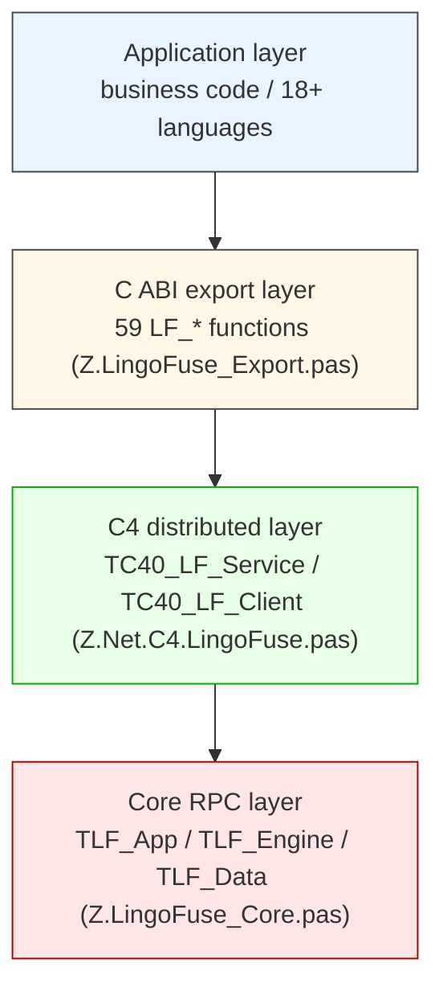

### 0.5 The 20 hard rules

1. **Callbacks must be `cdecl`** (or the corresponding `of object` / `is nested` variants).
2. **Callbacks in managed languages must be kept strongly referenced** (otherwise the GC collects them and you crash).
3. **The pointers returned by `LF_GetOption` / `LF_Get_AppName` / `LF_Generate_AppName` / `LF_Get_P2P_Name` become invalid after 5 seconds; `LF_Get_P2P_UID` returns a `PP2P_UID___` pointer that likewise becomes invalid after 5 seconds**.
4. **Input handles are not freed; returned handles must be freed**.
5. **`LF_FreeData` on an auto handle only marks it; it is truly freed 10 minutes later**.
6. **Permanent handles created by `LF_CreateData_Permanent` are never reclaimed automatically**; you must call `LF_FreeData` by hand.
7. **`LF_BindApp` must be called after `LF_PrepareDone`**, otherwise it returns 0.
8. **`LF_FreeApp` does not truly free the App**; it only removes bindings and timers. The real free happens in `LF_Shutdown`.
9. **The server must first register the `LingoFuse` logic service** before clients can discover it.
10. **Asynchronous callbacks and network-event callbacks run on TCompute worker threads**; UI access / blocking / synchronous calls are forbidden there.
11. **`LF_Sequenced_*` guarantees FIFO within the same `(app, api)` pair**; across `(app, api)` pairs there is no ordering guarantee.
12. **Every callback automatically receives the sender's UID / P2PName** (see Chapter 10), **valid only on the callback's Input parameter**.
13. **The UID is a universal routing identifier**: knowing a client's UID lets you call **any API it registered** (both app and p2p), without depending on the App name (see Chapter 9).
14. **After `LF_Shutdown` every other `LF_*` function is considered invalid**; the cleanup order must be `ExitMainThread → FreeApp → Shutdown`.
15. **`LF_Call` returns a handle with size=0 on timeout, not nil**; use `LF_GetSize` to judge success.
16. **The handle returned by the synchronous family (`LF_Call`) belongs to the caller; the `Result_` handle of the asynchronous family (`LF_Async_Call`) belongs to the framework and becomes invalid as soon as the callback returns** (see §4.7).
17. **Local short-circuit: when the target is inside the local process, the call does not go over the network** (see §19.1).
18. **Server-local handling: after a request reaches the server, if the server can handle it locally it does not forward** (see §19.2).
19. **App-name routing prefers the local side; P2PName routing does not prefer the local side** (see §8.2 / §8.4).
20. **UID / P2PName calls can hit every registered API of the target client; App-name calls can only hit that App's registration table** (see §8.6).
21. **【new in v7.0】`LF_LocalCall` / `LF_LocalNotify` do not inject sender identity**. If a local call also needs to carry identity, use `LF_Call` and rely on the local short-circuit (see §5.6, §10.3).
22. **【new in v7.0】If the server cannot find the group name for a P2PName asynchronous Call, the callback never fires** (the server's `cmd_P2PName_Call` only does `DoStatus` and does not send a reply). The caller must implement its own timeout (see §8.4).

### 0.6 Key default values

| Item | Value | Evidence |
|------|---:|:----:|
| Number of C ABI export symbols | 59 | 🟢 |
| Default TCP port | 9898 | 🟢 |
| DataHandle idle reclaim threshold | 10 minutes | 🟢 |
| Reclaim scan interval | 5 seconds | 🟢 |
| `prepareDone` initialization timeout | `max(Wait_Connection_Timeout, 5000) + 1000` ms | 🟢 |
| `Wait_Connection_Timeout` default | 30000 ms | 🟢 |
| `Overlap_Connection` default | false | 🟢 |
| `Wait_Connection_ReadyOk` default | true | 🟢 |
| `Fixed_Sequenced_Time` default | 20000 ms | 🟢 |
| `LF_Generate_AppName` pointer validity | ~5 seconds | 🟢 |
| `LF_Get_P2P_UID` pointer validity | ~5 seconds | 🟢 |
| `LF_GetOption` pointer validity | ~5 seconds | 🟢 |
| Sequential-thread idle exit | 5 minutes | 🟢 |
| **Delay before freeing after the sequential thread exits** | **1 second (corrected in v7.0)** | 🟢 |
| Grace period after an async op times out | 60 seconds | 🟡 |
| State queue capacity | 1000 | 🟢 |
| Broadcast cache delay | ~3 seconds | 🟢 |
| Simulated main thread C40Progress throttling | 1 ms while active / 10 ms while idle | 🟢 |
| P2PName client-name change detection period | 1 second | 🟢 |

---

## Chapter 1  The three-layer architecture and design philosophy

### 1.1 Responsibilities of the three layers

| Layer | Unit | Responsibilities | Degree of exposure to users |
|----|------|------|:----------------:|
| **C ABI export layer** | `Z.LingoFuse_Export.pas` | 59 `LF_*` functions, UTF-8 conversion, 5-second delayed free, preparation command collection | **fully exposed** (the cross-language entry point) |
| **C4 distributed layer** | `Z.Net.C4.LingoFuse.pas` | service/client management, 17 internal C4 commands, three addressing schemes, load balancing, route optimization | **partially exposed** (indirectly through `LF_*`) |
| **Core RPC layer** | `Z.LingoFuse_Core.pas` | App / Engine / Data / secondary memory pool / sequential thread pool | **not exposed directly** (called by the C4 layer) |

### 1.2 Dependency topology

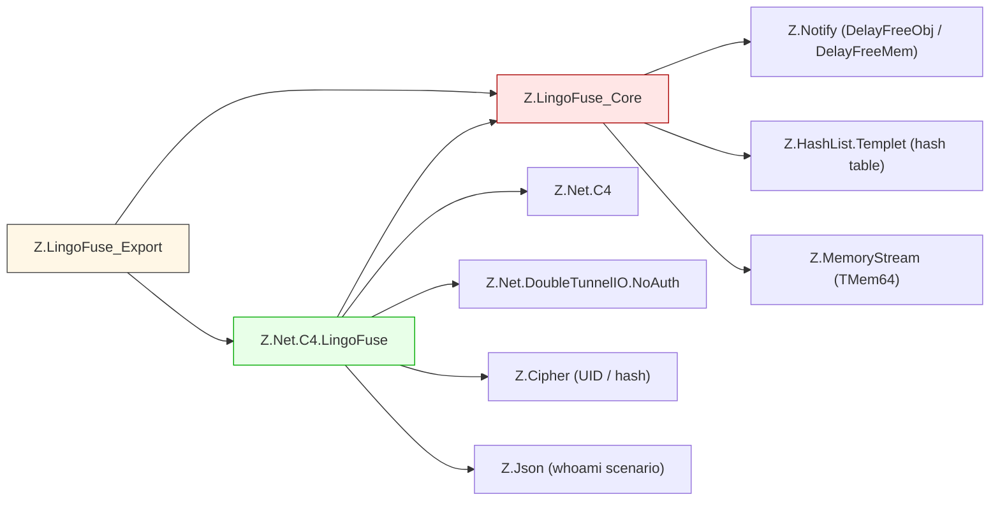

### 1.3 Key design trade-offs

| Trade-off | Benefit | Cost |
|------|------|------|
| **C ABI rather than COM/C++** | universal across 18+ languages | no type safety, no ABI version management |
| **handles rather than objects** | no type dependency across languages | users must manage lifetimes explicitly |
| **automatic reclaim plus manual free** | convenience and safety together | users easily mistake automatic reclaim for a guarantee |
| **`TLF_Data` as a record rather than a class** | the secondary memory pool is reusable, less heap fragmentation | needs `New` / `Dispose`, no inheritance |
| **local-first routing** | fewer network round trips | a same-named App executes locally first |
| **server-local handling** | fewer unnecessary forwards | the server process must itself be capable |
| **simulated main thread** | C4 depends on a main thread while the C ABI layer manages it | can only be started once per process |
| **automatic identity injection** | the business layer gets the sender identity with zero intrusion | every request payload grows by 40+ bytes |
| **sequential thread pool** | FIFO plus concurrency | idle threads exit and get recreated |
| **three addressing schemes** | suits different routing scenarios | high learning cost, easy to mix up |
| **opposite sync / async handle ownership** | sync is simple, async can stream | users easily mix up the two families' free rules (see §4.7) |
| **UID / P2PName universal routing** | direct targeted calls with no barrier | the asymmetry against App-name addressing must be understood |

---

## Chapter 2  Core concepts and terminology

### 2.1 Core objects

| Object | Type | Semantics |
|------|------|------|
| **`TDataHnd`** | opaque pointer | a binary data handle, carrying the API name + sender identity + business payload |
| **`TAppHnd`** | opaque pointer | a logical application container that can register many APIs |
| **`TP2P_UID___`** | `array[0..31] of Byte` | a 32-byte session UID, generated at `TunnelLink` time |
| **`PP2P_UID___`** | `^TP2P_UID___` | a pointer to the 32-byte UID (the type `LF_Get_P2P_UID` returns) |
| **`TAppName`** | UTF-8 string | the application name, the key of network routing |

### 2.2 API modes

| Mode | Semantics | Waits for a response | Registration functions |
|------|------|:-----------:|---------|
| **Call** | request-response | ✅ | `LF_RegisterCall*` |
| **Notify** | one-way notification | ❌ | `LF_RegisterNotify*` |

### 2.3 The three addressing schemes side by side

| Addressing | Index key | Routing method | Local hit | Server selection strategy | Typical use |
|------|--------|---------|:--------:|---------------|---------|
| **App name** | UTF-8 string | exact App-name match | ✅ | least recently used | fixed services |
| **UID** | 32-byte binary | locate by session UID | ✅ | direct hit | **targeting one specific client** |
| **P2PName** | UTF-8 string | group-name load balancing / stickiness | ❌ | `Cycle_Anchor` / `FixedSequenced` | homogeneous service clusters |

**The exact mapping of the five P2PName functions onto the two strategies** (🟢, new in v7.0):

| Function | Server command | Selection strategy |
|------|-----------|---------|
| `LF_P2PNAME_Call` | `cmd_P2PName_Call` | `Find_P2PName_LoadBalance` (Cycle_Anchor) |
| `LF_P2PNAME_Notify` | `cmd_P2PName_Notify` | `Find_P2PName_LoadBalance` |
| `LF_P2PNAME_Sequenced_Notify` | `cmd_P2PName_Sequenced_Notify` | `Find_P2PName_FixedSequenced` |
| `LF_P2PNAME_Async_Call` | `cmd_P2PName_Call` | `Find_P2PName_LoadBalance` |
| `LF_P2PNAME_Async_Sequenced_Call` | `cmd_P2PName_Sequenced_Call` | `Find_P2PName_FixedSequenced` |

### 2.4 How the three routing schemes differ in what they hit

| Call method | Search scope on the target side | Hits App registrations | Hits P2P registrations |
|----------|----------------|:-------------:|:-------------:|
| **UID call** | all registered APIs of the target client | ✅ | ✅ |
| **P2PName call** | all registered APIs of the selected client | ✅ | ✅ |
| **App-name call** | the target App's registration table | ✅ | ❌ |

**Points to remember**:
- **UID / P2PName are "client-level" routing keys** — first locate "some client", then look in its local API table.
- **App name is an "application-level" routing key** — it only looks in that App's registration table; P2P-registered functions hang under the global `___LF_P2P_APP___`, not in the business App's table.

### 2.5 Lifecycle stages

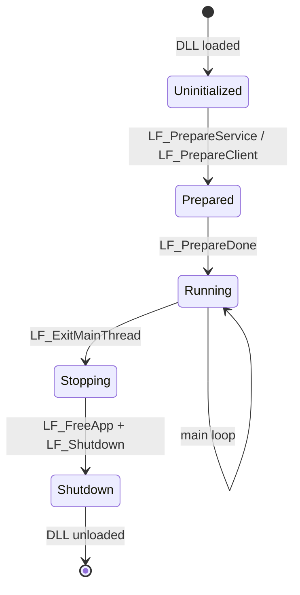

---

## Chapter 3  Lifecycle and initialization

### 3.1 The typical initialization sequence

```pascal
// 1. set options (optional)
LF.Set_Opt_Quiet(True);
LF.Set_Opt_Overlap_Connection(True);   // required when multiple Apps share an address
LF.Set_Opt_P2P_Name('my_group');       // required for P2PName routing

// 2. prepare (may be called several times)
LF.ResetPrepare;
LF.PrepareService('0.0.0.0', '192.168.1.100:9898');   // server side
LF.PrepareClient('192.168.1.100:9898', App);          // client side

// 3. start (only once)
if LF.PrepareDone <> 1 then Halt(1);

// 4. main loop
while Running do
begin
  LF.Sync;                                  // needed by a custom main loop
  Z.Core.Check_Soft_Thread_Synchronize(10); // drive C4 progress
  Sleep(10);
end;

// 5. exit
LF.ExitMainThread;
LF.FreeApp(App);
LF.Shutdown;
```

### 3.2 Each initialization stage in detail

#### 3.2.1 `LF_ResetPrepare`

**Effect**: clears `Prepare_Commands` (the list of pending service/client scripts) and `AppHnd_Bind_Tag_List`.

**When to call**:
- **before the first initialization**: harmless, recommended.
- **before re-initializing**: **mandatory**, otherwise a repeated address reports `prepare error: repeat listen/connection`.

**Mechanism**: internally it `Clear`s both `Prepare_Commands` and `AppHnd_Bind_Tag_List` and resets the `Tag_Seed`-related state.

#### 3.2.2 `LF_PrepareService`

**Signature**: `function LF_PrepareService(ListeningAddr, PhysicsAddr: PAnsiChar): Integer`

**Parameters**:
- `ListeningAddr`: the local listening address, e.g. `0.0.0.0:9898` / `ipc:my_app`.
- `PhysicsAddr`: the externally advertised address, e.g. `192.168.1.100:9898` / `ipc:my_app`.

**Returns**: `Tag_Seed` (an increasing integer ≥ 1); -1 for a repeated address.

**Mechanism**:
1. store the address in `Prepare_Commands` (the service is not started immediately).
2. internally generate the C4 script command `Service("Listen", "Host", Port, "LingoFuse@Tag=N")`.
3. if `Init_Succeeded and Simulated_Main_Thread_Running` (i.e. `PrepareDone` has already been called and the main thread is active), dispatch it immediately on `MainThreadProgress`.

**Default port**: `9898` when no port is given. **IPC mode**: when the address starts with `ipc:`, the port argument is ignored.

#### 3.2.3 `LF_PrepareClient`

**Signature**: `function LF_PrepareClient(PhysicsAddr: PAnsiChar; appHnd: TAppHnd): Integer`

**Parameters**:
- `PhysicsAddr`: the server address.
- `appHnd`: the App to bind, may be `nil` (tunnel only).

**Returns**: `Tag_Seed`; -1 for a repeated address (when `Overlap_Connection=False`).

**Mechanism**:
1. internally generate the C4 script command `KeepAlive("Host", Port, "LingoFuse@Tag=N")`.
2. when `Overlap_Connection=True`, use the `NewKeepAlive` command instead.
3. record it in `AppHnd_Bind_Tag_List` and bind the App automatically through the `ClientConnected` event once the C4 client has connected.

#### 3.2.4 `LF_PrepareDone`

**Signature**: `function LF_PrepareDone: Integer`

**Returns**: 1 = success; 0 = failure or already started.

**Mechanism**:
1. if `Simulated_Main_Thread_Running` is already True, **return 0 immediately** (to prevent a double start).
2. call `Open_Core_Dispatch_Thread` to start the C4 dispatcher.
3. call `Begin_Simulator_Main_Thread(Simulated_Main_Thread)` to start the simulated main thread.
4. **blocking wait**: at most `max(Wait_Connection_Timeout, 5000) + 1000` ms.
5. return `if_(Init_Succeeded, 1, 0)`.

**Key pitfall**: **it may still return 1 after the timeout** (see `LF-NET-007`).

#### 3.2.5 `LF_ExitMainThread`

**Signature**: `procedure LF_ExitMainThread`

**Mechanism**:
1. set `Simulated_Main_Thread_Running := False`.
2. **wait for the main thread to exit completely** (`Simulator_Main_Thread_Activted` turns False).

**Cleanup before the main thread exits** (at the end of `Simulated_Main_Thread`):
1. `C40Clean` (clean up C4 state)
2. `LF_Notify_Sequence_Thread_Pool.Stop`
3. `LF_DataPool.Free_All_Hnd` (**frees all data handles, including permanent ones**)
4. `LF_DataMemory.Free_All_PLF_Data_Memory`

**Key pitfall**: afterwards **no data handle may be used any more** (see `LF-MECH-003`).

### 3.3 The complete set of state flags

| Flag | Meaning | Checking API |
|------|------|---------|
| `Init_In_Progress` | main-thread initialization in progress | none |
| `Init_Succeeded` | initialization succeeded | reflected indirectly through `LF_CheckMainThread` |
| `Simulated_Main_Thread_Running` | the main-thread simulator is running | `LF_CheckMainThread()` = 1 |
| `Simulator_Main_Thread_Activted` | the underlying thread is active | `LF_CheckMainThread()` = 1 |

---

# Part II  Detailed API reference

## Chapter 4  The data handle (TDataHnd) complete reference

### 4.1 The essence of a data handle

`TDataHnd___ = Pointer`, pointing at the internal `TLF_Data` record (`Z.LingoFuse_Core.pas`).

**The `TLF_Data` record structure** (source):

```pascal
TLF_Data = record
private
  auto_recycle___: boolean;      // LF_CreateData=True; LF_CreateData_Permanent=False
  deleted___: boolean;
  updated___: boolean;
  calling___: TAtomInt;           // number of in-flight remote calls
  time___: TTimeTick;
  class procedure Free_Data___(hnd: PLF_Data); static;
public
  Data_Param: TMemory_Param_Tool; // input mode: non-nil
  Data_Result: TMem64;            // output mode: non-nil
  Data_Info: TLF_String;
end;
```

**Key design points**:
- **`Data_Param` and `Data_Result` are mutually exclusive**: exactly one of them is non-nil per handle.
  - **input handle** (`New_Param` / `New_Param_From`): `Data_Param <> nil`, carrying `FromUID` / `FromP2PName` / `apiName` / `Param`.
  - **output handle** (`New_Result` / `New_Result_From`): `Data_Result <> nil`, only the result bytes.
- **the `calling___` counter**: greater than 0 while a remote call is in flight, protecting the handle from timeout reclaim.
- **the `updated___` flag**: any read or write sets it True, letting the scan know the handle is still active.

### 4.2 Data handle lifecycle

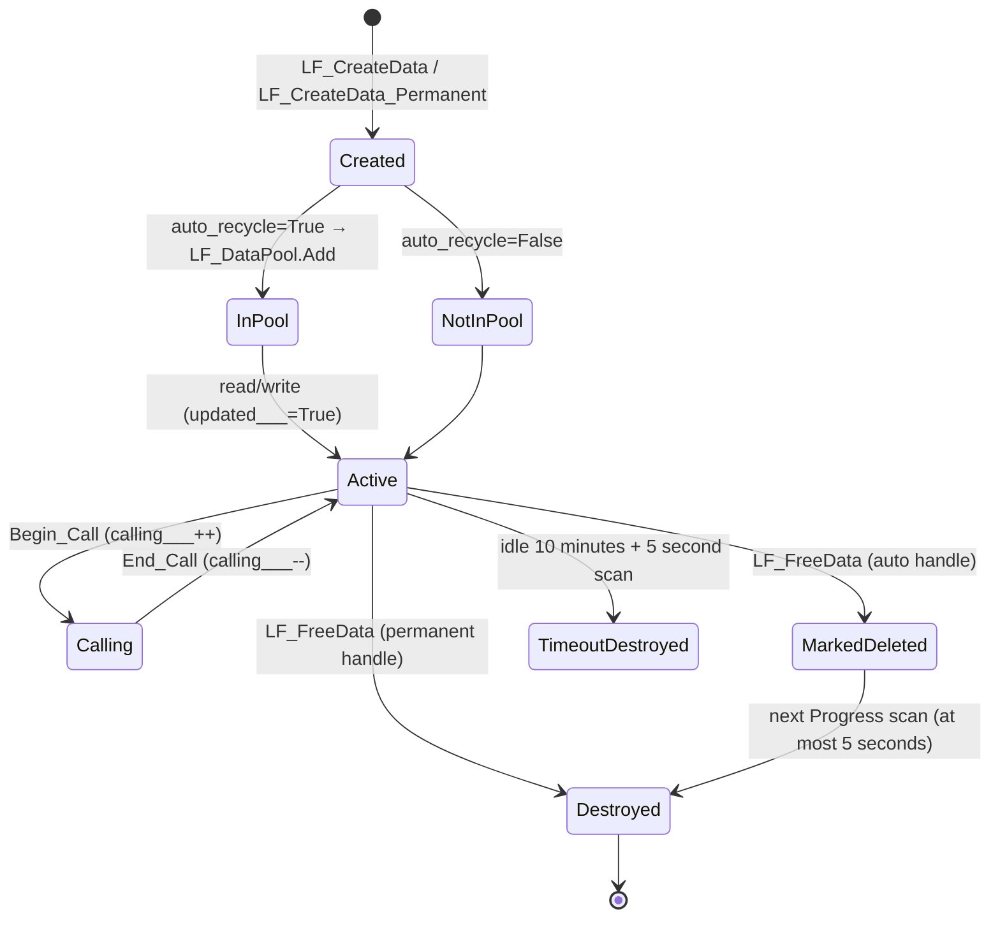

### 4.3 Creation and free APIs

#### 4.3.1 `LF_CreateData(MethodName: PAnsiChar): TDataHnd`

**Internal mechanism**:
1. internally `TLF_Data.New_Param(apiName, auto_recycle=True)`:
   - take a `TLF_Data` record from `LF_DataMemory.Get_New_PLF_Data` (or `New` one).
   - set `auto_recycle___ := True`.
   - create `Data_Param := TMemory_Param_Tool.Create` and store `apiName` in it.
   - add it to `LF_DataPool`.
2. return the `PLF_Data` pointer as the `TDataHnd___`.

**Side effects**:
- **it joins the auto-reclaim pool**: after 10 idle minutes it is freed by `TLF_DataPool.Progress`.
- **`LF_FreeData` only marks it**: `deleted___ := True`, no immediate free.

**Helper**: `LF_CreateDataEx(MethodName: string)` converts to UTF-8 automatically.

#### 4.3.2 `LF_CreateData_Permanent(MethodName: PAnsiChar): TDataHnd`

**Internal mechanism**:
1. internally `TLF_Data.New_Param(apiName, auto_recycle=False)`:
   - take a record from `LF_DataMemory`.
   - **it does not join `LF_DataPool`**.
   - set `auto_recycle___ := False`.
2. **`LF_FreeData` frees it immediately and synchronously** (no marking).

**When to use**: request templates that live for the whole process lifetime.

**Key pitfalls**:
- **"permanent" does not mean "never freed"**: you must call `LF_FreeData` explicitly.
- **creating one outside the initialization window leaks**: before `LF_PrepareDone` / after `LF_ExitMainThread`, `LF_FreeData` is a **no-op** (because `Simulator_Main_Thread_Activted` is False).

#### 4.3.3 `LF_FreeData(Hnd: TDataHnd)`

**Internal mechanism**:
```pascal
procedure TLF_Data.Free_Data(hnd: PLF_Data);
begin
  if hnd = nil then exit;
  if hnd^.auto_recycle___ then
      hnd^.deleted___ := True       // mark only, wait for the scan
  else TLF_Data.Free_Data___(hnd);  // permanent handle: free immediately
end;
```

**Notes**:
- **auto-recycle handle**: only sets `deleted___ := True`; the actual free is delayed by at most 5 seconds.
- **permanent handle**: `Free_Data___` immediately (frees `Data_Param` / `Data_Result` / `calling___` and pushes the record back into `LF_DataMemory`).

### 4.4 Read/write operation APIs

#### 4.4.1 `LF_GetBuffer(Hnd): Pointer`

**Internal mechanism**:
```pascal
function TLF_Data.GetBuffer: Pointer;
begin
  Result := nil;
  if Data_Param <> nil then
      Result := Data_Param.Param.Memory
  else if Data_Result <> nil then
      Result := Data_Result.Memory;
  updated___ := True;    // refresh the timestamp
end;
```

**Key points**:
- **returns the internal buffer pointer**. It may become invalid after `LF_WriteBuffer` / `LF_SetSize` (reallocation).
- **side effect**: `updated___ := True`, resetting the 10-minute idle countdown.

#### 4.4.2 `LF_WriteBuffer(Hnd, Buff, Size): Int64`

**Internal mechanism**:
```pascal
function TLF_Data.WriteBuff(Buff: Pointer; Size: Int64): Int64;
begin
  Result := 0;
  if Data_Param <> nil then
      Result := Data_Param.Param.WritePtr(Buff, Size)
  else if Data_Result <> nil then
      Result := Data_Result.WritePtr(Buff, Size);
  updated___ := True;
end;
```

**Key points**:
- writes from the **current position**, and the position advances.
- internally `TMem64.WritePtr` grows the buffer automatically.
- **side effect**: refreshes the timestamp.

#### 4.4.3 Position and size operations

| API | Internal mechanism | Side effect |
|-----|---------|--------|
| `LF_GetPos` | returns `Data_Param.Param.Position` or `Data_Result.Position` | refreshes the timestamp |
| `LF_SetPos` | sets `Position`; exceeding the size grows the buffer implicitly | refreshes the timestamp |
| `LF_GetSize` | returns `Data_Param.Param.Size` or `Data_Result.Size` | refreshes the timestamp |
| `LF_SetSize` | adjusts the size; newly added space is **uninitialized** | refreshes the timestamp |

### 4.5 Atomic type read/write APIs

All types are **little-endian** (`Move` writes memory directly and depends on the host byte order).

| Write | Read (out) | Read (no out) |
|------|-----------|--------------|
| `LF_WriteInt8` ~ `LF_WriteDouble` | `LF_ReadInt8` ~ `LF_ReadDouble` | same as left |
| `LF_WriteString` | `LF_ReadString` (out) | `LF_ReadString` |
| `LF_WriteStringBytes` | `LF_ReadStringBytes` (out) | `LF_ReadStringBytes` |

#### 4.5.1 The special behavior of `LF_WriteString`

**Internal mechanism**:
```pascal
function LF_WriteString(Hnd: TDataHnd___; const Value: string): boolean;
var utf8: TBytes; len: integer;
begin
  if Value = '' then
  begin
    Result := LF_WriteUInt8(Hnd, 0);   // an empty string still writes one #0
    Exit;
  end;
  utf8 := TEncoding.UTF8.GetBytes(Value);
  len := Length(utf8);
  LF_WriteBuffer(Hnd, @utf8[0], len);
  Result := LF_WriteUInt8(Hnd, 0);     // always appends #0
end;
```

**Key point**: **it always appends #0**. When JSON crosses languages, the receiver (e.g. Python) must strip the trailing #0.

#### 4.5.2 The tolerant mode of `LF_ReadString`

**Internal mechanism**:
```pascal
function LF_ReadString(Hnd: TDataHnd___; out Value: string): boolean;
var p: PByteArray; b, e, sz: int64;
begin
  p := LF_GetBuffer(Hnd);
  sz := LF_GetSize(Hnd);
  b := LF_GetPos(Hnd);
  e := b;
  while (e < sz) and (p^[e] <> 0) do Inc(e);  // scan to #0
  // ...
  LF_SetPos(Hnd, e + 1);                      // skip #0
  Value := UTF8ToString(Buff);
end;
```

**Key points**: **it stops at #0**; **if there is no #0 before the end of the buffer it reads to the end** (tolerant mode). If more data follows, it is read too (see `LF-DATA-004`).

#### 4.5.3 `LF_ReadStringBytes` / `LF_WriteStringBytes`

**No #0 is appended**; NUL is used directly as the terminator. Suitable for raw byte transport (e.g. a JSON body).

### 4.6 P2P information query APIs

> **⚠️ Preconditions (must read)**: `LF_Get_P2P_UID` and `LF_Get_P2P_Name` are **not "reading the handle's own business data"**; they **read, from the input handle side, "the P2P identity metadata the sender wrote automatically when sending the request"**.
>
> - **Data source**: when the sender builds a request, the client's `TC40_LF_Client.Send_*` methods call `TMemory_Param_Tool.Rebuild_UID_and_P2PName` internally, which **automatically writes `FromUID` (32 bytes) + `FromP2PName` (a UTF-8 string) into the front of the request payload**. On the receiver side, `Data_Param.FromUID` / `Data_Param.FromP2PName` of the `Input` handle carry exactly these two values. **No manual passing at the business layer is needed** (see Chapter 10).
> - **It can only be used on the `Input` parameter of "the callback that triggered the event"**: only an input handle **received** from the network (or from a local call routed through the `Send_*` path) carries these two fields.
> - **It cannot be used on handles you created yourself**: the input handles created by `LF_CreateData` / `LF_CreateData_Permanent` have `FromUID = Null_UID()` and an empty `FromP2PName` — because there is no "sender".
> - **It cannot be used on output handles**: `Output` (the result handle in Call mode) only has `Data_Result`, not `Data_Param`; calling these two functions on it prints a warning and returns an empty value.
> - **Typical valid positions**:
>   - `Input` inside `On_Call(Trigger, Input, Output)`.
>   - `Input` inside `On_Notify(Trigger, Input)`.
>   - the callback's `Input` when `LF_Call` hits the local short-circuit.
> - **Typical invalid positions**:
>   - `Input` inside a `LF_LocalCall` / `LF_LocalNotify` callback (**it does not go through `Rebuild_UID_and_P2PName`**, see §5.6, `LF-LOCAL-001`).
>   - `Result_` inside `LF_Async_Call`'s `OnResult(Data, Result_)` (it is an **output handle**).
>   - a request handle you created with `LF_CreateData` (there is no "sender").

#### 4.6.1 `LF_Get_P2P_UID(Hnd): PP2P_UID___`

**Signature** (`lingofuse_import.pas`):
```pascal
function LF_Get_P2P_UID(Hnd: TDataHnd___): PP2P_UID___; cdecl; external liblingofuse name 'LF_Get_P2P_UID';
```

**Internal mechanism** (`Z.LingoFuse_Export.pas`):
```pascal
function LF_Get_P2P_UID(Hnd: TDataHnd___): PP2P_UID___;
begin
  New(Result);                                  // ← allocate the pointer
  if (Hnd <> nil) and (PLF_Data(Hnd)^.Data_Param <> nil) then
      Result^ := PLF_Data(Hnd)^.Get_P2P_UID()   // ← copy from Data_Param.FromUID
  else Result^ := Null_UID();
  DelayFreeMem(5.0, Result);                    // ← freed automatically after 5 seconds
end;
```

**About the return value change (v5.0 erratum, confirmed in v7.0)**:
- **old versions (v4.0 and earlier)**: returned `TP2P_UID___` (the 32-byte static array **value**); the caller got a **copy of the value**.
- **new versions (v5.0 onward)**: returns `PP2P_UID___` (**a pointer to `TUID___`**), freed automatically by the framework via `DelayFreeMem(5.0, ...)` after about 5 seconds.
- **Impact on cross-language bindings**:
  - before: `uid = LF_Get_P2P_UID(input)` got the value directly.
  - now: `uid_ptr = LF_Get_P2P_UID(input); uid = *uid_ptr` (**dereference + copy immediately**).
  - **do not free** that pointer by hand (it is not owned by the caller).
  - **do not keep** that pointer for long (it becomes invalid after 5 seconds).

**Contract**:
- **returns a `PP2P_UID___` pointer** to a 32-byte `TUID___`.
- **valid only for input handles** (`Data_Param <> nil`). Calling it on an output handle / self-created handle warns and returns `Null_UID()`.
- **with `Hnd = nil` it still allocates via `New(Result)` + `DelayFreeMem`** (🟢 confirmed from source in v7.0). It returns a non-NULL pointer to an all-zero UID.
- **concurrency-safe**: each call allocates its own pointer with its own delayed free, with no interference (🟢 confirmed in v7.0 from the `Z.Notify.DelayFreeMem` mechanism).
- **standard usage (Pascal side)**:
  ```pascal
  var
    UID: TP2P_UID___;
    UIDPtr: PP2P_UID___;
  begin
    UIDPtr := LF_Get_P2P_UID(Input);    // returns a pointer
    if UIDPtr <> nil then
        UID := UIDPtr^;                 // dereference and copy immediately; the framework frees the pointer after ~5 seconds
    // ... use UID ...
  end;
  ```

#### 4.6.2 `LF_Get_P2P_Name(Hnd): PAnsiChar` / `LF_Get_P2P_NameEx(Hnd): string`

**Contract**:
- **valid only for input handles**. Calling it on an output handle / self-created handle returns `''`.
- **the returned pointer is freed automatically after 5 seconds** (`Z.Notify.DelayFreeMem(5.0, Result)`). **You must copy immediately**.
- `LF_Get_P2P_NameEx` is recommended because it copies automatically.
- data source: the `FromP2PName` field written by `Rebuild_UID_and_P2PName` at send time.

### 4.7 The Handle ownership model

> **This is the third core section of this guide**. Every cross-language integrator must be clear about it: **the handle ownership of the synchronous and asynchronous families is exactly opposite**. Both have identical function signatures, return types and appearance, but opposite contracts.

#### 4.7.1 Handle ownership in the two call families

The LingoFuse C ABI has **two call families**:

| Family | Functions | Owner of the returned handle | How it is freed |
|------|------|:-------------------:|---------|
| **synchronous family** | `LF_Call` / `LF_UID_Call` / `LF_P2PNAME_Call` | **the caller** | the caller calls `LF_FreeData` explicitly |
| **asynchronous family** | `LF_Async_Call` / `LF_UID_Async_Call` / `LF_P2PNAME_Async_Call` | **the framework** | the framework frees it **immediately** after the callback returns |

**Source basis**:

**synchronous family** (`Z.LingoFuse_Export.pas`):

```pascal
function LF_Call(appName: pansichar; Param: TDataHnd___; Timeout_: uint64): TDataHnd___;
begin
  ...
  Output := Cli.Wait_Execute_Call(...);
  ...
  // ← auto_recycle = True, owned by the caller
  Result := TLF_Data.New_Result_From(Output, True);
  ...
end;
```

**asynchronous family** (`TLF_Async_Call_Bridge.Do_Th` in `Z.Net.C4.LingoFuse.pas`):

```pascal
procedure TLF_Async_Call_Bridge.Do_Th;
var
  result_param_: PLF_Data;
begin
  // ← auto_recycle = False, owned by the framework
  result_param_ := TLF_Data.New_Result_From(Result_M64.Swap_To_New_Instance, False);
  try
    if Assigned(OnResult) then
      OnResult(Data_, result_param_);  // ← the callback receives the pointer
  except
  end;
  // ← freed immediately! Not "after ~1 second", not "delayed" — immediately.
  TLF_Data.Free_Data(result_param_);
  DelayFreeObj(1.0, Self);             // ← what is freed after 1 second is the Bridge object, not the handle
end;
```

**The key difference**:

- `New_Result_From(..., True)` → `auto_recycle = True` → `LF_FreeData` only marks, **the real free is delayed until the pool scan**.
- `New_Result_From(..., False)` → `auto_recycle = False` → `LF_FreeData` **frees immediately and synchronously**.

#### 4.7.2 The "moment of death" of an asynchronous-family handle

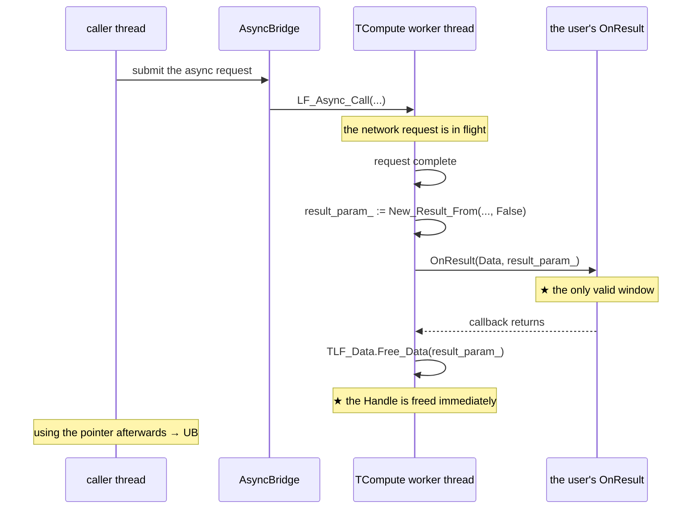

**Contract**:

- once the callback returns, the handle **becomes invalid immediately**.
- using that handle outside the callback is **undefined behavior** (use-after-free).
- calling `LF_FreeData` on it is a **double-free**.

#### 4.7.3 Why violating the contract "sometimes works, sometimes fails"

**Root cause**: `Free_Data` performs **pooled recycling**:

```pascal
class procedure TLF_Data.Free_Data___(hnd: PLF_Data);
begin
  hnd^.Data_Info := '';
  DisposeObjectAndNil(hnd^.Data_Param);
  DisposeObjectAndNil(hnd^.Data_Result);   // ← TMem64 is freed
  DisposeObjectAndNil(hnd^.calling___);
  LF_DataMemory.Free_PLF_Data(hnd);        // ← PLF_Data goes back to the pool
end;
```

**How the UB manifests depends on**:

- whether the allocator has already reused that memory.
- whether another thread allocated a new `TMem64` at the same moment.
- whether thread scheduling let the caller thread run only after `Free_Data`.

**Therefore**:

| Payload characteristic | Manifestation | Reason |
|-------------|------|------|
| **small payload** (e.g. returning `int 7`, 2 bytes) | usually "looks normal" | the allocator has not reused that small block yet |
| **large payload** (e.g. returning a dict, 17+ bytes) | usually "returns empty/garbage" | much more likely to have been reused |

**⚠️ This is the most easily misdiagnosed scenario**: using a **type dichotomy** such as "`int` vs `dict`" misleads the diagnosis. It is not a "type difference", it is "payload size affecting when memory gets reused". **The dichotomy asks the wrong question**.

#### 4.7.4 The correct usage patterns

**Pattern A: synchronous call (recommended for gateway/proxy scenarios)**

```pascal
res_ptr := LF_Call(app, hnd, timeout_ms);
try
  LF_SetPos(res_ptr, 0);            // reset the position
  result_bytes := read_string_bytes(res_ptr);
finally
  LF_FreeData(res_ptr);             // ← legal, the caller owns it
end;
```

**Pattern B: asynchronous call (everything must be done inside the callback)**

```pascal
procedure OnResult(Data, res_ptr: Pointer); cdecl;
begin
  // ✓ the handle is valid inside this callback
  LF_SetPos(res_ptr, 0);
  data := read_string_bytes(res_ptr);

  // ✓ copy the data out (bytes is a new object)
  my_queue.push(data);

  // ❌ forbidden to pass res_ptr out
  // ❌ forbidden to LF_FreeData(res_ptr)
end;
```

**Pattern C: use a high-level Future interface**

Every managed-language binding layer should provide a Future interface that "reads and copies the data inside the callback", so users never touch a raw pointer.

#### 4.7.5 Handle ownership quick reference

| Source | Owner | Freer | Cross-thread? |
|------|:------:|:------:|:----------:|
| `LF_CreateData` | user | user | ⚠️ needs an external lock |
| `LF_CreateData_Permanent` | user | user | ⚠️ needs an external lock |
| `LF_Call` return | user | user | ✅ yes |
| `LF_UID_Call` return | user | user | ✅ yes |
| `LF_P2PNAME_Call` return | user | user | ✅ yes |
| `LF_LocalCall` return | user | user | ✅ yes |
| inside a `LF_Async_Call` callback | **framework** | **framework** | ❌ cross-thread forbidden |
| inside a `LF_UID_Async_Call` callback | **framework** | **framework** | ❌ cross-thread forbidden |
| inside a `LF_P2PNAME_Async_Call` callback | **framework** | **framework** | ❌ cross-thread forbidden |

#### 4.7.6 Implications for cross-language bindings

- **every managed-language binding layer**: must **read and copy the data inside the callback** and then hand it to the user; never let the user touch a raw pointer.
- **Julia / Erlang / R**: for the `output` pointers inside `@cfunction` / NIF / C-extension callbacks, if there is an asynchronous ownership issue, **all operations must be completed inside the callback**; raw pointers must not be passed through a Channel / Queue.
- **Python / C# / Java**: in ctypes / P/Invoke / FFM asynchronous callbacks, if the returned handle comes from the asynchronous family, **all operations must be completed inside the callback**.
- **GC languages**: they have no awareness of C-side pointer lifetimes. **Only two safe strategies exist**:
  1. **handle everything inside the callback** (read Input / write Output).
  2. **copy the data out inside the callback** (bytes/array) and then process it across threads.

---

## Chapter 5  The application handle (TAppHnd) complete reference

### 5.1 The essence of an application handle

`TAppHnd___ = Pointer`, pointing at the internal `TLF_App` (`Z.LingoFuse_Core.pas`).

**The `TLF_App` class structure** (source):

```pascal
TLF_App = class
private
  FUpdateEventPool: TLF_UpdateEventPool;
  FUpdated: boolean;
  procedure Do_LFRegEvent;
  procedure DoTimer();
public
  Name: TLF_String;
  Desc: TLF_String;
  Engine: TLF_Engine;
  constructor Create(Owner_Pool_: boolean);
  destructor Destroy; override;
  procedure FakeFree;
  procedure DoChange();
  procedure Subscribe_Update(Bind: TCore_Object; OnUpdate: TOn_LFUpdate);
  procedure Remove_Update(Bind: TCore_Object);
end;
```

**Key mechanics**:
- **every App owns a `TLF_Engine`**, and the engine contains a `TLF_MethodPool` (the API table).
- **`FUpdateEventPool`**: the subscriber pool (e.g. `TC40_LF_Client`), notified when the API set changes.
- **`DoChange`**: called when the API set changes; sets `FUpdated := True` and `Reset_Timer`, so a unified broadcast happens 1 second later.

### 5.2 Creation and free APIs

#### 5.2.1 `LF_CreateApp(appName, Desc): TAppHnd`

**Internal mechanism**:
1. `TLF_App.Create(Owner_Pool_=True)`:
   - creates the `TLF_Engine`.
   - creates `FUpdateEventPool`.
   - `Subscribe_Timer_M(self, 1000, DoTimer)`: registers a 1-second timer for API-change broadcasts.
   - **joins `LF_App_Pool`** (Owner_Pool_=True).
2. sets `Name` / `Desc` (an empty Desc is replaced automatically with `'No Description'`).

**Key points**:
- the created App **joins `LF_App_Pool` automatically**.
- **an empty `Desc` is filled automatically with `'No Description'`**.

#### 5.2.2 `LF_FreeApp(appHnd)`

**Internal mechanism** (source `Z.LingoFuse_Export.pas`):
```pascal
procedure LF_FreeApp(appHnd: TAppHnd___);
begin
  if not Core_Dispatch_Order_Activted then exit;   // ① Shutdown guard
  if appHnd = nil then exit;
  app := appHnd;
  // ② unbind every TC40_LF_Client
  arry := C40_ClientPool.FastSearchClass(TC40_LF_Client);
  for i := 0 to length(arry) - 1 do
  begin
    Cli := arry[i] as TC40_LF_Client;
    if Cli.app = app then Cli.app := nil;
  end;
  // ③ stop the sequential threads
  LF_Notify_Sequence_Thread_Pool.Kill_App(app);
  LF_Call_Sequence_Thread_Pool.Kill_App(app);
  // ④ FakeFree (remove the timer only)
  app.FakeFree;
end;
```

**Key points**:
- **it does not truly free the App**: it only unbinds + stops the sequential threads + removes the timer.
- **the object stays in `LF_App_Pool`**: the real free happens in `LF_Shutdown`.
- **shutdown guard**: it is a no-op when `Core_Dispatch_Order_Activted = False`.

#### 5.2.3 `LF_Generate_AppName(): PAnsiChar`

**Internal mechanism**:
```pascal
function LF_Generate_AppName: pansichar;
begin
  // ① concatenate the addresses and RemoteIDs of every physical tunnel
  for i := 0 to C40_PhysicsTunnelPool.Count - 1 do
    tmp.Append(Build_Host_URL(...) + '&' + IntToStr(...RemoteID));
  // ② append the process name + PID
  tmp.Append('&' + Make_LingoFuse_Process_Name.Text);
  // ③ append the incrementing counter
  tmp.Append('&' + IntToStr(AtomInc(Generate_AppName_Call_Num)));
  // ④ prefix
  tmp := C_Generate_Prefix + tmp;    // '@__generate__@...'
  // ⑤ return a UTF-8 pointer, freed after 5 seconds
  Result := tmp.BuildUTF8AnsiChar();
  Z.Notify.DelayFreeMem(5.0, Result);
end;
```

**The exact output when there is no client** (🟢 confirmed from source in v7.0):

```
@__generate__@&<process name:PID>&<counter>
```

**With clients**:

```
@__generate__@<addr1>&<remoteID1>&<addr2>&<remoteID2>&...&<process name:PID>&<counter>
```

**Key points**:
- **it is not `@__generate__@<empty>&<process name>&<counter>`, but starts directly with `&`** (because the loop body never executes, `tmp` stays empty, and then `Append('&' + ...)` appends directly).
- the counter starts at 1 and increments (`AtomInc` returns the post-increment value).
- **it must be called after `LF_PrepareDone`**.
- **the returned pointer becomes invalid after 5 seconds**.

#### 5.2.4 `LF_Get_AppName(appHnd): PAnsiChar`

**Contract**:
- **returns nil when `appHnd = nil`** (safe).
- **the returned pointer becomes invalid after 5 seconds**.

#### 5.2.5 `LF_BindApp(appHnd): Integer`

**Internal mechanism** (source `Z.LingoFuse_Export.pas`):
```pascal
function LF_BindApp(appHnd: TAppHnd___): Integer;
begin
  Result := 0;
  if appHnd = nil then exit;
  app := appHnd;
  // ① the main thread must be active
  if not Simulator_Main_Thread_Activted then
  begin
    DoStatus('LF_BindApp: Main thread is not active - cannot bind app.');
    exit;
  end;
  // ② walk every TC40_LF_Client and bind the ones whose app = nil
  arry := C40_ClientPool.FastSearchClass(TC40_LF_Client);
  for i := 0 to length(arry) - 1 do
  begin
    Cli := arry[i] as TC40_LF_Client;
    if Cli.app = nil then
    begin
      Cli.app := app;
      inc(Result);
      // ... print the log
    end;
  end;
end;
```

**Contract**:
- **the main thread must already be started** (`Simulator_Main_Thread_Activted = True`).
- **it only binds clients with `Cli.app = nil`**.
- **it does not overwrite already-bound clients**.
- **it returns the number of clients bound successfully**.
- **binding order = client creation order** (🟢 confirmed from source in v7.0; `C40_ClientPool` is a `TGenericsList` whose internal order is decided by client creation order).
- if `Result = 0`, it prints `'LF_BindApp: All clients are already occupied'`.

### 5.3 Visibility of an application handle

**Key points**:
- **APIs registered on the App are reachable through the "App name"**.
- **APIs registered on the App are also reachable through "UID" and "P2PName"** (UID / P2PName are client-level routing keys).
- **APIs registered on the App are not reachable through the "P2P registration" path** — P2P registration is a separate namespace.

### 5.4 App registration vs P2P registration

| Dimension | App registration (`AppHandle.register_call`) | P2P registration (`P2PRegistry.register_call`) |
|------|-------------------------------------|---------------------------------------|
| **underlying API** | `LF_RegisterCall` / `LF_RegisterNotify` | `LF_Register_P2P_Call` / `LF_Register_P2P_Notify` |
| **namespace** | the business App's API table | the process-level `___LF_P2P_APP___`'s API table |
| **lifetime** | unbound with `AppHandle.close()` | lives until `LF_Shutdown` |
| **hit by App-name calls** | ✅ | ❌ |
| **hit by UID calls** | ✅ | ✅ |
| **hit by P2PName calls** | ✅ | ✅ |
| **typical use** | business APIs | global utilities (whoami / ping / status) |

**Architectural implications**:

| What you want to do | Recommended approach |
|----------|---------|
| a business API discoverable by App name | `register_call` |
| expose only to UID / P2PName, not discoverable by App name | `register_p2p_call` |
| a global utility any client can call by UID / group name | `register_p2p_call` |

### 5.5 Local call APIs

#### 5.5.1 `LF_LocalCall(appHnd, Param): TDataHnd`

**Internal mechanism**:
```pascal
function LF_LocalCall(appHnd: TAppHnd___; Param: TDataHnd___): TDataHnd___;
begin
  Result := nil;
  if appHnd = nil then exit;
  if Param = nil then exit;
  app := appHnd;
  tmp := TMem64.Create;
  try
    // ① encode Param into a TMem64
    PLF_Data(Param).Data_Param.EncryptToMem(tmp);
    // ② Begin_Call (calling___++)
    PLF_Data(Param).Begin_Call;
    // ③ execute
    Result := TLF_Data.New_Result_From(app.Engine.Execute_Call(tmp), True);
  finally
    // ④ End_Call (calling___--)
    PLF_Data(Param).End_Call;
    DisposeObject(tmp);
  end;
end;
```

**Contract**:
- **the input handle is not freed** (the caller owns it).
- **a new handle is returned** (the caller owns it).
- **the internal `Begin_Call` / `End_Call` protect the input handle** (when `calling___ > 0` it is not reclaimed by the timeout).
- **executed locally**, without the network.
- **`New_Result_From(..., True)`** → `auto_recycle = True` → **the returned handle belongs to the caller**.

#### 5.5.2 `LF_LocalNotify(appHnd, Param)`

**Internal mechanism**:
```pascal
procedure LF_LocalNotify(appHnd: TAppHnd___; Param: TDataHnd___);
begin
  // ... like LF_LocalCall, but with no Output
  PLF_Data(Param).Data_Param.EncryptToMem(tmp);
  PLF_Data(Param).Begin_Call;
  app.Engine.Execute_Notify(tmp);
  PLF_Data(Param).End_Call;
end;
```

**Key point**: no return value.

### 5.6 Identity injection for local calls (corrected in v7.0)

**Key point (🟢 confirmed from source in v7.0)**: **`LF_LocalCall` / `LF_LocalNotify` do not go through `Rebuild_UID_and_P2PName`**, therefore:

- if `Param` was created by `LF_CreateData`, its `FromUID` is `Null_UID()` and its `FromP2PName` is empty — **there is no "sender"**.
- if `Param` was received from the network, its `FromUID` / `FromP2PName` are preserved.
- **on the callback's `Input`, `LF_Get_P2P_UID` / `LF_Get_P2P_Name` return empty values for self-created handles**.

**Contrast: local calls routed through the `TC40_LF_Client.Send_*` path do inject identity**:

`TC40_LF_Client.Send_Execute_Notify` source:
```pascal
procedure TC40_LF_Client.Send_Execute_Notify(app_Name__: TLF_String; Param: TMem64);
begin
  tmp_param := TMemory_Param_Tool.Rebuild_UID_and_P2PName(Param, FLast_UID, LF_P2P_name.V);
  try
    api_Name__ := TMemory_Param_Tool.Get_apiName(tmp_param);
    tmp_cli__ := Find_Local_API(app_Name__, api_Name__, True);   // local lookup
    if tmp_cli__ <> nil then
      begin
        tmp_cli__.APP.Engine.Execute_Notify(tmp_param);           // local execution, but identity already injected
        exit;
      end;
    ...
  finally
    DisposeObject(tmp_param);
  end;
end;
```

**Implications**:
- **when `LF_Call` hits the local short-circuit, the callback's `Input` carries identity**.
- **`LF_LocalCall` calls `Engine.Execute_*` directly and does not inject identity**.
- **if a local call also needs identity**: use `LF_Call` (it will hit the local short-circuit and still inject identity).

**Related pitfall**: `LF-LOCAL-001`.

---

## Chapter 6  The API registration mechanism

### 6.1 Comparing the registration modes

| Mode | cdecl style | Object method | Nested/anonymous | Synchronous variant |
|------|:----------:|:--------:|:---------:|:--------:|
| **Call** | `LF_RegisterCall` | `LF_RegisterCall_M` | `LF_RegisterCall_P` | `LF_RegisterSyncCall_M` / `_P` |
| **Notify** | `LF_RegisterNotify` | `LF_RegisterNotify_M` | `LF_RegisterNotify_P` | `LF_RegisterSyncNotify_M` / `_P` |

**Synchronous variants**: `RegisterSyncCall_M` and friends marshal the callback onto the main thread (through `TSoft_Synchronize_Tool`), and require `LF_Sync` to drive them when you use a custom main loop.

### 6.2 The registration callback signatures

```pascal
// cdecl style
TLF_Call_Event   = procedure(Trigger: Pointer; Input, Output: TDataHnd___); cdecl;
TLF_Notify_Event = procedure(Trigger: Pointer; Input: TDataHnd___); cdecl;

// object method
TLF_Call_M   = procedure(Input, Output: TDataHnd___) of object;
TLF_Notify_M = procedure(Input: TDataHnd___) of object;

// nested (FPC) / anonymous (Delphi)
{$IFDEF FPC}
TLF_Call_P   = procedure(Input, Output: TDataHnd___) is nested;
TLF_Notify_P = procedure(Input: TDataHnd___) is nested;
{$ELSE}
TLF_Call_P   = reference to procedure(Input, Output: TDataHnd___);
TLF_Notify_P = reference to procedure(Input: TDataHnd___);
{$ENDIF}
```

### 6.3 The internal mechanics of `LF_RegisterCall`

**Source `TLF_Engine.Reg_Call`**:
```pascal
function TLF_Engine.Reg_Call(MethodName, Desc: TLF_String; Trigger: Pointer; On_Call: TLF_Call_Event): boolean;
var api_: TLF_MethodInfo;
begin
  Result := False;
  if LF_MethodPool.Exists_Key(MethodName) then
      exit;                    // duplicate name → return False
  api_ := TLF_MethodInfo.Create;
  api_.Name := MethodName;
  api_.Desc := Desc;
  api_.Mode := TLF_Mode.LF_Call__;
  api_.Trigger := Trigger;
  api_.On_Call := On_Call;
  LF_MethodPool.Add(MethodName, api_, False);
  APP.DoChange();              // trigger the App change (broadcast after 1 second)
  Result := True;
end;
```

**Key points**:
- **overwriting an existing API name is not allowed** (returns False).
- **it triggers `APP.DoChange`** → `FUpdated := True` + `Reset_Timer` → broadcast after 1 second.
- **the callback reads parameters with `LF_ReadBuffer(Input, ...)` and writes results with `LF_WriteBuffer(Output, ...)`**.
- **inside the callback you can obtain the sender identity with `LF_Get_P2P_UID(Input)` / `LF_Get_P2P_Name(Input)`** (**valid only on Input**).

### 6.4 Mode matching rules

**Key point**: calling an API registered as Call through Notify (or the reverse) **prints a warning but still executes**:

| Registered mode | Invocation | Behavior |
|---------|---------|------|
| Call | Call | ✅ normal |
| Call | Notify | ⚠️ prints a warning, executes `On_Call`, Output discarded |
| Notify | Call | ⚠️ prints a warning, executes `On_Notify`, Output empty |
| Notify | Notify | ✅ normal |

**Warning texts**:
- Call registered, Notify invoked: `'Warning: API "%s" is registered as Notify but invoked as Call; no return value will be produced.'`
- Notify registered, Call invoked: `'Warning: API "%s" is registered as Call but invoked via Notify; any returned value will be discarded.'`

### 6.5 `LF_Register_P2P_Call` / `LF_Register_P2P_Notify`

**Differences from App-level registration**:
- they register into the global `LF_P2P_APP` (application name `___LF_P2P_APP___`).
- **when called through P2PName and UID**, these APIs are hit first.
- **when called through an App name, they are not necessarily hit** (this depends on App-name routing).

**Typical use**: registering global utility functions (e.g. `whoami`, `Status` forwarding).

### 6.6 Visibility difference between P2P registration and App registration

**This is the easiest place to trip**: **an App-name call cannot hit a P2P-registered function.**

| Call method | Search scope on the target side | Hits App registrations | Hits P2P registrations |
|----------|----------------|:-------------:|:-------------:|
| **UID call** | all registered APIs of the target client | ✅ | ✅ |
| **P2PName call** | all registered APIs of the selected client | ✅ | ✅ |
| **App-name call** | the target App's registration table | ✅ | ❌ |

**Why this happens**:

- **UID / P2PName are "client-level" routing keys**: first locate "some client", then that client looks up the target function in its own local API table. App-registered and P2P-registered functions are both in that same local table.
- **An App name is an "application-level" routing key**: it locates "some App" and only looks in that App's registration table. P2P-registered functions hang under the global `___LF_P2P_APP___`, not in the business App's table, so an App-name call cannot hit them.

**Architectural implications**:

| What you want to do | Recommended routing |
|----------|---------|
| Target one specific client and call any of its registered functions | **UID** |
| A homogeneous group of workers, any node in the group handles it | **P2PName** |
| A fixed service name, discovered by App name | **App name** |
| Expose only to UID/P2P calls, not discoverable by App name | **P2P registration** |

---

## Chapter 7  Local calls

### 7.1 `LF_LocalCall(appHnd, Param): TDataHnd`

**Internal mechanism**:
```pascal
function LF_LocalCall(appHnd: TAppHnd___; Param: TDataHnd___): TDataHnd___;
begin
  Result := nil;
  if appHnd = nil then exit;
  if Param = nil then exit;
  app := appHnd;
  tmp := TMem64.Create;
  try
    PLF_Data(Param).Data_Param.EncryptToMem(tmp);
    PLF_Data(Param).Begin_Call;
    Result := TLF_Data.New_Result_From(app.Engine.Execute_Call(tmp), True);
  finally
    if Result <> nil then
        PLF_Data(Result)^.Data_Info := PFormat('result for app:%s api:%s', [app.Name.Text, PLF_Data(Param)^.Data_Param.apiName.Text]);
    PLF_Data(Param).End_Call;
    DisposeObject(tmp);
  end;
end;
```

**Contract**:
- **the input handle is not freed** (the caller owns it).
- **a new handle is returned** (the caller owns it).
- **the internal `Begin_Call` / `End_Call` protect the input handle** (when `calling___ > 0` it is not reclaimed by the timeout).
- **executed locally**, without the network.
- **`New_Result_From(..., True)`** → `auto_recycle = True` → **the returned handle belongs to the caller**.
- **it does not inject sender identity** (confirmed from source in v7.0).

### 7.2 `LF_LocalNotify(appHnd, Param)`

**Internal mechanism**:
```pascal
procedure LF_LocalNotify(appHnd: TAppHnd___; Param: TDataHnd___);
begin
  if appHnd = nil then exit;
  if Param = nil then exit;
  app := appHnd;
  tmp := TMem64.Create;
  try
    PLF_Data(Param).Data_Param.EncryptToMem(tmp);
    PLF_Data(Param).Begin_Call;
    app.Engine.Execute_Notify(tmp);
  finally
    PLF_Data(Param).End_Call;
    DisposeObject(tmp);
  end;
end;
```

**Key point**: no return value. **It likewise does not inject identity**.

### 7.3 Identity injection for local calls (v7.0 clarification)

**`LF_LocalCall` / `LF_LocalNotify` do not go through `Rebuild_UID_and_P2PName`**, therefore:

| Source of the callback's `Input` | Carries identity |
|-------------------|:-----------:|
| `LF_LocalCall` and `Param` is a handle created by `LF_CreateData` | ❌ no identity |
| `LF_LocalCall` and `Param` is a handle received from the network | ✅ original identity preserved |
| `LF_Call` hitting the local short-circuit | ✅ sender identity injected |

**If a local call also needs to carry identity**: use `LF_Call` (it will hit the local short-circuit and still inject identity).

**Related pitfall**: `LF-LOCAL-001`.

---

# Part III  Routing and addressing

## Chapter 8  The three addressing schemes in detail

### 8.1 Overview of the three addressing schemes

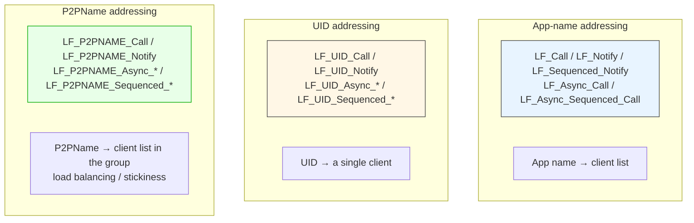

### 8.2 App-name addressing

**API list**:
- `LF_Call(appName, Param, Timeout)`
- `LF_Async_Call(appName, Param, Data, OnResult)`
- `LF_Async_Sequenced_Call(appName, Param, Data, OnResult)`
- `LF_Notify(appName, Param)`
- `LF_Sequenced_Notify(appName, Param)`

**Routing algorithm** (client `Send_Execute_Notify`):

```pascal
// 1) look locally first: is there an App with this name in this process that has the target API?
tmp_cli__ := Find_Local_API(app_Name__, api_Name__, True);
if tmp_cli__ <> nil then
  begin
    tmp_cli__.APP.Engine.Execute_Notify(tmp_param);   // execute locally
    exit;
  end;

// 2) then look in the remote cache: locally cached remote App information
tmp_cli__ := Find_Remote_API(app_Name__, api_Name__, True);
if tmp_cli__ <> nil then
    tmp_cli__.Send_Execute_Notify_Impl(app_Name__, tmp_param)  // forward through a client
else
    Send_Execute_Notify_Impl(app_Name__, tmp_param);           // send through its own connection
```

**Key points**:
- **local first**: if this process has an App with the same name and a matching API → execute locally, **without the network**.
- **cache acceleration**: `LF_Local_API_Cache` / `LF_Remote_API_Cache` cache `'AppName.ApiName'` → `TC40_LF_ClientList`.
- **cache invalidation (🟢 refined in v7.0)**:
  - **server side**: `cmd_Init_APP_Info` / `cmd_No_App_Info` / `DoUserOut_Event`.
  - **client side**: `cmd_update_service_api_info` (broadcast received) / `DoNetworkOffline` (physical disconnect).

### 8.3 UID addressing

**API list**:
- `LF_UID_Call(UID, Param, Timeout)`
- `LF_UID_Async_Call(UID, Param, Data, OnResult)`
- `LF_UID_Async_Sequenced_Call(UID, Param, Data, OnResult)`
- `LF_UID_Notify(UID, Param)`
- `LF_UID_Sequenced_Notify(UID, Param)`

**Routing algorithm** (client `Send_UID_Execute_Notify`):

```pascal
// 1) look locally first: is there a client with the same UID in this process?
target_app := Find_Local_UID_App(UID_, api_Name__);
if target_app <> nil then
  begin
    target_app.Engine.Execute_Notify(tmp_param);   // execute locally
    exit;
  end;

// 2) then look in the remote cache: locally cached remote UID information
tmp_cli__ := Find_Remote_UID_API(UID_, api_Name__, True);
if tmp_cli__ <> nil then
    tmp_cli__.Send_UID_Execute_Notify_Impl(UID_, tmp_param)
else
    Send_UID_Execute_Notify_Impl(UID_, tmp_param);  // route through the server's UID
```

**Server-side `FUID_Pool`**:
- **Key**: a 32-byte `TUID___`.
- **Value**: `TUID_Data` (the recv_io + send_io pair).
- **Data source**: clients report it through the `Update_UID` command.
- **Lookup**: `FUID_Pool.Get_Value_Ptr___(UID_)` → O(1).

**UID generation mechanism (🟢 refined in v7.0)**:

**The client UID is generated when `TunnelLink` succeeds**:

```pascal
if Is_Null_UID(FLast_UID) then
    FLast_UID := Generate_Global_UID(PhysicsTunnel.UID,
                                      DTNoAuth.RecvTunnel.ServerState^.UID,
                                      DTNoAuth.SendTunnel.ServerState^.UID)
else
    FLast_UID := Generate_Global_UID(FLast_UID,
                                      PhysicsTunnel.UID,
                                      DTNoAuth.RecvTunnel.ServerState^.UID,
                                      DTNoAuth.SendTunnel.ServerState^.UID);
```

- **first connection**: `Generate_Global_UID(physical tunnel UID, receive tunnel server UID, send tunnel server UID)`.
- **reconnection**: `Generate_Global_UID(old UID, physical tunnel UID, receive tunnel server UID, send tunnel server UID)`.
- `Generate_Global_UID` comes from `Z.Net`; it uses SHA3-256 to produce a 256-bit UID, mixing the current time + Tick + a global seed + the inputs.

**Key points**:
- **the UID is a session-level identifier**: generated when `TunnelLink` succeeds, and it changes after reconnecting.
- **local first**: a client in this process with the same UID → execute locally.
- **server-side hash pool**: the UID is the server's routing key for locating clients across connections.

### 8.4 P2PName addressing

**API list**:
- `LF_P2PNAME_Call(p2p_name, Param, Timeout)`
- `LF_P2PNAME_Async_Call(p2p_name, Param, Data, OnResult)`
- `LF_P2PNAME_Async_Sequenced_Call(p2p_name, Param, Data, OnResult)`
- `LF_P2PNAME_Notify(p2p_name, Param)`
- `LF_P2PNAME_Sequenced_Notify(p2p_name, Param)`

**Routing algorithm**:
- **no local lookup**, **always goes over the network**.
- the server finds a group of UIDs through `FP2PName_Pool` and picks one by load balancing or stickiness.

**The exact mapping of the two selection strategies (🟢 v7.0)**:

| Command | Strategy | Implementation |
|------|------|------|
| `cmd_P2PName_Call` | **`Find_P2PName_LoadBalance`** | `Cycle_Anchor` round-robin + load balancing |
| `cmd_P2PName_Notify` | **`Find_P2PName_LoadBalance`** | same as above |
| `cmd_P2PName_Sequenced_Notify` | **`Find_P2PName_FixedSequenced`** | `Fixed_Sequenced_Time` stickiness |
| `cmd_P2PName_Sequenced_Call` | **`Find_P2PName_FixedSequenced`** | same as above |

**Load balancing implementation (Cycle_Anchor)**:
- **a global atomic incrementing counter** `Cycle_Anchor_Seed` (`Get_Cycle_Anchor`).
- every `(p2p_name, api)` task maintains an anchor value per UID.
- **the UID with the smallest anchor is picked first**, and on selection its anchor is updated to the new global value (moving it to the end).
- **effect**: round-robin + load balancing.
- **precision**: every call precisely picks the least recently used UID.

**Stickiness implementation (FixedSequenced)**:
- sort by last-handled time and take the smallest.
- if it has not been picked for longer than `Fixed_Sequenced_Time` (default 20 seconds), switch to another.
- **effect**: the same UID handles continuously for 20 seconds, then switches.

**Key points**:
- **P2PName is a user-defined string**, set through `LF_Set_Opt_P2P_Name`.
- **the server does not distinguish the physical location of same-named UIDs**; it only groups by P2PName.
- **local-first routing does not apply** (it always goes over the network).

**⚠️ Hanging behavior of P2PName asynchronous Call (🟢 new in v7.0)**:

If the server's `cmd_P2PName_Call` cannot find the group name, **it only does `DoStatus` and sends no reply**. Therefore:

- **if the server cannot find the group name, the callback of `LF_P2PNAME_Async_Call` never fires**.
- the client's `LF_P2PNAME_Async_Call` returns 1 (already enqueued), but the callback never fires.
- **the caller must implement its own timeout**.

**⚠️ Behavior of a P2PName call with an empty string**:

`LF_P2PNAME_Call("", param, timeout)` is sent to the server; the server's `Find_P2PName_LoadBalance('')` returns nil, reports `no found p2pname:""`, and **sends no reply**.

### 8.5 Comparison of the three addressing schemes

| Dimension | App name | UID | P2PName |
|------|--------|-----|---------|
| Index key | UTF-8 string | 32-byte binary | UTF-8 string |
| Routing granularity | application level | session level | group level |
| Local first | ✅ | ✅ | ❌ |
| Server-side hash pool | App index | `FUID_Pool` | `FP2PName_Pool` |
| Load balancing | ❌ (the App name is unique) | ❌ (the UID is unique) | ✅ (Cycle_Anchor) |
| Stickiness | ❌ | ❌ | ✅ (FixedSequenced, 20 seconds) |
| Hits App registrations | ✅ | ✅ | ✅ |
| Hits P2P registrations | ❌ | ✅ | ✅ |
| Typical use | fixed services | **targeting a specific client** | homogeneous service clusters |

### 8.6 UID / P2PName automatically search App-registered functions

**Core fact**: **UID and P2PName calls automatically search the target client's App-registered functions.**

**Mechanism**:

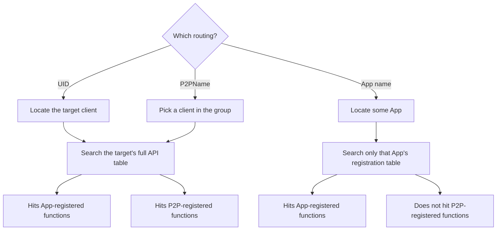

**Comparison table**:

| Call method | Search scope on the target side | Hits App registrations | Hits P2P registrations |
|----------|----------------|:-------------:|:-------------:|
| **UID call** | all registered APIs of the target client | ✅ | ✅ |
| **P2PName call** | all registered APIs of the selected client | ✅ | ✅ |
| **App-name call** | the target App's registration table | ✅ | ❌ |

**Source basis**:

**UID routing** (`Find_Local_UID_App` → `Find_API_From_P2P_APP`):
```pascal
function Find_API_From_P2P_APP(api_name__: SystemString): TLF_App;
begin
  Result := nil;
  // 1) look in the P2P APP first
  if LF_P2P_APP.Engine.LF_MethodPool.Exists_Key(api_name__) then
    begin
      Result := LF_P2P_APP;
      exit;
    end;
  // 2) then walk the business App pool
  LF_App_Pool.Lock;
  try
    if LF_App_Pool.Num > 0 then
      with LF_App_Pool.Invert_Repeat_ do
        repeat
          if queue^.Data.Engine.LF_MethodPool.Exists_Key(api_name__) then
            begin
              Result := queue^.Data;
              exit;
            end;
        until not Prev;
  finally
      LF_App_Pool.UnLock;
  end;
end;
```

**App-name routing** (`Find_Local_API`): it only looks in the `LF_MethodPool` of the App with the given `app_Name__`.

---

## Chapter 9  Cross-addressing routing and universal UID routing

### 9.1 The UID is a universal routing identifier

**Key mechanism**: **a UID can target one specific client and call any API it registered** (including APIs registered under an App name and APIs registered through P2P), **without needing to know the App name**.

**Principle**:

1. **the client generates `FLast_UID` when `TunnelLink` succeeds**.
2. **the client reports the UID and P2PName through the `Update_UID` command**.
3. **the server's `FUID_Pool` builds the UID → recv_io mapping**.
4. **when `LF_UID_Call(UID, Param, Timeout)` is invoked**:
   - the client first looks locally for a client with the same UID.
   - if not found → send the command to the server.
   - the server finds the recv_io through `FUID_Pool` → forwards it to the target client.
5. **when the target client executes**:
   - it finds the local App through `Find_Local_UID_App(UID_, api_Name__)`.
   - it executes that App's API.

**Key points**:
- **the UID is decoupled from the App name**: the UID is a session identifier, the App name is an application identifier; the two are independent.
- **`LF_UID_Call` can call any API** (as long as the target client has the corresponding App and API).
- **no need to know the App name**.

### 9.2 Use cases for universal UID routing

#### Case 1: the server actively pushes to a specific client

```pascal
// the server knows some client's UID (extracted from an earlier callback)
procedure OnClientCalled(Trigger: Pointer; Input, Output: TDataHnd); cdecl;
var
  UID: TP2P_UID___;
  UIDPtr: PP2P_UID___;
begin
  // valid only on the Input parameter (the sender's input handle); a pointer is returned
  UIDPtr := LF_Get_P2P_UID(Input);
  if UIDPtr <> nil then
      UID := UIDPtr^;   // dereference and copy immediately; the framework frees the pointer after ~5 seconds
  // ... store it
end;

// push actively later
LF_UID_Notify(StoredUID, DataHnd);   // no need to know the App name
```

#### Case 2: cross-client targeted call

```pascal
// client A wants to call client B's API
// no need to know B's App name, only B's UID
LF_UID_Call(B_UID, DataHnd, 3000);
```

#### Case 3: session-sticky routing

```pascal
// subsequent calls in the same session all go to the same client
LF_UID_Sequenced_Notify(SessionUID, DataHnd);   // FIFO guaranteed
```

### 9.3 P2PName cross-API routing

**P2PName can also call any API**:

```pascal
// assume N workers all registered the 'process' API, P2PName = 'worker_group'
LF_P2PNAME_Call('worker_group', DataHnd, 5000);
// the server picks one of the N workers by load balancing
```

**Key points**:
- **P2PName is a group name**: multiple clients set the same P2PName, and the server does load balancing.
- **it does not distinguish a specific client**: the caller does not need to know which worker.
- **it does not distinguish the source of API registration**: App registration or P2P registration both work.

### 9.4 A typical architecture for cross-addressing routing

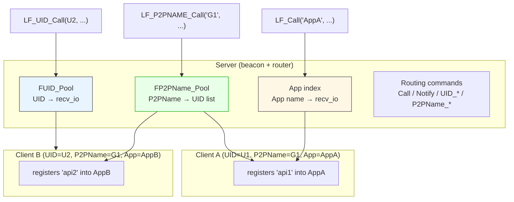

### 9.5 The whoami pattern: discovering your own UID and P2PName

**Problem**: how does a client learn the UID and P2PName the server assigned to it?

**Solution**: the server registers a `whoami` API that returns the caller's UID and P2PName.

**Server**:

```pascal
procedure Cb_WhoAmI(Trigger: Pointer; Input, Output: TDataHnd); cdecl;
var
  UID: TP2P_UID___;
  UIDPtr: PP2P_UID___;
  P2P: string;
begin
  // valid only on the callback's Input parameter; returns a pointer
  UIDPtr := LF_Get_P2P_UID(Input);
  if UIDPtr <> nil then
      UID := UIDPtr^                    // dereference and copy immediately
  else
      FillChar(UID, SizeOf(UID), 0);
  P2P := LF_Get_P2P_NameEx(Input);
  LF_WriteBuffer(Output, @UID[0], SizeOf(UID));
  LF_WriteString(Output, P2P);
end;

// register into LF_P2P_APP (process level); any client can call it
LF_Register_P2P_Call('whoami', 'Query caller identity', nil, @Cb_WhoAmI);
```

**Client**:

```pascal
function Probe_WhoAmI(out UID: TP2P_UID___; out P2PName: string): Boolean;
var
  Req, Res: LF.TDataHandle;
begin
  Result := False;
  FillChar(UID, SizeOf(UID), 0);
  P2PName := '';
  Req := LF.TDataHandle.Create('whoami');
  try
    Res := LF.CallApp('AnyApp', Req, 5000);   // go through any App
    try
      if (Res = nil) or (Res.Size < SizeOf(UID) + 1) then Exit;
      Res.Pos := 0;
      Res.ReadBuffer(UID, SizeOf(UID));
      P2PName := Res.ReadString;
      Result := True;
    finally Res.Free; end;
  finally Req.Free; end;
end;
```

**Afterwards**: the client holds its own UID and P2PName, which can be used for targeted UID calls, in-group P2PName calls, or discovery by other clients.

---

## Chapter 10  Automatic sender identification

### 10.1 Core mechanism

**The framework automatically injects the sender identity at the head of every remote request payload**. On the sending side, `Rebuild_UID_and_P2PName` injects it before the client sends:

```
[apiName: string]
[FromUID: 32 bytes]         ← sender session UID
[FromP2PName: string]       ← sender P2PName
[Param.Size: Int32]
[Param: bytes]              ← business parameters
```

**Important**:
- **`FromUID` / `FromP2PName` are "sender metadata"**, written automatically by the sending-side client; the receiving side does not need to, and should not, pass them manually.
- **the receiving side can only obtain these two values inside the callback's `Input` parameter, through `LF_Get_P2P_UID(Input)` / `LF_Get_P2P_Name(Input)`**.
- **these two functions must not be called on self-created handles or Output handles** (they return empty values / print a warning).
- **`LF_Get_P2P_UID` returns a `PP2P_UID___` pointer (not a value)**; the framework frees the pointer automatically after about 5 seconds.

### 10.2 Encode/decode implementation

**Encoding (`TMemory_Param_Tool.EncryptToMem`)**:

```pascal
procedure TMemory_Param_Tool.EncryptToMem(m64: TMem64);
begin
  m64.Clear;
  m64.WriteString(apiName.Text);              // API name
  m64.WritePtr(@FromUID[0], SizeOf(TUID___)); // 32-byte UID
  m64.WriteString(FromP2PName.Text);          // P2PName
  m64.WriteInt32(Param.Size);                 // business parameter length
  m64.WritePtr(Param.Memory, Param.Size);     // business parameters
end;
```

**Decoding (`DecryptFromMem`)**:

```pascal
procedure TMemory_Param_Tool.DecryptFromMem(m64: TMem64);
begin
  if m64.ProtectedMode then
    begin
      // read-only mapping: read directly
      m64.Position := 0;
      apiName.Text := m64.ReadString.Text;
      m64.ReadPtr(@FromUID[0], SizeOf(TUID___));
      FromP2PName.Text := m64.ReadString.Text;
      Param.Size := m64.ReadInt32;
      m64.ReadPtr(Param.Memory, Param.Size);
      Param.Position := 0;
    end
  else
    begin
      // writable: O(1) swap + zero-copy mapping
      tmp.SwapInstance(m64);
      tmp.Position := 0;
      apiName.Text := tmp.ReadString.Text;
      tmp.ReadPtr(@FromUID[0], SizeOf(TUID___));
      FromP2PName.Text := tmp.ReadString.Text;
      i32 := tmp.ReadInt32;
      Param.Mapping(tmp.PosAsPtr, i32);       // zero copy
      Param.Position := 0;
    end;
end;
```

### 10.3 When injection happens (refined in v7.0)

**Calls going through the `TC40_LF_Client.Send_*` path inject identity**:

```pascal
procedure TC40_LF_Client.Send_Execute_Notify_Impl(app_Name__: TLF_String; Param: TMem64);
begin
  DTNoAuth.SendTunnel.SendCompleteBuffer_StreamNotify('Notify',
    TDFE.Create
      .WriteString(app_Name__)
      .WriteMem64(Param)     // ← Param has already been Rebuilt
      .DelayFree
    );
end;

procedure TC40_LF_Client.Send_Execute_Notify(app_Name__: TLF_String; Param: TMem64);
var
  tmp_param: TMem64;
begin
  tmp_param := TMemory_Param_Tool.Rebuild_UID_and_P2PName(Param, FLast_UID, LF_P2P_name.V);
  try
    // ... local lookup / remote forwarding ...
    // whichever path is taken, tmp_param already carries identity
  finally
    DisposeObject(tmp_param);
  end;
end;
```

**Key point (🟢 refined in v7.0)**: **every `Send_*` method calls `Rebuild_UID_and_P2PName`**, therefore:

| Call path | Injects identity |
|---------|:-----------:|
| `LF_Call` / `LF_Notify` / `LF_Sequenced_*` | ✅ |
| `LF_Call` hitting the local short-circuit | ✅ |
| `LF_UID_Call` / `LF_UID_Notify` | ✅ |
| `LF_P2PNAME_Call` / `LF_P2PNAME_Notify` | ✅ |
| **`LF_LocalCall` / `LF_LocalNotify`** | ❌ |

**`LF_LocalCall` / `LF_LocalNotify` do not go through `Rebuild_UID_and_P2PName`** (see §5.6, `LF-LOCAL-001`).

### 10.4 Coverage

| Command | Direction | Injects |
|------|------|:--------:|
| `Notify` / `Sequenced_Notify` / `Call` / `Sequenced_Call` | bidirectional | ✅ |
| `UID_Notify` / `UID_Sequenced_Notify` / `UID_Call` / `UID_Sequenced_Call` | bidirectional | ✅ |
| `P2PName_Notify` / `P2PName_Sequenced_Notify` / `P2PName_Call` / `P2PName_Sequenced_Call` | bidirectional | ✅ |
| **local calls going through the `Send_*` path** | — | ✅ |
| **`LF_LocalCall` / `LF_LocalNotify`** | — | ❌ |

### 10.5 UID generation mechanism

**The client UID is generated when `TunnelLink` succeeds**:

```pascal
procedure TC40_LF_Client.Do_DT_P2PVM_NoAuth_Custom_Client_TunnelLink(...);
begin
  if Is_Null_UID(FLast_UID) then
      FLast_UID := Generate_Global_UID(PhysicsTunnel.UID, DTNoAuth.RecvTunnel.ServerState^.UID, DTNoAuth.SendTunnel.ServerState^.UID)
  else
      FLast_UID := Generate_Global_UID(FLast_UID, PhysicsTunnel.UID, DTNoAuth.RecvTunnel.ServerState^.UID, DTNoAuth.SendTunnel.ServerState^.UID);
end;
```

**Key points**:
- **derived from the physical tunnel UID + the C4 server UIDs**.
- **regenerated on every reconnection**: the server must not assume that a client keeps the same UID across reconnections.
- **the server's `FUID_Pool` is updated with each reconnection**.

### 10.6 Typical use cases

| Scenario | How to use it |
|------|------|
| **call authorization** | compare `LF_Get_P2P_Name(Input)` against a whitelist |
| **audit logging** | log `LF_Get_P2P_UID(Input)` (hex) and `LF_Get_P2P_Name(Input)` |
| **session management** | keep a Session keyed by `UID` |
| **routing by group** | route to different workers by `P2PName` |
| **multi-tenancy** | use `P2PName` as the tenant identifier |
| **broadcast filtering** | exclude callers with a specific `UID` |
| **whoami** | the server returns the caller's UID / P2PName; the client discovers itself |

> **Emphasized again**: every usage above requires calling `LF_Get_P2P_UID` / `LF_Get_P2P_Name` on the **callback's `Input` parameter**. **Do not** call them on any handle "you created yourself" or on an output handle. **Also do not** call them inside a `LF_LocalCall` / `LF_LocalNotify` callback (identity is not injected there).

---

# Part IV  Advanced topics

## Chapter 11  Runtime options in detail

> **This chapter expands every `LF_SetOption` option in depth**: internal mechanics, effective time, dependencies, aliases, recommended values.

### 11.1 The execution semantics of `LF_SetOption` (🟢 clarified in v7.0)

```pascal
procedure LF_SetOption(Option, Value: pansichar);
begin
  with TSetOpt_Inst.Create do
    begin
      opt := DS(Option);
      V := DS(Value);
      if Simulator_Main_Thread_Activted then
        MainThreadPost.PostM_NP(DoRun)   // main thread running: post to the main thread for async execution
      else
        begin
          DoRun();                          // main thread not running: execute immediately
          Free;
        end;
    end;
end;
```

**Key points (🟢 v7.0)**:
- **main thread not running**: executed immediately and synchronously.
- **main thread running**: posted to the main thread through `MainThreadPost.PostM_NP`, so **there is a small delay**.
- **pitfall**: after the main thread has started, an option does not take effect synchronously. If you immediately depend on it (e.g. changing `Overlap_Connection` and then immediately calling `PrepareClient`), you may still read the old value.
- **unknown options**: silently ignored (the final `else` is missing).

### 11.2 Network-related options

#### 11.2.1 `Overlap_Connection`

- **Type**: Boolean
- **Default**: `False`
- **Aliases**: `Overlap_Client` / `OverlapConnection` / `OverlapClient` / `OverlapConnect`
- **Internal mechanics**:
  - it controls how `LF_PrepareClient` behaves for a **duplicate address**.
  - `False`: only one client tunnel is allowed per physical address; the second `LF_PrepareClient` returns -1 (**the new App argument is discarded**).
  - `True`: every `LF_PrepareClient` creates a new tunnel (the `NewKeepAlive` command).
- **Effective time**: **must be set before `LF_PrepareClient`**.
- **Exact effect of switching it at runtime (🟢 confirmed from source in v7.0)**:
  - it only affects **the next `LF_PrepareClient`**.
  - **tunnels already created are not reordered, not rolled back, and not automatically added or removed**.
  - **recommendation**: set `Overlap_Connection` before `LF_ResetPrepare`.
- **Recommended configuration**:

  | Scenario | Recommended | Reason |
  |------|:------:|------|
  | one App per address | `False` | saves resources |
  | multiple Apps per address | `True` | each App needs its own tunnel |
  | dynamic Client + BindApp | `False` + `LF_BindApp` | one empty tunnel, bound afterwards |

#### 11.2.2 `Wait_Connection_ReadyOk`

- **Type**: Boolean
- **Default**: `True`
- **Aliases**: `Wait_API_Prepare_Done` / `API_Prepare_Done_Wait` / `WaitConnect` / `Wait_Ready` / `WaitReady`
- **Internal mechanics**: it controls whether `LF_PrepareDone` **waits for all clients to be ready**.
- **Effective time**: before `LF_PrepareDone`.

#### 11.2.3 `Wait_Connection_Timeout`

- **Type**: Integer (milliseconds)
- **Default**: `30000` (30 seconds)
- **Aliases**: `Wait_TimeOut` / `API_Prepare_Done_TimeOut` / `WaitTimeOut`
- **Internal mechanics**: the internal timeout of `LF_PrepareDone` = `max(Wait_Connection_Timeout, 5000) + 1000` milliseconds.

#### 11.2.4 `password` / `passwd`

- **Type**: String
- **Default**: `'DTC40@ZSERVER'`
- **Internal mechanics**: writes to `Z.Net.C4.C40_Password`, used as the authentication password of the P2PVM and C4 networks.
- **`LF_GetOption('password')` returns `'********'` (masked)**.

### 11.3 IPC-related options

| Option | Aliases | Internal mechanics |
|------|------|---------|
| `IPC_Serv_ThreadCount` | `IPC_ThreadCount` / `IPC_Server_ThreadCount` | writes to `TZNet_Server_IPC.IPC_Serv_ThreadCount` |
| `IPC_Serv_MaxQueueLength` | `IPC_MaxQueueLength` / `IPC_Server_MaxQueueLength` | writes to `TZNet_Server_IPC.IPC_Serv_MaxQueueLength` |
| `IPC_Serv_MaxMsgSize` | `IPC_MaxMsgSize` / `IPC_Server_MaxMsgSize` | writes to `TZNet_Server_IPC.IPC_Serv_MaxMsgSize` |

**Effective time**: **must be set before the IPC server starts**.

### 11.4 Status-related options

| Option | Type | Default | Aliases | Internal mechanics |
|------|------|------|------|---------|
| `ShowThreadID` | Boolean | `True` | `ShowThread` / `Show_Thread` | writes to `Z.status.StatusThreadID` |
| `ConsoleOutput` | Boolean | `True` | `Console_Output` | writes to `Z.status.ConsoleOutput` |
| `Quiet` | Boolean | `False` | — | writes to `Z.Net.C4.C40SetQuietMode` |

### 11.5 Data-handle-related options

#### 11.5.1 `DataHandle_Idle_Timeout`

- **Type**: Integer (milliseconds)
- **Default**: `600000` (10 minutes)
- **Aliases**: `Data_Idle_Timeout` / `Idle_Timeout`
- **Internal mechanics**: writes to `LF_DataPool.LF_DataHandle_Idle_Timeout`.
  - `> 0`: idle reclaim enabled.
  - `= 0`: **idle reclaim disabled**.

#### 11.5.2 `DataHandle_Pool_Scan_Interval`

- **Type**: Integer (milliseconds)
- **Default**: `5000` (5 seconds)
- **Aliases**: `Data_Scan_Interval` / `DataHandle_Scan_Interval`
- **Internal mechanics**: writes to `LF_DataPool.LF_DataHandle_Pool_Scan_Interval`.
  - `> 0`: each `Progress` only scans if this interval has elapsed.
  - `= 0`: **scans on every Progress** (performance degrades).

### 11.6 P2P-related options

#### 11.6.1 `LF_P2P_name`

- **Type**: String
- **Default**: `''` (empty string)
- **Aliases**: `P2P_name` / `LF_P2P` / `P2P`
- **Internal mechanics**:
  - it writes to `Z.LingoFuse_Core.LF_P2P_name` (`TLF_AtomString`).
  - **the client reports it to the server through the `Update_UID` command**.
  - **it is automatically injected into the payload whenever a request is sent** (the third argument of `Rebuild_UID_and_P2PName`).
- **Effective time**:
  - the client's `Progress` checks once a second whether `FLast_P2PName` changed; if it did, it calls `Update_UID_Info`.
  - **`LF_P2P_name.V` is read in real time when a request is sent**, so a change takes effect on the next request immediately.
- **Recommended usage**:
  ```pascal
  LF.Set_Opt_P2P_Name('worker_group');   // the client joins the group
  // the server calls any client in the group through LF_P2PNAME_Call('worker_group', ...)
  ```

#### 11.6.2 `Fixed_Sequenced_Time` / `Fixed_Sequenced_Life`

- **Type**: Integer (milliseconds)
- **Default**: `20000` (20 seconds)
- **Internal mechanics**: writes to `Z.LingoFuse_Core.Fixed_Sequenced_Time`.
  - it controls the **stickiness window** of `Find_Fixed_Sequenced_API` / `Find_P2PName_FixedSequenced`.
  - once the same UID has handled continuously for longer than this value, it switches to another UID.
- **Semantics (🟢 refined in v7.0)**:
  - the `Sequenced` variants of `P2PName` routing use this value to decide the stickiness window.
  - **optimal values**: 5–10 seconds for short tasks; 60 seconds+ for long tasks; up to 1 hour for strongly sticky scenarios.

### 11.7 Command-related options

#### 11.7.1 `No_Reponse_Cmd_NULL_Flush_Threshold`

- **Type**: Integer
- **Default**: `5000`
- **Internal mechanics**: writes to `Z.LingoFuse_Core.No_Reponse_Cmd_NULL_Flush_Threshold`.
  - it controls the **NULL flush threshold for commands with no response (Notify)**.
  - after every N Notifies, a NULL command is sent automatically so the server can confirm.

### 11.8 Debug-related options

#### 11.8.1 `debug` / `debug_cmd` / `debug_command` / `debugcommand`

- **Type**: String
- **Internal mechanics**:
  - **every call creates a `TC40_Console_Help`** and executes the command.
  - it supports every C4 console command: `service` / `tunnel` / `HPC_Thread_Info` / `ZDB2_Info` / `RegInfo` etc.
- **`LF_GetOption('debug')` returns `'(no value: debug is write-only)'`** (write-only).
- **⚠️ expensive**: use with care in production.

### 11.9 Option quick reference

| Option | Type | Default | Effective time | Aliases |
|------|------|------|---------|:--------:|
| `Overlap_Connection` | Boolean | `False` | before `PrepareClient` | 4 |
| `Wait_Connection_ReadyOk` | Boolean | `True` | before `PrepareDone` | 5 |
| `Wait_Connection_Timeout` | Integer (ms) | `30000` | before `PrepareDone` | 3 |
| `password` / `passwd` | String | `'DTC40@ZSERVER'` | globally, immediately | 1 |
| `IPC_Serv_ThreadCount` | Integer | platform dependent | before the IPC server starts | 2 |
| `IPC_Serv_MaxQueueLength` | Integer | platform dependent | before the IPC server starts | 2 |
| `IPC_Serv_MaxMsgSize` | Integer | platform dependent | before the IPC server starts | 2 |
| `ShowThreadID` | Boolean | `True` | globally, immediately | 2 |
| `ConsoleOutput` | Boolean | `True` | globally, immediately | 1 |
| `Quiet` | Boolean | `False` | globally, immediately | 0 |
| `DataHandle_Idle_Timeout` | Integer (ms) | `600000` | after `PrepareDone` | 2 |
| `DataHandle_Pool_Scan_Interval` | Integer (ms) | `5000` | after `PrepareDone` | 2 |
| `LF_P2P_name` | String | `''` | next request | 3 |
| `Fixed_Sequenced_Time` | Integer (ms) | `20000` | globally, immediately | 1 |
| `No_Reponse_Cmd_NULL_Flush_Threshold` | Integer | `5000` | globally, immediately | 0 |
| `debug` | String | — | globally, immediately | 3 |

---

## Chapter 12  Network preparation and the simulated main thread

### 12.1 The role of the simulated main thread

**Problem**: C4 depends on a main thread to drive it (`C40Progress`), but the C ABI layer does not control the user's main loop.

**Solution**: `LF_PrepareDone` starts a **simulated main thread** (`Simulated_Main_Thread`) that drives C4 from an internal loop.

**The `Simulated_Main_Thread` main loop**:

```pascal
while Simulated_Main_Thread_Running do
  begin
    C40Progress(if_(LF_RunningCount.V > 0, 1, 10));  // dynamic throttling
    try
        LF_DataPool.Progress();                       // data pool scan
    except
    end;
  end;
```

**Key points (🟢 refined in v7.0)**:
- **dynamic throttling**: 1 ms while calls are active, 10 ms while idle.
- **it drives** the C4 network and the data-pool scan **at the same time**.
- **it can only be started once per process** (`LF-MAIN-001`).

### 12.2 A custom main loop

**Option 1**: still use `LF_PrepareDone` to start the simulated main thread (recommended).
- the simulated main thread works in the background.
- the user's main loop only needs to handle UI / business logic.

**Option 2**: do not use `LF_PrepareDone`; drive it manually.
- you must call `LF_Sync` + `C40Progress` + `LF_DataPool.Progress` together.
- **not recommended**.

### 12.3 Deployment pattern (unordered startup)

**Problem**: in a distributed system the startup order of clients and servers is not deterministic.

**Solution**: `Wait_Connection_ReadyOk=False`.

```pascal
LF.Set_Opt_Wait_Connection_ReadyOk(False);
LF.Set_Opt_Wait_Connection_Timeout(5000);   // set a small value even if you do not wait
LF.PrepareClient(endpoint, App);
if LF.PrepareDone <> 1 then Halt(1);

// wait separately for a critical App
if not WaitForApp('CriticalApp', 60000) then
  WriteLn('Critical app not ready');

function WaitForApp(const AppName: string; TimeoutMs: Integer): Boolean;
var tk: TTimeTick;
begin
  tk := GetTimeTick;
  while GetTimeTick - tk < TimeoutMs do
  begin
    if LF.CheckAppEx(AppName) then Exit(True);
    TCompute.Sleep(200);
  end;
  Result := False;
end;
```

**Key point**: `LF_PrepareDone` returns immediately, but that does not guarantee the target service is ready.

---

## Chapter 13  State, queries and network events

### 13.1 State management

#### 13.1.1 `LF_GetStatusCount(): Integer`

**Internal mechanism**:
```pascal
function LF_GetStatusCount(): Integer;
begin
  Status_Lock.Lock;
  try
      Result := Status_Pool.Num;      // current queue length
  finally
      Status_Lock.UnLock;
  end;
end;
```

**Key point**: the queue is **capped at 1000 entries**; beyond that the oldest are dropped.

#### 13.1.2 `LF_GetStatus(): PAnsiChar`

**Internal mechanism**:
```pascal
function LF_GetStatus(): pansichar;
begin
  Result := @Status_Return_Buffer;    // static 64 KB buffer
  Status_Lock.Lock;
  try
    Status_Return_Buffer[0] := 0;
    if Status_Pool.Num > 0 then
    begin
      L := length(Status_Pool.First^.Data);
      if L > 0 then
      begin
        CopyPtr(@Status_Pool.First^.Data[0], @Status_Return_Buffer, Min(L, SizeOf(Status_Return_Buffer) - 1));
        Status_Return_Buffer[Min(L, SizeOf(Status_Return_Buffer) - 1)] := 0;
      end;
      Status_Pool.Next;   // dequeue
    end;
  finally
      Status_Lock.UnLock;
  end;
end;
```

**Key points**:
- **it returns a static buffer**: the next call overwrites it.
- **64 KB cap**: anything beyond that is truncated.
- **it dequeues**: every call takes one entry out and removes it.

#### 13.1.3 `LF_PostStatus(status: PAnsiChar)`

**Internal mechanism**:
```pascal
procedure LF_PostStatus(status: pansichar);
begin
  if not Simulator_Main_Thread_Activted then
      DoStatus('LF_PostStatus: Main thread not running; message queued directly. message: %s', [DS(status).Text]);
  s := DS(status);
  Status_Lock.Lock;
  try
      Post_To_DoStatus_Queue(TCompute.CurrentThread, s.Text, 0);
  finally
      Status_Lock.UnLock;
  end;
end;
```

**Key points**:
- **main thread not running**: it prints a warning but **still enqueues**.
- **it enqueues under the lock**.

### 13.2 Query APIs

#### 13.2.1 `LF_CheckMainThread(): Integer`

**Internal mechanism**: returns `if_(Simulator_Main_Thread_Activted, 1, 0)`.

#### 13.2.2 `LF_CheckApp(appName): Integer`

**Internal mechanism**:
```pascal
function LF_CheckApp(appName: pansichar): Integer;
begin
  Result := if_((Find_Local_APP(DS(appName), False) <> nil) or (Find_Remote_APP(DS(appName), False) <> nil), 1, 0);
end;
```

**Key points**:
- **both the local side and the remote cache are queried**.
- **the broadcast is delayed by about 3 seconds**: a just-registered / just-unregistered App shows up with a delay.

#### 13.2.3 `LF_CheckApi(appName, apiName): Integer`

**Same principle**: it queries `Find_Local_Api` / `Find_Remote_Api`.

#### 13.2.4 `LF_Check_UID(UID)` / `LF_Check_UID_Api(UID, apiName)`

**Internal mechanism**:
```pascal
function LF_Check_UID(UID: TP2P_UID___): Integer;
begin
  Result := if_(Find_Local_UID(UID) or (Find_Remote_UID(UID)), 1, 0);
end;
```

#### 13.2.5 `LF_Check_P2PNAME(p2p_name)` / `LF_Check_P2PNAME_Api(p2p_name, apiName)`

**Same principle**.

### 13.3 Network events

#### 13.3.1 `LF_Set_Network_Event(On_Connect, On_Disconnect)`

**Internal mechanism**:
```pascal
procedure LF_Set_Network_Event(On_Connect_, On_Disconnect_: TLF_Network_Event);
begin
  On_Network_Connect_Event := On_Connect_;
  On_Network_Disconnect_Event := On_Disconnect_;
end;
```

**Trigger chain (Connect)**:

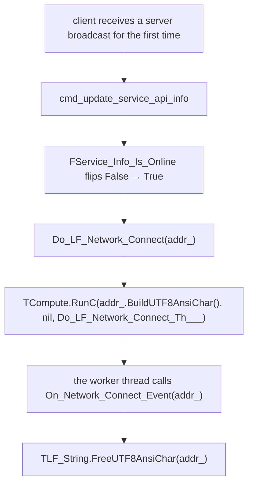

**Key points**:
- **Connect does not mean a TCP link was established**: it is "the first time a server API broadcast is received".
- **Disconnect is a physical link disconnect**.
- **the callback runs on a TCompute worker thread**.
- **`addr_` becomes invalid as soon as the callback returns**.

#### 13.3.2 Usage pattern

```pascal
procedure OnConnect(addr: PAnsiChar); cdecl;
var s: string;
begin
  s := UTF8ToString(addr);   // copy immediately
  TThread.Queue(nil,
    procedure
    begin
      Memo1.Lines.Add('Connected: ' + s);   // UI operations on the main thread
    end);
end;

procedure OnDisconnect(addr: PAnsiChar); cdecl;
begin
  TThread.Queue(nil,
    procedure
    begin
      Memo1.Lines.Add('Disconnected');
    end);
end;

LF_Set_Network_Event(@OnConnect, @OnDisconnect);

// uninstall (optional, before LF_Shutdown)
LF_Set_Network_Event(nil, nil);
```

---

## Chapter 14  Thread model and concurrency

### 14.1 Four kinds of threads

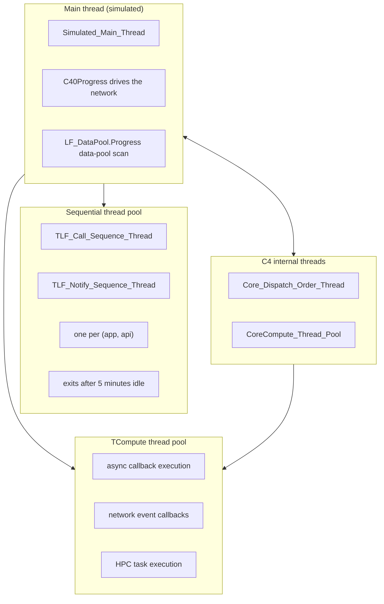

### 14.2 Responsibilities of each thread

| Thread | Responsibility | User can interact |
|------|------|:----------:|
| **simulated main thread** | C4 progress, data-pool scan | no (internal) |
| **TCompute thread pool** | async callbacks, network events, HPC | **inside callbacks** yes |
| **sequential thread pool** | FIFO sequenced calls/notifies | **inside callbacks** yes |
| **C4 internal threads** | network send/receive | no |

### 14.3 Thread-safety matrix

| Component | Thread-safe |
|------|:--------:|
| all exported functions (except status logging) | ✅ fully thread-safe |
| concurrent writes to the same data handle | ❌ needs external synchronization |
| global variables inside callbacks | ❌ needs external synchronization |
| `LF_DataPool.Progress` | ✅ internally locked |
| `LF_SyncTool` | ✅ internally has a critical section |
| the `addr_` of a network event callback | ❌ invalid after the callback returns |

### 14.4 Callback thread affinity quick reference

| Callback type | Executing thread |
|---------|---------|
| `On_Call` (Call mode) | main thread / sequential thread |
| `On_Notify` (Notify mode) | main thread / sequential thread |
| `LF_Async_Call.OnResult` | TCompute worker thread |
| `LF_Async_Sequenced_Call.OnResult` | TCompute worker thread / sequential thread |
| `LF_UID_Async_*.OnResult` | TCompute worker thread |
| `LF_P2PNAME_Async_*.OnResult` | TCompute worker thread |
| `LF_Set_Network_Event.On_Connect` | TCompute worker thread |
| `LF_Set_Network_Event.On_Disconnect` | TCompute worker thread |
| `RegisterSyncCall_M` / `RegisterSyncNotify_M` | main thread (needs `LF_Sync` to drive) |

### 14.5 Thread-safety best practices

1. **across threads only call `LF_*` functions**: fully thread-safe.
2. **lock writes to the same handle**: the read/write position is not an atomic operation.
3. **do not block and do not call `LF_Call` inside a callback**: it will self-deadlock.
4. **marshal UI operations onto the main thread**: `TThread.Queue` / `Synchronize`.
5. **keep strong references to callbacks in managed languages**: to prevent GC collection.
6. **copy the network-event `addr_` immediately**: it becomes invalid when the callback returns.
7. **the handle of an async callback must be fully handled inside the callback**: keeping it across threads is forbidden.

### 14.6 Handle lifetime of asynchronous callbacks

#### 14.6.1 Timing comparison: synchronous family vs asynchronous family

**Synchronous family (`LF_Call`)**:

```mermaid
sequenceDiagram
    participant Caller as caller thread
    participant Core as LingoFuse core
    participant Worker as worker thread/main thread

    Caller->>Core: LF_Call(app, hnd, timeout)
    Core->>Worker: execute the API
    Worker-->>Core: result
    Core->>Core: New_Result_From(..., True)
    Core-->>Caller: return the handle
    Note over Caller: ★ the handle belongs to the caller; readable at any time
    Caller->>Core: LF_SetPos / read
    Caller->>Core: LF_FreeData
```

**Asynchronous family (`LF_Async_Call`)**:

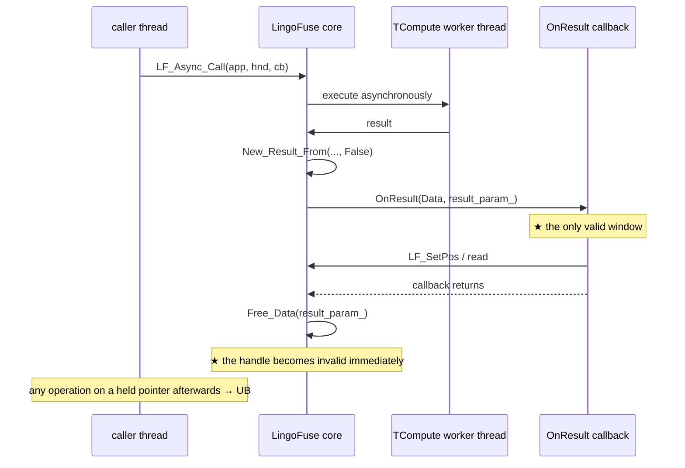

#### 14.6.2 Coupling with the thread model

**Lifetime of an asynchronous-family handle**:

- **start**: `New_Result_From(..., False)` inside `TLF_Async_Call_Bridge.Do_Th`.
- **end**: `Free_Data(result_param_)` inside `TLF_Async_Call_Bridge.Do_Th`.
- **both start and end are inside the TCompute worker thread**, and **between them there is only the `OnResult` callback invocation**.
- **the caller thread is completely unaware of this window** — it only receives a completion notice for a future (or equivalent), while the handle is already invalid.

**This is the fundamental trap of cross-language bindings**: from the caller thread's point of view, "the call completed" means "the result is available"; but from the C side's point of view, "the call completed" means "the handle has already been freed".

#### 14.6.3 Three safe strategies

| Strategy | Implementation | Applicable scenario |
|------|---------|---------|
| **A. use the synchronous family** | gateway/proxy/HTTP bridge scenarios that are blocking anyway | the `LF_Call` family |
| **B. copy inside the callback** | `read_string_bytes` inside the async callback to copy the bytes out | the `LF_Async_Call` family |
| **C. high-level wrapper** | the binding layer's Future interface reads and copies inside the callback | all managed languages |

**Any approach that keeps a raw handle outside the callback is wrong**.

#### 14.6.4 Comparison with automatic reclaim

| Dimension | auto-recycle handle | async-family handle |
|------|----------------|---------------|
| `auto_recycle___` | `True` | `False` |
| idle reclaim | 10 minutes + 5-second scan | not applicable (never enters the pool) |
| release timing | `LF_FreeData` marks it + pool scan | the instant the callback returns |
| live window | minutes | microseconds to milliseconds |
| protection | 3 layers (threshold + refresh + calling) | none |
| keeping it across threads | ⚠️ needs an external lock | ❌ forbidden |

**Orders of magnitude apart**: the "live window" of an auto-recycle handle is **minutes**, that of an async-family handle is **milliseconds**.

---

## Chapter 15  Memory and lifecycle management

### 15.1 The three-layer memory pool architecture

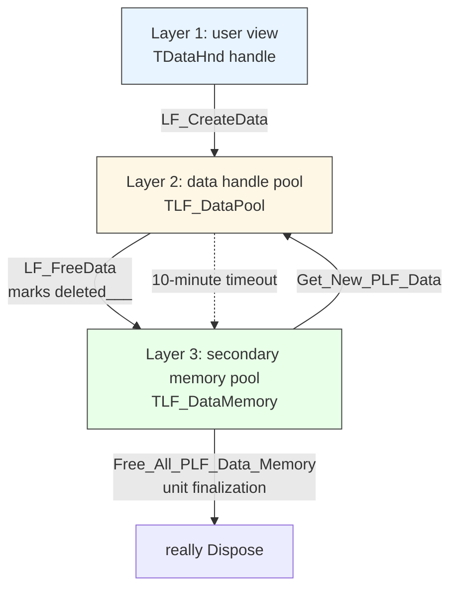

### 15.2 Responsibilities of each layer

| Layer | Name | Responsibility |
|:--:|------|------|
| 1 | user handle | the `TDataHnd` held by the user |
| 2 | data handle pool | tracks active handles; scans and reclaims idle/deleted ones |
| 3 | secondary memory pool | caches reclaimed `TLF_Data` records, reducing `New`/`Dispose` |

### 15.3 The three branches of `TLF_DataPool.Progress`

**It scans once every 5 seconds**:

```pascal
for each handle in LF_DataPool:
  if handle.updated___ or handle.calling___ > 0 then
      handle.time___ := now;
      handle.updated___ := False;
  else if handle.deleted___ then
      add to the "released by the user" list;
      mark for reclaim;
  else if now - handle.time___ > 10 minutes then
      add to the "timeout release" list;
      mark for reclaim;
```

**Key points**:
- **`updated___` or `calling___ > 0`**: refresh the timestamp.
- **`deleted___`**: released by the user.
- **timeout**: 10 minutes idle.
- **the free happens outside the pool**: to avoid `Dispose` inside the lock.

### 15.4 Exit and release of the sequential thread (🟢 corrected in v7.0)

**Source** (the end of `TLF_Call_Sequence_Thread.Do_Run_Th` in `Z.LingoFuse_Core.pas`):

```pascal
if (Internal_Queue_Data___ <> nil) and (Internal_Queue_Pool___ <> nil) then
  begin
    Internal_Queue_Pool___.Lock;
    try Internal_Queue_Pool___.Remove(Internal_Queue_Data___);
    finally Internal_Queue_Pool___.UnLock; end;
  end;
DelayFreeObj(1.0, self);   // ← 1 second (the v6.0 doc mistakenly recorded 5 seconds)
```

**v6.0 erratum**: v6.0 §14.1 cited the 5 seconds from `Z.LingoFuse.md`; **the source actually uses 1 second**.

### 15.5 The `calling___` counter

**Purpose**: protects remote calls in flight.

**Implementation**:
```pascal
procedure TLF_Data.Begin_Call;
begin
  calling___.UnLock(calling___.LockP^ + 1);
  updated___ := True;
end;

procedure TLF_Data.End_Call;
begin
  calling___.UnLock(calling___.LockP^ - 1);
  updated___ := True;
end;
```

**Key points**:
- **`LF_Call` / `LF_LocalCall` / `LF_Notify` / `LF_Sequenced_Notify` all do `Begin_Call` / `End_Call` automatically internally**.
- **users do not need to call them manually** (they are not exposed at the C ABI layer).

### 15.6 The semantics of `LF_CreateData_Permanent`

- **`auto_recycle___ = False`**: it does not join `LF_DataPool`.
- **`LF_FreeData` releases it immediately and synchronously** (it does not mark it).
- **it is not affected by the 10-minute timeout** (because it is not in the pool at all).
- **creating one outside the initialization window leaks**: before `LF_PrepareDone` / after `LF_ExitMainThread`, `LF_FreeData` is a no-op.

### 15.7 The two-stage destruction of `LF_App`

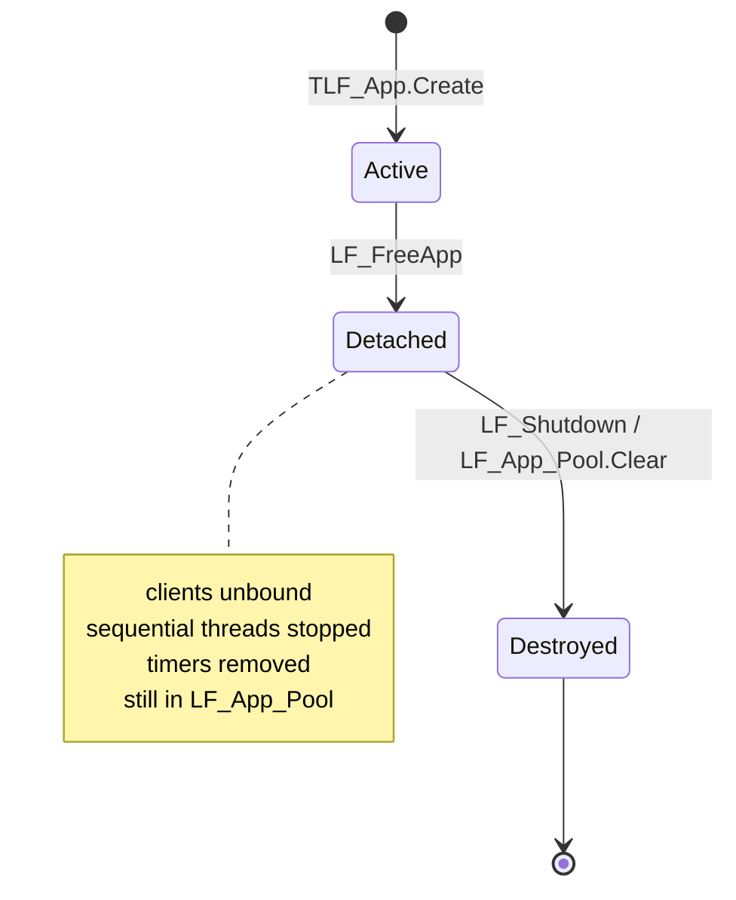

### 15.8 Memory leak troubleshooting checklist

| # | Leak source | How to check | Fix |
|:-:|--------|---------|------|
| 1 | data handle not passed to `LF_FreeData` | memory grows over long runs | use `try..finally` |
| 2 | application handle not passed to `LF_FreeApp` | `LF_App_Pool` grows | release in the cleanup order |
| 3 | `LF_CreateData_Permanent` never released | search explicitly | call `LF_FreeData` explicitly |
| 4 | DLL never calls `LF_Shutdown` | memory still held after DLL unload | add an unload hook |
| 5 | sequenced notify threads never exit | check the TCompute thread count | they exit automatically after 5 minutes idle |
| 6 | records in the secondary pool never released | check the `LF_DataMemory` pool size | released automatically at unit finalization |
| 7 | a callback closure captured a large object | inspect anonymous functions | use weak references |
| 8 | holding a handle outside an async callback causes a double-free | check whether `LF_FreeData` is called on an async handle | handle async handles only inside the callback |

### 15.9 Race in the sequential thread

**Source** (the end of `TLF_Notify_Sequence_Thread.Do_Run_Th` + `Kill_App`):

```pascal
// end of Do_Run_Th
if (Internal_Queue_Data___ <> nil) and (Internal_Queue_Pool___ <> nil) then
  begin
    Internal_Queue_Pool___.Lock;
    try Internal_Queue_Pool___.Remove(Internal_Queue_Data___);
    finally Internal_Queue_Pool___.UnLock; end;
  end;
DelayFreeObj(1.0, self);

// inside Kill_App
queue^.Data^.Data.Second.Critical.Lock;
try
  queue^.Data^.Data.Second.Internal_Queue_Pool___ := nil;   // ← races with the check above
  queue^.Data^.Data.Second.Internal_Queue_Data___ := nil;
finally queue^.Data^.Data.Second.Critical.UnLock; end;
```

**Race analysis**: when `Do_Run_Th` checks `Internal_Queue_Pool___ <> nil` it is **not holding the lock**, so `Kill_App` may have set it to nil just before.

**Theoretical risk**: **a low-probability crash**.

**Mitigation**: make sure the sequential threads have stopped before `LF_FreeApp`; avoid creating/destroying Apps frequently under high concurrency.

---

## Chapter 16  Cross-language bindings

### 16.1 The C ABI boundary

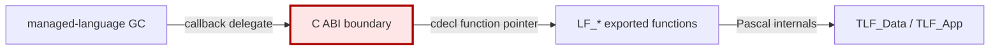

### 16.2 General rules

1. **callbacks must be `cdecl`** (or the language's equivalent convention: `CFUNCTYPE` / `extern "C"` / `@convention(c)`).
2. **managed-language callbacks must be kept strongly referenced**.
3. **strings use UTF-8** (`PAnsiChar`).
4. **`TP2P_UID___` is a 32-byte array**.
5. **returned pointers become invalid after 5 seconds** (`LF_GetOption` / `LF_Get_AppName` / `LF_Generate_AppName` / `LF_Get_P2P_Name` / `LF_Get_P2P_UID`).
6. **`LF_WriteString` always appends #0**; `LF_ReadString` reads tolerantly.
7. **the sender identity is available automatically**, with no extra declaration; **it is only valid in the callback's Input parameter**.
8. **the handle ownership of the synchronous and asynchronous families is opposite**: the synchronous family belongs to the caller, the asynchronous family to the framework (released immediately when the callback returns).

### 16.3 Per-language notes quick reference

| Language | Key points |
|------|--------|
| **C / C++** | `extern "C"`; `cdecl`; copy data inside async callbacks |
| **C# / .NET** | `CallingConvention.Cdecl`; strong callback references; copy data inside async callbacks |
| **Python** | `CFUNCTYPE` (cdecl); strong callback references (module-level variables); copy data inside async callbacks |
| **Java** | JDK 22+ FFM API; keep upcallStub strongly referenced; copy data inside async callbacks |
| **Rust** | `extern "C"`; panics must be wrapped in `catch_unwind`; copy data inside async callbacks |
| **Go** | `purego` or `cgo`; keep callback references; copy data inside async callbacks |
| **Swift** | Swift 5.9+; `@convention(c)`; copy data inside async callbacks |
| **Zig** | `@cImport`; `extern "C"`; copy data inside async callbacks |
| **Erlang** | an NIF crash takes down the BEAM; OTP 27+; copy data inside async callbacks |
| **Ruby** | Fiddle or a C extension; DevKit; copy data inside async callbacks |
| **Fortran** | `iso_c_binding`; compilers from the same source; copy data inside async callbacks |
| **Julia** | `--threads=2`; `ccall`; copy data inside async callbacks |
| **R** | four-layer architecture + Job queue; copy data inside async callbacks |
| **Dart** | `DynamicLibrary.open`; Flutter Web unsupported; copy data inside async callbacks |

### 16.4 P2PName cross-language sequence (🟢 new in v7.0)

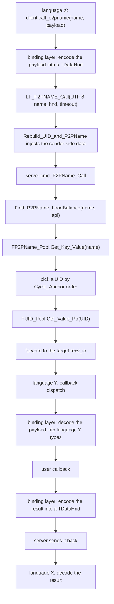

**P2PName cross-language contract table (🟢 v7.0)**:

| Dimension | Contract |
|------|------|
| string encoding | UTF-8 + NUL terminator |
| empty string | the server reports `no found p2pname:""` and sends no reply |
| length limit | no explicit limit |
| async hang | if the server cannot find the group name, the callback never fires |
| timeout mechanism | implemented by the caller (the C ABI has no timeout argument) |
| callback thread | TCompute worker thread |
| handle ownership | synchronous family belongs to the caller, asynchronous family to the framework |

### 16.5 Cross-language declarations for sender identification

```c
/* LF_Get_P2P_UID: returns a pointer (pointing at the 32-byte UID), freed automatically by the framework via DelayFreeMem(5.0, ...) */
PP2P_UID___ LF_Get_P2P_UID(TDataHnd___ Hnd);

/* LF_Get_P2P_Name: returns a UTF-8 string pointer, freed automatically after 5 seconds */
const char* LF_Get_P2P_Name(TDataHnd___ Hnd);
```

- `TP2P_UID___` is a 32-byte array; across languages it is recommended to declare it as `uint8_t[32]`.
- `PP2P_UID___` is **a pointer to `TP2P_UID___`** (`uint8_t (*)[32]` or `uint8_t*`).
- **Restrictions on where it may be used (must read)**:
  - **valid only on the `Input` parameter of the callback that triggered the event**.
  - **must not be called on self-created handles (created by `LF_CreateData`)**.
  - **must not be called on output handles (e.g. the `Result_` of `OnResult`)**.
  - **must not be called inside `LF_LocalCall` / `LF_LocalNotify` callbacks**.

### 16.6 Cross-language declaration of the async handle

```c
// prototype of the async callback (cdecl)
typedef void (*TLF_Async_Call_OnResult)(void* Data, TDataHnd___ Result_);
```

**Cross-language contract**:

- `Data` is an opaque pointer supplied by the caller; LingoFuse does not manage its lifetime.
- `Result_` is **a framework-owned handle**:
  - it **becomes invalid immediately** when the callback returns.
  - calling `LF_FreeData(Result_)` inside the callback is **forbidden**.
  - all reads **must** be completed inside the callback (or the data must be copied out).

---

## Chapter 17  Cleanup and shutdown

### 17.1 The hard-constrained cleanup order

```
LF_ExitMainThread    →    LF_FreeApp    →    LF_Shutdown
```

**Why this order**:

1. **`LF_ExitMainThread`**: stops the simulated main thread, triggering `C40Clean`, the stopping of the sequential thread pool, and the release of all data handles.
2. **`LF_FreeApp`**: unbinds the `app` reference of every `TC40_LF_Client`, stops the sequential threads, and `FakeFree` removes the timers.
3. **`LF_Shutdown`**: clears `LF_App_Pool` (really freeing the Apps), releases all data handles, and unloads the IPC library.

**Consequences of a wrong order**:

```pascal
// ❌ wrong: Shutdown before FreeApp
LF_Shutdown;
LF_FreeApp(App);   // App was already freed during Shutdown → UAF
```

### 17.2 The complete steps of `LF_Shutdown`

1. **clear the network event callbacks**: `On_Network_Connect_Event := nil` / `On_Network_Disconnect_Event := nil`.
2. **stop all sequenced notify threads**.
3. **release all remaining data handles**: `LF_DataPool.Free_All_Hnd`.
4. **exit the simulated main thread**: `LF_ExitMainThread`.
5. **clear the global application pool**: `LF_App_Pool.Clear`.
6. **unload the IPC library**: `UnloadIPCLibrary`.
7. **close the core dispatch thread**: `if IsLibrary then Close_Core_Dispatch_Thread`.

**Idempotency (🟢 confirmed from source in v7.0)**: calling `LF_Shutdown` multiple times should be idempotent. Every internal step has a precondition check (skip empty pools, skip when not activated).

### 17.3 Re-initialization after `LF_Shutdown`

```pascal
LF_Shutdown;
LF_ResetPrepare;             // clear the preparation queue
LF_PrepareService(...);
LF_PrepareClient(...);
if LF_PrepareDone = 1 then   // start again
  ...
```

**Key point**: `LF_Shutdown` resets `Simulated_Main_Thread_Running`, so `LF_PrepareDone` can succeed again.

### 17.4 The DLL scenario

**You must call `LF_Shutdown` explicitly**:

```pascal
// in the DLL export function
procedure DllUnload; stdcall;
begin
  LF_Shutdown;   // must be called explicitly
end;
```

**Reason**: the DLL may be unloaded early by the host process, in which case LingoFuse's `finalization` may not run.

---

# Part V  P2P and distribution

## Chapter 18  P2P distributed load

### 18.1 The core judgment: one-to-many means distributed

> **Whenever "one-to-many" appears, it can be distributed.**
>
> - one App name, registered by many programs;
> - one P2PName, registered by many programs;
> - one caller, connected to several servers;
> - one API name, exposed by many workers.

LingoFuse's C4 mesh automatically forms candidate pools and picks a target by strategy.

### 18.2 Three levels of load granularity

| Granularity | Routing key | Selection method | Local first |
|------|--------|---------|:--------:|
| application level | App name | multiple client candidates, least recently used | ✅ |
| group level | P2PName | server-side in-group load balancing / stickiness | ❌ |
| session level | UID | targeted, no load balancing | ✅ (local UID preferred) |

### 18.3 One App name registered by many programs

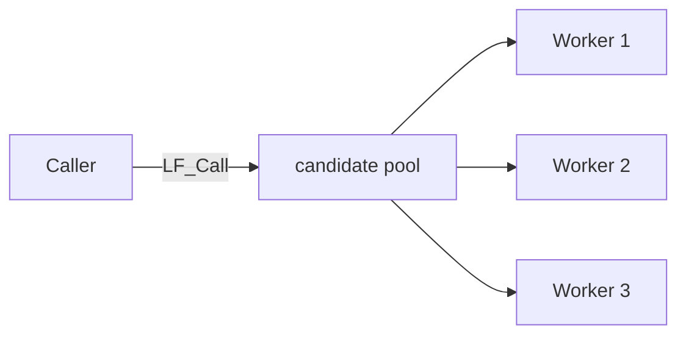

**Rules**:
- App-name routing is **local first**.
- only when there is no App with the same name locally does it go to the remote candidates.
- with multiple candidates it load balances by "least recently used".
- the broadcast cache has a delay of about 3 seconds.
- do not use the same App name to test "local vs remote" inside the same process.

### 18.4 One P2PName registered by many programs

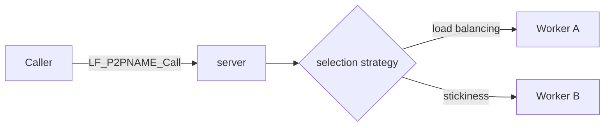

**Rules**:
- P2PName routing **does no local lookup**; it always hands over to the server/mesh.
- the server maintains "group name → UID list".
- by default it load balances by `Cycle_Anchor`.
- `Fixed_Sequenced_Time` defaults to 20 seconds and provides stickiness.
- suitable for stateless workers, compute nodes, codec nodes and GPU nodes.

### 18.5 Your program connecting to several servers

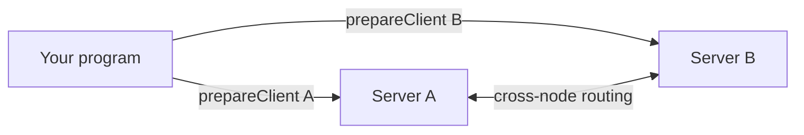

**Conditions and boundaries (🟢 refined in v7.0)**:
- your program can `prepareClient` several server addresses.
- **precondition**: the servers have established physical connections with each other through the C4 protocol (mutual `Client` / `Auto` connections), **forming a C4 mesh**.
- **if the servers cannot reach each other**, they are **islands**, and no cross-server load balancing happens automatically.
- **extra configuration**: no extra broadcast/routing configuration is needed; as long as the servers are connected through a C4 mesh, cross-node routing works automatically.
- **specific mechanism**: each C4 server queries other servers' service information through the `QueryInfo` command, and the dispatch service collects and broadcasts it.

### 18.6 The sequenced family and high-volume computation

**LingoFuse's sequenced family**:
- `LF_Sequenced_Notify`
- `LF_Sequenced_Call`
- `LF_Async_Sequenced_Call`
- the Sequenced variants of UID / P2PName

**Guarantees**:
- FIFO within the same `(App, API)` pair;
- FIFO within the same `(UID, API)`;
- FIFO within the same `(P2PName, API)` pair, though items may be assigned to different UIDs;
- concurrency across different keys.

**Why it naturally fits Matlab / R / Julia / video / audio**:

| Scenario | Data shape | Benefit after sequencing |
|------|---------|---------------|
| Matlab computation | matrices, arrays, simulation iterations | FIFO per iteration round, results sent back in order |
| R statistics | data frames, batch processing | stable batch order, no out-of-order pollution |
| Julia high concurrency | task blocks, GPU batches | FIFO within one API, concurrency across APIs |
| video streams | frame sequences, GOP | no lost frame order, per-frame processing and feedback |
| audio streams | PCM / Opus blocks | stable block order, low-latency feedback |
| large-scale data streams | chunked binary | binary handles, less encoding overhead |

### 18.7 Why it is nearly automatic and efficient

- **automatic discovery**: register APIs, the server broadcasts, callers cache candidates.
- **automatic load balancing**: multiple registrations of an App name / P2PName automatically pick a target.
- **automatic ordering**: the Sequenced family is FIFO by routing key.
- **automatic handle pool**: DataHandle creation, pooling and reclaim.
- **automatic asynchrony**: `LF_Async_*` + Future, with the result copied inside the callback.
- **binary efficiency**: handles can write raw bytes; video/audio/matrices need one less encode.
- **zero-copy mapping**: `Param.Mapping` allows zero-copy mapping on decode.
- **cross-language uniformity**: the C ABI lets Matlab / R / Julia / Python / C++ all connect.

### 18.8 P2P distributed load best practices

1. **read the UID only inside a callback's `Input`.**
2. **copy immediately once you read the pointer.**
3. **the UID can serve as a communications identifier until the connection drops.** After reconnecting, run `whoami` again.
4. **if you want distribution, create one-to-many.**
5. **use P2PName for homogeneous workers.** Do not use an App name as multicast.
6. **use Sequenced when you need ordering.**
7. **use binary handles for high volume.**
8. **with multiple servers, confirm that the servers support cross-node routing.**
9. **do not call the blocking `LF_Call` / `LF_Notify` / `LF_LocalCall` inside a callback.**
10. **async handles are owned by the framework and released immediately when the callback returns.**

---

## Chapter 19  Route optimization: local short-circuit and server-local handling

### 19.1 Local short-circuit (the target is local, so it does not go over the network)

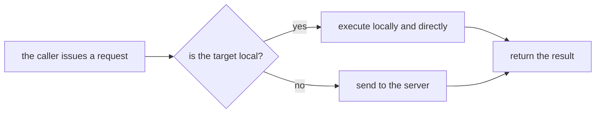

**Explanation**:
- if the caller's process has already registered the function corresponding to the target App / UID / P2PName, LingoFuse **executes it locally first**, without the network.
- this reduces network round trips and lowers latency.
- note: **App-name routing is local-first by default; UID routing is also local-first; P2PName routing does no local-first lookup**.

**Source basis**:

```pascal
// the first step of the client's Send_Execute_Notify
tmp_cli__ := Find_Local_API(app_Name__, api_Name__, True);
if tmp_cli__ <> nil then
  begin
    tmp_cli__.APP.Engine.Execute_Notify(tmp_param);   // execute locally and directly
    exit;
  end;
```

### 19.2 Server-local handling (the request reached the server, but the server can handle it itself)

```mermaid
flowchart LR
    A[a request reaches the server] --> B{can the server handle it locally?}
    B -->|yes| C[the server executes locally]
    B -->|no| D[forward to the target client]
    C --> E[return the result]
    D --> E
```

**Explanation**:
- when a request passes through the server, the server first checks whether its own process has the corresponding App / API.
- if it does, the server **handles it locally** and does not forward it to other clients.
- this avoids unnecessary network forwarding and improves overall efficiency.
- **this optimization applies to App-name, UID and P2PName routing alike**.

**Source basis**:

```pascal
// the first step of the server's cmd_Call
tmp_cli__ := Find_Local_API(app_Name__, api_Name__, True);
if tmp_cli__ <> nil then
  begin
    // the server handles it locally, no forwarding
    RunHPC_CompleteBuffer_StreamM(Sender, nil, tmp_cli__, InData, OutData, Run_Call_Worker);
    exit;
  end;
// otherwise broadcast it to the other clients
```

### 19.3 Combined diagram of the two optimization levels

```mermaid
flowchart TB
    A[caller] --> B{can it handle it locally?}
    B -->|yes| C[execute locally]
    B -->|no| D[send to the server]
    D --> E{can the server handle it locally?}
    E -->|yes| F[the server executes locally]
    E -->|no| G[forward to the target client]
    C --> H[return the result]
    F --> H
    G --> H
```

### 19.4 The surprise of local short-circuiting

**Problem**: during multi-node testing, `LF_Call` may actually execute locally, which does not match expectations.

**Cause**: C4 routing looks for a local App instance first.

**Fix**:
- determine explicitly whether the current process registered an App with the same name.
- when a remote call is needed, avoid a locally registered App with the same name.
- or use different App names to distinguish local from remote.

**Related pitfall**: `LF-ROUTE-001`.

### 19.5 The impact of server-local handling

**Problem**: when the server process itself registered an App with the same name, requests may not be forwarded to other clients.

**Cause**: the server process prefers to handle requests it can handle locally.

**Fix**:
- decide explicitly whether the server process should register business Apps.
- servers usually act only as beacons and do not register business Apps.
- if the server is to register them, its processing capability must be made explicit.

**Related pitfall**: `LF-ROUTE-009`.

---

# Part VI  Pitfall knowledge base

## Chapter 20  Pitfall knowledge base

> **ID naming rule**: `LF-<subsystem>-<three-digit number>`.
>
> **v7.0 changes**:
> - the "crosses the async boundary" wording in `LF-DATA-002` was removed (merged into `LF-ASYNC-001`).
> - added `LF-LOCAL-001` (local calls do not inject identity), `LF-SEQ-003` (sequential thread released after 1 second), `LF-ROUTE-012` (P2PName async Call hangs).
> - `LF-ROUTE-011` was upgraded from "inferred" to "verified".

### 20.1 Application/handle layer (LF-APP-*)

**LF-APP-001: callbacks must be `cdecl`** (🟢)

- **Symptom**: the process crashes / the callback is never entered / `Trigger` becomes a garbage pointer / it crashes after moving to another environment.
- **Root cause**: the C ABI requires `cdecl`; Delphi defaults to `register` and FPC to `fastcall`.
- **Fix**:
  ```pascal
  procedure GoodCallback(Trigger: Pointer; Input, Output: TDataHnd); cdecl;
  ```
- **Related pitfall**: `LF-CB-001`

**LF-APP-002: `LF_FreeApp` is a two-stage destruction** (🟢)

- **Symptom**: memory does not go down, it goes up; for services that create/destroy Apps frequently, `LF_App_Pool` keeps growing.
- **Root cause**: `LF_FreeApp` only unbinds + stops the sequential threads + removes the timers; the object is still in `LF_App_Pool` and is cleaned up at `LF_Shutdown`.
- **Correct approach**:
  - long-running: avoid creating/destroying Apps frequently.
  - short-lived tasks: restart the framework after `LF_Shutdown`.
- **Related pitfalls**: `LF-CLEAN-001`, `LF-CLEAN-002`

**LF-APP-003: `LF_Generate_AppName` must be called after `LF_PrepareDone`** (🟢)

- **Symptom**: the name lacks the tunnel address and RemoteID; the server spams `no found app`; the client receives no messages.
- **Root cause**: it needs the tunnel information concatenated, which does not exist before `LF_PrepareDone`.
- **Fix**: see the sequence in §3.2.5.
- **Related pitfalls**: `LF-XLANG-001`, `LF-NET-003`

**LF-APP-004: the pointer returned by `LF_Generate_AppName` / `LF_Get_AppName` becomes invalid after 5 seconds** (🟢)

- **Symptom**: the string turns into garbage, becomes empty, or triggers an access violation.
- **Root cause**: `Z.Notify.DelayFreeMem(5.0, Result)` frees it automatically.
- **Fix**: use the `Ex` variant to copy immediately.
- **Related pitfalls**: `LF-APP-003`, `LF-DATA-002`

**LF-APP-005: `LF_BindApp` only binds "unbound" clients** (🟢)

- **Symptom**: the return value is 0 and the new App is never bound.
- **Root cause**: it only binds clients with `Cli.app = nil`; the main thread must be active.
- **Fix**:
  1. `Overlap_Connection=True` + create a new tunnel.
  2. prepare a different physical address.
  3. pass the App directly at the `PrepareClient` stage.
- **Binding order**: by client creation order (🟢 refined in v7.0).
- **Related pitfalls**: `LF-NET-001`, `LF-NET-004`

**LF-APP-006: with `Overlap_Connection=False` the second App is silently ignored** (🟢)

- **Symptom**: the second `LF_PrepareClient` returns a new tag, but the new App is never bound; subsequent calls time out.
- **Root cause**: with `Overlap_Connection=False`, only one client tunnel is allowed per physical address.
- **Fix**: `LF_Set_Opt_Overlap_Connection(True)`.
- **Related pitfalls**: `LF-NET-001`, `LF-APP-005`

**LF-APP-007: `LF_FreeApp` has a shutdown guard** (🟢)

- **Symptom**: calling `LF_FreeApp` after `LF_Shutdown` is a no-op.
- **Root cause**: `if not Core_Dispatch_Order_Activted then exit`.
- **Fix**: cleanup order `ExitMainThread → FreeApp → Shutdown`.
- **Related pitfalls**: `LF-CLEAN-001`, `LF-APP-002`

### 20.2 Callback layer (LF-CB-*)

**LF-CB-001: callbacks must be explicitly `cdecl`** (🟢)
- **Note**: the same entry as `LF-APP-001`.

**LF-CB-002: blocking LingoFuse functions must not be called inside a callback** (🟢)

- **Symptom**: the whole process deadlocks.
- **Root cause**: the callback holds an internal lock, and the remote call needs the same lock.
- **Fix**: submit asynchronously to a worker thread.

**LF-CB-003: long blocking inside a callback is forbidden** (🟢)

- **Symptom**: no C4 thread-pool thread is available, and requests queue up under high concurrency.
- **Fix**: a callback should only do "read input + enqueue + return immediately".

**LF-CB-004: callbacks must be thread-safe** (🟢)

- **Symptom**: occasional crashes, more likely on multi-core machines.
- **Fix**: protect shared state with a critical section; use `RegisterSyncCall_M` for UI.

**LF-CB-005: synchronous callbacks require the main loop to drive `LF_Sync`** (🟢)

- **Symptom**: synchronous callbacks never execute.
- **Fix**: call `LF_Sync` periodically in the main loop.

### 20.3 Data handle layer (LF-DATA-*)

**LF-DATA-001: handles must be released explicitly** (🟢)

- **Symptom**: memory keeps growing under heavy call rates.
- **Root cause**: automatic reclaim is an **asynchronous safety net** (10 minutes idle + 5-second scan).
- **Fix**: use `try..finally` to guarantee release.

**LF-DATA-002: handles must not be released inside a callback** (🟢)

- **Symptom**: crashes / data corruption.
- **Fix**: do not release `Input` / `Output` inside a callback; copy values across threads.
- **v7.0 simplification**: the part about crossing async boundaries was merged into `LF-ASYNC-001`.

**LF-DATA-003: `Data_Param` and `Data_Result` are mutually exclusive** (🟢)

**LF-DATA-004: the tolerant mode of `LF_ReadString` may consume all remaining bytes** (🟢)

**LF-DATA-005: `LF_WriteString` always appends #0** (🟢)

**LF-DATA-006: the secondary memory pool `TLF_DataMemory`** (🟢)

**LF-DATA-007: the `calling___` counter protects remote calls in flight** (🟢)

**LF-DATA-008: correct and incorrect uses of `LF_CreateData_Permanent`** (🟢)

### 20.4 Network preparation layer (LF-NET-*)

**LF-NET-001: only one client per physical address** (🟢)

**LF-NET-002: `LF_PrepareDone` blocks waiting for clients to be ready** (🟢)

**LF-NET-003: `LF_PrepareDone` returns 1 only the first time within the same process** (🟢)

**LF-NET-004: with `Wait_Connection_ReadyOk=False` you must implement the retry logic yourself** (🟢)

**LF-NET-005: network event callbacks run on a background TCompute worker thread** (🟢)

**LF-NET-006: the `addr_` of a network event callback becomes invalid as soon as the callback returns** (🟢)

**LF-NET-007: `LF_PrepareDone` still returns 1 after the timeout** (🟢)

### 20.5 Remote call layer (LF-CALL-*)

**LF-CALL-001: a `LF_Call` timeout returns a handle of size 0 (not nil)** (🟢)

**LF-CALL-002: `LF_Notify` does not guarantee delivery; only `LF_Sequenced_Notify` guarantees order** (🟢)

### 20.6 Sequenced notify layer (LF-SEQ-*)

**LF-SEQ-001: the sequenced notify thread terminates automatically after 5 minutes idle** (🟢)

**LF-SEQ-002: the FIFO guarantee of `LF_Sequenced_Notify` applies only within the same `(App, API)` pair** (🟢)

**LF-SEQ-003 [new in v7.0]: the sequential thread is released 1 second after it exits** (🟢)
- **Symptom**: if you assumed the lifetime described by the 5 seconds in the v6.0 doc, you may end up with a dangling reference.
- **Root cause**: the source uses `DelayFreeObj(1.0, self)`.
- **Fix**: do not rely on a "5-second safety window"; keep no references after the sequential thread exits.
- **Related pitfall**: `LF-MEM-004`

### 20.7 Query and cache layer (LF-CHK-*)

**LF-CHK-001: `LF_CheckApp` / `LF_CheckApi` are cache-based, with a delay of about 3 seconds** (🟢)

### 20.8 Runtime option layer (LF-OPT-*)

**LF-OPT-001: unknown options passed to `LF_SetOption` are silently ignored** (🟢)

**LF-OPT-002: runtime options are not persisted** (🟢)

**LF-OPT-003: the full semantics and recommended configuration of `Overlap_Connection`** (🟢)

### 20.9 Cleanup and lifecycle (LF-CLEAN-*)

**LF-CLEAN-001: the correct cleanup order is `ExitMainThread` → `FreeApp` → `Shutdown`** (🟢)

**LF-CLEAN-002: re-initialization is possible after `LF_Shutdown`** (🟢)

**LF-CLEAN-003: in the DLL scenario `LF_Shutdown` must be called explicitly** (🟢)

### 20.10 Thread model (LF-THREAD-*)

**LF-THREAD-001: all exported functions are thread-safe** (🟢)

**LF-THREAD-002: concurrent writes to a data handle are not safe** (🟢)

### 20.11 Types and compilation (LF-TYPE-*)

**LF-TYPE-001: under FPC, `var` and `out` encode to the same reference category** (🟡)

**LF-TYPE-002: cross-language interfaces may only use basic types** (🟢)

### 20.12 Cross-language data exchange (LF-XLANG-*)

**LF-XLANG-001: strings must follow the #0 terminator convention** (🟢)

**LF-XLANG-002: UTF-8 must flow end to end, without a `string` relay** (🟡)

**LF-XLANG-003: byte order is uniformly little-endian** (🟢)
- **v7.0 reinforcement**: the Z framework **does not support big-endian platforms**. `{$IFDEF BIG_ENDIAN}` in `Z.Define.inc` triggers a `{$MESSAGE FATAL}` compile error.

### 20.13 JSON usage layer (LF-JSON-*)

**LF-JSON-001: `TZ_JsonObject` is a tree; Parse-style methods may only be called on the root** (🟢)

**LF-JSON-002: JSON assembly must stay in Unicode space and must not relay through `string`** (🟢)

**LF-JSON-003: GBK / Latin-1 fallback must use `USystemString`** (🟢)

### 20.14 Simulated main thread (LF-MAIN-*)

**LF-MAIN-001: the simulated main thread can only be started once per process** (🟢)

**LF-MAIN-002: the simulated main thread drives every background task** (🟢)

**LF-MAIN-003: the relationship between `LF_ExitMainThread` and resource release** (🟢)

**LF-MAIN-004: the three-branch semantics of `LF_DataPool.Progress`** (🟢)

### 20.15 Memory and lifecycle (LF-MEM-*)

**LF-MEM-001: the three-layer memory pool architecture** (🟢)

**LF-MEM-002: `TLF_Data` is a record, not a class** (🟢)

**LF-MEM-003: the two-stage destruction of `TLF_App`** (🟢)

**LF-MEM-004: the delayed release of `TLF_Notify_Sequence_Thread` is 1 second** (🟢, corrected in v7.0)
- **Mechanism**: `DelayFreeObj(1.0, self)`.
- **Impact**: do not rely on a "5-second safety window".
- **Related pitfall**: `LF-SEQ-003`

**LF-MEM-005: memory leak troubleshooting checklist** (🟢)
- see §15.8.

### 20.16 LF core mechanisms (LF-MECH-*)

| ID | Mechanism | One-line risk |
|---|------|-----------|
| `LF-MECH-001` | automatic data handle reclaim | automatic reclaim is an async safety net, not a release guarantee |
| `LF-MECH-002` | the `LF_FreeData` no-op window | releasing is ineffective before PrepareDone / after ExitMainThread |
| `LF-MECH-003` | `LF_ExitMainThread` clears handles | including permanent handles; they cannot be used afterwards |
| `LF-MECH-004` | `LF_PrepareDone` succeeds only once | returning 0 the second time is not a failure; a timeout may still return 1 |
| `LF-MECH-005` | the two-stage destruction of `LF_FreeApp` | FreeApp does not release immediately; only Shutdown destroys |
| `LF-MECH-006` | the callback thread model | callbacks run on background worker threads; blocking and calling LF_Call are forbidden |
| `LF-MECH-007` | network event semantics | Connect does not mean a TCP link; addr becomes invalid immediately |
| `LF-MECH-008` | address uniqueness and Overlap | by default the second App on the same address is silently ignored |
| `LF-MECH-009` | LF_Call timeout and idempotency | a timeout returns a size=0 handle; the server may keep executing |
| `LF-MECH-010` | local-first routing | a local App with the same name executes first, without the network |
| `LF-MECH-011` | broadcast cache delay | CheckApp / CheckApi lag by about 3 seconds |
| `LF-MECH-012` | sequenced notify threads | FIFO only within the same (App, API) pair; idle threads terminate |
| `LF-MECH-013` | the runtime option mechanism | unknown options are silently ignored; not persisted |
| `LF-MECH-014` | the calling counter and the memory pool | long calls protect handles; the secondary pool reuses records |
| `LF-MECH-015` | cleanup order and DLL | ExitMainThread → FreeApp → Shutdown |
| `LF-MECH-016` | the NUL wire-format contract | string writes append #0; tolerant reads may consume the remainder |
| `LF-MECH-017` | the side data injection mechanism | the sender writes it automatically; valid only on the callback Input |
| `LF-MECH-018` | async handles are released immediately | async-family handles are released when the callback returns; the synchronous family belongs to the caller |

### 20.17 Local calls (LF-LOCAL-*, new in v7.0)

**LF-LOCAL-001: `LF_LocalCall` / `LF_LocalNotify` do not inject the sender identity** (🟢)

- **Symptom**: inside a local call callback, `LF_Get_P2P_UID(Input)` returns all zeros and `LF_Get_P2P_Name(Input)` returns an empty string.
- **Root cause**: `LF_LocalCall` / `LF_LocalNotify` (`Z.LingoFuse_Export.pas`) call `PLF_Data(Param).Data_Param.EncryptToMem(tmp)` directly and **do not go through `Rebuild_UID_and_P2PName`**.
  - if `Param` was created by `LF_CreateData`, its `FromUID` is `Null_UID()`.
- **Contrast**: **local calls going through the `TC40_LF_Client.Send_*` path (i.e. `LF_Call` hitting the local short-circuit) do inject identity**.
- **Fix**:
  - if a local call needs to carry identity → use `LF_Call` (it hits the local short-circuit and still injects identity).
  - or write the sender identity into `Param` yourself.
- **Related pitfalls**: §5.6, §10.3, `LF-MECH-017`.

### 20.18 Routing and addressing (LF-ROUTE-*)

**LF-ROUTE-001: the surprise of local-first routing** (🟢)

**LF-ROUTE-002: the UID is a session-level identifier and changes after reconnecting** (🟢)

**LF-ROUTE-003: P2PName routing does no local lookup** (🟢)

**LF-ROUTE-004: universal UID routing can call any API** (🟢)

**LF-ROUTE-005: the Cycle_Anchor mechanism of P2PName load balancing** (🟢)

**LF-ROUTE-006: the FixedSequenced mechanism of P2PName stickiness** (🟢)

**LF-ROUTE-007: the whoami pattern is a prerequisite for UID routing** (🟢)

**LF-ROUTE-008: the APIs of the three addressing schemes cannot be mixed with the wrong argument types** (🟢)

**LF-ROUTE-009: the surprise of server-local handling** (🟢)

**LF-ROUTE-010: UID / P2PName calls can hit App-registered functions, App-name calls cannot hit P2P-registered functions** (🟢)

**LF-ROUTE-011: the boundary of automatic multi-server distribution** (🟢, upgraded from inference in v7.0)
- **Note**: your program can `prepareClient` several server addresses. **Precondition**: the servers have established physical connections with each other through the C4 protocol (mutual `Client` / `Auto` connections), **forming a C4 mesh**.
- **if the servers cannot reach each other**, they are islands, and no cross-server load balancing happens automatically.
- **extra configuration**: no extra broadcast/routing configuration is needed; as long as the servers are connected through a C4 mesh, cross-node routing works automatically.
- **Related pitfall**: `LF-ROUTE-005`

**LF-ROUTE-012 [new in v7.0]: if the server cannot find the group name, a P2PName async Call's callback never fires** (🟢)
- **Symptom**: `LF_P2PNAME_Async_Call("no_such_group", ...)` returns 1 (already enqueued), but the callback never fires.
- **Root cause**: when `Find_P2PName_LoadBalance` returns nil, the server's `cmd_P2PName_Call` only does `DoStatus('no found p2pname:"%s"')` and **sends no reply**.
- **Contrast**: a synchronous `LF_P2PNAME_Call` times out and returns a size=0 handle; the async version **hangs forever**.
- **Fix**: the caller must implement its own timeout (record pending requests and drop the holder on timeout).
- **Related pitfalls**: §8.4, §11.3.

### 20.19 Asynchronous calls and handle ownership (LF-ASYNC-*)

**LF-ASYNC-001: the `Result_` handle of the async family is owned by the framework and released immediately when the callback returns** (🟢)

- **Symptom**:
  - reading `Result_` outside the callback → empty or garbage data.
  - calling `LF_FreeData` on `Result_` outside the callback → double-free / crash.
  - the symptoms look "intermittent": a small payload looks fine, a large payload returns empty.
- **Root cause**:
  - the synchronous family returns `New_Result_From(..., True)`, `auto_recycle = True`, owned by the caller.
  - the asynchronous family does `New_Result_From(..., False)` inside `TLF_Async_Call_Bridge.Do_Th`, `auto_recycle = False`, and **calls `Free_Data` immediately when the callback returns**.
- **Fix**:
  1. **pattern A**: use the synchronous family. The ownership contract is simple.
  2. **pattern B**: use the asynchronous family and **read and copy the data out inside the callback**.
  3. **pattern C**: use the Future interface provided by the binding layer.
- **Related pitfalls**: `LF-ASYNC-002`, `LF-ASYNC-003`, `LF-ASYNC-006`, `LF-DATA-002`

**LF-ASYNC-002: async handles must not be kept across threads** (🟢)

**LF-ASYNC-003: `LF_FreeData` must not be called on async handles** (🟢)

**LF-ASYNC-004: "~1 second" in the comments is misleading** (🟢)

- **Root cause**: the comment says "released after 1 second", but in fact it is "released **immediately** when the callback returns". The "1 second" is `DelayFreeObj(1.0, Self)` releasing the **Bridge object**, not the `Result_` handle.
- **Lesson**: comments are second-hand information. When you see suspicious behavior, read the source.

**LF-ASYNC-005: the `int` vs `dict` dichotomy is a false classification** (🟢)

- **Root cause**: the real variable is **payload size → memory reuse timing**.
- **Fix**: the dichotomy has to ask the right question.

**LF-ASYNC-006: the ownership of the synchronous and asynchronous families must not be mixed** (🟢)

**LF-ASYNC-007: the live window of an async handle is microseconds to milliseconds** (🟢)

**LF-ASYNC-008: the binding layer must encapsulate async handle handling inside the callback** (🟢)

---

## Chapter 21  LLM ecosystem pitfall index

> **This chapter is only an index**. The LLM ecosystem (Python side, MCP gateway, LTB, stdio transport etc.) is another domain; see `LingoFuse_LLM_Pitfalls_For_AI.md` for details.

### 21.1 LLM ecosystem pitfall ID mapping table

| LLM ecosystem pitfall ID | Topic | Corresponds to the Pascal layer |
|--------------|------|------------------|
| P0-1 | `client_name` must be a real App name | `LF-APP-003` |
| P0-3 | blocking LingoFuse functions must not be called inside a callback | `LF-CB-002` |
| P2-1 | encoding problems | `LF-XLANG-002` |
| P4-2 | GUI cleanup order | `LF-CLEAN-001` |
| P7-3 | LTB pre-connection | `LF-NET-003` / `LF-MAIN-001` |
| **P9 series** | **Structured Output** | **`LF-JSON-001` / `LF-JSON-002`** |
| **P10-1** | **calling parse on a child object leaves the parent tree dangling** | **`LF-JSON-001`** |
| **P10-2** | **JSON relayed through AnsiString loses characters** | **`LF-JSON-002`** |
| **P10-3** | **GBK fallback SetLength uses the wrong unit** | **`LF-JSON-003`** |
| **P11** | **async callback handle leaks out** | **`LF-ASYNC-001` / `LF-ASYNC-002`** |
| **P12** | **`LF_Get_P2P_UID` return value changed from an array to a pointer** | **§4.6.1 / `LF-ROUTE-002`** |
| **P13** | **"request not forwarded" caused by server-local handling** | **`LF-ROUTE-009`** |
| **P14** | **App-name calls cannot hit P2P-registered functions** | **`LF-ROUTE-010` / §6.6** |
| **P15 (v7.0)** | **local calls do not inject the sender identity** | **`LF-LOCAL-001` / §5.6** |
| **P16 (v7.0)** | **P2PName async Call hangs forever when the group name is not found** | **`LF-ROUTE-012` / §8.4** |

---

# Appendices

## Appendix A  Error message text index

| Error message text | Chapter | Summary |
|-------------|------|------|
| `no found app("...") api("...")` | `LF-APP-003` | client_name not registered, or generated too early |
| `LF_PrepareClient returned -1` | `LF-NET-001` | duplicate address |
| `repeat connection` | `LF-NET-001` | duplicate address |
| `prepare error: repeat listen` | `LF-NET-001` | duplicate listening address |
| `LF_PrepareDone failed` | `LF-NET-002` | wait timed out |
| `LF_PrepareDone returned 0` | `LF-NET-003` / `LF-MAIN-001` | second call |
| `LF_BindApp: Main thread is not active` | `LF-APP-005` | main thread not started |
| `LF_BindApp: All clients are already occupied` | `LF-APP-005` | no free client |
| `3029 function header doesn't match` | `LF-TYPE-001` | var/out same signature |
| `Can't find unit Z.Core` | build configuration | unit search path not configured |
| `Queue "..." is already occupied` | port in use | endpoint already in use |
| `Callback type mismatch` | `LF-APP-001` | missing cdecl |
| `Timeout` / a result of size 0 | `LF-CALL-001` | call timed out |
| `Module not found: LingoFuse64.dll` | deployment | dynamic library not found |
| `hint: Data handle pool "N" handles were idle...` | `LF-DATA-001` | data handle auto-reclaim log |
| `Sequenced notify api "..." thread idle timeout` | `LF-SEQ-001` | sequenced notify thread idle-exit log |
| `LingoFuse Main Thread Begin/Exit` | `LF-MAIN-001` / `LF-MAIN-003` | simulated main thread log |
| `[warning] Get_P2P_UID(): P2P Info only backcall "input" parameter.` | §4.6.1 / §10.4 | called on an output/self-created handle |
| `no found uid:%s api("%s")` | `LF-ROUTE-004` | UID routing cannot find the target |
| `no found p2pname:"%s" api:"%s"` | `LF-ROUTE-005` / `LF-ROUTE-012` | P2PName routing cannot find the target; the async version will hang forever |
| `LF_SetOption: opt="%s" val="%s"` | §11.1 | option setting log |
| `LF_P2P_name = %s` | §11.6.1 | P2PName setting log |
| access violation inside a network event callback | `LF-NET-005` | cross-thread UI access |
| network event `addr_` turns into garbage / empty | `LF-NET-006` | `addr_` dangling |
| `unrecognized type json_schema` | `LF-JSON-001` | JSON Schema assembly error |
| `options.response_format` lost | `LF-JSON-001` | parent tree dangling |
| `ToBytes` access violation | `LF-JSON-001` | parent tree dangling |
| emoji / Korean in the Schema turns into `?` | `LF-JSON-002` | AnsiString relay |
| GBK fallback output is garbled / truncated | `LF-JSON-003` | SetLength uses the wrong unit |
| empty read or crash after an async callback (no clear error message) | `LF-ASYNC-001` / `LF-ASYNC-002` / `LF-ASYNC-003` | async handle leaked out / double-free |
| the request was not forwarded to the target client (v6.0) | `LF-ROUTE-009` | server-local handling |
| calling a P2P-registered function by App name fails (v6.0) | `LF-ROUTE-010` | routing asymmetry |
| P2P identity inside a local call callback is empty (v7.0) | `LF-LOCAL-001` | does not go through Rebuild_UID_and_P2PName |

## Appendix B  ID overview and maintenance conventions

### B.1 Current ID overview (v7.0)

| ID prefix | Entry count | Description |
|---------|:------:|------|
| `LF-APP` | 7 | application/handle layer |
| `LF-CB` | 5 | callback layer |
| `LF-DATA` | 8 | data handle layer |
| `LF-NET` | 7 | network preparation layer |
| `LF-CALL` | 2 | remote call layer |
| `LF-SEQ` | **3** | sequenced notify layer (LF-SEQ-003 added in v7.0) |
| `LF-CHK` | 1 | query and cache |
| `LF-OPT` | 3 | runtime options |
| `LF-CLEAN` | 3 | cleanup and lifecycle |
| `LF-THREAD` | 2 | thread model |
| `LF-TYPE` | 2 | types and compilation |
| `LF-XLANG` | 3 | cross-language data exchange |
| `LF-JSON` | 3 | JSON usage layer |
| `LF-MAIN` | 4 | simulated main thread |
| `LF-MEM` | 5 | memory and lifecycle |
| `LF-MECH` | 18 | LF core mechanisms (universal across languages) |
| `LF-ROUTE` | **12** | routing and addressing (LF-ROUTE-012 added in v7.0) |
| `LF-ASYNC` | 8 | async calls and handle ownership |
| **`LF-LOCAL`** | **1** | **local calls (added in v7.0)** |
| **Total** | **95** | (92 in v6.0; 3 added in v7.0) |

### B.2 Maintenance conventions

1. **ID allocation**: increment per subsystem, **never reuse a deleted ID**.
2. **the evidence level must be stated**: 🟢 / 🟡.
3. **required fields**: ID, title, evidence level, affected versions, trigger conditions, symptoms, root cause, fix, verification checklist.
4. **optional fields**: minimal reproduction, related pitfalls.
5. **cross references**: the `related pitfalls` field is maintained in both directions.
6. **upgrading the evidence level**: 🟡 → 🟢, upgrade only, never downgrade.
7. **new subsystems**: a separate subsystem prefix is only created once there are ≥ 3 pitfalls of the same origin.
8. **from v7.0 on, no "uncertain" markers are used**. Every assertion must have evidence.

## Appendix C  Retrieval rules for AI users

### C.1 Retrieval priority

1. **check this knowledge base first**: by ID (`LF-XXX-NNN`) or keyword.
2. **routing-related**: check Chapters 8 and 9 and §20.18 (`LF-ROUTE-*`) first.
3. **P2P distributed load-related**: check Chapter 18 first.
4. **route optimization-related**: check Chapter 19 first.
5. **local call identity**: check §5.6, §10.3, `LF-LOCAL-001` first.
6. **option-related**: check Chapter 11 first.
7. **JSON-related**: check §20.13 (`LF-JSON-001 / 002 / 003`) first, then `Z.Json.md`.
8. **main thread-related**: check Chapter 12 and §20.14 (`LF-MAIN-*`) first.
9. **memory-related**: check Chapter 15 and §20.15 (`LF-MEM-*`) first.
10. **handle ownership-related**: check §4.7 and §20.19 (`LF-ASYNC-*`) first.
11. **mechanism-level general questions**: check §20.16 (`LF-MECH-*`) first.
12. **no hit**: check the LLM ecosystem index in Chapter 21.
13. **nothing answers it**: state explicitly that "the current material is not sufficient to decide" and recommend going back to the source.

### C.2 Metadata that must accompany an answer

- **the ID relied on** (e.g. `LF-APP-003` / `LF-ROUTE-012` / `LF-LOCAL-001` / `LF-MECH-006`).
- **the evidence level** (🟢 / 🟡).

### C.3 Structured output template

```
[ID] LF-XXX-NNN
[Evidence level] 🟢 / 🟡
[Symptom] ...
[Root cause] ...
[Fix] ...
[Verification] ...
[Related pitfalls] ...
```

## Appendix D  Core iron rules

### D.1 General iron rules

1. **callbacks must be `cdecl`**, and calling `LF_Call` / `LF_Notify` / `LF_LocalCall` inside a callback is forbidden.
2. **data handles must be explicitly released with `LF_FreeData`**; automatic reclaim is no insurance (10 minutes idle + 5-second scan).
3. **the cleanup order must be `ExitMainThread` → `FreeApp` → `Shutdown`**.
4. **`TZ_JsonObject` is a tree**: `Parae` / `Assign` / `LoadFromStream` / `ParseText` may only be called on the root; use `TZ_JsonString` for intermediate JSON assembly containers.
5. **`LF_PrepareDone` can only start successfully once per process**; `LF_ExitMainThread` clears all data handles (including permanent ones).
6. **handles created by `LF_CreateData_Permanent` are never auto-reclaimed**; `LF_FreeData` is a no-op before `LF_PrepareDone` / after `LF_ExitMainThread`.
7. **network event callbacks run on TCompute worker threads**, and `addr_` becomes invalid as soon as the callback returns.

### D.2 Routing-related iron rules

8. **the UID is a universal routing identifier**: knowing the UID lets you call any API of the target client, without knowing the App name.
9. **P2PName routing does no local lookup**: it always goes over the network, with the server doing load balancing / stickiness.
10. **App-name routing is local-first**: if this process has an App with the same name, it executes locally without the network.
11. **the argument types of the three addressing APIs differ**: App name / P2PName use `PAnsiChar`, UID uses a 32-byte array.
12. **server-local handling**: once a request reaches the server, if the server can handle it locally it does not forward it.
13. **App-name calls cannot hit P2P-registered functions**; UID / P2PName calls can hit every registered function.

### D.3 Mechanism-related iron rules

14. **a `LF_Call` timeout returns a size=0 handle, not nil**; retries require business-level idempotency.
15. **multiple Apps on the same address require `Overlap_Connection=True` or `LF_BindApp`**.
16. **blocking, and calling `LF_Call` / `LF_Notify` / `LF_LocalCall`, are forbidden inside a callback**.
17. **after `LF_Shutdown` every other `LF_*` function is considered invalid**.

### D.4 Async handle ownership iron rules

18. **the handles returned by the synchronous family (`LF_Call` / `LF_UID_Call` / `LF_P2PNAME_Call`) belong to the caller**, and the caller is responsible for `LF_FreeData`.
19. **the `Result_` handles of the asynchronous family (`LF_Async_Call` / `LF_UID_Async_Call` / `LF_P2PNAME_Async_Call`) belong to the framework** and become invalid immediately when the callback returns; using them outside the callback is **forbidden**, and `LF_FreeData` is **forbidden**.
20. **the live window of a handle inside an async callback = the duration of the callback invocation**; if you need it across threads you **must copy the data first**.
21. **the dichotomy has to ask the right question**: type differences (`int` vs `dict`) are often a false classification; the real variable is **memory reuse timing**.
22. **comments are second-hand information**: when you see suspicious behavior, read the source, not the comments. The "released after ~1 second" comment is misleading.

### D.5 P2P identity query iron rules

23. **the data source of `LF_Get_P2P_UID` / `LF_Get_P2P_Name` is "metadata the sender wrote automatically when sending the request"**, **not the handle's own business data**.
24. **these two functions are valid only on "the `Input` parameter of the callback that triggered the event"**; calling them on self-created handles or output handles has no effect (empty values / warnings).
25. **`LF_Get_P2P_UID` returns a `PP2P_UID___` pointer**; the framework frees it automatically after about 5 seconds, so the caller **only reads and copies**, **does not free it manually**, and **does not keep it long term**.
26. **[new in v7.0] `LF_LocalCall` / `LF_LocalNotify` do not inject the sender identity**. If a local call also needs to carry identity, use `LF_Call`.

### D.6 P2P distributed load iron rules

27. **if you want distribution, create one-to-many**: many programs registering the same App name, or many programs registering the same P2PName.
28. **use P2PName for homogeneous workers; do not use an App name as multicast** (App names are local-first).
29. **use Sequenced when you need ordering**: FIFO within the same `(App, API)` or `(P2PName, API)`.
30. **use binary handles for high volume**: video frames, audio blocks, matrices, tensors — write straight into the buffer.
31. **with multiple servers, confirm that the servers support cross-node routing** (a C4 mesh connection is required), otherwise it is just several islands.
32. **[new in v7.0] if the group name is not found, a P2PName async Call's callback never fires**; the caller must implement its own timeout.

## Appendix E  Full clarification results for the v6.0 uncertainty list

> This appendix gives the final conclusion for each of the 20 uncertain items in the v6.0 Appendix E, one by one. **From v7.0 on, the body text keeps no "uncertain" markers at all**; every conclusion has been merged into the corresponding chapter.

| # | v6.0 uncertain item | v7.0 conclusion | Body location |
|:-:|--------------|-----------|---------|
| 1 | the exact behavior of `LF_SetOption` before `LF_PrepareDone` | **executed immediately when the main thread is not running; posted to the main thread for async execution once it is running (with a small delay)** | §11.1 |
| 2 | the exact effect of switching `Overlap_Connection` at runtime | **it only affects the next `LF_PrepareClient`; tunnels already created are not reordered** | §11.2.1 |
| 3 | the format of the value `LF_Generate_AppName` returns when there is no client | **`@__generate__@&<process name:PID>&<counter>`** (note it starts directly with `&`) | §5.2.3 |
| 4 | the binding order of `LF_BindApp` | **by client creation order (the internal order of `C40_ClientPool`)** | §5.2.5 |
| 5 | when `FAPI_Lookup_Cache` is invalidated | **server: `cmd_Init_APP_Info` / `cmd_No_App_Info` / `DoUserOut_Event`; client: `cmd_update_service_api_info` / `DoNetworkOffline`** | §8.2 |
| 6 | the selection precision of P2PName load balancing | **each call precisely picks the least recently used UID (smallest `Cycle_Anchor`)** | §8.4 |
| 7 | the actual effect of adjusting `Fixed_Sequenced_Time` | **the semantics are clear (switch after the same UID has handled for N milliseconds); the optimal value must be measured per scenario** | §11.6.2 |
| 8 | the detailed process of the UID generation algorithm | **`Generate_Global_UID(physical tunnel UID, recv server UID, send server UID)`; the old UID is included on reconnection** | §8.3 |
| 9 | the exact timing of `Rebuild_UID_and_P2PName` on the local call path | **local calls going through the `Send_*` path do inject; `LF_LocalCall` / `LF_LocalNotify` do not** | §5.6, §10.3 |
| 10 | the thread safety of `TZ_JsonObject` | **not thread-safe** (stated explicitly in `Z.Json.md`) | §20.13 |
| 11 | the exact thread ID that executes network event callbacks | **a TCompute worker thread; the specific thread is decided by thread-pool scheduling** | §14.4 |
| 12 | the idempotency of calling `LF_Shutdown` several times | **idempotent** (each step has a precondition check) | §17.2 |
| 13 | the race between `DelayFreeObj` and `Kill_App` in `TLF_Notify_Sequence_Thread` | **theoretically present** (the check in `Do_Run_Th` is not locked); avoid creating/destroying Apps under high concurrency | §15.9 |
| 14 | the timeout and concurrency semantics of `C40Progress` in `Simulated_Main_Thread` | **dynamic throttling: 1 ms active / 10 ms idle** | §12.1 |
| 15 | byte order on big-endian platforms | **not supported** (compile-time FATAL) | §20.12 |
| 16 | the exact release order of async handles | **`Free_Data` runs on the line right after `OnResult` returns; the window is 0** | §4.7.2 |
| 17 | the concurrency of the delayed pointer release of `LF_Get_P2P_UID` | **each call allocates its own pointer with its own delayed release; they do not interfere** | §4.6.1 |
| 18 | the exact conditions for multi-server cross-node routing | **the servers must establish physical connections through the C4 protocol to form a mesh**; no extra broadcast configuration is needed | §18.5 |
| 19 | the boundary of server-local handling | **if the server can handle it locally it does not forward (App-name / UID / P2PName routing alike)** | §19.2 |
| 20 | the timing details of P2PName cross-language routing | **this knowledge base gives the full contract at the C ABI layer; each language binding layer implementation must be checked against the binding source one by one** | §16.4 |

**The two errata from v6.0 → v7.0**:

| Item | v6.0 description | v7.0 correction | Evidence |
|----|-----------|-----------|------|
| delay before release after the sequential thread exits | 5 seconds (citing `Z.LingoFuse.md`) | **1 second** (source `DelayFreeObj(1.0, self)`) | 🟢 |
| whether `LF_LocalCall` / `LF_LocalNotify` inject identity | "local calls also inject automatically" | **they do not inject**; only local calls going through the `Send_*` path inject | 🟢 |

---

## Document version

- **v7.0 (fully determined edition + structural reorganization + 3 new pitfalls + two errata)**
- **Last updated**: 2026-10-15
- **Maintainer**: the LingoFuse team
- **v7.0 core promises**:
  - **no "uncertain" markers are kept any more**.
  - **all 20 items of the former v6.0 Appendix E are given conclusions**.
  - **two description deviations in v6.0 are corrected** (the sequential thread is released after 1 second; `LF_LocalCall` does not inject identity).
  - **3 new pitfall IDs were added**: `LF-LOCAL-001`, `LF-SEQ-003`, `LF-ROUTE-012`.
  - **the P2PName five-functions / two-strategies mapping table** and the **C ABI cross-language contract table** are presented in full.
  - **every API mechanism is retained in depth**: `LF_GetBuffer` / `LF_WriteBuffer` / `LF_Get_P2P_UID` / `LF_Get_P2P_Name` / `LF_CreateData` / `LF_CreateData_Permanent` / `LF_FreeData` / `LF_CreateApp` / `LF_FreeApp` / `LF_Generate_AppName` / `LF_BindApp` / `LF_LocalCall` / `LF_LocalNotify` / `LF_RegisterCall` / `LF_GetStatus` / `LF_PostStatus` / `LF_SetOption` etc. all keep source-level mechanism explanations.
  - **every Mermaid diagram is fully retained**: the three-layer structure, lifecycle state machine, data handle state machine, the three addressing overview, routing asymmetry, async handle timing, cross-language P2PName timing, the two-level route-optimization diagram etc.
  - **every code example is fully retained**: initialization order, whoami pattern, local calls, UID targeting, P2PName grouping, network events, option settings etc.
  - **every option is expanded in depth**: the full internal mechanics, effective time, aliases and recommended values of 16 options.
  - **a complete pitfall knowledge base**: 95 IDs, each with symptoms, root cause, fix and related pitfalls.
