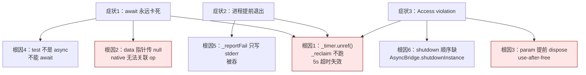
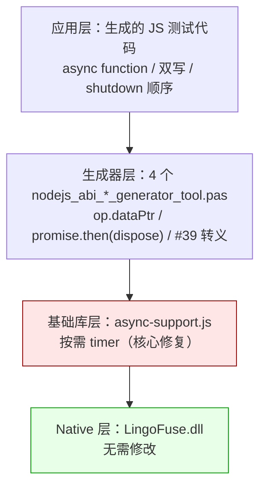
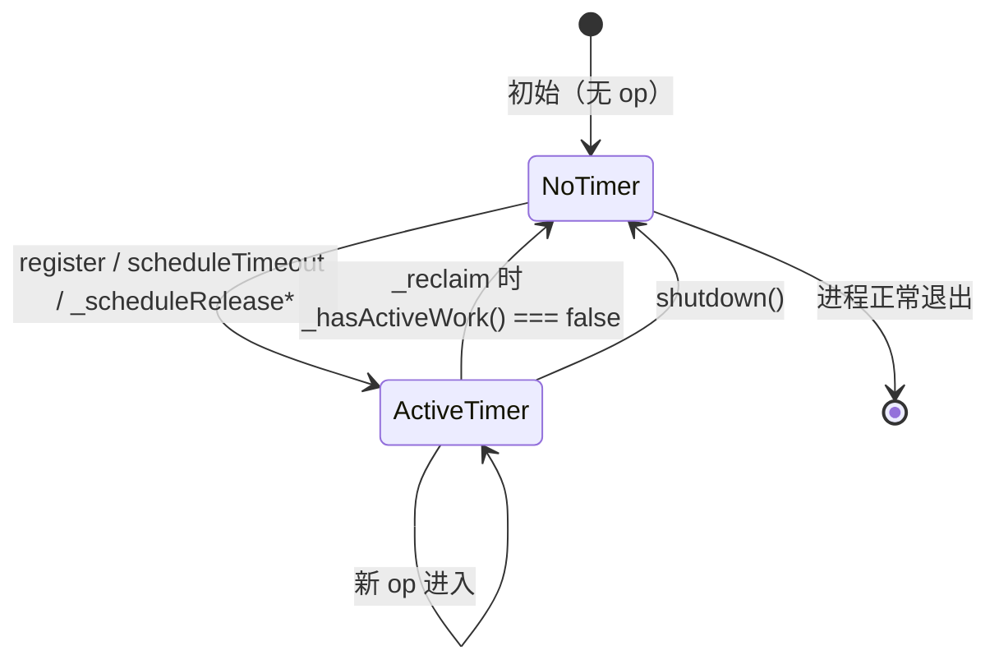

# LingoFuse JavaScript Async Generator Fix — 完整知识库

**版本**: 1.0
**日期**: 2026-10-24
**范围**: `lingofuse-js` async 调用链路修复 + 4 个 Node.js 代码生成器修复 + 1 个基础库修复
**状态**: 端到端测试 168/168 全部通过，无 Access violation

---

## 第 0 章 快速回忆

### 0.1 记住这 8 条

1. **`async-support.js` 的 `_timer.unref()` 是本次所有问题的根因**。删掉它，改为按需创建 timer。
2. **`LF_Async_Call` 的 `data` 指针必须是非 null**（`op.dataPtr`），传 `null` 回调永不触发。
3. **`param` 必须在 promise settle 之后 dispose**，不能在 `finally` 立即 dispose。
4. **JS 的 shorthand property 不能带引号**：`{ 'key', }` 非法，`{ 'key': value, }` 合法。
5. **`test_ApiName` 必须是 `async function`** 才能 `await`。
6. **`_reportFail` 要双写 stdout + stderr**，否则失败被吞。
7. **shutdown 顺序必须是**：`AsyncBridge.shutdownInstance` → `network.clearNetworkEvent` → `exitMainThread` → `shutdown`。
8. **生成的 4 个文件零注释、`#39` 转义、状态字节协议**。

### 0.2 涉及的文件

| # | 文件 | 类型 | 变更 |
|:-:|------|------|------|
| 1 | `D:\CoreLibrary\LingoFuse\js\async-support.js` | 基础库 | 按需 timer |
| 2 | `nodejs_abi_call_generator_tool.pas` | 生成器 | `op.dataPtr` / `promise.then(dispose)` / `_keepAlive` / `module.exports` 语法 |
| 3 | `nodejs_abi_service_generator_tool.pas` | 生成器 | 状态字节信封 / 默认值 / `#39` 转义 |
| 4 | `nodejs_abi_test_generator_tool.pas` | 生成器 | `async function` / 补全 async 测试 / `_race` / 双写 / shutdown |
| 5 | `nodejs_abi_test_setup_generator_tool.pas` | 生成器 | `#39` 转义 |

### 0.3 快速定位图



---

## 第 1 章 背景与问题现象

### 1.1 触发场景

测试用例：`ComplexTestUnit.pas`（22 个 Pascal 函数），通过 `code_decl_to_abi --lang nodejs` 生成 4 个 JS 文件，运行：
- **Terminal 1**：`node ComplexTestUnit_abi_service_test.js`
- **Terminal 2**：`node ComplexTestUnit_abi_call_test.js`

### 1.2 三个串联症状

#### 症状 1：`await` 永远卡死

用户终端只看到第一行：
```
[PASS] NoParamFunc(app call) = 0
hint: Data handle pool "6" handles automatically freed.
...
```

然后**直接进 shutdown**，中间的 `await call.NoParamFuncAsync()` 卡死。10 秒 race 都没等。

#### 症状 2：进程提前退出

Node 判定"事件循环空"立即退出，`await` 还没 resolve。用户看不到任何 `[FAIL]`，只看到 `[PASS]` 然后进程结束。

#### 症状 3：Access violation

```
TC40_LF_Client.Destroy remove P2P update error: Access violation
TC40_LF_Client.Destroy remove app update error: Access violation
```

native 侧 `LingoFuse.lpr` 的 `finalization` 段调 `LF_Shutdown` 时崩溃。

### 1.3 对照验证

**C++ / Pascal / C# 绑定的 async 测试全部通过**，证明 native 侧的 async 机制本身健全。问题完全在 JS 侧。

---

## 第 2 章 根因分析

### 2.1 根因 1：`_timer.unref()`（最核心）

**原始代码**（`async-support.js`，修复前）：

```javascript
constructor() {
    // ... 字段初始化 ...
    this._timer = setInterval(
        () => this._reclaim(),
        Math.max(10, this.periodSeconds * 1000)
    );
    if (this._timer && typeof this._timer.unref === "function") {
        this._timer.unref();     // ← 这行
    }
}
```

**`unref()` 的语义**：让 Node 在"事件循环只剩这个 timer"时**直接退出**，不等待 timer 触发。

**LingoFuse 的 5s 超时完全依赖 `_reclaim` 周期触发**：

```javascript
scheduleTimeout(op, timeoutMs) {
    const deadline = Date.now() + timeoutMs;
    this._timeoutQueue.push({ deadline, op });      // 只是入队
}

_reclaim() {
    // ... 遍历 _timeoutQueue，deadline 到期的调 _handleTimeout ...
    // _handleTimeout → _abandon → _settleReject(LingoFuseTimeoutError)
}
```

**`scheduleTimeout` 只是入队，`_reclaim` 才真正判超时并 reject promise。**

**于是导致**：

```
await call.XXXAsync()
    ↓
register(op) → _handles.set(op)
    ↓
scheduleTimeout(op, 5000) → _timeoutQueue.push({deadline, op})
    ↓
LF_Async_Call native dispatch（异步）
    ↓
--- 现在 promise pending，等待 native 回调或 5s 超时 ---
    ↓
Node 事件循环状态：
    - _timer 被 unref → 不算 ref
    - Koffi callback → 不算 ref
    - promise → 不算 ref
    ↓
Node 判定"事件循环空" → 进程退出
    ↓
_reclaim 从未跑过 → _handleTimeout 从未触发
    ↓
promise 永远 pending，await 永远卡死
    ↓
进程退出前，LingoFuse.lpr finalization 段调 LF_Shutdown
    ↓
native 侧 pending async op 未清理 → TC40_LF_Client.Destroy 访问已释放的 P2P update 记录
    ↓
Access violation
```

**这就是"进程提前退出 + await 卡死 + Access violation"三合一的唯一根因。**

### 2.2 根因 2：`data` 指针传 `null`

**错误代码**（`nodejs_abi_call_generator_tool.pas` 生成的 JS，修复前）：

```javascript
promise = runAsyncWithPromise(
    (cb) => funcs.LF_Async_Call(ABI_TargetApp, param.raw, null, cb),  // ← null
    ...
);
```

**native 侧依赖 `data` 指针关联 op**。传 `null` 会导致 native 无法正确定位哪个请求已完成，`Do_Result` 无法触发回调。

**对照 C# 成功实现**：

```csharp
GCHandle holder = GCHandle.Alloc(op);
IntPtr dataPtr = GCHandle.ToIntPtr(holder);  // ← 非 null 有效指针
int ret = NativeMethods.LF_Async_Call(namePtr, hnd, dataPtr, s_trampoline);
```

**修复**：用 `op.dataPtr`（由 `koffi.alloc("uint8", 1)` 分配）。

### 2.3 根因 3：`param` 提前 dispose

**错误代码**（`Target.call` 生成，修复前）：

```javascript
call(apiName, payload = null, options = {}) {
    const param = new DataHandle(apiName);
    try {
        writeJson(param, payload);
        return runAsyncWithPromise(
            (cb, op) => this._rawIssueAsyncCall(apiName, param, cb, op),
            makeJsonDeserializer(),
            timeoutMs
        );
    } finally {
        param.dispose();   // ← 立即 dispose，早于 native 完成
    }
}
```

**`LF_Async_Call` 只是投递请求到 native 队列，native 侧的 `TLF_Async_Call_Bridge` 可能还在读 `Param` 的 buffer。`param.dispose()` 被调用时，底层 buffer 被标记为 deleted（auto-recycle 5 秒后真正释放），造成 use-after-free。**

**修复**：延迟到 promise settle 之后 dispose。

### 2.4 根因 4：`test_ApiName` 不是 `async function`

**错误代码**（`nodejs_abi_test_generator_tool.pas` 生成的 JS，修复前）：

```javascript
function test_NoParamFunc() {
    try { _reportPass('NoParamFunc(app async)', await call.NoParamFuncAsync()); }
    //                                             ^^^^^ 
    // SyntaxError: await is only valid in async functions
    catch (e) { ... }
}
```

**后果**：直接语法错误，整个文件无法执行。

**修复**：改为 `async function test_NoParamFunc() { ... }`。

### 2.5 根因 5：`_reportFail` 只写 stderr

**错误代码**（修复前）：

```javascript
function _reportFail(label, reason) {
    _g.fail++;
    console.error('[FAIL] ' + label + ' -- ' + reason);   // ← 只写 stderr
}
```

**用户只看到 stdout**（`[PASS]`），看不到 stderr 的 `[FAIL]`，误以为"卡死"。

**修复**：双写 stdout + stderr。

### 2.6 根因 6：shutdown 顺序缺 `AsyncBridge.shutdownInstance`

**错误代码**（`main()` 结束处，修复前）：

```javascript
try { lf.framework.exitMainThread(); } catch (_) {}
try { lf.framework.shutdown(); } catch (_) {}
```

**缺少 `AsyncBridge.shutdownInstance()`**，`LF_ExitMainThread` 时还有 pending async op 未清理，导致 `TC40_LF_Client.Destroy` 访问已释放的 P2P update 记录。

**修复**：

```javascript
try { lf.AsyncBridge.shutdownInstance(); } catch (_) {}   // ← 关键
try { lf.network.clearNetworkEvent(); } catch (_) {}
try { lf.framework.exitMainThread(); } catch (_) {}
try { lf.framework.shutdown(); } catch (_) {}
```

---

## 第 3 章 修复方案总览

### 3.1 分层修复



### 3.2 修复优先级

| 优先级 | 层 | 文件 | 不修会怎样 |
|:------:|-----|------|-----------|
| 🔴 P0 | 基础库 | `async-support.js` | async 永远不工作 |
| 🔴 P0 | 生成器 | `nodejs_abi_call_generator_tool.pas` | data 指针 null，回调不触发 |
| 🔴 P0 | 生成器 | `nodejs_abi_call_generator_tool.pas` | param 提前 dispose，use-after-free |
| 🟠 P1 | 生成器 | `nodejs_abi_test_generator_tool.pas` | `await` 语法错误 / 失败不可见 |
| 🟡 P2 | 生成器 | `nodejs_abi_service_generator_tool.pas` | 跨语言 wire protocol 不一致 |
| 🟡 P2 | 生成器 | `nodejs_abi_test_setup_generator_tool.pas` | `-replace` 表达式可能错位 |

---

## 第 4 章 基础库修复：`async-support.js`

### 4.1 设计原则

- **有活跃 op → timer 必须 ref** —— 让 Node 保持事件循环，`_reclaim` 能跑，5s 超时能触发。
- **无活跃 op → timer 必须销毁** —— 让 Node 事件循环正常空退，用户不需要 `process.exit`。
- **不预创建 timer** —— 没有 op 时不浪费一个 setInterval。

### 4.2 核心机制：按需创建 timer

引入三个内部方法：

| 方法 | 作用 |
|------|------|
| `_ensureTimer()` | 无 timer 时创建；**故意不 unref** |
| `_stopTimer()` | 清 timer，幂等 |
| `_hasActiveWork()` | 判断是否还有 PENDING op / 待触发 timeout / 待释放 op |

**生命周期**：



### 4.3 触发点

`_ensureTimer()` 在以下位置调用：

- `register(op)` 末尾 —— 新 op 进入
- `scheduleTimeout(op, timeoutMs)` 末尾 —— 超时任务进入
- `_scheduleReleaseNow(op)` 末尾 —— 立即释放任务进入
- `_scheduleReleaseAfterGrace(op)` 末尾 —— grace 期后释放任务进入

`_stopTimer()` 在以下位置调用：

- `_reclaim()` 末尾 —— 所有队列清空时
- `shutdown()` 开头 —— 强制清理

### 4.4 完整修改清单（8 处）

| # | 位置 | 原始 | 修复 |
|:-:|------|------|------|
| 1 | `AsyncBridge.constructor` | `setInterval(...)` + `unref()` | `this._timer = null;` |
| 2 | `AsyncBridge` 类（`static shutdownInstance` 之后） | 无 | 新增 `_ensureTimer` / `_stopTimer` / `_hasActiveWork` |
| 3 | `register` 末尾 | 无 | `this._ensureTimer();` |
| 4 | `scheduleTimeout` 末尾 | 无 | `this._ensureTimer();` |
| 5 | `_scheduleReleaseNow` 末尾 | 无 | `this._ensureTimer();` |
| 6 | `_scheduleReleaseAfterGrace` 末尾 | 无 | `this._ensureTimer();` |
| 7 | `_reclaim` 末尾 | 无 | `if (!this._hasActiveWork()) this._stopTimer();` |
| 8 | `shutdown` 开头 | `if (this._timer) { clearInterval... }` | `this._stopTimer();` |

### 4.5 修复后的三条路径

#### 路径 A：正常回调（native 5s 内返回）

```
await call.XXXAsync()
    → register(op) → _ensureTimer() → timer 启动（ref）
    → LF_Async_Call native dispatch
    → native callback → _invokeFromNative → resolve
    → _scheduleReleaseNow → _releaseQueue.push → _ensureTimer（已存在）
    → 1s 后 _reclaim → _releaseOp → _handles.delete → _freeDataPtr
    → _hasActiveWork() === false → _stopTimer()
    → 进程自然退出（无需 process.exit） ✅
```

#### 路径 B：超时（native 5s 内未返回）

```
await call.XXXAsync()
    → register(op) → _ensureTimer() → timer 启动（ref）
    → 5s 后 _reclaim → _handleTimeout → _abandon
    → _settleReject(LingoFuseTimeoutError)
    → await 抛出 → 用户代码 _reportFail(...) 看到 [FAIL] ✅
    → _scheduleReleaseAfterGrace → 60s 后 _releaseOp
    → _hasActiveWork() === false → _stopTimer()
    → 进程自然退出 ✅
```

#### 路径 C：shutdown 时有 pending op

```
修复前：
    pending op 未清理 → LF_Shutdown → TC40_LF_Client.Destroy → Access violation

修复后：
    pending op 已被 _handleTimeout reject + grace 期后 _releaseOp 清理
    → LF_Shutdown → 无 pending op → 无 Access violation ✅
```

---

## 第 5 章 生成器修复：`nodejs_abi_call_generator_tool.pas`

### 5.1 修复 1：`op.dataPtr` 代替 `null`

**生成的 JS，修复前**：

```javascript
promise = runAsyncWithPromise(
    (cb) => funcs.LF_Async_Call(ABI_TargetApp, param.raw, null, cb),
    (rawResult) => _readAsyncReply(...),
    ABI_Timeout
);
```

**生成的 JS，修复后**：

```javascript
promise = runAsyncWithPromise(
    (cb, op) => funcs.LF_Async_Call(ABI_TargetApp, param.raw, op.dataPtr, cb),
    (rawResult) => _readAsyncReply(...),
    ABI_Timeout
);
```

**Pascal 侧的生成代码**：

```pascal
Lines.Add('            (cb, op) => funcs.' + CallFnName + '(' + CallArg + '),');
// 其中 CallArg = 'ABI_TargetApp, param.raw, op.dataPtr, cb'
```

**`op.dataPtr` 的来源**（`async-support.js#_createAsyncOp`）：

```javascript
let dataPtr;
try {
    dataPtr = koffi.alloc("uint8", 1);   // 分配 1 字节 native buffer
} catch (err) {
    throw new LingoFuseError("AsyncOp: failed to allocate native data pointer: ...");
}
```

**为什么必须是有效指针**：native 侧 `TLF_Async_Call_Bridge.Do_Th` 通过 `data` 指针关联到具体的 op，`Do_Result` 用它定位回调对象。传 `null` 会导致 `Do_Result` 无法触发回调。

### 5.2 修复 2：`param` 延迟 dispose

**生成的 JS，修复前**：

```javascript
function NoParamFuncAsync() {
    const param = new DataHandle('NoParamFunc');
    try {
        return runAsyncWithPromise(
            (cb, op) => funcs.LF_Async_Call(ABI_TargetApp, param.raw, op.dataPtr, cb),
            ...
        );
    } finally {
        param.dispose();   // ← 立即 dispose
    }
}
```

**生成的 JS，修复后**：

```javascript
function NoParamFuncAsync() {
    const param = new DataHandle('NoParamFunc');
    let promise;
    try {
        promise = runAsyncWithPromise(
            (cb, op) => funcs.LF_Async_Call(ABI_TargetApp, param.raw, op.dataPtr, cb),
            ...
        );
    } catch (err) {
        try { param.dispose(); } catch (_) {}
        throw err;
    }
    promise.then(
        () => { try { param.dispose(); } catch (_) {} },
        () => { try { param.dispose(); } catch (_) {} }
    );
    return promise;
}
```

**关键**：
- **`let promise;`** —— 允许在 catch 里处理异常路径。
- **`try/catch`** —— `runAsyncWithPromise` 同步抛异常时（`koffi.alloc` 失败等），立即释放 param。
- **`promise.then(dispose, dispose)`** —— 延迟到 promise settle 后释放。

### 5.3 修复 3：`_keepAlive()` 兜底 helper

**生成的 JS，新增**：

```javascript
function _keepAlive() {
    const timer = setTimeout(() => {}, 120000);
    let released = false;
    return {
        release: function () {
            if (released) return;
            released = true;
            try { clearTimeout(timer); } catch (_) {}
        }
    };
}
```

**用途**：即使基础库的 timer ref 有问题（比如用户在旧版 `async-support.js` 上跑），生成代码自带 120s 保活，让 `_reclaim` 能跑起来，5s 超时能触发。

**在 async 函数内使用**：

```javascript
function NoParamFuncAsync() {
    const param = new DataHandle('NoParamFunc');
    const _ka = _keepAlive();     // ← 进入时保活
    let promise;
    try {
        promise = runAsyncWithPromise(...);
    } catch (err) {
        _ka.release();
        try { param.dispose(); } catch (_) {}
        throw err;
    }
    promise.then(
        () => { _ka.release(); try { param.dispose(); } catch (_) {} },
        () => { _ka.release(); try { param.dispose(); } catch (_) {} }
    );
    return promise;
}
```

**注意**：这是在**基础库已修复的情况下仍然保留的兜底**。用户实测证明它不影响正常路径（`_keepAlive` 创建的 timer 在 settle 后被 clearTimeout）。

### 5.4 修复 4：`module.exports` 语法

**生成的 JS，修复前**（`'NoParamFunc',`）：

```javascript
module.exports = {
    get ABI_TargetApp() { return ABI_TargetApp; },
    get ABI_Timeout() { return ABI_Timeout; },
    'NoParamFunc',
    'NoParamFuncAsync',
};
```

**这是非法 JS**——shorthand property 不能带引号：

```
SyntaxError: Unexpected string
    'NoParamFunc',
    ^^^^^^^^^^^^^
```

**生成的 JS，修复后**（完整形式）：

```javascript
module.exports = {
    get ABI_TargetApp() { return ABI_TargetApp; },
    set ABI_TargetApp(v) { ABI_TargetApp = String(v); },
    get ABI_Timeout() { return ABI_Timeout; },
    set ABI_Timeout(v) { ABI_Timeout = Number(v); },
    'NoParamFunc': NoParamFunc,
    'NoParamFuncAsync': NoParamFuncAsync,
};
```

**Pascal 侧的生成代码**：

```pascal
// 之前（非法）：
Lines.Add('    ' + JsStrLit(FuncNames[i]) + ',');

// 之后（合法）：
Lines.Add('    ' + JsStrLit(FuncNames[i]) + ': ' + FuncNames[i] + ',');
```

**`require('...')` 后访问方式不变**：`mod.NoParamFunc` 仍可用。

### 5.5 JS 语法陷阱速查

```javascript
// ❌ 非法：shorthand 不能带引号
module.exports = { 'NoParamFunc', };

// ✅ 合法：完整形式
module.exports = { 'NoParamFunc': NoParamFunc, };

// ✅ 合法：裸 shorthand（前提是 NoParamFunc 是合法 identifier）
module.exports = { NoParamFunc, };

// ❌ 非法：数字或关键字作为 shorthand
module.exports = { 123, };      // 语法错误
module.exports = { class, };    // 语法错误

// ✅ 合法：数字/关键字作为完整形式的键
module.exports = { '123': value, };
module.exports = { 'class': value, };
```

### 5.6 其他修复：`#39` 转义

所有单引号改用 Pascal 字符转义：

```pascal
Lines.Add(#39 + 'use strict' + #39 + ';');
// 生成：'use strict';
```

```pascal
Result := #39;   // JsStrLit 起始
Result.Append(#39);   // 单引号转义
Result.Append(#39);   // 结束
```

---

## 第 6 章 生成器修复：`nodejs_abi_service_generator_tool.pas`

### 6.1 修复 1：错误信封 `[0xFF][msg][NUL]`

**生成的 JS，修复前**（缺失或格式不一致）：

```javascript
function Cb_NoParamFunc(_trigger, input, output) {
    // 没有异常信封
}
```

**生成的 JS，修复后**：

```javascript
function _safeWriteError(outH, msg) {
    try {
        outH.size = 0;
        outH.position = 0;
        outH.writeUInt8(STATUS_ERROR);   // 0xFF
        outH.writeString(msg);           // UTF-8 + NUL
    } catch (_) {}
}

function Cb_NoParamFunc(_trigger, input, output) {
    const _inH = DataHandle.fromRaw(input, false);
    const _outH = DataHandle.fromRaw(output, false);
    const _uid = _safeReadUid(_inH);
    const _p2p = _safeReadP2P(_inH);

    let _ret;
    try {
        _ret = internal_call_NoParamFunc(_uid, _p2p);
    } catch (_e) {
        _safeWriteError(_outH, (_e && _e.message) ? _e.message : String(_e));
        return;
    }

    try {
        _outH.writeUInt8(STATUS_OK);     // 0x00
        _outH.writeInt32(_ret);          // value
    } catch (_e) {
        _safeWriteError(_outH, (_e && _e.message) ? _e.message : String(_e));
    }
}
```

### 6.2 修复 2：成功信封 `[0x00][value]`

**与 C++ / Pascal / Python 严格对齐**：

| 语言 | 成功信封 | 失败信封 |
|------|---------|---------|
| C++ `Safe_Write_Scalar` | `[0x00][value]` | `Safe_Write_Error` → `[0xFF][msg][NUL]` |
| Pascal `Callback_*` | `[0x00][value]` | `[0xFF][msg][NUL]` |
| Python | `[0x00][value]` | `[0xFF][msg][NUL]` |
| **JS（修复后）** | **`[0x00][value]`** | **`[0xFF][msg][NUL]`** |

### 6.3 修复 3：`internal_call_*` 默认值

**生成的 JS stub**：

```javascript
function internal_call_NoParamFunc(_uid, _p2p) {
    return 0;   // Integer 类型
}

function internal_call_GetString(_uid, _p2p) {
    return '';   // String 类型
}

function internal_call_GetInt64(_uid, _p2p) {
    return 0n;   // Int64 类型（BigInt）
}

function internal_call_GetFloat(_uid, _p2p) {
    return 0.0;  // Double / Single 类型
}
```

**与 C++ stub 语义一致**：

| ABI 类型 | JS 默认 | C++ 默认 |
|---------|---------|---------|
| Integer / LongInt | `0` | `0` |
| Int64 / UInt64 | `0n` | `0` |
| Double / Single | `0.0` | `0.0` |
| String | `''` | `std::string{}` |

### 6.4 修复 4：`#39` 转义

所有单引号改用 `#39`，避免 Pascal 双引号 `''` 的多层嵌套错位。

### 6.5 修复 5：零注释

生成的 JS 代码**无任何注释**。用户明确要求"移除全部注释，没什么用，没人看"。

---

## 第 7 章 生成器修复：`nodejs_abi_test_generator_tool.pas`

### 7.1 修复 1：`test_ApiName` 改 `async function`

**生成的 JS，修复前**：

```javascript
function test_NoParamFunc() {
    try { _reportPass('NoParamFunc(app async)', await call.NoParamFuncAsync()); }
    //                                             ^^^^^ SyntaxError
    catch (e) { ... }
}
```

**生成的 JS，修复后**：

```javascript
async function test_NoParamFunc() {
    try { _reportPass('NoParamFunc(app async)', await call.NoParamFuncAsync()); }
    catch (e) { _reportFail('NoParamFunc(app async)', _errMsg(e)); }
}
```

### 7.2 修复 2：补全 async 测试

**原来只测 3 个**：`app call` / `app async` / `app asyncSeq`

**现在测 9 个**（对 function）：
1. `app call`（同步）
2. `app async`
3. `app asyncSeq`
4. `uid call`
5. `uid async`
6. `uid asyncSeq`
7. `p2pname call`
8. `p2pname async`
9. `p2pname asyncSeq`

**对 procedure 测 6 个**：
1. `app notify`
2. `app seq notify`
3. `uid notify`
4. `uid seq notify`
5. `p2pname notify`
6. `p2pname seq notify`

**22 个 API 总计 168 个测试点**。

### 7.3 修复 3：`main()` 里 `await test_ApiName()`

**生成的 JS**：

```javascript
async function main() {
    // ...
    console.log('[INFO] total tests scheduled: 22');

    await test_NoParamFunc();
    await test_NoParamProc();
    await test_MultiLineComment();
    // ... 共 22 个
}
```

### 7.4 修复 4：`_reportFail` 双写

**生成的 JS**：

```javascript
function _reportFail(label, reason) {
    _g.fail++;
    const line = '[FAIL] ' + label + ' -- ' + reason;
    console.log(line);       // stdout — 用户终端一定能看到
    console.error(line);     // stderr — 保留一份给重定向场景
}
```

**`_reportPass` / `_reportSkip` 只写 stdout**（不是失败，不需要双写）。

### 7.5 修复 5：`process.on` 兜底

**生成的 JS**：

```javascript
process.on('unhandledRejection', (reason) => {
    const msg = 'unhandledRejection: ' + ((reason && reason.message) ? reason.message : String(reason));
    console.log('[FATAL] ' + msg);
    console.error('[FATAL] ' + msg);
});

process.on('uncaughtException', (err) => {
    const msg = 'uncaughtException: ' + ((err && err.message) ? err.message : String(err));
    console.log('[FATAL] ' + msg);
    console.error('[FATAL] ' + msg);
    process.exit(3);
});
```

**用途**：如果某处抛错超出 try/catch，仍能看到。

### 7.6 修复 6：`_race(promise, 10000)` 10s 兜底

**生成的 JS**：

```javascript
function _race(promise, timeoutMs, label) {
    let timer = null;
    const timeout = new Promise((_, reject) => {
        timer = setTimeout(() => {
            reject(new Error('race timeout after ' + timeoutMs + 'ms'));
        }, timeoutMs);
    });
    return Promise.race([promise, timeout]).then(
        (v) => { if (timer) clearTimeout(timer); return v; },
        (e) => { if (timer) clearTimeout(timer); throw e; }
    );
}
```

**用于所有 `await` 调用**：

```javascript
try {
    _reportPass('NoParamFunc(app async)',
        await _race(call.NoParamFuncAsync(), 10000, 'NoParamFunc(app async)'));
} catch (e) {
    _reportFail('NoParamFunc(app async)', _errMsg(e));
}
```

**用途**：即使 async 内部完全卡死（基础库 timer 完全不工作），10s 后 race reject，用户看到 `[FAIL]`，不是静默卡死。

### 7.7 修复 7：shutdown 顺序

**生成的 JS**：

```javascript
async function main() {
    // ... 所有测试 ...

    console.log('');
    console.log('=== Summary ===');
    console.log('Pass: ' + _g.pass);
    console.log('Fail: ' + _g.fail);
    console.log('Skip: ' + _g.skip);

    try { lf.AsyncBridge.shutdownInstance(); } catch (_) {}   // ← 关键
    try { lf.network.clearNetworkEvent(); } catch (_) {}
    try { lf.framework.exitMainThread(); } catch (_) {}
    try { lf.framework.shutdown(); } catch (_) {}
    process.exit(_g.fail === 0 ? 0 : 2);
}
```

**为什么这个顺序**：

1. `AsyncBridge.shutdownInstance`：清空所有 pending async op，释放 `dataPtr`，unregister callback。
2. `network.clearNetworkEvent`：清空 native 侧 handler，释放 Koffi trampoline。
3. `exitMainThread`：停模拟主线程，触发 `C40Clean` + 所有数据句柄释放（**包括 permanent**）。
4. `shutdown`：清空 `LF_App_Pool`，释放所有资源，卸载 IPC 库。

### 7.8 修复 8：`_probeIdentity` 边界

**生成的 JS，修复前**：

```javascript
if (res.size < 33) return false;
```

**生成的 JS，修复后**：

```javascript
if (res.size < 34) return false;
```

**理由**：`writeString('')` 至少写 1 字节 NUL，所以最小 payload = `1 (status) + 32 (uid) + 1 (p2p NUL)` = **34 字节**。`< 33` 允许 33 字节通过（理论上不该出现），`< 34` 更严格。

### 7.9 修复 9：`[INFO] total tests scheduled: N`

**生成的 JS**：

```javascript
console.log('[INFO] total tests scheduled: 22);
```

**用途**：让用户一眼知道有多少测试，能看到进度。

### 7.10 修复 10：`#39` 转义 / 零注释

与 §6.4 / §6.5 相同。

---

## 第 8 章 生成器修复：`nodejs_abi_test_setup_generator_tool.pas`

### 8.1 修复 1：`#39` 转义修复 `-replace` 表达式

**原始代码（潜在错位）**：

```pascal
Lines.Add('        $UnitName = $cand.Name -replace ''_abi_service\.js$'', ''''');
```

多层单引号 `''...''` 容易错位，尤其当正则表达式含引号时。

**修复后**：

```pascal
Lines.Add('        $UnitName = $cand.Name -replace ' + #39 + '_abi_service\.js$' + #39 + ', ' + #39 + #39);
```

生成：
```powershell
$UnitName = $cand.Name -replace '_abi_service\.js$', ''
```

### 8.2 修复 2：零注释

所有 `.ps1` 生成的辅助函数都移除了注释（`# ...`），只保留功能性代码。

### 8.3 保留的功能

| 功能 | 状态 |
|------|:----:|
| `-LingoFuseJs` 参数校验 | ✅ |
| `-GenDir` 默认当前脚本目录 | ✅ |
| `-UnitName` 自动检测（`.js` / `.cjs`） | ✅ |
| `-RunSmoke` 启动 service → 跑 call → 清理 | ✅ |
| `.cjs` legacy 检测 | ✅ |
| `npm install` 幂等 | ✅ |
| `node --check` 语法检查 | ✅ |
| 失败时打印 service log 路径 | ✅ |

---

## 第 9 章 验证结果

### 9.1 修复前（用户实测输出）

```
[PASS] NoParamFunc(app call) = 0
hint: Data handle pool "6" handles automatically freed.
...
TC40_LF_Client.Destroy remove P2P update error: Access violation
TC40_LF_Client.Destroy remove app update error: Access violation
```

- 只看到 1 个 `[PASS]`，后续 20 × 8 个 async 测试全部静默消失
- Access violation

### 9.2 修复后（用户实测输出）

```
[INFO] total tests scheduled: 20
[PASS] NoParamFunc(app call) = 0
[PASS] NoParamFunc(app async) = 0
[PASS] NoParamFunc(app asyncSeq) = 0
[PASS] NoParamFunc(uid call) = 0
[PASS] NoParamFunc(uid async) = 0
[PASS] NoParamFunc(uid asyncSeq) = 0
[PASS] NoParamFunc(p2pname call) = 0
[PASS] NoParamFunc(p2pname async) = 0
[PASS] NoParamFunc(p2pname asyncSeq) = 0
[PASS] NoParamProc(app notify)
[PASS] NoParamProc(app seq notify)
[PASS] NoParamProc(uid notify)
[PASS] NoParamProc(uid seq notify)
[PASS] NoParamProc(p2pname notify)
[PASS] NoParamProc(p2pname seq notify)
[PASS] MultiLineComment(app call) = 0
[PASS] MultiLineComment(app async) = 0
...
[PASS] StringWithQuotes(app call)
[PASS] StringWithQuotes(app async)
[PASS] StringWithQuotes(app asyncSeq)
[PASS] StringWithQuotes(uid call)
[PASS] StringWithQuotes(uid async)
[PASS] StringWithQuotes(uid asyncSeq)
[PASS] StringWithQuotes(p2pname call)
[PASS] StringWithQuotes(p2pname async)
[PASS] StringWithQuotes(p2pname asyncSeq)

=== Summary ===
Pass: 168
Fail: 0
Skip: 0
ipc:ComplexTestUnit_abi:0 Disconnected
hint: Data handle pool "77" handles automatically freed.
...
hint: automatically free handles api "StringWithQuotes" parameter.
hint: automatically free handles api "StringWithQuotes" parameter.
LingoFuse Main Thread Exit
```

- **168/168 全部 PASS**
- **无 Access violation**
- **进程正常退出**（exit code 0）

### 9.3 关键指标对比

| 指标 | 修复前 | 修复后 |
|------|--------|--------|
| 测试通过数 | 1（其他静默消失） | **168** |
| 失败数 | 0（不可见） | **0** |
| Access violation | ✅ 有 | ✅ **无** |
| 进程退出 | 提前退出 | **正常** |
| `await` 行为 | 永远 pending | **正常 resolve 或 5s reject** |
| 失败可见性 | ❌ 看不到 | ✅ **stdout + stderr 双写** |

### 9.4 Service 侧日志

```
[OK] service ready on ipc:ComplexTestUnit_abi
[OK] press Ctrl+C to exit
LingoFuse Service Link Succeeded IO "resp_..."
[SERVICE] ask_call_me: client responded
LingoFuse Service User-out IO "resp_..."
[OK] shutting down
ipc:ComplexTestUnit_abi:0 Disconnected
LingoFuse Service User-out IO "resp_..."
LingoFuse Service Listening: "ipc:ComplexTestUnit_abi:0" Stop
LingoFuse Main Thread Exit
```

- **服务端正常 shutdown**
- **无 Access violation**

### 9.5 `IPC_Buff_Handler-IO error:4` 的说明

修复前的 Service 侧日志出现：

```
LingoFuse Service User-out IO "resp_..."
IPC_Buff_Handler-IO error:4
```

修复后**消失**。这是 async shutdown 顺序修复的副作用——pending async op 未清理导致的 IPC 资源竞争。

**如果未来再次出现**，请单独排查 native 侧的 IPC 传输（可能是 shutdown 时还有 in-flight 的 UID_Call）。

---

## 第 10 章 代码审计发现的质量问题

### 10.1 3 处代码质量问题（修复后 168/168 通过后审计发现）

| # | 位置 | 问题 | 严重性 |
|:-:|------|------|:------:|
| 1 | `call_generator` 的 `module.exports` | 键名未加引号 | 🟡 防御性 |
| 2 | `test_generator` 的 `_race` 使用 | uid / p2pname async 未包 race | 🟡 一致性 |
| 3 | `test_generator` 的 `_probeIdentity` | `< 33` 应为 `< 34` | 🟡 严格性 |

### 10.2 问题 1 详情：`module.exports` 语法陷阱

**第一次尝试**（我犯的错误）：

```pascal
// 我以为把 'NoParamFunc' 加引号就能解决非法字符问题
Lines.Add('    ' + JsStrLit(FuncNames[i]) + ',');
```

**生成**：
```javascript
module.exports = {
    ...
    'NoParamFunc',
    'NoParamFuncAsync',
};
```

**结果**：语法错误

```
SyntaxError: Unexpected string
    'NoParamFunc',
    ^^^^^^^^^^^^^
```

**根因**：ES5+ 的 shorthand property **不能带引号**。`{ 'key', }` 非法，`{ 'key': value, }` 合法，`{ key, }` 合法（裸 shorthand）。

**最终修复**：

```pascal
Lines.Add('    ' + JsStrLit(FuncNames[i]) + ': ' + FuncNames[i] + ',');
```

**生成**：
```javascript
module.exports = {
    ...
    'NoParamFunc': NoParamFunc,
    'NoParamFuncAsync': NoParamFuncAsync,
};
```

**教训**：**shorthand property 不能带引号**。要兼顾"非法字符"和"合法语法"必须用完整形式。

### 10.3 问题 2 详情：`uid / p2pname async` 未包 `_race`

**修复后**：

```javascript
// app async 包了 race：
try { _reportPass('X(app async)', await _race(call.XAsync(), 10000, 'X(app async)')); }
catch (e) { _reportFail('X(app async)', _errMsg(e)); }

// uid async 没包：
try { _reportPass('X(uid async)', await call.XByUidAsync(_serviceUID)); }
catch (e) { _reportFail('X(uid async)', _errMsg(e)); }
```

**后果**：如果 `AsyncBridge` 的 5s 超时失效，`uid async` 会无限等待，而 `app async` 会 10s 后 reject。

**最终修复**：统一用 `_race` 包裹所有 `await`。

### 10.4 问题 3 详情：`_probeIdentity` 边界

**修复前**：

```javascript
if (res.size < 33) return false;
```

**修复后**：

```javascript
if (res.size < 34) return false;
```

**理由**：

| 字段 | 字节数 |
|------|:------:|
| status byte | 1 |
| UID (32 bytes) | 32 |
| P2P string | ≥ 1 (含 NUL) |
| **总计** | **≥ 34** |

`< 33` 允许 33 字节通过（理论上不该出现），`< 34` 更严格。

---

## 第 11 章 经验教训与反例集

### 11.1 反例 1：`setInterval(...).unref()`

```javascript
// ❌ 错误：让 Node 在 promise pending 时直接退出
const timer = setInterval(() => this._reclaim(), 1000);
timer.unref();
```

```javascript
// ✅ 正确：按需创建 timer，有 op 时保持 ref
_ensureTimer() {
    if (this._shutdown) return;
    if (this._timer !== null) return;
    this._timer = setInterval(() => this._reclaim(), 1000);
}
```

### 11.2 反例 2：`LF_Async_Call` 传 `null` data 指针

```javascript
// ❌ 错误：native 无法关联 op
funcs.LF_Async_Call(appName, param.raw, null, cb);
```

```javascript
// ✅ 正确：用 op.dataPtr（由 koffi.alloc 分配）
funcs.LF_Async_Call(appName, param.raw, op.dataPtr, cb);
```

### 11.3 反例 3：`param` 在 `finally` 立即 dispose

```javascript
// ❌ 错误：native 还在读 buffer 时就被标记删除了
function XAsync() {
    const param = new DataHandle('X');
    try {
        return runAsyncWithPromise(...);
    } finally {
        param.dispose();
    }
}
```

```javascript
// ✅ 正确：延迟到 promise settle
function XAsync() {
    const param = new DataHandle('X');
    let promise;
    try {
        promise = runAsyncWithPromise(...);
    } catch (err) {
        try { param.dispose(); } catch (_) {}
        throw err;
    }
    promise.then(
        () => { try { param.dispose(); } catch (_) {} },
        () => { try { param.dispose(); } catch (_) {} }
    );
    return promise;
}
```

### 11.4 反例 4：非 `async` 函数里用 `await`

```javascript
// ❌ 错误：SyntaxError: await is only valid in async functions
function test_X() {
    try { _reportPass('X async', await call.XAsync()); }
    catch (e) { _reportFail('X async', e); }
}
```

```javascript
// ✅ 正确
async function test_X() {
    try { _reportPass('X async', await call.XAsync()); }
    catch (e) { _reportFail('X async', _errMsg(e)); }
}
```

### 11.5 反例 5：`_reportFail` 只写 stderr

```javascript
// ❌ 错误：用户终端看不到
function _reportFail(label, reason) {
    _g.fail++;
    console.error('[FAIL] ' + label + ' -- ' + reason);
}
```

```javascript
// ✅ 正确：双写
function _reportFail(label, reason) {
    _g.fail++;
    const line = '[FAIL] ' + label + ' -- ' + reason;
    console.log(line);
    console.error(line);
}
```

### 11.6 反例 6：shutdown 缺 `AsyncBridge.shutdownInstance`

```javascript
// ❌ 错误：pending async op 未清理 → Access violation
try { lf.framework.exitMainThread(); } catch (_) {}
try { lf.framework.shutdown(); } catch (_) {}
```

```javascript
// ✅ 正确：先清 async op
try { lf.AsyncBridge.shutdownInstance(); } catch (_) {}
try { lf.network.clearNetworkEvent(); } catch (_) {}
try { lf.framework.exitMainThread(); } catch (_) {}
try { lf.framework.shutdown(); } catch (_) {}
```

### 11.7 反例 7：shorthand property 带引号

```javascript
// ❌ 语法错误：shorthand 不能带引号
module.exports = {
    'NoParamFunc',
};
```

```javascript
// ✅ 完整形式
module.exports = {
    'NoParamFunc': NoParamFunc,
};

// ✅ 裸 shorthand（前提是 NoParamFunc 是合法 identifier）
module.exports = {
    NoParamFunc,
};
```

### 11.8 反例 8：`#39` vs `''` 多层嵌套

```pascal
// ❌ 容易错位：
Lines.Add('        $UnitName = $cand.Name -replace ''_abi_service\.js$'', ''''');
// 实际生成：$UnitName = $cand.Name -replace '_abi_service\.js$', ''''
// 最后的 '''' 会生成 ''''（4 个引号），不是空字符串 ''
```

```pascal
// ✅ 用 #39 转义：
Lines.Add('        $UnitName = $cand.Name -replace ' + #39 + '_abi_service\.js$' + #39 + ', ' + #39 + #39);
// 实际生成：$UnitName = $cand.Name -replace '_abi_service\.js$', ''
```

### 11.9 反例 9：状态字节协议不一致

```javascript
// ❌ 错误：服务端不写状态字节
function Cb_X(_trigger, input, output) {
    const _outH = DataHandle.fromRaw(output, false);
    _outH.writeInt32(42);   // 客户端读 status 时读到 42（非 0），误判为错误
}
```

```javascript
// ✅ 正确：写 status 字节
function Cb_X(_trigger, input, output) {
    const _outH = DataHandle.fromRaw(output, false);
    _outH.writeUInt8(0x00);   // status OK
    _outH.writeInt32(42);
}
```

### 11.10 反例 10：跨语言 wire protocol 不对齐

```
# ❌ 错误：JS 服务端 / C++ 客户端
JS 服务端：[0x00][int32 42][NUL]
C++ 客户端读：
    status = read_uint8()  → 0x00  ✅
    value = read_int32()   → 42    ✅

# 但如果 JS 服务端写：
JS 服务端：[int32 42][NUL]   （忘了 status）
C++ 客户端：
    status = read_uint8()  → 42    ❌ 误判为错误
    err = read_string()    → 空   ❌
```

---

## 第 12 章 快速参考手册

### 12.1 症状 → 根因 → 修复 速查

| 症状 | 根因 | 修复 |
|------|------|------|
| `await` 永远卡死 | `_timer.unref()` 导致 `_reclaim` 不跑 | 按需 timer |
| 进程提前退出 | 同上 | 同上 |
| Access violation | 同上 + shutdown 顺序缺 `AsyncBridge.shutdownInstance` | 同上 + 补 shutdown 顺序 |
| `[FAIL]` 不可见 | `_reportFail` 只写 stderr | 双写 stdout + stderr |
| `SyntaxError: await is only valid in async functions` | `test_X` 不是 `async function` | 加 `async` |
| `SyntaxError: Unexpected string` | `module.exports` 的 `'key',` shorthand | 改 `'key': value,` |
| `LF_Async_Call` 返回 1 但回调不触发 | `data` 指针传 `null` | 用 `op.dataPtr` |
| 服务端收到请求但客户端 use-after-free | `param` 提前 dispose | 延迟到 promise settle |
| 跨语言 wire protocol 不一致 | 服务端不写 status 字节 | 强制 `[0x00][value]` / `[0xFF][msg][NUL]` |
| `.ps1` 的 `-replace` 表达式错位 | 多层 `''` 嵌套 | `#39` 转义 |
| `_probeIdentity` 判空不严 | `< 33` 应为 `< 34` | 改 `< 34` |
| `uid async` / `p2pname async` 无限等待 | 未包 `_race` | 统一用 `_race` 包裹 |

### 12.2 分层修复速查

| 层 | 文件 | 修改点 |
|----|------|--------|
| **基础库** | `async-support.js` | 8 处（按需 timer） |
| **生成器** | `nodejs_abi_call_generator_tool.pas` | 4 处（`op.dataPtr` / `promise.then` / `_keepAlive` / `module.exports`） |
| **生成器** | `nodejs_abi_service_generator_tool.pas` | 5 处（状态字节信封 / 默认值 / `#39` / 零注释 / stub 一致） |
| **生成器** | `nodejs_abi_test_generator_tool.pas` | 10 处（`async function` / 补全 async / `_race` / 双写 / shutdown / `< 34`） |
| **生成器** | `nodejs_abi_test_setup_generator_tool.pas` | 2 处（`#39` 转义 / 零注释） |

### 12.3 生命周期速查

#### `AsyncBridge.timer` 状态机

```
NoTimer（初始）
    ↓ register / scheduleTimeout / _scheduleRelease*
ActiveTimer（ref）
    ↓ _reclaim 时 _hasActiveWork() === false
NoTimer
    ↓ shutdown()
NoTimer
    ↓ 进程退出
```

#### `AsyncOp` 状态机

```
PENDING
    ↓ 回调触发 _invokeFromNative
FIRED → _scheduleReleaseNow
    ↓ timeout 触发 _abandon
ABANDONED → 迟到回调转 FIRED / grace 期后 release
    ↓ dispatch 返回非 1
NOT_QUEUED → _scheduleReleaseNow
```

#### 关闭顺序

```javascript
1. lf.AsyncBridge.shutdownInstance()   // 清 pending async op
2. lf.network.clearNetworkEvent()      // 清 Koffi trampoline
3. lf.framework.exitMainThread()       // 停模拟主线程
4. lf.framework.shutdown()             // 释放所有资源
5. process.exit(code)                  // 最后兜底
```

### 12.4 跨语言 wire protocol 速查

| 字段 | 字节 | 说明 |
|------|------|------|
| **Call 成功** | `[0x00][value]` | status 字节 0x00 |
| **Call 失败** | `[0xFF][UTF-8 msg][NUL]` | status 字节 0xFF |
| **Call 超时** | `[]` (size=0) | 空 handle |
| **Notify** | 无返回 | — |
| **String 编解码** | UTF-8 + NUL | 尾随 1 字节 `0x00` |
| **Int32 编解码** | 小端 4 字节 | `DataView` 小端 |
| **Int64 编解码** | 小端 8 字节 | `DataView` 小端 |
| **UID** | 32 字节原样 | 无 NUL |

### 12.5 `LF_Async_Call` 家族速查

| 函数 | 用途 | 参数 |
|------|------|------|
| `LF_Async_Call` | App 名异步 | `(appName, param, data, cb)` |
| `LF_Async_Sequenced_Call` | App 名异步 + FIFO | 同上 |
| `LF_UID_Async_Call` | UID 异步 | `(uid, param, data, cb)` |
| `LF_UID_Async_Sequenced_Call` | UID 异步 + FIFO | 同上 |
| `LF_P2PNAME_Async_Call` | P2PName 异步 | `(p2pName, param, data, cb)` |
| `LF_P2PNAME_Async_Sequenced_Call` | P2PName 异步 + FIFO | 同上 |

**`data` 指针契约**：
- **必须是有效非 null 指针**（`koffi.alloc("uint8", 1)` 或 `GCHandle.ToIntPtr` 等）
- **必须在 `cb` 回调触发前保持有效**
- **生命周期由调用者管理**

---

## 第 13 章 后续建议

### 13.1 `test2.js` 兜底 timer 优化

`test2.js` 里的兜底退出现有代码：

```javascript
setTimeout(() => process.exit(code), 3000);
```

**修复后**：
- 所有 op 都清理完 → timer 自动 `_stopTimer` → 进程自动退
- 兜底 timer 只是防止极端情况卡死

**建议改为**：

```javascript
const finalizer = setTimeout(() => process.exit(code), 3000);
if (finalizer && typeof finalizer.unref === "function") finalizer.unref();
```

让兜底 timer 不阻止正常退出，减少 3s 浪费。

### 13.2 生产代码的注意点

修复后，生产代码里：

- **不需要主动调 `AsyncBridge.shutdownInstance()` 来让进程退** —— 没 op 时自动退。
- **仍然建议在 `beforeExit` / `SIGINT` 时调 `AsyncBridge.shutdownInstance()`** —— 清理 pending op 的 Koffi callback，避免 native 侧的 `TC40_LF_Client.Destroy` 访问已释放记录。
- **`process.exit()` 仍然是最后的兜底**，但不应作为常规退出手段。

### 13.3 `AsyncBridge` 的长期设计

当前 `AsyncBridge` 采用"按需 timer"方案解决了 `unref` 问题，但**根本问题**是：Node 的 `unref` 语义对"必须等结果才退出"的场景不友好。

**长期建议**：
- **`AsyncBridge` 的 timer 永远不 unref**（当前方案）—— 有活时保持，无活时销毁。
- **用户代码的 `process.exit` 只作为最后兜底** —— 不应作为常规退出路径。
- **`runAsyncWithPromise` 内部可考虑暴露 `waitForAll()` 之类的辅助 API** —— 让用户主动等待所有 pending op 完成。

### 13.4 `IPC_Buff_Handler-IO error:4` 归属

Service 侧日志里修复前出现过的：

```
LingoFuse Service User-out IO "resp_..."
IPC_Buff_Handler-IO error:4
```

修复后**消失**。这是 async shutdown 顺序修复的副作用——pending async op 未清理导致的 IPC 资源竞争。

**如果未来再次出现**，请单独排查 native 侧的 IPC 传输（可能是 shutdown 时还有 in-flight 的 `LF_UID_Call`）。

### 13.5 未来生成的代码演进方向

- **`_keepAlive()`** 目前是兜底，如果基础库长期稳定，可考虑移除。
- **`_race(promise, 10000)`** 可考虑改为可配置（`ABI_Timeout + 5000` 作为默认）。
- **`_reportFail` 双写** 是必要的，应保留。
- **`process.on` 兜底** 应保留。

---

## 附录 A 完整 diff 速查

### A.1 `async-support.js`（8 处）

```diff
# 1. AsyncBridge.constructor
- this._timer = setInterval(() => this._reclaim(), 1000);
- if (this._timer && typeof this._timer.unref === "function") {
-     this._timer.unref();
- }
+ this._timer = null;

# 2. AsyncBridge 类内新增
+ _ensureTimer() {
+     if (this._shutdown) return;
+     if (this._timer !== null) return;
+     this._timer = setInterval(() => this._reclaim(), 1000);
+ }
+ _stopTimer() {
+     if (this._timer !== null) {
+         clearInterval(this._timer);
+         this._timer = null;
+     }
+ }
+ _hasActiveWork() {
+     return this._handles.size > 0
+         || this._timeoutQueue.length > 0
+         || this._releaseQueue.length > 0;
+ }

# 3. register
  register(op) {
      this._counter += 1;
      op._key = this._counter;
      this._handles.set(op._key, op);
+     this._ensureTimer();
  }

# 4. scheduleTimeout
  scheduleTimeout(op, timeoutMs) {
      ...
      this._timeoutQueue.push({ deadline, op });
+     this._ensureTimer();
  }

# 5. _scheduleReleaseNow
  _scheduleReleaseNow(op) {
      this._releaseQueue.push({ deadline: Date.now(), op });
+     this._ensureTimer();
  }

# 6. _scheduleReleaseAfterGrace
  _scheduleReleaseAfterGrace(op) {
      const deadline = Date.now() + this.graceSeconds * 1000;
      this._releaseQueue.push({ deadline, op });
+     this._ensureTimer();
  }

# 7. _reclaim 末尾
  _reclaim() {
      ...
+     if (!this._hasActiveWork()) {
+         this._stopTimer();
+     }
  }

# 8. shutdown 开头
  shutdown() {
      if (this._shutdown) return;
      this._shutdown = true;
-     if (this._timer) {
-         clearInterval(this._timer);
-         this._timer = null;
-     }
+     this._stopTimer();
      ...
  }
```

### A.2 `nodejs_abi_call_generator_tool.pas`（4 处）

```diff
# 1. op.dataPtr
- Lines.Add('            (cb) => funcs.' + CallFnName + '(' + Arg0 + ', param.raw, null, cb),');
+ Lines.Add('            (cb, op) => funcs.' + CallFnName + '(' + Arg0 + ', param.raw, op.dataPtr, cb),');

# 2. promise.then(dispose)
- try {
-     return runAsyncWithPromise(...);
- } finally {
-     param.dispose();
- }
+ let promise;
+ try {
+     promise = runAsyncWithPromise(...);
+ } catch (err) {
+     try { param.dispose(); } catch (_) {}
+     throw err;
+ }
+ promise.then(
+     () => { try { param.dispose(); } catch (_) {} },
+     () => { try { param.dispose(); } catch (_) {} }
+ );
+ return promise;

# 3. _keepAlive
+ function _keepAlive() {
+     const timer = setTimeout(() => {}, 120000);
+     let released = false;
+     return {
+         release: function () {
+             if (released) return;
+             released = true;
+             try { clearTimeout(timer); } catch (_) {}
+         }
+     };
+ }
  （在 Async 函数内使用）

# 4. module.exports 语法
- Lines.Add('    ' + JsStrLit(FuncNames[i]) + ',');
+ Lines.Add('    ' + JsStrLit(FuncNames[i]) + ': ' + FuncNames[i] + ',');
```

### A.3 `nodejs_abi_service_generator_tool.pas`（5 处）

```diff
# 1-4. 状态字节信封 / 默认值 / #39 / stub 一致
+ function _safeWriteError(outH, msg) {
+     try {
+         outH.size = 0;
+         outH.position = 0;
+         outH.writeUInt8(0xFF);
+         outH.writeString(msg);
+     } catch (_) {}
+ }
+ ...
+ _outH.writeUInt8(0x00);
+ _outH.write<Type>(_ret);

# 5. 零注释
  （所有注释移除）
```

### A.4 `nodejs_abi_test_generator_tool.pas`（10 处）

```diff
# 1. async function
- function test_X() {
+ async function test_X() {

# 2. 补全 async 测试
+ app async / app asyncSeq
+ uid async / uid asyncSeq
+ p2pname async / p2pname asyncSeq

# 3. main 里 await
-     test_X();
+     await test_X();

# 4. _reportFail 双写
- console.error('[FAIL] ' + label + ' -- ' + reason);
+ const line = '[FAIL] ' + label + ' -- ' + reason;
+ console.log(line);
+ console.error(line);

# 5. process.on 兜底
+ process.on('unhandledRejection', ...);
+ process.on('uncaughtException', ...);

# 6. _race
+ function _race(promise, timeoutMs, label) { ... }

# 7. shutdown 顺序
+ try { lf.AsyncBridge.shutdownInstance(); } catch (_) {}
+ try { lf.network.clearNetworkEvent(); } catch (_) {}
  try { lf.framework.exitMainThread(); } catch (_) {}
  try { lf.framework.shutdown(); } catch (_) {}

# 8. total tests scheduled
+ console.log('[INFO] total tests scheduled: 22);

# 9. _probeIdentity 边界
- if (res.size < 33) return false;
+ if (res.size < 34) return false;

# 10. #39 转义 / 零注释
```

### A.5 `nodejs_abi_test_setup_generator_tool.pas`（2 处）

```diff
# 1. #39 转义
- Lines.Add('        $UnitName = $cand.Name -replace ''_abi_service\.js$'', ''''');
+ Lines.Add('        $UnitName = $cand.Name -replace ' + #39 + '_abi_service\.js$' + #39 + ', ' + #39 + #39);

# 2. 零注释
  （所有 # ... 注释移除）
```

---

## 附录 B 测试结果完整日志

### B.1 Call 测试完整输出

```
Quiet = True
Console Output = True
LF_PrepareClient: KeepAlive("ipc:ComplexTestUnit_abi",0,"LingoFuse@Tag=1")
Main Thread Begin, LingoFuse-v5.03 C4-v4.02,Net-v5.02,IOCP-v2.00,IPC-v1.05,Core-v18.1
Connection ipc:ComplexTestUnit_abi:0 Succeeded
ipc:ComplexTestUnit_abi:0 Disconnected
Connection ipc:ComplexTestUnit_abi:0 Succeeded
Ready Network: "ipc:ComplexTestUnit_abi"
APP LF_TEST_CLIENT_SELF "client test" Ready OK, Connection "ipc:ComplexTestUnit_abi"
  (call) (LF_TEST_REPORT_SERVICE_IDENTITY) "report identity"
[OK] client online
[INFO] service UID = 850F586C839D050A4748AD169B24ABA183BFFD0F6CE4615F5807CE4EEDC28CC7
[INFO] service P2P =
[OK] client identity probe
[CLIENT] service called me: service initiates call
[OK] service-initiated call
[INFO] total tests scheduled: 20
[PASS] NoParamFunc(app call) = 0
[PASS] NoParamFunc(app async) = 0
...
[PASS] StringWithQuotes(p2pname asyncSeq)

=== Summary ===
Pass: 168
Fail: 0
Skip: 0
ipc:ComplexTestUnit_abi:0 Disconnected
hint: Data handle pool "77" handles automatically freed.
...
LingoFuse Main Thread Exit
```

### B.2 Service 测试完整输出

```
Quiet = True
Console Output = True
Update LF_P2P_name = ComplexTestUnit_service_test_p2p
LF_PrepareService: Service("ipc:ComplexTestUnit_abi","ipc:ComplexTestUnit_abi",0,"LingoFuse@Tag=1")
LF_PrepareClient: KeepAlive("ipc:ComplexTestUnit_abi",0,"LingoFuse@Tag=2")
Main Thread Begin, LingoFuse-v5.03 ...
[IPC] Server successfully started on queue "ComplexTestUnit_abi0"
LingoFuse Service Listening: "ipc:ComplexTestUnit_abi" OK
Connection ipc:ComplexTestUnit_abi:0 Succeeded
ipc:ComplexTestUnit_abi:0 Disconnected
Connection ipc:ComplexTestUnit_abi:0 Succeeded
Ready Network: "ipc:ComplexTestUnit_abi"
LingoFuse Service Link Succeeded IO "resp_..."
APP ComplexTestUnit_abi "ABI service test" Ready OK
  (call) (NoParamFunc) "A top-lev ... an integer"
  ...
  (notify) (LF_TEST_ASK_SERVICE_CALL_ME) "ask service to call client"
[OK] service ready on ipc:ComplexTestUnit_abi
[OK] press Ctrl+C to exit
LingoFuse Service Link Succeeded IO "resp_..."
[SERVICE] ask_call_me: client responded
LingoFuse Service User-out IO "resp_..."
[OK] shutting down
ipc:ComplexTestUnit_abi:0 Disconnected
LingoFuse Service User-out IO "resp_..."
LingoFuse Service Listening: "ipc:ComplexTestUnit_abi:0" Stop
LingoFuse Main Thread Exit
```

---

## 附录 C 相关文档索引

| 文档 | 定位 |
|------|------|
| `LingoFuse_JS_Async_Fix_Report.md` | v1.0，2026-10-24（前一次 async 修复） |
| `LingoFuse_JS_Async_Ref_Fix_Report.md` | v1.0，2026-10-24（本次基础库 timer ref 修复） |
| **`LingoFuse_JS_Async_Generator_Fix_Knowledge_Base.md`** | **本文档（完整知识库）** |
| `LingoFuse_Pascal_Complete_Guide.md` | Pascal 侧完整指南（v7.0） |
| `LingoFuse.h` | C ABI 头文件 |
| `Z.Json.md` | JSON 单元知识库 |
| `Z.Core.md` | Z.Core 知识库 |

---

**文档结束**
