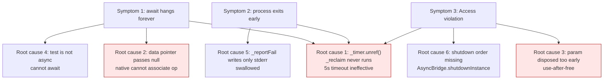
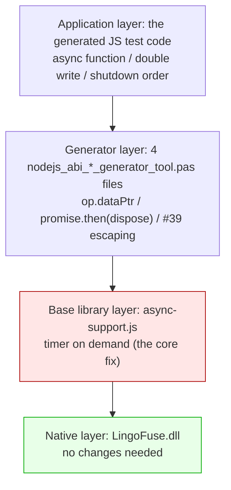
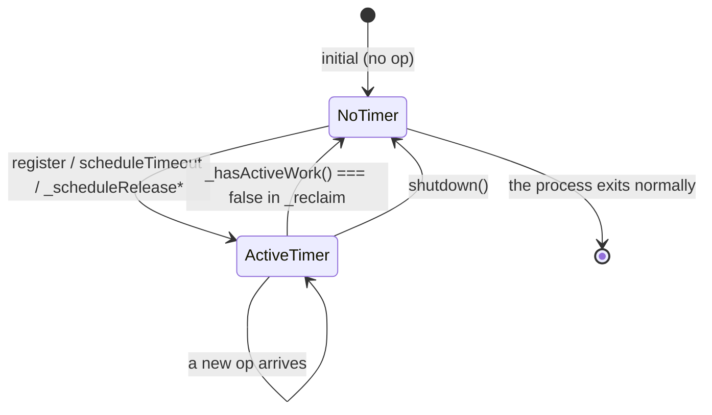

# LingoFuse JavaScript Async Generator Fix — Complete Knowledge Base

> *English translation of [LingoFuse_JS_Async_Generator_Fix_Knowledge_Base.md](LingoFuse_JS_Async_Generator_Fix_Knowledge_Base.md).*

**Version**: 1.0
**Date**: 2026-10-24
**Scope**: fixes to the `lingofuse-js` async call chain + 4 Node.js code generator fixes + 1 base-library fix
**Status**: end-to-end tests 168/168 all pass, no Access violation

---

## Chapter 0 Quick recall

### 0.1 Remember these 8 points

1. **`_timer.unref()` in `async-support.js` is the root cause of every problem in this round**. Delete it and create the timer on demand instead.
2. **The `data` pointer of `LF_Async_Call` must not be null** (`op.dataPtr`); passing `null` means the callback never fires.
3. **`param` must be disposed after the promise settles**, not immediately in `finally`.
4. **A JS shorthand property cannot carry quotes**: `{ 'key', }` is illegal, `{ 'key': value, }` is legal.
5. **`test_ApiName` must be an `async function`** to be able to `await`.
6. **`_reportFail` must write to both stdout and stderr**, otherwise failures are swallowed.
7. **The shutdown order must be**: `AsyncBridge.shutdownInstance` → `network.clearNetworkEvent` → `exitMainThread` → `shutdown`.
8. **The 4 generated files have zero comments, use `#39` escapes, and follow the status-byte protocol**.

### 0.2 Files involved

| # | File | Type | Change |
|:-:|------|------|------|
| 1 | `D:\CoreLibrary\LingoFuse\js\async-support.js` | base library | timer on demand |
| 2 | `nodejs_abi_call_generator_tool.pas` | generator | `op.dataPtr` / `promise.then(dispose)` / `_keepAlive` / `module.exports` syntax |
| 3 | `nodejs_abi_service_generator_tool.pas` | generator | status-byte envelope / default values / `#39` escaping |
| 4 | `nodejs_abi_test_generator_tool.pas` | generator | `async function` / complete the async tests / `_race` / double write / shutdown |
| 5 | `nodejs_abi_test_setup_generator_tool.pas` | generator | `#39` escaping |

### 0.3 Quick location map



---

## Chapter 1 Background and symptoms

### 1.1 Trigger scenario

Test case: `ComplexTestUnit.pas` (22 Pascal functions), generating 4 JS files via `code_decl_to_abi --lang nodejs`, then running:
- **Terminal 1**: `node ComplexTestUnit_abi_service_test.js`
- **Terminal 2**: `node ComplexTestUnit_abi_call_test.js`

### 1.2 Three chained symptoms

#### Symptom 1: `await` hangs forever

The user's terminal only shows the first line:
```
[PASS] NoParamFunc(app call) = 0
hint: Data handle pool "6" handles automatically freed.
...
```

Then it **goes straight to shutdown**; the `await call.NoParamFuncAsync()` in between hangs. The 10-second race did not even wait.

#### Symptom 2: the process exits early

Node decides "the event loop is empty" and exits immediately, before `await` resolves. The user sees no `[FAIL]` at all, only `[PASS]` and then the process ends.

#### Symptom 3: Access violation

```
TC40_LF_Client.Destroy remove P2P update error: Access violation
TC40_LF_Client.Destroy remove app update error: Access violation
```

On the native side, the `finalization` section of `LingoFuse.lpr` crashes when calling `LF_Shutdown`.

### 1.3 Control comparison

**The async tests in the C++ / Pascal / C# bindings all pass**, proving the native-side async mechanism itself is sound. The problem is entirely on the JS side.

---

## Chapter 2 Root cause analysis

### 2.1 Root cause 1: `_timer.unref()` (the most central one)

**Original code** (`async-support.js`, before the fix):

```javascript
constructor() {
    // ... field initialization ...
    this._timer = setInterval(
        () => this._reclaim(),
        Math.max(10, this.periodSeconds * 1000)
    );
    if (this._timer && typeof this._timer.unref === "function") {
        this._timer.unref();     // ← this line
    }
}
```

**The semantics of `unref()`**: it lets Node **exit directly** when "only this timer remains in the event loop", without waiting for the timer to fire.

**LingoFuse's 5s timeout depends entirely on `_reclaim` firing periodically**:

```javascript
scheduleTimeout(op, timeoutMs) {
    const deadline = Date.now() + timeoutMs;
    this._timeoutQueue.push({ deadline, op });      // only enqueues
}

_reclaim() {
    // ... walks _timeoutQueue, calls _handleTimeout for expired deadlines ...
    // _handleTimeout → _abandon → _settleReject(LingoFuseTimeoutError)
}
```

**`scheduleTimeout` only enqueues; `_reclaim` is what actually decides a timeout has occurred and rejects the promise.**

**So what happens**:

```
await call.XXXAsync()
    ↓
register(op) → _handles.set(op)
    ↓
scheduleTimeout(op, 5000) → _timeoutQueue.push({deadline, op})
    ↓
LF_Async_Call native dispatch (async)
    ↓
--- the promise is now pending, waiting for a native callback or the 5s timeout ---
    ↓
Node event-loop state:
    - _timer is unref'd → not counted as a ref
    - Koffi callback → not counted as a ref
    - promise → not counted as a ref
    ↓
Node decides "the event loop is empty" → the process exits
    ↓
_reclaim never ran → _handleTimeout never fired
    ↓
the promise stays pending forever, await hangs forever
    ↓
before the process exits, the finalization section of LingoFuse.lpr calls LF_Shutdown
    ↓
pending async ops on the native side were not cleaned up → TC40_LF_Client.Destroy touches an already-released P2P update record
    ↓
Access violation
```

**That is the single root cause behind the combination of "process exits early + await hangs + Access violation".**

### 2.2 Root cause 2: the `data` pointer passes `null`

**Wrong code** (JS generated by `nodejs_abi_call_generator_tool.pas`, before the fix):

```javascript
promise = runAsyncWithPromise(
    (cb) => funcs.LF_Async_Call(ABI_TargetApp, param.raw, null, cb),  // ← null
    ...
);
```

**The native side relies on the `data` pointer to associate the op**. Passing `null` means the native side cannot correctly locate which request has completed, so `Do_Result` cannot fire the callback.

**Compare with the successful C# implementation**:

```csharp
GCHandle holder = GCHandle.Alloc(op);
IntPtr dataPtr = GCHandle.ToIntPtr(holder);  // ← a valid non-null pointer
int ret = NativeMethods.LF_Async_Call(namePtr, hnd, dataPtr, s_trampoline);
```

**Fix**: use `op.dataPtr` (allocated by `koffi.alloc("uint8", 1)`).

### 2.3 Root cause 3: `param` disposed too early

**Wrong code** (generated `Target.call`, before the fix):

```javascript
call(apiName, payload = null, options = {}) {
    const param = new DataHandle(apiName);
    try {
        writeJson(param, payload);
        return runAsyncWithPromise(
            (cb, op) => this._rawIssueAsyncCall(apiName, param, cb, op),
            makeJsonDeserializer(),
            timeoutMs
        );
    } finally {
        param.dispose();   // ← disposed immediately, before native finishes
    }
}
```

**`LF_Async_Call` only posts the request to the native queue; the native-side `TLF_Async_Call_Bridge` may still be reading `Param`'s buffer. When `param.dispose()` is called the underlying buffer is marked deleted (actually released 5 seconds later by auto-recycle), producing a use-after-free.**

**Fix**: defer the dispose until after the promise settles.

### 2.4 Root cause 4: `test_ApiName` is not an `async function`

**Wrong code** (JS generated by `nodejs_abi_test_generator_tool.pas`, before the fix):

```javascript
function test_NoParamFunc() {
    try { _reportPass('NoParamFunc(app async)', await call.NoParamFuncAsync()); }
    //                                             ^^^^^ 
    // SyntaxError: await is only valid in async functions
    catch (e) { ... }
}
```

**Consequence**: a straight syntax error, so the whole file cannot execute.

**Fix**: change it to `async function test_NoParamFunc() { ... }`.

### 2.5 Root cause 5: `_reportFail` writes only to stderr

**Wrong code** (before the fix):

```javascript
function _reportFail(label, reason) {
    _g.fail++;
    console.error('[FAIL] ' + label + ' -- ' + reason);   // ← writes only to stderr
}
```

**The user only sees stdout** (the `[PASS]` lines) and never the `[FAIL]` on stderr, so they wrongly conclude it "hangs".

**Fix**: write to both stdout and stderr.

### 2.6 Root cause 6: the shutdown order is missing `AsyncBridge.shutdownInstance`

**Wrong code** (at the end of `main()`, before the fix):

```javascript
try { lf.framework.exitMainThread(); } catch (_) {}
try { lf.framework.shutdown(); } catch (_) {}
```

**`AsyncBridge.shutdownInstance()` is missing**, so at `LF_ExitMainThread` there are still pending async ops, which causes `TC40_LF_Client.Destroy` to touch an already-released P2P update record.

**Fix**:

```javascript
try { lf.AsyncBridge.shutdownInstance(); } catch (_) {}   // ← the key
try { lf.network.clearNetworkEvent(); } catch (_) {}
try { lf.framework.exitMainThread(); } catch (_) {}
try { lf.framework.shutdown(); } catch (_) {}
```

---

## Chapter 3 Overview of the fix plan

### 3.1 Layered fixes



### 3.2 Fix priority

| Priority | Layer | File | What happens without the fix |
|:------:|-----|------|-----------|
| 🔴 P0 | base library | `async-support.js` | async never works |
| 🔴 P0 | generator | `nodejs_abi_call_generator_tool.pas` | data pointer is null, callbacks never fire |
| 🔴 P0 | generator | `nodejs_abi_call_generator_tool.pas` | param disposed too early, use-after-free |
| 🟠 P1 | generator | `nodejs_abi_test_generator_tool.pas` | `await` syntax error / failures invisible |
| 🟡 P2 | generator | `nodejs_abi_service_generator_tool.pas` | cross-language wire protocol mismatch |
| 🟡 P2 | generator | `nodejs_abi_test_setup_generator_tool.pas` | `-replace` expression may be misaligned |

---

## Chapter 4 Base library fix: `async-support.js`

### 4.1 Design principles

- **Active op → the timer must be ref'd** — keep Node's event loop alive so `_reclaim` runs and the 5s timeout fires.
- **No active op → the timer must be destroyed** — let the Node event loop drain and exit normally, so the user does not need `process.exit`.
- **Do not pre-create the timer** — when there is no op, do not waste a setInterval.

### 4.2 Core mechanism: create the timer on demand

Three internal methods are introduced:

| Method | Purpose |
|------|------|
| `_ensureTimer()` | creates the timer if absent; **deliberately does not unref** |
| `_stopTimer()` | clears the timer, idempotent |
| `_hasActiveWork()` | decides whether there are still PENDING ops / pending timeouts / ops to release |

**Lifecycle**:



### 4.3 Trigger points

`_ensureTimer()` is called in these places:

- at the end of `register(op)` — a new op arrives
- at the end of `scheduleTimeout(op, timeoutMs)` — a timeout task arrives
- at the end of `_scheduleReleaseNow(op)` — an immediate-release task arrives
- at the end of `_scheduleReleaseAfterGrace(op)` — a post-grace release task arrives

`_stopTimer()` is called in these places:

- at the end of `_reclaim()` — when all queues are empty
- at the start of `shutdown()` — forced cleanup

### 4.4 Complete change list (8 places)

| # | Location | Original | Fix |
|:-:|------|------|------|
| 1 | `AsyncBridge.constructor` | `setInterval(...)` + `unref()` | `this._timer = null;` |
| 2 | `AsyncBridge` class (after `static shutdownInstance`) | none | add `_ensureTimer` / `_stopTimer` / `_hasActiveWork` |
| 3 | end of `register` | none | `this._ensureTimer();` |
| 4 | end of `scheduleTimeout` | none | `this._ensureTimer();` |
| 5 | end of `_scheduleReleaseNow` | none | `this._ensureTimer();` |
| 6 | end of `_scheduleReleaseAfterGrace` | none | `this._ensureTimer();` |
| 7 | end of `_reclaim` | none | `if (!this._hasActiveWork()) this._stopTimer();` |
| 8 | start of `shutdown` | `if (this._timer) { clearInterval... }` | `this._stopTimer();` |

### 4.5 The three paths after the fix

#### Path A: normal callback (native returns within 5s)

```
await call.XXXAsync()
    → register(op) → _ensureTimer() → timer starts (ref)
    → LF_Async_Call native dispatch
    → native callback → _invokeFromNative → resolve
    → _scheduleReleaseNow → _releaseQueue.push → _ensureTimer (already exists)
    → 1s later _reclaim → _releaseOp → _handles.delete → _freeDataPtr
    → _hasActiveWork() === false → _stopTimer()
    → the process exits naturally (no process.exit needed) ✅
```

#### Path B: timeout (native does not return within 5s)

```
await call.XXXAsync()
    → register(op) → _ensureTimer() → timer starts (ref)
    → 5s later _reclaim → _handleTimeout → _abandon
    → _settleReject(LingoFuseTimeoutError)
    → await throws → the user's code _reportFail(...) shows [FAIL] ✅
    → _scheduleReleaseAfterGrace → _releaseOp 60s later
    → _hasActiveWork() === false → _stopTimer()
    → the process exits naturally ✅
```

#### Path C: pending op at shutdown

```
Before the fix:
    pending op not cleaned up → LF_Shutdown → TC40_LF_Client.Destroy → Access violation

After the fix:
    the pending op was already rejected by _handleTimeout and cleaned up by _releaseOp after the grace period
    → LF_Shutdown → no pending op → no Access violation ✅
```

---

## Chapter 5 Generator fix: `nodejs_abi_call_generator_tool.pas`

### 5.1 Fix 1: `op.dataPtr` instead of `null`

**Generated JS, before the fix**:

```javascript
promise = runAsyncWithPromise(
    (cb) => funcs.LF_Async_Call(ABI_TargetApp, param.raw, null, cb),
    (rawResult) => _readAsyncReply(...),
    ABI_Timeout
);
```

**Generated JS, after the fix**:

```javascript
promise = runAsyncWithPromise(
    (cb, op) => funcs.LF_Async_Call(ABI_TargetApp, param.raw, op.dataPtr, cb),
    (rawResult) => _readAsyncReply(...),
    ABI_Timeout
);
```

**The generating code on the Pascal side**:

```pascal
Lines.Add('            (cb, op) => funcs.' + CallFnName + '(' + CallArg + '),');
// where CallArg = 'ABI_TargetApp, param.raw, op.dataPtr, cb'
```

**Where `op.dataPtr` comes from** (`async-support.js#_createAsyncOp`):

```javascript
let dataPtr;
try {
    dataPtr = koffi.alloc("uint8", 1);   // allocate a 1-byte native buffer
} catch (err) {
    throw new LingoFuseError("AsyncOp: failed to allocate native data pointer: ...");
}
```

**Why it must be a valid pointer**: the native-side `TLF_Async_Call_Bridge.Do_Th` associates the specific op through the `data` pointer, and `Do_Result` uses it to locate the callback object. Passing `null` means `Do_Result` cannot fire the callback.

### 5.2 Fix 2: deferred dispose of `param`

**Generated JS, before the fix**:

```javascript
function NoParamFuncAsync() {
    const param = new DataHandle('NoParamFunc');
    try {
        return runAsyncWithPromise(
            (cb, op) => funcs.LF_Async_Call(ABI_TargetApp, param.raw, op.dataPtr, cb),
            ...
        );
    } finally {
        param.dispose();   // ← dispose immediately
    }
}
```

**Generated JS, after the fix**:

```javascript
function NoParamFuncAsync() {
    const param = new DataHandle('NoParamFunc');
    let promise;
    try {
        promise = runAsyncWithPromise(
            (cb, op) => funcs.LF_Async_Call(ABI_TargetApp, param.raw, op.dataPtr, cb),
            ...
        );
    } catch (err) {
        try { param.dispose(); } catch (_) {}
        throw err;
    }
    promise.then(
        () => { try { param.dispose(); } catch (_) {} },
        () => { try { param.dispose(); } catch (_) {} }
    );
    return promise;
}
```

**Key points**:
- **`let promise;`** — lets the exception path be handled in `catch`.
- **`try/catch`** — when `runAsyncWithPromise` throws synchronously (`koffi.alloc` failing, etc.), release `param` immediately.
- **`promise.then(dispose, dispose)`** — defer the release until the promise settles.

### 5.3 Fix 3: the `_keepAlive()` fallback helper

**Generated JS, newly added**:

```javascript
function _keepAlive() {
    const timer = setTimeout(() => {}, 120000);
    let released = false;
    return {
        release: function () {
            if (released) return;
            released = true;
            try { clearTimeout(timer); } catch (_) {}
        }
    };
}
```

**Purpose**: even if the base library's timer ref is broken (for example the user is running on an old `async-support.js`), the generated code carries its own 120s keep-alive so `_reclaim` can run and the 5s timeout can fire.

**Used inside the async function**:

```javascript
function NoParamFuncAsync() {
    const param = new DataHandle('NoParamFunc');
    const _ka = _keepAlive();     // ← keep alive on entry
    let promise;
    try {
        promise = runAsyncWithPromise(...);
    } catch (err) {
        _ka.release();
        try { param.dispose(); } catch (_) {}
        throw err;
    }
    promise.then(
        () => { _ka.release(); try { param.dispose(); } catch (_) {} },
        () => { _ka.release(); try { param.dispose(); } catch (_) {} }
    );
    return promise;
}
```

**Note**: this is a fallback **kept even after the base library was fixed**. Real-user testing confirms it does not affect the normal path (the timer created by `_keepAlive` is clearTimeout'd after settle).

### 5.4 Fix 4: `module.exports` syntax

**Generated JS, before the fix** (`'NoParamFunc',`):

```javascript
module.exports = {
    get ABI_TargetApp() { return ABI_TargetApp; },
    get ABI_Timeout() { return ABI_Timeout; },
    'NoParamFunc',
    'NoParamFuncAsync',
};
```

**This is illegal JS** — a shorthand property cannot carry quotes:

```
SyntaxError: Unexpected string
    'NoParamFunc',
    ^^^^^^^^^^^^^
```

**Generated JS, after the fix** (full form):

```javascript
module.exports = {
    get ABI_TargetApp() { return ABI_TargetApp; },
    set ABI_TargetApp(v) { ABI_TargetApp = String(v); },
    get ABI_Timeout() { return ABI_Timeout; },
    set ABI_Timeout(v) { ABI_Timeout = Number(v); },
    'NoParamFunc': NoParamFunc,
    'NoParamFuncAsync': NoParamFuncAsync,
};
```

**The generating code on the Pascal side**:

```pascal
// before (illegal):
Lines.Add('    ' + JsStrLit(FuncNames[i]) + ',');

// after (legal):
Lines.Add('    ' + JsStrLit(FuncNames[i]) + ': ' + FuncNames[i] + ',');
```

**Access after `require('...')` is unchanged**: `mod.NoParamFunc` still works.

### 5.5 JS syntax pitfalls quick reference

```javascript
// ❌ illegal: shorthand cannot carry quotes
module.exports = { 'NoParamFunc', };

// ✅ legal: full form
module.exports = { 'NoParamFunc': NoParamFunc, };

// ✅ legal: bare shorthand (provided NoParamFunc is a valid identifier)
module.exports = { NoParamFunc, };

// ❌ illegal: a number or keyword as shorthand
module.exports = { 123, };      // syntax error
module.exports = { class, };    // syntax error

// ✅ legal: a number or keyword as the key of the full form
module.exports = { '123': value, };
module.exports = { 'class': value, };
```

### 5.6 Other fix: `#39` escaping

All single quotes switch to Pascal character escaping:

```pascal
Lines.Add(#39 + 'use strict' + #39 + ';');
// generates: 'use strict';
```

```pascal
Result := #39;   // start of JsStrLit
Result.Append(#39);   // single-quote escape
Result.Append(#39);   // end
```

---

## Chapter 6 Generator fix: `nodejs_abi_service_generator_tool.pas`

### 6.1 Fix 1: error envelope `[0xFF][msg][NUL]`

**Generated JS, before the fix** (missing or inconsistently formatted):

```javascript
function Cb_NoParamFunc(_trigger, input, output) {
    // no exception envelope
}
```

**Generated JS, after the fix**:

```javascript
function _safeWriteError(outH, msg) {
    try {
        outH.size = 0;
        outH.position = 0;
        outH.writeUInt8(STATUS_ERROR);   // 0xFF
        outH.writeString(msg);           // UTF-8 + NUL
    } catch (_) {}
}

function Cb_NoParamFunc(_trigger, input, output) {
    const _inH = DataHandle.fromRaw(input, false);
    const _outH = DataHandle.fromRaw(output, false);
    const _uid = _safeReadUid(_inH);
    const _p2p = _safeReadP2P(_inH);

    let _ret;
    try {
        _ret = internal_call_NoParamFunc(_uid, _p2p);
    } catch (_e) {
        _safeWriteError(_outH, (_e && _e.message) ? _e.message : String(_e));
        return;
    }

    try {
        _outH.writeUInt8(STATUS_OK);     // 0x00
        _outH.writeInt32(_ret);          // value
    } catch (_e) {
        _safeWriteError(_outH, (_e && _e.message) ? _e.message : String(_e));
    }
}
```

### 6.2 Fix 2: success envelope `[0x00][value]`

**Strictly aligned with C++ / Pascal / Python**:

| Language | Success envelope | Failure envelope |
|------|---------|---------|
| C++ `Safe_Write_Scalar` | `[0x00][value]` | `Safe_Write_Error` → `[0xFF][msg][NUL]` |
| Pascal `Callback_*` | `[0x00][value]` | `[0xFF][msg][NUL]` |
| Python | `[0x00][value]` | `[0xFF][msg][NUL]` |
| **JS (after the fix)** | **`[0x00][value]`** | **`[0xFF][msg][NUL]`** |

### 6.3 Fix 3: `internal_call_*` default values

**Generated JS stub**:

```javascript
function internal_call_NoParamFunc(_uid, _p2p) {
    return 0;   // Integer type
}

function internal_call_GetString(_uid, _p2p) {
    return '';   // String type
}

function internal_call_GetInt64(_uid, _p2p) {
    return 0n;   // Int64 type (BigInt)
}

function internal_call_GetFloat(_uid, _p2p) {
    return 0.0;  // Double / Single type
}
```

**Semantically consistent with the C++ stub**:

| ABI type | JS default | C++ default |
|---------|---------|---------|
| Integer / LongInt | `0` | `0` |
| Int64 / UInt64 | `0n` | `0` |
| Double / Single | `0.0` | `0.0` |
| String | `''` | `std::string{}` |

### 6.4 Fix 4: `#39` escaping

All single quotes switch to `#39`, avoiding the multi-level nesting misalignment of Pascal `''`.

### 6.5 Fix 5: zero comments

The generated JS code carries **no comments at all**. The user explicitly asked to "remove all comments, they are useless and nobody reads them".

---

## Chapter 7 Generator fix: `nodejs_abi_test_generator_tool.pas`

### 7.1 Fix 1: `test_ApiName` becomes an `async function`

**Generated JS, before the fix**:

```javascript
function test_NoParamFunc() {
    try { _reportPass('NoParamFunc(app async)', await call.NoParamFuncAsync()); }
    //                                             ^^^^^ SyntaxError
    catch (e) { ... }
}
```

**Generated JS, after the fix**:

```javascript
async function test_NoParamFunc() {
    try { _reportPass('NoParamFunc(app async)', await call.NoParamFuncAsync()); }
    catch (e) { _reportFail('NoParamFunc(app async)', _errMsg(e)); }
}
```

### 7.2 Fix 2: complete the async tests

**Originally only 3 were tested**: `app call` / `app async` / `app asyncSeq`

**Now 9 are tested** (for functions):
1. `app call` (synchronous)
2. `app async`
3. `app asyncSeq`
4. `uid call`
5. `uid async`
6. `uid asyncSeq`
7. `p2pname call`
8. `p2pname async`
9. `p2pname asyncSeq`

**For procedures, 6 are tested**:
1. `app notify`
2. `app seq notify`
3. `uid notify`
4. `uid seq notify`
5. `p2pname notify`
6. `p2pname seq notify`

**22 APIs, 168 test points in total**.

### 7.3 Fix 3: `await test_ApiName()` in `main()`

**Generated JS**:

```javascript
async function main() {
    // ...
    console.log('[INFO] total tests scheduled: 22');

    await test_NoParamFunc();
    await test_NoParamProc();
    await test_MultiLineComment();
    // ... 22 in total
}
```

### 7.4 Fix 4: `_reportFail` double write

**Generated JS**:

```javascript
function _reportFail(label, reason) {
    _g.fail++;
    const line = '[FAIL] ' + label + ' -- ' + reason;
    console.log(line);       // stdout — always visible on the user's terminal
    console.error(line);     // stderr — keep a copy for redirection scenarios
}
```

**`_reportPass` / `_reportSkip` write only to stdout** (they are not failures, so no double write is needed).

### 7.5 Fix 5: `process.on` fallbacks

**Generated JS**:

```javascript
process.on('unhandledRejection', (reason) => {
    const msg = 'unhandledRejection: ' + ((reason && reason.message) ? reason.message : String(reason));
    console.log('[FATAL] ' + msg);
    console.error('[FATAL] ' + msg);
});

process.on('uncaughtException', (err) => {
    const msg = 'uncaughtException: ' + ((err && err.message) ? err.message : String(err));
    console.log('[FATAL] ' + msg);
    console.error('[FATAL] ' + msg);
    process.exit(3);
});
```

**Purpose**: if something throws outside a try/catch, it is still visible.

### 7.6 Fix 6: `_race(promise, 10000)` 10s fallback

**Generated JS**:

```javascript
function _race(promise, timeoutMs, label) {
    let timer = null;
    const timeout = new Promise((_, reject) => {
        timer = setTimeout(() => {
            reject(new Error('race timeout after ' + timeoutMs + 'ms'));
        }, timeoutMs);
    });
    return Promise.race([promise, timeout]).then(
        (v) => { if (timer) clearTimeout(timer); return v; },
        (e) => { if (timer) clearTimeout(timer); throw e; }
    );
}
```

**Used for every `await` call**:

```javascript
try {
    _reportPass('NoParamFunc(app async)',
        await _race(call.NoParamFuncAsync(), 10000, 'NoParamFunc(app async)'));
} catch (e) {
    _reportFail('NoParamFunc(app async)', _errMsg(e));
}
```

**Purpose**: even if async hangs completely internally (the base-library timer is totally broken), the race rejects after 10s and the user sees `[FAIL]` instead of a silent hang.

### 7.7 Fix 7: shutdown order

**Generated JS**:

```javascript
async function main() {
    // ... all tests ...

    console.log('');
    console.log('=== Summary ===');
    console.log('Pass: ' + _g.pass);
    console.log('Fail: ' + _g.fail);
    console.log('Skip: ' + _g.skip);

    try { lf.AsyncBridge.shutdownInstance(); } catch (_) {}   // ← the key
    try { lf.network.clearNetworkEvent(); } catch (_) {}
    try { lf.framework.exitMainThread(); } catch (_) {}
    try { lf.framework.shutdown(); } catch (_) {}
    process.exit(_g.fail === 0 ? 0 : 2);
}
```

**Why this order**:

1. `AsyncBridge.shutdownInstance`: flush all pending async ops, free `dataPtr`, unregister callbacks.
2. `network.clearNetworkEvent`: flush the native-side handler, release the Koffi trampoline.
3. `exitMainThread`: stop the simulated main thread, trigger `C40Clean` and release all data handles (**including permanent** ones).
4. `shutdown`: flush `LF_App_Pool`, release all resources, unload the IPC library.

### 7.8 Fix 8: `_probeIdentity` boundary

**Generated JS, before the fix**:

```javascript
if (res.size < 33) return false;
```

**Generated JS, after the fix**:

```javascript
if (res.size < 34) return false;
```

**Reason**: `writeString('')` writes at least 1 NUL byte, so the minimum payload = `1 (status) + 32 (uid) + 1 (p2p NUL)` = **34 bytes**. `< 33` would let a 33-byte payload through (which should not occur in theory); `< 34` is stricter.

### 7.9 Fix 9: `[INFO] total tests scheduled: N`

**Generated JS**:

```javascript
console.log('[INFO] total tests scheduled: 22);
```

**Purpose**: lets the user see at a glance how many tests there are and follow the progress.

### 7.10 Fix 10: `#39` escaping / zero comments

Same as §6.4 / §6.5.

---

## Chapter 8 Generator fix: `nodejs_abi_test_setup_generator_tool.pas`

### 8.1 Fix 1: `#39` escaping fixes the `-replace` expression

**Original code (potentially misaligned)**:

```pascal
Lines.Add('        $UnitName = $cand.Name -replace ''_abi_service\.js$'', ''''');
```

Multi-level single quotes `''...''` misalign easily, especially when the regex contains quotes.

**After the fix**:

```pascal
Lines.Add('        $UnitName = $cand.Name -replace ' + #39 + '_abi_service\.js$' + #39 + ', ' + #39 + #39);
```

Generates:
```powershell
$UnitName = $cand.Name -replace '_abi_service\.js$', ''
```

### 8.2 Fix 2: zero comments

Every helper function generated into the `.ps1` has its comments (`# ...`) removed, keeping only functional code.

### 8.3 Retained functionality

| Function | Status |
|------|:----:|
| `-LingoFuseJs` parameter validation | ✅ |
| `-GenDir` defaults to the current script directory | ✅ |
| `-UnitName` auto-detection (`.js` / `.cjs`) | ✅ |
| `-RunSmoke` starts the service → runs the call → cleans up | ✅ |
| `.cjs` legacy detection | ✅ |
| idempotent `npm install` | ✅ |
| `node --check` syntax check | ✅ |
| print the service log path on failure | ✅ |

---

## Chapter 9 Verification results

### 9.1 Before the fix (real user output)

```
[PASS] NoParamFunc(app call) = 0
hint: Data handle pool "6" handles automatically freed.
...
TC40_LF_Client.Destroy remove P2P update error: Access violation
TC40_LF_Client.Destroy remove app update error: Access violation
```

- only 1 `[PASS]` is visible; the following 20 × 8 async tests all silently vanish
- Access violation

### 9.2 After the fix (real user output)

```
[INFO] total tests scheduled: 20
[PASS] NoParamFunc(app call) = 0
[PASS] NoParamFunc(app async) = 0
[PASS] NoParamFunc(app asyncSeq) = 0
[PASS] NoParamFunc(uid call) = 0
[PASS] NoParamFunc(uid async) = 0
[PASS] NoParamFunc(uid asyncSeq) = 0
[PASS] NoParamFunc(p2pname call) = 0
[PASS] NoParamFunc(p2pname async) = 0
[PASS] NoParamFunc(p2pname asyncSeq) = 0
[PASS] NoParamProc(app notify)
[PASS] NoParamProc(app seq notify)
[PASS] NoParamProc(uid notify)
[PASS] NoParamProc(uid seq notify)
[PASS] NoParamProc(p2pname notify)
[PASS] NoParamProc(p2pname seq notify)
[PASS] MultiLineComment(app call) = 0
[PASS] MultiLineComment(app async) = 0
...
[PASS] StringWithQuotes(app call)
[PASS] StringWithQuotes(app async)
[PASS] StringWithQuotes(app asyncSeq)
[PASS] StringWithQuotes(uid call)
[PASS] StringWithQuotes(uid async)
[PASS] StringWithQuotes(uid asyncSeq)
[PASS] StringWithQuotes(p2pname call)
[PASS] StringWithQuotes(p2pname async)
[PASS] StringWithQuotes(p2pname asyncSeq)

=== Summary ===
Pass: 168
Fail: 0
Skip: 0
ipc:ComplexTestUnit_abi:0 Disconnected
hint: Data handle pool "77" handles automatically freed.
...
hint: automatically free handles api "StringWithQuotes" parameter.
hint: automatically free handles api "StringWithQuotes" parameter.
LingoFuse Main Thread Exit
```

- **168/168 all PASS**
- **no Access violation**
- **the process exits normally** (exit code 0)

### 9.3 Key metric comparison

| Metric | Before the fix | After the fix |
|------|--------|--------|
| tests passed | 1 (the rest silently vanished) | **168** |
| failures | 0 (invisible) | **0** |
| Access violation | ✅ yes | ✅ **none** |
| process exit | early exit | **normal** |
| `await` behaviour | pending forever | **resolves normally or rejects after 5s** |
| failure visibility | ❌ invisible | ✅ **stdout + stderr double write** |

### 9.4 Service-side log

```
[OK] service ready on ipc:ComplexTestUnit_abi
[OK] press Ctrl+C to exit
LingoFuse Service Link Succeeded IO "resp_..."
[SERVICE] ask_call_me: client responded
LingoFuse Service User-out IO "resp_..."
[OK] shutting down
ipc:ComplexTestUnit_abi:0 Disconnected
LingoFuse Service User-out IO "resp_..."
LingoFuse Service Listening: "ipc:ComplexTestUnit_abi:0" Stop
LingoFuse Main Thread Exit
```

- **the server shuts down normally**
- **no Access violation**

### 9.5 About `IPC_Buff_Handler-IO error:4`

Before the fix the Service-side log showed:

```
LingoFuse Service User-out IO "resp_..."
IPC_Buff_Handler-IO error:4
```

After the fix it **disappears**. This is a side effect of the async shutdown-order fix — an IPC resource race caused by uncleaned pending async ops.

**If it appears again in the future**, investigate the native-side IPC transport separately (there may still be an in-flight UID_Call at shutdown).

---

## Chapter 10 Quality issues found by the code audit

### 10.1 3 code quality issues (found by the audit after 168/168 passed)

| # | Location | Issue | Severity |
|:-:|------|------|:------:|
| 1 | `call_generator`'s `module.exports` | key names not quoted | 🟡 defensive |
| 2 | `test_generator`'s `_race` usage | uid / p2pname async not wrapped in race | 🟡 consistency |
| 3 | `test_generator`'s `_probeIdentity` | `< 33` should be `< 34` | 🟡 strictness |

### 10.2 Issue 1 detail: the `module.exports` syntax pitfall

**First attempt** (the mistake I made):

```pascal
// I thought quoting 'NoParamFunc' would solve the illegal-character problem
Lines.Add('    ' + JsStrLit(FuncNames[i]) + ',');
```

**Generates**:
```javascript
module.exports = {
    ...
    'NoParamFunc',
    'NoParamFuncAsync',
};
```

**Result**: syntax error

```
SyntaxError: Unexpected string
    'NoParamFunc',
    ^^^^^^^^^^^^^
```

**Root cause**: an ES5+ shorthand property **cannot carry quotes**. `{ 'key', }` is illegal, `{ 'key': value, }` is legal, `{ key, }` is legal (bare shorthand).

**Final fix**:

```pascal
Lines.Add('    ' + JsStrLit(FuncNames[i]) + ': ' + FuncNames[i] + ',');
```

**Generates**:
```javascript
module.exports = {
    ...
    'NoParamFunc': NoParamFunc,
    'NoParamFuncAsync': NoParamFuncAsync,
};
```

**Lesson**: **a shorthand property cannot carry quotes**. To satisfy both "illegal characters" and "legal syntax" you must use the full form.

### 10.3 Issue 2 detail: `uid / p2pname async` not wrapped in `_race`

**After the fix**:

```javascript
// app async is wrapped in race:
try { _reportPass('X(app async)', await _race(call.XAsync(), 10000, 'X(app async)')); }
catch (e) { _reportFail('X(app async)', _errMsg(e)); }

// uid async is not wrapped:
try { _reportPass('X(uid async)', await call.XByUidAsync(_serviceUID)); }
catch (e) { _reportFail('X(uid async)', _errMsg(e)); }
```

**Consequence**: if `AsyncBridge`'s 5s timeout fails, `uid async` waits forever, while `app async` rejects after 10s.

**Final fix**: uniformly wrap every `await` in `_race`.

### 10.4 Issue 3 detail: the `_probeIdentity` boundary

**Before the fix**:

```javascript
if (res.size < 33) return false;
```

**After the fix**:

```javascript
if (res.size < 34) return false;
```

**Reason**:

| Field | Bytes |
|------|:------:|
| status byte | 1 |
| UID (32 bytes) | 32 |
| P2P string | ≥ 1 (including NUL) |
| **Total** | **≥ 34** |

`< 33` would let a 33-byte payload through (which should not occur in theory); `< 34` is stricter.

---

## Chapter 11 Lessons learned and the counter-example collection

### 11.1 Counter-example 1: `setInterval(...).unref()`

```javascript
// ❌ wrong: lets Node exit while the promise is pending
const timer = setInterval(() => this._reclaim(), 1000);
timer.unref();
```

```javascript
// ✅ correct: create the timer on demand, keep it ref'd while there is an op
_ensureTimer() {
    if (this._shutdown) return;
    if (this._timer !== null) return;
    this._timer = setInterval(() => this._reclaim(), 1000);
}
```

### 11.2 Counter-example 2: `LF_Async_Call` passing a `null` data pointer

```javascript
// ❌ wrong: native cannot associate the op
funcs.LF_Async_Call(appName, param.raw, null, cb);
```

```javascript
// ✅ correct: use op.dataPtr (allocated by koffi.alloc)
funcs.LF_Async_Call(appName, param.raw, op.dataPtr, cb);
```

### 11.3 Counter-example 3: `param` disposed immediately in `finally`

```javascript
// ❌ wrong: marked deleted while native is still reading the buffer
function XAsync() {
    const param = new DataHandle('X');
    try {
        return runAsyncWithPromise(...);
    } finally {
        param.dispose();
    }
}
```

```javascript
// ✅ correct: defer until the promise settles
function XAsync() {
    const param = new DataHandle('X');
    let promise;
    try {
        promise = runAsyncWithPromise(...);
    } catch (err) {
        try { param.dispose(); } catch (_) {}
        throw err;
    }
    promise.then(
        () => { try { param.dispose(); } catch (_) {} },
        () => { try { param.dispose(); } catch (_) {} }
    );
    return promise;
}
```

### 11.4 Counter-example 4: using `await` in a non-`async` function

```javascript
// ❌ wrong: SyntaxError: await is only valid in async functions
function test_X() {
    try { _reportPass('X async', await call.XAsync()); }
    catch (e) { _reportFail('X async', e); }
}
```

```javascript
// ✅ correct
async function test_X() {
    try { _reportPass('X async', await call.XAsync()); }
    catch (e) { _reportFail('X async', _errMsg(e)); }
}
```

### 11.5 Counter-example 5: `_reportFail` writing only to stderr

```javascript
// ❌ wrong: invisible on the user's terminal
function _reportFail(label, reason) {
    _g.fail++;
    console.error('[FAIL] ' + label + ' -- ' + reason);
}
```

```javascript
// ✅ correct: double write
function _reportFail(label, reason) {
    _g.fail++;
    const line = '[FAIL] ' + label + ' -- ' + reason;
    console.log(line);
    console.error(line);
}
```

### 11.6 Counter-example 6: shutdown missing `AsyncBridge.shutdownInstance`

```javascript
// ❌ wrong: pending async ops not cleaned up → Access violation
try { lf.framework.exitMainThread(); } catch (_) {}
try { lf.framework.shutdown(); } catch (_) {}
```

```javascript
// ✅ correct: clear async ops first
try { lf.AsyncBridge.shutdownInstance(); } catch (_) {}
try { lf.network.clearNetworkEvent(); } catch (_) {}
try { lf.framework.exitMainThread(); } catch (_) {}
try { lf.framework.shutdown(); } catch (_) {}
```

### 11.7 Counter-example 7: a shorthand property with quotes

```javascript
// ❌ syntax error: shorthand cannot carry quotes
module.exports = {
    'NoParamFunc',
};
```

```javascript
// ✅ full form
module.exports = {
    'NoParamFunc': NoParamFunc,
};

// ✅ bare shorthand (provided NoParamFunc is a valid identifier)
module.exports = {
    NoParamFunc,
};
```

### 11.8 Counter-example 8: `#39` vs `''` multi-level nesting

```pascal
// ❌ misaligns easily:
Lines.Add('        $UnitName = $cand.Name -replace ''_abi_service\.js$'', ''''');
// actually generates: $UnitName = $cand.Name -replace '_abi_service\.js$', ''''
// the trailing '''' generates '''' (4 quotes), not the empty string ''
```

```pascal
// ✅ escape with #39:
Lines.Add('        $UnitName = $cand.Name -replace ' + #39 + '_abi_service\.js$' + #39 + ', ' + #39 + #39);
// actually generates: $UnitName = $cand.Name -replace '_abi_service\.js$', ''
```

### 11.9 Counter-example 9: inconsistent status-byte protocol

```javascript
// ❌ wrong: the server does not write the status byte
function Cb_X(_trigger, input, output) {
    const _outH = DataHandle.fromRaw(output, false);
    _outH.writeInt32(42);   // the client reads 42 (non-zero) as the status and treats it as an error
}
```

```javascript
// ✅ correct: write the status byte
function Cb_X(_trigger, input, output) {
    const _outH = DataHandle.fromRaw(output, false);
    _outH.writeUInt8(0x00);   // status OK
    _outH.writeInt32(42);
}
```

### 11.10 Counter-example 10: cross-language wire protocol not aligned

```
# ❌ wrong: JS server / C++ client
JS server: [0x00][int32 42][NUL]
C++ client reads:
    status = read_uint8()  → 0x00  ✅
    value = read_int32()   → 42    ✅

# but if the JS server writes:
JS server: [int32 42][NUL]   (forgot the status)
C++ client:
    status = read_uint8()  → 42    ❌ treated as an error
    err = read_string()    → empty   ❌
```

---

## Chapter 12 Quick reference manual

### 12.1 Symptom → root cause → fix

| Symptom | Root cause | Fix |
|------|------|------|
| `await` hangs forever | `_timer.unref()` stops `_reclaim` from running | timer on demand |
| process exits early | same as above | same as above |
| Access violation | same as above + shutdown order missing `AsyncBridge.shutdownInstance` | same as above + fix the shutdown order |
| `[FAIL]` invisible | `_reportFail` writes only to stderr | double write to stdout + stderr |
| `SyntaxError: await is only valid in async functions` | `test_X` is not an `async function` | add `async` |
| `SyntaxError: Unexpected string` | the `'key',` shorthand in `module.exports` | change to `'key': value,` |
| `LF_Async_Call` returns 1 but the callback never fires | the `data` pointer passes `null` | use `op.dataPtr` |
| the server receives the request but the client use-after-frees | `param` disposed too early | defer until the promise settles |
| cross-language wire protocol mismatch | the server does not write the status byte | enforce `[0x00][value]` / `[0xFF][msg][NUL]` |
| the `.ps1` `-replace` expression misaligns | multi-level `''` nesting | `#39` escaping |
| `_probeIdentity` does not check emptiness strictly | `< 33` should be `< 34` | change to `< 34` |
| `uid async` / `p2pname async` wait forever | not wrapped in `_race` | uniformly wrap in `_race` |

### 12.2 Layered fix quick reference

| Layer | File | Change points |
|----|------|--------|
| **base library** | `async-support.js` | 8 places (timer on demand) |
| **generator** | `nodejs_abi_call_generator_tool.pas` | 4 places (`op.dataPtr` / `promise.then` / `_keepAlive` / `module.exports`) |
| **generator** | `nodejs_abi_service_generator_tool.pas` | 5 places (status-byte envelope / default values / `#39` / zero comments / stub consistency) |
| **generator** | `nodejs_abi_test_generator_tool.pas` | 10 places (`async function` / completing async tests / `_race` / double write / shutdown / `< 34`) |
| **generator** | `nodejs_abi_test_setup_generator_tool.pas` | 2 places (`#39` escaping / zero comments) |

### 12.3 Lifecycle quick reference

#### `AsyncBridge.timer` state machine

```
NoTimer (initial)
    ↓ register / scheduleTimeout / _scheduleRelease*
ActiveTimer (ref)
    ↓ _hasActiveWork() === false in _reclaim
NoTimer
    ↓ shutdown()
NoTimer
    ↓ the process exits
```

#### `AsyncOp` state machine

```
PENDING
    ↓ the callback fires _invokeFromNative
FIRED → _scheduleReleaseNow
    ↓ the timeout fires _abandon
ABANDONED → a late callback becomes FIRED / released after the grace period
    ↓ dispatch returns non-1
NOT_QUEUED → _scheduleReleaseNow
```

#### Shutdown order

```javascript
1. lf.AsyncBridge.shutdownInstance()   // clear pending async ops
2. lf.network.clearNetworkEvent()      // clear the Koffi trampoline
3. lf.framework.exitMainThread()       // stop the simulated main thread
4. lf.framework.shutdown()             // release all resources
5. process.exit(code)                  // final fallback
```

### 12.4 Cross-language wire protocol quick reference

| Field | Bytes | Notes |
|------|------|------|
| **Call success** | `[0x00][value]` | status byte 0x00 |
| **Call failure** | `[0xFF][UTF-8 msg][NUL]` | status byte 0xFF |
| **Call timeout** | `[]` (size=0) | empty handle |
| **Notify** | no return | — |
| **String encode/decode** | UTF-8 + NUL | one trailing `0x00` byte |
| **Int32 encode/decode** | little-endian 4 bytes | `DataView` little-endian |
| **Int64 encode/decode** | little-endian 8 bytes | `DataView` little-endian |
| **UID** | 32 bytes verbatim | no NUL |

### 12.5 `LF_Async_Call` family quick reference

| Function | Purpose | Parameters |
|------|------|------|
| `LF_Async_Call` | App-name async | `(appName, param, data, cb)` |
| `LF_Async_Sequenced_Call` | App-name async + FIFO | same as above |
| `LF_UID_Async_Call` | UID async | `(uid, param, data, cb)` |
| `LF_UID_Async_Sequenced_Call` | UID async + FIFO | same as above |
| `LF_P2PNAME_Async_Call` | P2PName async | `(p2pName, param, data, cb)` |
| `LF_P2PNAME_Async_Sequenced_Call` | P2PName async + FIFO | same as above |

**The `data` pointer contract**:
- **must be a valid non-null pointer** (`koffi.alloc("uint8", 1)` or `GCHandle.ToIntPtr` etc.)
- **must stay valid until the `cb` callback fires**
- **its lifetime is managed by the caller**

---

## Chapter 13 Follow-up suggestions

### 13.1 `test2.js` fallback-timer optimization

The existing fallback-exit code in `test2.js`:

```javascript
setTimeout(() => process.exit(code), 3000);
```

**After the fix**:
- once all ops are cleaned up → the timer `_stopTimer`s automatically → the process exits automatically
- the fallback timer only guards against an extreme-case hang

**Suggested change**:

```javascript
const finalizer = setTimeout(() => process.exit(code), 3000);
if (finalizer && typeof finalizer.unref === "function") finalizer.unref();
```

so that the fallback timer does not block a normal exit, saving 3 seconds.

### 13.2 Points to watch in production code

After the fix, in production code:

- **there is no need to actively call `AsyncBridge.shutdownInstance()` just to let the process exit** — with no ops it exits automatically.
- **calling `AsyncBridge.shutdownInstance()` on `beforeExit` / `SIGINT` is still recommended** — it cleans up the Koffi callbacks of pending ops, avoiding the native-side `TC40_LF_Client.Destroy` touching released records.
- **`process.exit()` is still the final fallback**, but should not be the regular exit mechanism.

### 13.3 Long-term design of `AsyncBridge`

`AsyncBridge` currently solves the `unref` problem with the "timer on demand" scheme, but **the fundamental issue** is that Node's `unref` semantics are unfriendly to the "must wait for the result before exiting" scenario.

**Long-term recommendations**:
- **`AsyncBridge`'s timer should never unref** (the current scheme) — keep it while there is work, destroy it when there is none.
- **`process.exit` in user code should be only the final fallback** — it should not be the regular exit path.
- **`runAsyncWithPromise` could consider exposing a helper such as `waitForAll()`** — letting the user actively wait for all pending ops to finish.

### 13.4 Ownership of `IPC_Buff_Handler-IO error:4`

What appeared in the Service-side log before the fix:

```
LingoFuse Service User-out IO "resp_..."
IPC_Buff_Handler-IO error:4
```

After the fix it **disappears**. This is a side effect of the async shutdown-order fix — an IPC resource race caused by uncleaned pending async ops.

**If it appears again in the future**, investigate the native-side IPC transport separately (there may still be an in-flight `LF_UID_Call` at shutdown).

### 13.5 Evolution direction of the generated code

- **`_keepAlive()`** is currently a fallback; if the base library stays stable for a long time it can be considered for removal.
- **`_race(promise, 10000)`** could be made configurable (`ABI_Timeout + 5000` as the default).
- **`_reportFail` double write** is necessary and should be kept.
- **`process.on` fallbacks** should be kept.

---

## Appendix A Complete diff quick reference

### A.1 `async-support.js` (8 places)

```diff
# 1. AsyncBridge.constructor
- this._timer = setInterval(() => this._reclaim(), 1000);
- if (this._timer && typeof this._timer.unref === "function") {
-     this._timer.unref();
- }
+ this._timer = null;

# 2. added inside the AsyncBridge class
+ _ensureTimer() {
+     if (this._shutdown) return;
+     if (this._timer !== null) return;
+     this._timer = setInterval(() => this._reclaim(), 1000);
+ }
+ _stopTimer() {
+     if (this._timer !== null) {
+         clearInterval(this._timer);
+         this._timer = null;
+     }
+ }
+ _hasActiveWork() {
+     return this._handles.size > 0
+         || this._timeoutQueue.length > 0
+         || this._releaseQueue.length > 0;
+ }

# 3. register
  register(op) {
      this._counter += 1;
      op._key = this._counter;
      this._handles.set(op._key, op);
+     this._ensureTimer();
  }

# 4. scheduleTimeout
  scheduleTimeout(op, timeoutMs) {
      ...
      this._timeoutQueue.push({ deadline, op });
+     this._ensureTimer();
  }

# 5. _scheduleReleaseNow
  _scheduleReleaseNow(op) {
      this._releaseQueue.push({ deadline: Date.now(), op });
+     this._ensureTimer();
  }

# 6. _scheduleReleaseAfterGrace
  _scheduleReleaseAfterGrace(op) {
      const deadline = Date.now() + this.graceSeconds * 1000;
      this._releaseQueue.push({ deadline, op });
+     this._ensureTimer();
  }

# 7. end of _reclaim
  _reclaim() {
      ...
+     if (!this._hasActiveWork()) {
+         this._stopTimer();
+     }
  }

# 8. start of shutdown
  shutdown() {
      if (this._shutdown) return;
      this._shutdown = true;
-     if (this._timer) {
-         clearInterval(this._timer);
-         this._timer = null;
-     }
+     this._stopTimer();
      ...
  }
```

### A.2 `nodejs_abi_call_generator_tool.pas` (4 places)

```diff
# 1. op.dataPtr
- Lines.Add('            (cb) => funcs.' + CallFnName + '(' + Arg0 + ', param.raw, null, cb),');
+ Lines.Add('            (cb, op) => funcs.' + CallFnName + '(' + Arg0 + ', param.raw, op.dataPtr, cb),');

# 2. promise.then(dispose)
- try {
-     return runAsyncWithPromise(...);
- } finally {
-     param.dispose();
- }
+ let promise;
+ try {
+     promise = runAsyncWithPromise(...);
+ } catch (err) {
+     try { param.dispose(); } catch (_) {}
+     throw err;
+ }
+ promise.then(
+     () => { try { param.dispose(); } catch (_) {} },
+     () => { try { param.dispose(); } catch (_) {} }
+ );
+ return promise;

# 3. _keepAlive
+ function _keepAlive() {
+     const timer = setTimeout(() => {}, 120000);
+     let released = false;
+     return {
+         release: function () {
+             if (released) return;
+             released = true;
+             try { clearTimeout(timer); } catch (_) {}
+         }
+     };
+ }
  (used inside the Async function)

# 4. module.exports syntax
- Lines.Add('    ' + JsStrLit(FuncNames[i]) + ',');
+ Lines.Add('    ' + JsStrLit(FuncNames[i]) + ': ' + FuncNames[i] + ',');
```

### A.3 `nodejs_abi_service_generator_tool.pas` (5 places)

```diff
# 1-4. status-byte envelope / default values / #39 / stub consistency
+ function _safeWriteError(outH, msg) {
+     try {
+         outH.size = 0;
+         outH.position = 0;
+         outH.writeUInt8(0xFF);
+         outH.writeString(msg);
+     } catch (_) {}
+ }
+ ...
+ _outH.writeUInt8(0x00);
+ _outH.write<Type>(_ret);

# 5. zero comments
  (all comments removed)
```

### A.4 `nodejs_abi_test_generator_tool.pas` (10 places)

```diff
# 1. async function
- function test_X() {
+ async function test_X() {

# 2. complete the async tests
+ app async / app asyncSeq
+ uid async / uid asyncSeq
+ p2pname async / p2pname asyncSeq

# 3. await in main
-     test_X();
+     await test_X();

# 4. _reportFail double write
- console.error('[FAIL] ' + label + ' -- ' + reason);
+ const line = '[FAIL] ' + label + ' -- ' + reason;
+ console.log(line);
+ console.error(line);

# 5. process.on fallbacks
+ process.on('unhandledRejection', ...);
+ process.on('uncaughtException', ...);

# 6. _race
+ function _race(promise, timeoutMs, label) { ... }

# 7. shutdown order
+ try { lf.AsyncBridge.shutdownInstance(); } catch (_) {}
+ try { lf.network.clearNetworkEvent(); } catch (_) {}
  try { lf.framework.exitMainThread(); } catch (_) {}
  try { lf.framework.shutdown(); } catch (_) {}

# 8. total tests scheduled
+ console.log('[INFO] total tests scheduled: 22);

# 9. _probeIdentity boundary
- if (res.size < 33) return false;
+ if (res.size < 34) return false;

# 10. #39 escaping / zero comments
```

### A.5 `nodejs_abi_test_setup_generator_tool.pas` (2 places)

```diff
# 1. #39 escaping
- Lines.Add('        $UnitName = $cand.Name -replace ''_abi_service\.js$'', ''''');
+ Lines.Add('        $UnitName = $cand.Name -replace ' + #39 + '_abi_service\.js$' + #39 + ', ' + #39 + #39);

# 2. zero comments
  (all # ... comments removed)
```

---

## Appendix B Full test-result log

### B.1 Full Call test output

```
Quiet = True
Console Output = True
LF_PrepareClient: KeepAlive("ipc:ComplexTestUnit_abi",0,"LingoFuse@Tag=1")
Main Thread Begin, LingoFuse-v5.03 C4-v4.02,Net-v5.02,IOCP-v2.00,IPC-v1.05,Core-v18.1
Connection ipc:ComplexTestUnit_abi:0 Succeeded
ipc:ComplexTestUnit_abi:0 Disconnected
Connection ipc:ComplexTestUnit_abi:0 Succeeded
Ready Network: "ipc:ComplexTestUnit_abi"
APP LF_TEST_CLIENT_SELF "client test" Ready OK, Connection "ipc:ComplexTestUnit_abi"
  (call) (LF_TEST_REPORT_SERVICE_IDENTITY) "report identity"
[OK] client online
[INFO] service UID = 850F586C839D050A4748AD169B24ABA183BFFD0F6CE4615F5807CE4EEDC28CC7
[INFO] service P2P =
[OK] client identity probe
[CLIENT] service called me: service initiates call
[OK] service-initiated call
[INFO] total tests scheduled: 20
[PASS] NoParamFunc(app call) = 0
[PASS] NoParamFunc(app async) = 0
...
[PASS] StringWithQuotes(p2pname asyncSeq)

=== Summary ===
Pass: 168
Fail: 0
Skip: 0
ipc:ComplexTestUnit_abi:0 Disconnected
hint: Data handle pool "77" handles automatically freed.
...
LingoFuse Main Thread Exit
```

### B.2 Full Service test output

```
Quiet = True
Console Output = True
Update LF_P2P_name = ComplexTestUnit_service_test_p2p
LF_PrepareService: Service("ipc:ComplexTestUnit_abi","ipc:ComplexTestUnit_abi",0,"LingoFuse@Tag=1")
LF_PrepareClient: KeepAlive("ipc:ComplexTestUnit_abi",0,"LingoFuse@Tag=2")
Main Thread Begin, LingoFuse-v5.03 ...
[IPC] Server successfully started on queue "ComplexTestUnit_abi0"
LingoFuse Service Listening: "ipc:ComplexTestUnit_abi" OK
Connection ipc:ComplexTestUnit_abi:0 Succeeded
ipc:ComplexTestUnit_abi:0 Disconnected
Connection ipc:ComplexTestUnit_abi:0 Succeeded
Ready Network: "ipc:ComplexTestUnit_abi"
LingoFuse Service Link Succeeded IO "resp_..."
APP ComplexTestUnit_abi "ABI service test" Ready OK
  (call) (NoParamFunc) "A top-lev ... an integer"
  ...
  (notify) (LF_TEST_ASK_SERVICE_CALL_ME) "ask service to call client"
[OK] service ready on ipc:ComplexTestUnit_abi
[OK] press Ctrl+C to exit
LingoFuse Service Link Succeeded IO "resp_..."
[SERVICE] ask_call_me: client responded
LingoFuse Service User-out IO "resp_..."
[OK] shutting down
ipc:ComplexTestUnit_abi:0 Disconnected
LingoFuse Service User-out IO "resp_..."
LingoFuse Service Listening: "ipc:ComplexTestUnit_abi:0" Stop
LingoFuse Main Thread Exit
```

---

## Appendix C Related document index

| Document | Purpose |
|------|------|
| `LingoFuse_JS_Async_Fix_Report.md` | v1.0, 2026-10-24 (the previous async fix) |
| `LingoFuse_JS_Async_Ref_Fix_Report.md` | v1.0, 2026-10-24 (this base-library timer-ref fix) |
| **`LingoFuse_JS_Async_Generator_Fix_Knowledge_Base.md`** | **this document (complete knowledge base)** |
| `LingoFuse_Pascal_Complete_Guide.md` | the complete Pascal-side guide (v7.0) |
| `LingoFuse.h` | the C ABI header |
| `Z.Json.md` | the Z.Json unit knowledge base |
| `Z.Core.md` | the Z.Core knowledge base |

---

**End of document**
