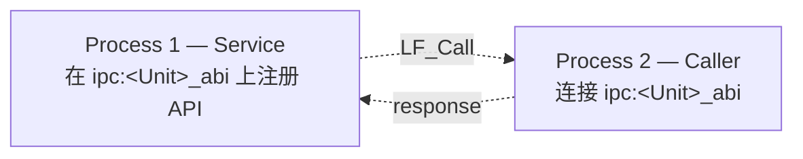
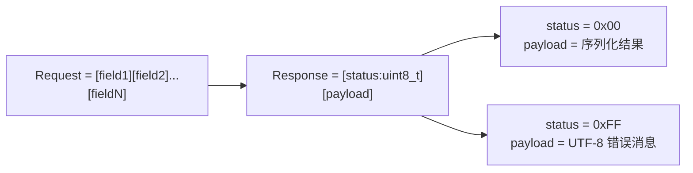

# code_decl_to_abi — User Guide

> **Purpose**: `code_decl_to_abi` 的端到端用户指南。覆盖完整工作流，按实际操作顺序编排：
>
> 1. **使用工具** — 安装、输入 Pascal 单元或 C 头文件、生成跨语言 ABI 源码。
> 2. **使用生成的代码** — 编译、接入应用、配置运行时环境、运行 service/caller 对。
>
> **Audience**: 应用开发者、集成工程师，以及希望通过工具调用驱动该工具的 AI Agent。
>
> **Companion documents**: `code_decl_to_abi_OPERATIONS.md`（内部实现与扩展方法），`pascal_code_abi_rule.md` 与 `C_code_abi_rule.md`（输入契约），`code_decl_to_json_abi_USER_GUIDE.md`（HTTP/JSON 兄弟工具）。
>
> **Language**: 本指南及工具生成的所有源代码与脚本均使用英文。

---

## 目录

**Part I — 使用工具**

- [Chapter 1  工具概览](#chapter-1--工具概览)
- [Chapter 2  为什么使用二进制 ABI：序列化效率](#chapter-2--为什么使用二进制-abi序列化效率)
- [Chapter 3  语言支持](#chapter-3--语言支持)
- [Chapter 4  安装与构建](#chapter-4--安装与构建)
- [Chapter 5  准备输入源码](#chapter-5--准备输入源码)
- [Chapter 6  通过 GUI 生成代码](#chapter-6--通过-gui-生成代码)
- [Chapter 7  通过 CLI 生成代码](#chapter-7--通过-cli-生成代码)
- [Chapter 8  通过 AI Agent (MCP) 生成代码](#chapter-8--通过-ai-agent-mcp-生成代码)
- [Chapter 9  程序化嵌入生成器](#chapter-9--程序化嵌入生成器)

**Part II — 使用生成的代码**

- [Chapter 10  产出物清单与职责](#chapter-10--产出物清单与职责)
- [Chapter 11  生成文件的目录布局与命名](#chapter-11--生成文件的目录布局与命名)
- [Chapter 12  消费各语言产出](#chapter-12--消费各语言产出)
- [Chapter 13  运行时环境配置](#chapter-13--运行时环境配置)
- [Chapter 14  端到端运行 Service/Caller 对](#chapter-14--端到端运行-servicecaller-对)

**Part III — 参考**

- [Chapter 15  类型系统](#chapter-15--类型系统)
- [Chapter 16  线协议](#chapter-16--线协议)
- [Chapter 17  故障排查](#chapter-17--故障排查)
- [Chapter 18  已知限制与路线图](#chapter-18--已知限制与路线图)

---

# Part I — 使用工具

---

## Chapter 1  工具概览

`code_decl_to_abi` 是 LingoFuse 工具链中的**二进制 ABI 代码生成器**。它读取一份**声明文件**，输出一组**匹配的 service 侧与 caller 侧源码**，覆盖多种目标语言。

**输入**：一份完整的 Pascal unit 或一份完整的 C header。

**输出**（每个请求的目标语言一套）：

- 一份 **service 侧库**：将声明的 routine 注册为可远程调用的 API；
- 一份 **caller 侧库**：为每个 routine 暴露一个强类型函数；
- 对大部分语言，附加**测试程序**（`*_test*` 或 `*_main*`）；
- 对大部分非原生语言，附加**测试环境初始化脚本**（`setup_*_tests.ps1`）以及**构建脚本**（`CMakeLists.txt`、`pom.xml`、`Project.toml`、`build.zig`、`build.zig.zon`、`runtests.jl` 等）。

**一句话概括**：给它一份声明文件，它铺开一个任意受支持语言都能调用的二进制 ABI RPC 面。

**新版本变化**：

- **不再生成任何 README/`.md` 文档**：所有构建与运行说明都由本指南承载，或由生成脚本自身携带（脚本内嵌帮助与下一步提示）。
- **目标语言大幅扩展**：从原来的 4 种扩展到 **17 种**（见 Chapter 3）。
- **测试与构建脚本内嵌**：除了代码，每种语言还附带该语言的测试程序与一套 `setup_*_tests.ps1` 环境初始化脚本；语言生态特有的构建文件（CMake / Maven / Cargo / Pub / rebar3 / gcc 编译脚本）由生成器一并产出。

工具拥有**三个共享同一后端的前端**：

| 前端 | 文件 | 受众 |
|------|------|------|
| **GUI** | `code_decl_to_abi_frm.pas` | 桌面交互 |
| **CLI** | `code_decl_to_abi_cmdline.pas` | 脚本 / CI / 自动化 |
| **MCP** | `code_decl_to_abi_mcp_api_tool_provider_unit.pas` | 通过 LingoFuse beacon 接入的 AI Agent |

三个前端驱动**同一批生成器函数**；GUI 与 MCP 路径共用同一套按钮处理程序，不会出现逻辑分叉。

---

## Chapter 2  为什么使用二进制 ABI：序列化效率

这是本工具相对 JSON 兄弟工具存在的核心理由：**在高并发场景下，二进制 ABI 路径显著更高效**。

### 2.1 紧凑、强类型的载荷 — 没有文本编码开销

在 ABI 线格式中，每个参数都以**原生机器表示**写入：

| 类型族 | 线格式编码 |
|--------|-------------|
| 整数 | 小端定宽二进制（1 / 2 / 4 / 8 字节） |
| 浮点 | IEEE 754（`Single` 4 字节、`Double` 8 字节、`Extended` 10 字节） |
| 字符串 | 原始 UTF-8 字节 + 一个 NUL 终止符 |

对比 JSON：

- 需要把每个数字**转成文本**（8 字节 `Int64` 通常变成 8–20 个 ASCII 字节加分隔符）；
- 需要**转义**每个引号、每个反斜杠；
- 需要**结构性标点**（`{}`、`[]`、`:`、`,`）。

### 2.2 热路径上没有任何解析/格式化成本

JSON 在发送端需要 `IntToStr`/`FloatToStr`/转义/拼接，在接收端需要词法分析/数字解析/反转义/结构校验。每次都要分配内存，高并发时这些分配成为主要成本。

二进制 ABI **直接写入预分配缓冲区**：

- 发送一个 `Int64` 就是一次 8 字节 `Move`；
- 发送一个字符串就是一次 `Move` + 一个 NUL 字节；
- 接收是镜像操作。

标量**每个字段零分配**；字符串**只为最终目标字符串分配一次**。

### 2.3 热路径中的零拷贝

生成的 ABI 代码使用 LingoFuse 的**直接缓冲区访问**：

- `LF_WriteBuffer` / `LF_ReadBuffer` 直接操作 handle 内部缓冲区；
- 生成的 Pascal service 用 `LF_ReadStringBytes` / `LF_WriteStringBytes` **直接读写 UTF-8 字节**，不产生中间字符串；
- 定宽字段（`Int64`、`Double`、……）读/写一个栈局部变量，一次 `Move` 搞定。

热路径从不构建 JSON AST：没有树、没有 `Variant` 装箱、没有文本扫描。

### 2.4 高并发下的确定性、低分配

| 项目 | 二进制 ABI | HTTP/JSON |
|------|-----------|-----------|
| 每标量分配 | 0 | 1+（装箱数字或文本片段） |
| 每字符串分配 | 1（最终目标） | 2–4（转义缓冲、片段、最终） |
| 临时 AST | 无 | 有（JSON 对象树） |
| UTF-8 二次编码 | 无（原始字节） | 有（转义 → 反转义往返） |
| 文本解析 | 无 | 有（词法分析 + 数字解析） |
| 分帧 | 定宽二进制头 | 变长文本信封 |

并发数上升时，ABI 路径伸缩更优雅。这正是**service mesh、微服务背板、Agent 工具注册表**需要的画像。

### 2.5 何时选择 ABI 而非 JSON

选择 `code_decl_to_abi`（二进制 ABI）：

- 两端都由你控制，且都原生使用 LingoFuse；
- 载荷偏重数值或二进制；
- 高并发、延迟预算紧张；
- 希望避免每次调用的固定 JSON 解析成本。

选择 `code_decl_to_json_abi`（HTTP/JSON）：

- 一端是浏览器、外部 HTTP 客户端，或没有 LingoFuse 绑定的语言；
- 载荷需可读、可用 `curl` 调试；
- 需要桥接第三方 HTTP API。

两个工具共享相同的输入格式、中间模型和类型系统，仅在**线格式**上不同。

---

## Chapter 3  语言支持

### 3.1 当前状态

工具当前随附 **17 种目标语言**，每种均含 service 侧、caller 侧、测试程序与一套 `setup_*_tests.ps1` 环境初始化脚本。

| # | 目标语言 | `--lang` ID | Service | Caller | Test 程序 | Setup 脚本 | 生态构建文件 |
|---|----------|------------|:-------:|:------:|:---------:|:----------:|--------------|
| 1 | **Pascal** | `pascal` | ✅ | ✅ | ✅ | —（由 test unit 自带） | — |
| 2 | **Python** | `python` | ✅ | ✅ | ✅ | —（模块含 `__main__`） | — |
| 3 | **C++** | `cpp` | ✅ | ✅ | ✅ | — | `CMakeLists.txt` |
| 4 | **C#** | `csharp` | ✅ | ✅ | ✅ | — | — |
| 5 | **Rust** | `rust` | ✅ | ✅ | ✅ | `setup_rust_tests.ps1` | `Cargo.toml` |
| 6 | **Go** | `go` | ✅ | ✅ | ✅ | `setup_go_tests.ps1` | `go.mod` / `go.sum` |
| 7 | **Java** | `java` | ✅ | ✅ | ✅ | `setup_java_tests.ps1` + `run_java_service.ps1` / `run_java_call.ps1` | `pom.xml` |
| 8 | **Node.js** | `nodejs` | ✅ | ✅ | ✅ | `setup_node_tests.ps1` | `package.json` |
| 9 | **TypeScript** | `http_ts` | ✅ | ✅ | ✅ | `setup_ts_tests.ps1` | `tsconfig.json` / `package.json` |
| 10 | **Erlang** | `erlang` | ✅ | ✅ | ✅ | `setup_erlang_tests.ps1` | `rebar.config` / `.app.src` |
| 11 | **Julia** | `julia` | ✅ | ✅ | ✅ | `setup_julia_tests.ps1` + `run_julia_service.ps1` / `run_julia_call.ps1` | `Project.toml` / `runtests.jl` |
| 12 | **Zig** | `zig` | ✅ | ✅ | ✅ | `setup_zig_tests.ps1` | `build.zig` / `build.zig.zon` |
| 13 | **Swift** | `swift` | ✅ | ✅ | ✅ | `setup_swift_tests.ps1` | `Package.swift` |
| 14 | **Ruby** | `ruby` | ✅ | ✅ | ✅ | `setup_ruby_tests.ps1` | — |
| 15 | **Fortran** | `fortran` | ✅ | ✅ | ✅ | `setup_fortran_tests.ps1` | —（gcc/gfortran 直接编译） |
| 16 | **Dart** | `dart` | ✅ | ✅ | ✅ | `setup_dart_tests.ps1` | `pubspec.yaml` |
| 17 | **R** | `r` | ✅ | ✅ | ✅ | `setup_R_tests.ps1` | — |

**Source languages**：`pascal`、`c`。

### 3.2 后端为无限扩展而设计

新增一种目标语言是**机械流程**，不涉及架构变更：

1. 新建两个生成器单元：`<lang>_abi_service_generator_tool.pas` 和 `<lang>_abi_call_generator_tool.pas`；
2. 视需要新增 test 与 setup 生成器；
3. 提供从三类 ABI 类型族（整数 / 浮点 / 字符串）到该语言原生类型的映射表；
4. 在主程序、CLI 分发器、GUI 表单、MCP 工具提供者中注册新单元；
5. 更新 CLI 的 `Detect_Target_Lang_ID` 与帮助文本；
6. 更新 MCP 的工具注册计数断言。

**没有天花板**：只要目标语言满足 (a) 有 C-ABI 兼容的 FFI、(b) 有能说 LingoFuse 线协议的运行时、(c) 能编组三类 ABI 类型，它就是候选。

---

## Chapter 4  安装与构建

### 4.1 编译器与平台

| 项目 | 要求 |
|------|------|
| 编译器 | Free Pascal 3.2+ 或 Delphi 10.4+ |
| 语言模式 | Delphi 模式（`{$mode delphi}`） |
| 源码编码 | UTF-8（`{$CODEPAGE UTF8}`） |
| 平台 | Windows / Linux / macOS |

### 4.2 **工具自身**的运行时依赖

仅在**工具运行时**需要，生成阶段不需要：

| 依赖 | 放置位置 | 缺失后果 |
|------|----------|----------|
| `LingoFuse64.dll` / `liblingofuse.so` / `liblingofuse.dylib` | 工具可执行文件同目录，或系统 PATH | 所有 `LF_*` 调用失败；MCP 工具注册被禁用 |
| `pascal_code_abi_rule.md` | 工具可执行文件目录 | GUI 的 "Pascal rule" 按钮无效 |
| `C_code_abi_rule.md` | 工具可执行文件目录 | GUI 的 "C rule" 按钮无效 |

**生成器本身不需要 LingoFuse 运行时**，只有嵌入在 GUI 进程里的 MCP 提供者需要。

### 4.3 构建

```bash
lazbuild -B code_decl_to_abi.lpi
```

工具以**控制台子系统**编译。这样做是刻意的：

- CLI 模式下 stdout 输出正常；
- GUI 模式仍工作；无 CLI 参数时控制台窗口自动隐藏。

### 4.4 验证构建

```bash
code_decl_to_abi --help
```

预期：输出帮助页（见 Chapter 7）。如果帮助页打印正确，工具就绪。

---

## Chapter 5  准备输入源码

在运行工具之前，输入必须能被解析器提取出声明。Pascal 与 C 规则不同，且都很严格：**违反规则的声明会被静默丢弃**，仅在报告里留一行说明。

### 5.1 Pascal 输入

**完整阅读 `pascal_code_abi_rule.md`** —— 这是解析契约。

硬性规则速览：

- 声明必须**在顶层**、位于 **`interface`** 段。嵌套（类/记录/接口内）的 routine 会被丢弃。
- 参数修饰符只接受：空、`const`、`in`。**`var` 与 `out` 会导致整条声明被丢弃**。
- 类型白名单：
  - 整数：`Integer`、`Int64`、`Cardinal`、`LongInt`、`DWord`、`Word`、`SmallInt`、`Byte`、`UInt64`、`LongWord`
  - 浮点：`Double`、`Single`、`Extended`、`Real`
  - 字符串：`string`、`AnsiString`、`UnicodeString`、`PChar`、`PAnsiChar`、`PWideChar`、`TP_String`、`TPascalString`、`TUPascalString`、`U_String`
- **注释**必须**紧贴**在声明**上方**。`{ … }` 注释内不能有 `}`；如需内嵌花括号请使用 `(* … *)`。
- 返回类型必须**在签名里声明**（`: T`），不能只在注释里写。

最小示例：

```pascal
unit MyUnit;

interface

(*
  Computes the sum of two integers.

  a: first addend
  b: second addend

  Return value: the sum of a and b.
*)
function Add(a: Integer; b: Integer): Integer;

implementation

function Add(a: Integer; b: Integer): Integer;
begin
  Result := a + b;
end;

end.
```

### 5.2 C 输入

**完整阅读 `C_code_abi_rule.md`** —— 这是解析契约。

硬性规则速览：

- 仅提取**顶层函数原型**（以 `;` 结尾）。带函数体的定义被丢弃。
- `struct`、`enum`、`union`、`typedef`、全局变量、`#include` 和其他预处理指令被丢弃。
- 函数指针参数会导致整条声明被丢弃。
- 变参（`...`）会导致整条声明被丢弃。
- 接受的类型：
  - 整数：`signed char`/`int8_t`、`short`/`int16_t`、`int`/`int32_t`、`long`、`long long`/`int64_t` 及对应 `unsigned` 变体
  - 指针宽度整数：`size_t`、`uintptr_t`、`ssize_t`、`ptrdiff_t`、`intptr_t`
  - 浮点：`float`、`double`、`long double`
  - 字符串：`char *`、`const char *`、`char const *`
  - `void`（仅作为返回类型）
- **其他任何指针类型** —— 包括 `void *` —— 都映射为 `Pointer`，会被 Pascal 侧白名单拒绝，因此整条声明被丢弃。**用 `uint64_t` 传地址**。
- 多维数组会被拒绝。单层 `[]` / `[N]` 后缀能通过解析，但随即被 Pascal 侧白名单拒绝。
- 注释必须**紧贴**在声明**上方**，形式为 `/** … */`、`/* … */` 或 `// …`。

最小示例：

```c
/* my_unit.h */
#ifndef MY_UNIT_H
#define MY_UNIT_H

/**
 * Computes the sum of two integers.
 *
 * @param a first addend
 * @param b second addend
 * @return the sum of a and b
 */
int add(int a, int b);

#endif /* MY_UNIT_H */
```

### 5.3 被丢弃声明的处置

违反上述规则的声明会**被静默丢弃**。工具会向 `Report` 写一条说明。GUI 日志、CLI stdout、MCP `ConvertToXxx` 都可见该原因。

工具对丢弃的声明**不会抛异常** —— 它只是不出现在输出里。

---

## Chapter 6  通过 GUI 生成代码

**无参数**运行可执行文件即进入 GUI。

### 6.1 五个 Tab

```
[Welcome] → [Source Code] → [Source <-> JSON] → [JSON <-> Model] → [Final Source]
```

每个 Tab 顶部有「上一步 / 下一步」按钮，底部是日志面板。

### 6.2 Tab 1 — Welcome

- 说明工具与工作流；
- **Pascal rule doc** 打开 `pascal_code_abi_rule.md`；
- **C rule doc** 打开 `C_code_abi_rule.md`；
- **Next: Enter source code** 进入 Tab 2。

### 6.3 Tab 2 — Source Code

| 控件 | 作用 |
|------|------|
| **Select Language** 标签 | 点击后根据粘贴的文本自动检测源语言 |
| **Language Selector** 下拉 | `Auto-detect` / `Pascal` / `C` — 手动覆盖 |
| **Format** | 仅保留顶层声明，丢弃其他 |
| **Empty unit** | 插入所选语言的最小骨架 |
| **Test unit** | 插入一份丰富的语法样例 —— 首次运行的好选择 |
| **Next: Pascal/C → JSON** | 解析当前源码，产生 LV0 JSON，跳到 Tab 3 |

**流程**：

1. 粘贴 Pascal unit 或 C header；
2. 若不确定语言，点击 **Select Language** 标签自动检测；
3. 若语法高亮不对，手动选语言；
4. 点击 **Next: Pascal/C → JSON**。

### 6.4 Tab 3 — Source ↔ JSON

展示 **LV0 JSON**（解析器原始输出）。

| 按钮 | 作用 |
|------|------|
| **Back: rebuild code from JSON** | 从当前 JSON 反向重建源码，写回 Tab 2 |
| **Next: JSON ↔ Model** | 将 LV0 规范化为 LV1 Model，跳到 Tab 4 |

可手工编辑 JSON。若解析器误判某类型，可在此修正后点 **Next**。

### 6.5 Tab 4 — JSON ↔ Model

展示 **LV1 Model JSON** —— 所有生成器的唯一输入。

| 按钮 | 作用 |
|------|------|
| **Back: JSON ↔ Model** | 将 LV1 反向恢复为 LV0，写回 Tab 3 |
| **Next: generate source** | 运行所有生成器，跳到 Tab 5 |

**此时，所有类型不受支持的 routine 都已被丢弃。** 若你期望的函数不在，这里就能发现。见 Chapter 15。

### 6.6 Tab 5 — Final Source

Final Source Tab 每种语言、每侧各一个子 Tab。生成完成时：

- 所有子 Tab 被填充；
- **所有文件也被写入磁盘**，位于：

```
<exe directory>/<UnitName>/
```

命名遵循 Chapter 11 中的约定。

### 6.7 日志面板

底部面板是实时 `DoStatus` 日志。显示：

- 刚刚保存的文件；
- 规范化期间被跳过的 routine；
- 任何生成器抛出的错误；
- MCP 工具提供者的注册状态。

超过 5000 行后自动清空。

---

## Chapter 7  通过 CLI 生成代码

### 7.1 触发条件

**至少一个参数**时进入命令行模式。无参数进入 GUI。

### 7.2 语法

```
code_decl_to_abi --help
code_decl_to_abi --list-languages
code_decl_to_abi <input_file> <output_file>
code_decl_to_abi --call <input_file> <output_file>
code_decl_to_abi --lang <id> <input_file> <output_file>
```

| 参数 | 含义 |
|------|------|
| `--help` / `-h` / `-?` / `/?` | 打印帮助并退出。仅识别为第一个参数 |
| `--list-languages` / `-ll` | 列出所有注册语言与产物类型。仅识别为第一个参数 |
| `--call` / `-c` | 生成 caller 侧。仅识别为第一个参数；默认 service 侧 |
| `--lang` / `-l` | 强制指定目标语言（覆盖扩展名推断） |
| `<input_file>` | 输入文件。语言按扩展名判断 |
| `<output_file>` | 输出文件。目标语言按扩展名或 `--lang` 判断 |

### 7.3 输入语言 → 扩展名

| 扩展名 | 源语言 |
|--------|--------|
| `.pas` / `.pp` / `.p` | Pascal |
| `.h` / `.hpp` / `.hh` / `.c` / `.cpp` / `.cc` / `.cxx` | C |

### 7.4 目标语言 → 扩展名

| 扩展名 | 目标语言 ID | 产物 |
|--------|-------------|------|
| `.pas` / `.pp` / `.p` | `pascal` | service unit / call unit / 两个 test unit |
| `.py` | `python` | service / call / 两个 test 程序 |
| `.hpp` / `.hh` / `.h` / `.cpp` / `.cc` / `.cxx` / `.c` | `cpp` | `.hpp` + `.cpp`（服务与调用两侧）+ `CMakeLists.txt` + 两个 `_main.cpp` |
| `.cs` | `csharp` | service / call / 两个 test 程序 |
| `.rs` | `rust` | service / call / 两个 test 程序 + `setup_rust_tests.ps1` + `Cargo.toml` |
| `.go` | `go` | service / call / 两个 test 程序 + `setup_go_tests.ps1` + `go.mod` |
| `.java` | `java` | service / call / 两个 test 程序 + `setup_java_tests.ps1` + `pom.xml` + 两个 `run_*.ps1` |
| `.js` | `nodejs` | service / call / 两个 test 程序 + `setup_node_tests.ps1` + `package.json` |
| `.ts` | `http_ts` | service / call / 两个 test 程序 + `setup_ts_tests.ps1` + `tsconfig.json` |
| `.erl` | `erlang` | service / call / 两个 `_main.erl` + `setup_erlang_tests.ps1` + `rebar.config` + `.app.src` |
| `.jl` | `julia` | service / call / 两个 test 程序 + `setup_julia_tests.ps1` + `Project.toml` + `runtests.jl` + 两个 `run_*.ps1` |
| `.zig` | `zig` | service / call / 两个 test 程序 + `setup_zig_tests.ps1` + `build.zig` + `build.zig.zon` |
| `.swift` | `swift` | service / call / 两个 test 程序 + `setup_swift_tests.ps1` + `Package.swift` |
| `.rb` | `ruby` | service / call / 两个 test 程序 + `setup_ruby_tests.ps1` |
| `.f90` | `fortran` | service / call / 两个 test 程序 + `setup_fortran_tests.ps1` |
| `.dart` | `dart` | service / call / 两个 test 程序 + `setup_dart_tests.ps1` + `pubspec.yaml` |
| `.R` | `r` | service / call / 两个 test 程序 + `setup_R_tests.ps1` |

### 7.5 输出命名规则

**Pascal 与 Python 遵循你给的文件名。**

**其他语言会替换文件名**为从解析出的源 unit 名派生的规范名字（如 `<Unit>_abi_service.rs`）。**目录部分**保留；仅文件名被替换。原因：生成的构建脚本（CMake / Maven / Cargo / rebar3 等）和测试程序均按该名字引用。

### 7.6 C++ 特例

命名 `.hpp` 或 `.cpp` 任一都会产出两个文件（同 base name），外加 `CMakeLists.txt` 与两个测试程序。因此，两次 CLI 调用（service + caller）会留下一个一致的、可构建的目录。

### 7.7 C# 特例

每次 `.cs` 调用都写出**完整集合**（service + call + 两个 test）。`--call` 被接受但**对 `.cs` 无效果**，因为两个 console 测试程序引用**两个**库的命名空间；只出其中一个会导致测试项目无法编译。

### 7.8 退出码

| Code | 含义 |
|:----:|------|
| `0` | 转换成功 |
| `1` | 缺少或无效的参数 |
| `2` | 源解析失败 |
| `3` | 代码生成失败 |
| `4` | 文件 I/O 错误 |

### 7.9 示例

```bash
# Pascal → Pascal service
code_decl_to_abi calculator.pas calculator_service.pas

# Pascal → Python caller
code_decl_to_abi --call calculator.pas calculator_call.py

# C → C++ service
code_decl_to_abi ComplexTestUnit.h out/ComplexTestUnit_abi_service.hpp

# C → Rust service（自动带 setup_rust_tests.ps1 与 Cargo.toml）
code_decl_to_abi --lang rust ComplexTestUnit.h out/

# 强制指定语言，忽略扩展名
code_decl_to_abi --lang java ComplexTestUnit.h out/
```

### 7.10 Stdout 结构

成功时：

```
Reading: ComplexTestUnit.h (1234 chars)
Output : out/ComplexTestUnit_abi_service.rs
Target : rust
Unit   : ComplexTestUnit
Funcs  : 28
Wrote  : out/ComplexTestUnit_abi_service.rs
Wrote  : out/ComplexTestUnit_abi_call.rs
Wrote  : out/ComplexTestUnit_abi_service_test.rs
Wrote  : out/ComplexTestUnit_abi_call_test.rs
Wrote  : out/Cargo.toml
Wrote  : out/setup_rust_tests.ps1
Done.
```

失败时，工具打印一行诊断并返回非零退出码。**不要依赖具体措辞**，只依赖退出码。

### 7.11 CLI **不**做的事

- 不启动 service 或 caller。你负责编译并运行生成代码。
- 不启动 LingoFuse 运行时。
- 不启动 MCP 工具提供者。
- 不打开任何网络连接。

**这些都属于 Part II。**

---

## Chapter 8  通过 AI Agent (MCP) 生成代码

### 8.1 定位

`code_decl_to_abi_mcp_api_tool_provider_unit.pas` 将整个工具暴露为 **3 个 LingoFuse Call API**，并注册到 **agent beacon**（默认 App `agent_main_app`，默认注册 API `register_agent`）。MCP 客户端可以完全通过工具调用驱动生成。

提供者**模拟 GUI 操作**：每个 `internal_call_*` 通过 `TCompute.Sync` 投递任务到主线程，并调用与 GUI 相同的按钮处理程序。因此 GUI 路径与 MCP 路径**可证明一致**。

### 8.2 Agent 模式要求

- `code_decl_to_abi` **GUI 正在运行**。MCP 提供者活在 GUI 进程内；关闭 GUI 即工具离线。
- **beacon 服务在线**（默认 `agent_main_app`）。
- 两端使用相同 LingoFuse 端点（默认 `ipc:agent`）。
- LingoFuse 运行时可达。

### 8.3 三步式工具工作流

三个工具遵循同一个三步模式：

```
Step 1  CodeDeclToAbi_GenerateAll   — 一次性生成全部目标的所有产物
Step 2  CodeDeclToAbi_GetTargetList — 列举本次会话产生的产物文件名
Step 3  CodeDeclToAbi_GetTargetCode — 按文件名读取某个产物内容
```

- **Step 1 是唯一的"工作"步骤**：它一次性跑完整个流水线（解析 → 规范化 → 生成 → 写盘）。
- **Step 2 与 Step 3 都是纯读取**：它们不触发新的生成，不修改状态。

### 8.4 三个工具

**Step 1**

| 工具 | 参数 | 返回 |
|------|------|------|
| `CodeDeclToAbi_GenerateAll` | `Source: string`、`Language: string` | `{"status":"ok","unit":"<U>","count":N}` 或 `{"error":"<message>"}` |

`Language` 接受 `"pascal"` 或 `"c"`（大小写不敏感）。它表示**源**语言；传入 `"python"` / `"cpp"` / `"csharp"` 会被拒绝（客户端把源语言和目标语言搞混）。

**Step 2**

| 工具 | 参数 | 返回 |
|------|------|------|
| `CodeDeclToAbi_GetTargetList` | 无 | `{"count":N,"files":["<name1>",...]}` |

返回文件名列表（不是路径）。文件名列表顺序不作保证，请按名使用。

**Step 3**

| 工具 | 参数 | 返回 |
|------|------|------|
| `CodeDeclToAbi_GetTargetCode` | `FileName: string` | `{"name":"<file>","content":"<text>"}` 或 `{"error":"..."}` |

`FileName` 必须是 Step 2 返回的**精确文件名**，包含扩展名。比较大小写敏感。

### 8.5 推荐序列

```
# 最小完整流程
CodeDeclToAbi_GenerateAll(Source = "<contents of calculator.pas>", Language = "pascal")
CodeDeclToAbi_GetTargetList()
CodeDeclToAbi_GetTargetCode("Calculator_abi_service_unit.pas")
CodeDeclToAbi_GetTargetCode("Calculator_abi_call_unit.pas")
```

### 8.6 Agent 模式注意事项

1. **源语言必须是 `pascal` 或 `c`**；其他一律拒绝。
2. **顺序强制**：Step 1 → Step 2 → Step 3。
3. **`GenerateAll` 是同步的**：所有产物写入磁盘后，它才返回。
4. **GUI 必须活着**：没有无头 MCP 模式。
5. **生成代码 ≠ 运行代码**：Part II 仍然适用。
6. **产物清单是不稳定的**：`count` 取决于源 unit 中有多少 routine 通过类型白名单，不是编译期常量。

### 8.7 Agent 交互示例

```
# 1. 一次性生成全部目标
CodeDeclToAbi_GenerateAll(
    Source   = "<contents of calculator.pas>",
    Language = "pascal")
# 返回 {"status":"ok","unit":"Calculator","count":17}

# 2. 列举本次产物
CodeDeclToAbi_GetTargetList()
# 返回 {"count":17,"files":["Calculator_abi_service_unit.pas","Calculator_abi_call_unit.pas","Calculator_abi_service.py",...]}

# 3. 读取你需要的产物
CodeDeclToAbi_GetTargetCode("Calculator_abi_service_unit.pas")
CodeDeclToAbi_GetTargetCode("Calculator_abi_call.py")
CodeDeclToAbi_GetTargetCode("CMakeLists.txt")
```

Agent 随后可将产物交给用户，或在允许的前提下直接执行生成脚本。

---

## Chapter 9  程序化嵌入生成器

对希望嵌入生成器（而非启动它）的工具与服务，`code_decl_to_abi` 公开一组小型 API。这些正是 CLI、GUI、MCP 提供者内部调用的函数。

### 9.1 模型构建

```pascal
var
  Parser: tpascal_func_decl_tool;
  Model: TPascal_Func_Model;
  Report: TPascalStringList;
begin
  Parser := tpascal_func_decl_tool.CreateFrom_Pascal_Code(SourceText);
  try
    Report := TPascalStringList.Create;
    try
      Model := TPascal_Func_Model.Create;
      try
        Model.Typ_Normalize_Func := tnf_ABI;   // 生成 ABI 时必需
        Model.LoadFromParser(Parser, Report);
        // 现在 Model 可供生成器函数使用
      finally
        Model.Free;
      end;
    finally
      Report.Free;
    end;
  finally
    Parser.Free;
  end;
end;
```

C header 输入时，将 `CreateFrom_Pascal_Code` 换成 `CreateFrom_C_Code`。`LoadFromParser` 应用 Chapter 15 描述的六道过滤，因此 Model 中只包含类型受支持的 routine。

### 9.2 生成器入口

每个生成器单元导出一到多个函数，每个函数返回一份 `TPascalStringList`，调用者负责释放。

**注意新版本不再有 `*Readme` 函数**。示例（Rust）：

```pascal
function GenerateABIServiceRsCode(Model: TPascal_Func_Model): TPascalStringList;
function GenerateABICallRsCode(Model: TPascal_Func_Model): TPascalStringList;
function GenerateABIServiceTestRsCode(Model: TPascal_Func_Model): TPascalStringList;
function GenerateABICallTestRsCode(Model: TPascal_Func_Model): TPascalStringList;
function GenerateRustTestSetupScript(Model: TPascal_Func_Model): TPascalStringList;
```

其他语言类似：`GenerateABIService<Lang>Code`、`GenerateABICall<Lang>Code`，视需要附加 `GenerateABI<Lang>TestCode`、`Generate<Lang>TestSetupScript`、`GenerateABICmakeScript` 等。

### 9.3 最小可行嵌入

```pascal
var
  Parser: tpascal_func_decl_tool;
  Model: TPascal_Func_Model;
  Code: TPascalStringList;
begin
  Parser := tpascal_func_decl_tool.CreateFrom_Pascal_Code(SourceText);
  try
    Model := TPascal_Func_Model.Create;
    try
      Model.Typ_Normalize_Func := tnf_ABI;
      Model.LoadFromParser(Parser, nil);      // nil report = silent
      Code := GenerateABIServicePascalCode(Model);
      try
        if Code <> nil then
          Code.SaveToFile('MyUnit_abi_service_unit.pas');
      finally
        Code.Free;
      end;
    finally
      Model.Free;
    end;
  finally
    Parser.Free;
  end;
end;
```

---

# Part II — 使用生成的代码

工具的职责在文件写入磁盘时终止。Part II 说明如何处理它们。

---

## Chapter 10  产出物清单与职责

### 10.1 每种语言的产出

**Pascal**

| 类别 | 文件名 |
|------|--------|
| service | `<Unit>_abi_service_unit.pas` |
| caller | `<Unit>_abi_call_unit.pas` |
| service test | `<Unit>_abi_service_test_unit.pas` |
| call test | `<Unit>_abi_call_test_unit.pas` |

**Python**

| 类别 | 文件名 |
|------|--------|
| service | `<Unit>_abi_service.py`（含 `__main__` 测试入口） |
| caller | `<Unit>_abi_call.py` |
| service test | `<Unit>_abi_service_test.py` |
| call test | `<Unit>_abi_call_test.py` |

**C++**

| 类别 | 文件名 |
|------|--------|
| service 头 | `<Unit>_abi_service.hpp` |
| service 实现 | `<Unit>_abi_service.cpp` |
| caller 头 | `<Unit>_abi_call.hpp` |
| caller 实现 | `<Unit>_abi_call.cpp` |
| 构建脚本 | `CMakeLists.txt` |
| service test | `<Unit>_abi_service_main.cpp` |
| call test | `<Unit>_abi_call_main.cpp` |

**C#**

| 类别 | 文件名 |
|------|--------|
| service | `<Unit>_abi_service.cs` |
| caller | `<Unit>_abi_call.cs` |
| service test | `<Unit>_abi_service_test___.cs` |
| call test | `<Unit>_abi_call_test___.cs` |

**Rust**

| 类别 | 文件名 |
|------|--------|
| service | `<Unit>_abi_service.rs` |
| caller | `<Unit>_abi_call.rs` |
| service test | `<Unit>_abi_service_test.rs` |
| call test | `<Unit>_abi_call_test.rs` |
| setup | `setup_rust_tests.ps1` |

**Go**

| 类别 | 文件名 |
|------|--------|
| service | `<Unit>_abi_service.go` |
| caller | `<Unit>_abi_call.go` |
| service test | `<Unit>_abi_service_test.go` |
| call test | `<Unit>_abi_call_test.go` |
| setup | `setup_go_tests.ps1` |

**Java**

| 类别 | 文件名 |
|------|--------|
| service | `<Unit>AbiService.java` |
| caller | `<Unit>AbiCall.java` |
| service test | `<Unit>AbiServiceMain.java` |
| call test | `<Unit>AbiCallTestMain.java` |
| 构建 | `pom.xml` |
| setup + run | `setup_java_tests.ps1` / `run_java_service.ps1` / `run_java_call.ps1` |

**Node.js**

| 类别 | 文件名 |
|------|--------|
| service | `<Unit>_abi_service.js` |
| caller | `<Unit>_abi_call.js` |
| service test | `<Unit>_abi_service_test.js` |
| call test | `<Unit>_abi_call_test.js` |
| setup | `setup_node_tests.ps1` |

**TypeScript**（`http_ts`）

| 类别 | 文件名 |
|------|--------|
| service | `<Unit>_abi_service.ts` |
| caller | `<Unit>_abi_call.ts` |
| service test | `<Unit>_abi_service_test.ts` |
| call test | `<Unit>_abi_call_test.ts` |
| setup | `setup_ts_tests.ps1` |

**Erlang**

| 类别 | 文件名 |
|------|--------|
| service | `<Unit>_abi_service.erl` |
| caller | `<Unit>_abi_call.erl` |
| service test | `<Unit>_abi_service_main.erl` |
| call test | `<Unit>_abi_call_main.erl` |
| setup | `setup_erlang_tests.ps1` |

**Julia**

| 类别 | 文件名 |
|------|--------|
| service | `<Unit>_abi_service.jl` |
| caller | `<Unit>_abi_call.jl` |
| service test | `<Unit>_abi_service_test.jl` |
| call test | `<Unit>_abi_call_test.jl` |
| setup / run | `setup_julia_tests.ps1` / `run_julia_service.ps1` / `run_julia_call.ps1` |
| 构建 | `Project.toml` / `runtests.jl` |

**Zig**

| 类别 | 文件名 |
|------|--------|
| service | `<Unit>_abi_service.zig` |
| caller | `<Unit>_abi_call.zig` |
| service test | `<Unit>_abi_service_test.zig` |
| call test | `<Unit>_abi_call_test.zig` |
| setup | `setup_zig_tests.ps1` |

**Swift**

| 类别 | 文件名 |
|------|--------|
| service | `<Unit>_abi_service.swift` |
| caller | `<Unit>_abi_call.swift` |
| service test | `<Unit>_abi_service_test.swift` |
| call test | `<Unit>_abi_call_test.swift` |
| setup | `setup_swift_tests.ps1` |

**Ruby**

| 类别 | 文件名 |
|------|--------|
| service | `<Unit>_abi_service.rb` |
| caller | `<Unit>_abi_call.rb` |
| service test | `<Unit>_abi_service_test.rb` |
| call test | `<Unit>_abi_call_test.rb` |
| setup | `setup_ruby_tests.ps1` |

**Fortran**

| 类别 | 文件名 |
|------|--------|
| service | `<Unit>_abi_service.f90` |
| caller | `<Unit>_abi_call.f90` |
| service test | `<Unit>_abi_service_test.f90` |
| call test | `<Unit>_abi_call_test.f90` |
| setup | `setup_fortran_tests.ps1` |

**Dart**

| 类别 | 文件名 |
|------|--------|
| service | `<Unit>_abi_service.dart` |
| caller | `<Unit>_abi_call.dart` |
| service test | `<Unit>_abi_service_test.dart` |
| call test | `<Unit>_abi_call_test.dart` |
| setup | `setup_dart_tests.ps1` |

**R**

| 类别 | 文件名 |
|------|--------|
| service | `<Unit>_abi_service.R` |
| caller | `<Unit>_abi_call.R` |
| service test | `<Unit>_abi_service_test.R` |
| call test | `<Unit>_abi_call_test.R` |
| setup | `setup_R_tests.ps1` |

### 10.2 各文件职责

- **Service 代码**：把 API 注册进 LingoFuse，解码二进制请求，调用用户的 `internal_call_<Api>` 桩，编码二进制响应。
- **Caller 代码**：每个 API 一个强类型函数，编组参数，发起 LingoFuse 调用，反序列化结果，在错误时抛出语言相应的异常。
- **测试程序**：可独立运行的最小程序，端到端跑通产物。所有语言都有，形态各异（`__main__` 块、独立 `main`、`examples/` 下的 `main.rs`、`escript` 入口等）。
- **`setup_*_tests.ps1`**：一键环境初始化脚本。承载了该语言的**构建、依赖安装、语法检查、冒烟测试、下一步提示**，等价于旧版 README 的可执行形态。

### 10.3 使用前必须编辑的地方

**每种**目标语言均需：

1. **填写 `internal_call_<Api>` 桩体**。工具输出 `TODO` 占位；你替换成对真实实现的调用。
2. **放置运行时库**（`LingoFuse64.dll` / `liblingofuse.so` / `liblingofuse.dylib`）到进程可寻址处。见 Chapter 13。
3. **先启动 service 进程**，再启动任何 caller 进程。见 Chapter 14。

其余 —— 线格式、序列化助手、回调、注册函数 —— 已经正确。

---

## Chapter 11  生成文件的目录布局与命名

### 11.1 GUI 模式的目录布局

在 GUI 下，所有产物写入：

```
<exe directory>/<UnitName>/
```

### 11.2 CLI 模式的目录布局

在 CLI 下，目录由调用者决定（通过输出参数）；文件名规则：

- **Pascal / Python**：完全按你给的；
- **其他语言**：按源 unit 名派生的规范名（如 `<Unit>_abi_service.rs`）。

### 11.3 Setup 脚本的默认输出

`setup_*_tests.ps1` 由生成器固定写在输出目录根部，文件名固定为：

- `setup_rust_tests.ps1`
- `setup_go_tests.ps1`
- `setup_java_tests.ps1`
- `setup_node_tests.ps1`
- `setup_ts_tests.ps1`
- `setup_erlang_tests.ps1`
- `setup_julia_tests.ps1`
- `setup_zig_tests.ps1`
- `setup_swift_tests.ps1`
- `setup_ruby_tests.ps1`
- `setup_fortran_tests.ps1`
- `setup_dart_tests.ps1`
- `setup_R_tests.ps1`

以及部分语言附加的 run 脚本、构建脚本（`pom.xml`、`CMakeLists.txt`、`Project.toml`、`build.zig`、`build.zig.zon` 等）。

### 11.4 一个完整示例

假设输入是 `Calculator.pas`，目标目录 `out/`，要求全部语言的 service 侧：

```
out/
├── Calculator_abi_service_unit.pas       (Pascal service)
├── Calculator_abi_service_test_unit.pas
├── Calculator_abi_service.py             (Python service)
├── Calculator_abi_service_test.py
├── Calculator_abi_service.hpp            (C++ service)
├── Calculator_abi_service.cpp
├── Calculator_abi_service_main.cpp
├── CMakeLists.txt
├── Calculator_abi_service.cs             (C# service)
├── Calculator_abi_service_test___.cs
├── Calculator_abi_service.rs             (Rust service)
├── Calculator_abi_service_test.rs
├── setup_rust_tests.ps1
├── Cargo.toml
├── Calculator_abi_service.go             (Go service)
├── setup_go_tests.ps1
├── go.mod
├── CalculatorAbiService.java             (Java service)
├── pom.xml
├── setup_java_tests.ps1
├── run_java_service.ps1
├── Calculator_abi_service.js             (Node.js service)
├── setup_node_tests.ps1
├── Calculator_abi_service.ts             (TypeScript service)
├── setup_ts_tests.ps1
├── Calculator_abi_service.erl            (Erlang service)
├── setup_erlang_tests.ps1
├── rebar.config
├── Calculator_abi_service.jl             (Julia service)
├── Project.toml
├── setup_julia_tests.ps1
├── run_julia_service.ps1
├── Calculator_abi_service.zig            (Zig service)
├── setup_zig_tests.ps1
├── build.zig
├── build.zig.zon
├── Calculator_abi_service.swift          (Swift service)
├── setup_swift_tests.ps1
├── Calculator_abi_service.rb             (Ruby service)
├── setup_ruby_tests.ps1
├── Calculator_abi_service.f90            (Fortran service)
├── setup_fortran_tests.ps1
├── Calculator_abi_service.dart           (Dart service)
├── setup_dart_tests.ps1
├── Calculator_abi_service.R              (R service)
└── setup_R_tests.ps1
```

调用侧同理，只是文件名由 `_service` 换成 `_call`。

---

## Chapter 12  消费各语言产出

本章按语言给出**构建与运行**的高层流程。**确切的构建命令与依赖安装在 `setup_*_tests.ps1` 的 `-Help` 输出与脚本顶部注释里**（脚本自身就是该语言的构建手册）。

### 12.1 Pascal

- **构建**：`fpc -Fu<dir-with-lingofuse_import.pas> -Fu<dir-with-Z.Core.pas> your_program.pas`
- **填充桩体**：打开 `_abi_service_unit.pas`，将 `internal_call_<Api>` 函数体替换为对真实函数的调用。
- **调用**：`_abi_call_unit.pas` 完全生成 —— 无需编辑，直接编译调用。
- **shutdown 顺序**：`LF_ExitMainThread` → `LF_FreeApp(App)`（仅 service）→ `LF_Shutdown`。

### 12.2 Python

- **依赖**：`pip install py-lingofuse`，或 `PYTHONPATH` 指向 `<v3>/src`。
- **填充桩体**：打开 `_abi_service.py`，替换 `internal_call_<Api>` 的函数体。
- **运行 service**：`python <Unit>_abi_service.py`（模块自带 `__main__`）。
- **运行 call test**：`python <Unit>_abi_call_test.py`。
- **超时调整**：`import <Unit>_abi_call as abi; abi.ABI_TIMEOUT = 30000`。

### 12.3 C++

- **构建**：推荐 CMake —— `cmake -S . -B build -DLINGOFUSE_CPP_DIR=<dir-with-LingoFuse.h>; cmake --build build`。
- **填充桩体**：打开 `_abi_service.cpp`，替换 `internal_call_<Api>` 桩体。
- **运行**：先 `./<Unit>_abi_service_main`，再 `./<Unit>_abi_call_main`。
- **MSVC**：必须加 `/utf-8`。
- **超时/目标 App**：在 `<Unit>_abi` 命名空间调整 `ABI_Timeout` 与 `ABI_TargetApp`。

### 12.4 C#

- **构建**：每个 `.cs` 库都是一个 class library（**没有 `Main`**）。测试程序独立成一个 console 项目。
- **填充桩体**：打开 `_abi_service.cs`，替换 `InternalCalls.InternalCall_<Api>` 方法体。
- **运行 service test**：
  ```bash
  dotnet new console -o service_test && cd service_test
  cp ../<Unit>_abi_service.cs .
  cp ../<Unit>_abi_service_test___.cs Program.cs
  cp ../LingoFuse64.dll .
  dotnet run
  ```
- **运行 call test**：同上，换 `_call.cs` 与 `_call_test___.cs`。

### 12.5 Rust

- **构建**：`cargo build`
- **填充桩体**：`src/service.rs` 中的 `internal_call_<Api>` 函数体。
- **运行**：`cargo run --example service_test`，另一个终端 `cargo run --example call_test`。
- **环境**：先生成 `setup_rust_tests.ps1`，按 `-Help` 使用。

### 12.6 Go

- **构建**：`go build ./...`
- **填充桩体**：`<Unit>_abi_service.go` 中的 `internalCall<Api>`。
- **运行**：`setup_go_tests.ps1` 会把库与两个 test 主程序整理到 `.go_clean_build/`，随后 `go run ./<Unit>_abi_service_test` 与 `go run ./<Unit>_abi_call_test`。

### 12.7 Java

- **构建**：`mvn -q -DskipTests compile`（`pom.xml` 已生成）。
- **填充桩体**：`<Unit>AbiService.java` 中的 `internal_call_<Api>` 方法体。
- **运行**：`run_java_service.ps1` / `run_java_call.ps1`。

### 12.8 Node.js

- **依赖**：`npm install`（在 `setup_node_tests.ps1` 中已包含 lingofuse-js 的本地链接）。
- **填充桩体**：`<Unit>_abi_service.js` 中的 `internal_call_<Api>` 函数体。
- **运行**：`node <Unit>_abi_service_test.js` 与 `node <Unit>_abi_call_test.js`。

### 12.9 TypeScript（`http_ts`）

- **依赖**：`npm install`（`setup_ts_tests.ps1` 会生成 `tsconfig.json`、`package.json`，并自动链接 `lingofuse-ts`）。
- **填充桩体**：`<Unit>_abi_service.ts` 中的 `internal_call_<Api>`。
- **运行**：默认 `tsx` 执行 `.ts`；加 `-Compiled` 会用 `tsc` 编译到 `dist/` 后运行 `.js`。

### 12.10 Erlang

- **构建**：`setup_erlang_tests.ps1` 生成 `rebar.config` 与 `.app.src`，并编译。
- **填充桩体**：`<Unit>_abi_service.erl` 中的 `internal_call_<Api>`。
- **运行**：`erl -noshell -pa ... -eval "<Unit>_abi_service_main:main([])."` 与对应 call 主程序。

### 12.11 Julia

- **构建**：`setup_julia_tests.ps1` 生成 `Project.toml` 与 `runtests.jl`。
- **填充桩体**：`<Unit>_abi_service.jl` 中的 `_internal_call_<Api>_default`。
- **运行**：`run_julia_service.ps1`（终端 A）与 `run_julia_call.ps1`（终端 B）。要求 `--threads=2`。

### 12.12 Zig

- **构建**：`zig build`
- **填充桩体**：`<Unit>_abi_service.zig` 中的 `internal_call_<api>`。
- **运行**：`zig-out/bin/<Unit>_abi_service_test` 与 `zig-out/bin/<Unit>_abi_call_test`。

### 12.13 Swift

- **构建**：`swift build`（`Package.swift` 由 setup 脚本生成）。
- **填充桩体**：`<Unit>_abi_service.swift` 中的 `internalCall_<Api>`。
- **运行**：`swift run ServiceTest`（终端 A）与 `swift run CallTest`（终端 B）。

### 12.14 Ruby

- **依赖**：`lingofuse` gem（setup 脚本会校验其存在与 API 完整性）。
- **填充桩体**：`<Unit>_abi_service.rb` 中的 `internal_call_<Api>`。
- **运行**：`ruby <Unit>_abi_service_test.rb` 与 `ruby <Unit>_abi_call_test.rb`。

### 12.15 Fortran

- **构建**：`setup_fortran_tests.ps1` 使用 `gfortran` 直接编译（需要 gcc / g++ / gfortran）。
- **填充桩体**：`<Unit>_abi_service.f90` 中的 `internal_call_<api>`。
- **运行**：`.fortran_build/<Unit>_abi_service_test.exe` 与 `_call_test.exe`。

### 12.16 Dart

- **构建**：`dart pub get`（`setup_dart_tests.ps1` 生成 `pubspec.yaml`，链接 `lingofuse` Dart 包，拷贝 `lf_dart_bridge.dll`）。
- **填充桩体**：`<Unit>_abi_service.dart` 中的 `internal_call_<Api>`。
- **运行**：`dart run <Unit>_abi_service_test.dart` 与 `dart run <Unit>_abi_call_test.dart`。

### 12.17 R

- **依赖**：`lingofuse` R 包（setup 脚本会探测 API surface 完整性）、可选 `bit64`。
- **填充桩体**：`<Unit>_abi_service.R` 中的 `internal_call_<Api>`。
- **运行**：`Rscript --vanilla <Unit>_abi_service_test.R` 与 `<Unit>_abi_call_test.R`。

---

## Chapter 13  运行时环境配置

本章对**所有目标语言**适用。覆盖每个生成程序在运行时都需要的二进制文件与端点。

### 13.1 运行时二进制

| 文件 | 作用 |
|------|------|
| `LingoFuse64.dll`（Windows）/ `liblingofuse.so`（Linux）/ `liblingofuse.dylib`（macOS） | LingoFuse 核心运行时。所有 `LF_*` 调用经由此 |
| `z_ipc_*.dll` / `libz_ipc_*.so` | IPC 传输插件。loopback 端点必需 |
| `LingoFuse.hpp` / `lf_io.hpp`（仅 C++） | C++ 包装头 |
| `LingoFuse.h` / `LingoFuse.c`（仅 C++） | C ABI 声明与动态加载包装源码 |

### 13.2 放置位置

| 环境 | 放置位置 |
|------|----------|
| Pascal / Python / C++ / C# 等 | 可执行文件同目录，或系统 loader search path |
| Linux / BSD | `LD_LIBRARY_PATH` |
| macOS | `DYLD_LIBRARY_PATH` |
| Windows | `PATH`，或可执行文件同目录 |

C++ 测试程序显式调用 `LF_LoadLibrary()`；其他语言依赖 OS loader。

### 13.3 默认 IPC 端点

按约定，每个 ABI service 监听：

```
ipc:<UnitName>_abi
```

例如源 unit 为 `Calculator` 时端点就是 `ipc:Calculator_abi`。`<UnitName>` 由解析器从源文件提取。所有语言的生成代码都使用同一端点约定，因此 Python caller 可直连 Pascal service，C# caller 可直连 C++ service —— 无需手工协调。

### 13.4 运行时线程模型

运行时在 C ABI 层**完全线程安全**。但：

- **回调在 worker 线程执行**，不是主线程。每个生成的回调都被语言相应的守卫包装，避免异常逃逸到 C 栈。
- **回调内不要调用 `LF_Call` / `LF_Notify`**。会导致 worker 线程自锁。若需在回调中到达另一个服务，请将工作投递到独立线程。
- **回调内不要阻塞**。长时间运行的回调会占用 worker 池线程。

### 13.5 运行时环境变量

| 变量 | 作用 |
|------|------|
| `LD_LIBRARY_PATH`（Linux）/ `DYLD_LIBRARY_PATH`（macOS） | 追加 loader 搜索目录 |
| `PATH`（Windows） | 同上，Windows 用 |

**没有**通过环境变量覆盖 LingoFuse 运行时文件名的机制，也**没有**在 C ABI 层指向任意目录运行时的方式。要么放到可执行文件同目录，要么放到 loader search path。

---

## Chapter 14  端到端运行 Service/Caller 对

本章是**最短的端到端配方**：两个进程，一个 service，一个 caller，同机 loopback IPC。

### 14.1 流程示意



### 14.2 Step 1 — 构建 service 与 caller

每种语言按 Chapter 12 对应小节或 `setup_*_tests.ps1 -Help` 执行。你最终会得到两个可执行文件（Python 是两个可运行模块），都指向同一端点。

### 14.3 Step 2 — 放置运行时二进制

确保两个进程都能找到 `LingoFuse64.dll` / `liblingofuse.so` / `liblingofuse.dylib` 与 `z_ipc_*.dll` / `libz_ipc_*.so`。见 Chapter 13。

### 14.4 Step 3 — 启动 service

在**终端 1**：

- Pascal / C++ / C# / Rust / Go / Zig / Swift / Fortran：运行你编译的 service 可执行文件；
- Python：`python <Unit>_abi_service.py`；
- Node.js：`node <Unit>_abi_service_test.js`；
- Java：`run_java_service.ps1`；
- Julia：`run_julia_service.ps1`；
- Dart：`dart run <Unit>_abi_service_test.dart`；
- Ruby：`ruby <Unit>_abi_service_test.rb`；
- Erlang：`erl -noshell -pa ... -eval "<Unit>_abi_service_main:main([])."`；
- R：`Rscript --vanilla <Unit>_abi_service_test.R`；
- TypeScript：`node <tsx> <Unit>_abi_service_test.ts` 或 `node dist/<Unit>_abi_service_test.js`。

等待打印类似：

```
[OK] Service ready on ipc:<Unit>_abi.
```

### 14.5 Step 4 — 启动 caller

在**终端 2**：

- 同语言对应 call test；
- 或你自己的应用代码直接 import caller 库。

test 程序会为每个 API 调用一次并打印结果；你的应用按需调用。

### 14.6 Step 5 — 干净关闭

在 service 终端：

1. 按 Enter（或输入 `exit`）触发 shutdown；
2. 看到 `[OK] Shutdown complete.`；
3. service 释放 App handle 并关闭运行时。

caller 侧在程序退出时自行关闭。

### 14.7 完整示例

源：

```pascal
unit Calculator;

interface

(* Adds two integers. *)
function Add(a: Integer; b: Integer): Integer;

(* Multiplies two integers. *)
function Mul(a: Integer; b: Integer): Integer;

implementation
end.
```

生成并编译后：

1. service 进程在 `ipc:Calculator_abi` 上注册 `Add` 与 `Mul`；
2. caller 进程连接 `ipc:Calculator_abi` 并调用 `Add(20, 22)`；
3. caller 打印 `42`。

### 14.8 混合语言部署

ABI 线协议与语言无关。你可以：

- Python service ↔ C++ caller；
- Pascal service ↔ C# caller；
- C++ service ↔ Python caller；
- 任意其他组合。

唯一要求：两端都由**同一源 unit**生成，且都说 LingoFuse 二进制 ABI 线格式。

---

# Part III — 参考

---

## Chapter 15  类型系统

### 15.1 三个受支持类型族

**整数族**：`integer`、`longint`、`int64`、`cardinal`、`dword`、`longword`、`uint64`、`word`、`smallint`、`byte`。

**浮点族**：`double`、`single`、`extended`、`real`。

**字符串族**：`string`、`ansistring`、`unicodestring`、`tpascalstring`、`tupascalstring`、`tp_string`、`pchar`、`pansichar`、`pwidechar`。

### 15.2 各目标语言类型映射（节选）

| ABI 族 | Pascal | Python | C++ | C# | Rust | Go | Java | Node.js | Zig | Swift | Ruby |
|--------|--------|--------|-----|-----|------|-----|------|---------|-----|-------|------|
| String | `string` | `str` | `std::string` | `string` | `String` | `string` | `String` | `string` | `[]u8` | `String` | `String` |
| Float (double) | `Double` | `float` | `double` | `double` | `f64` | `float64` | `double` | `number` | `f64` | `Double` | `Float` |
| Float (single) | `Single` | `float` | `float` | `float` | `f32` | `float32` | `float` | `number` | `f32` | `Float` | `Float` |
| Int32 | `Integer` | `int` | `int32_t` | `int` | `i32` | `int32` | `int` | `number` | `i32` | `Int32` | `Integer` |
| Int64 | `Int64` | `int` | `int64_t` | `long` | `i64` | `int64` | `long` | `bigint` | `i64` | `Int64` | `Integer` |

（完整映射见各生成器单元中的 `ABI_Type_To_<Lang>_Decl` 函数。）

### 15.3 不受支持类型 — 静默丢弃

以下类型会导致**整条 routine 被静默丢弃**：

- `Boolean`、`WordBool`、`LongBool`
- `Variant`、`OleVariant`
- 数组、记录、类、接口
- 枚举、集合、泛型
- 指针、函数指针
- `Currency`、`Comp`、`TDateTime`
- 任何 C `struct` / `enum` / `union`
- 除 `char *` / `const char *` / `char const *` 之外的任何 C 指针

### 15.4 `LoadFromParser` 的六道过滤

模型构建阶段执行六道过滤，任何一道触发都会让该 routine 从模型中消失：

1. `IsProc = False`
2. `NestLevel <> 0`（声明在类、记录或接口内部）
3. 空参数名
4. `var` / `out` 参数修饰符
5. 参数类型不受支持
6. 返回类型不受支持

**变通方法**：在调用前将复杂值序列化为 `string`，接收侧再反序列化。

---

## Chapter 16  线协议

### 16.1 请求与响应形态



### 16.2 字段编码

| 类型 | 编码 |
|------|------|
| 整数 | 小端定宽 |
| 浮点 | IEEE 754（`Single` 4 字节、`Double` 8 字节、`Extended` 10 字节） |
| 字符串 | 原始 UTF-8 字节 + 一个 NUL 终止符 |

### 16.3 状态字节语义

| Status | 含义 | Payload |
|:------:|------|---------|
| `0x00` | 成功 | 序列化结果；procedure 时为空 |
| `0xFF` | 失败 | UTF-8 错误消息 |

生成的 service 总是在写任何载荷前先写两个状态之一。生成的 caller 先读状态；非 `0x00` 时抛出语言相应的异常。

### 16.4 并发画像

线格式刻意做到**低分配**：

- 从不构建 JSON AST；
- 字符串以原始 UTF-8 字节搬运，不做转义/反转义往返；
- 无文本解析：无数字解析器、无词法分析、无结构校验；
- 每次调用的分配：handle 一次（从池中复用），加上每个目标字符串一次。

这正是**高并发 service mesh 与微服务背板**需要的画像。

### 16.5 跨语言混用

线格式与语言无关。任何正确实现编码器与解码器的语言都能与任何其他语言通信。当前 17 个后端对相同签名产生的线格式**逐字节相同**。

---

## Chapter 17  故障排查

### 17.1 生成期问题

| 症状 | 根因 | 修复 |
|------|------|------|
| CLI 报 "cannot detect source language" | 输入文件扩展名不在源语言表 | 重命名，或更新 `Detect_Source_Lang` |
| CLI 报 "cannot detect target language" | 输出文件扩展名不在目标语言表，且未给 `--lang` | 重命名、或用 `--lang` 指定 |
| 期望的 routine 不在模型中 | 六道过滤之一触发 | 见 Chapter 15 |
| 全部 routine 缺失 | 源中没有顶层 routine，或全部未通过类型检查 | 查看报告 |
| MCP `GenerateAll` 返回 `{"error":"Unsupported source language"}` | 传了目标语言（`python` / `cpp` / `csharp`）而非源语言 | 传 `pascal` 或 `c` |
| MCP `GetTargetCode` 返回 `{"error":"File ... is not in the current target list"}` | 文件名有误，或未先调用 `GetTargetList` | 先 `GetTargetList` 并按返回文件名精确匹配 |
| MCP `RegisterTools` 返回 False | beacon 不可达，或 `regCount` 不匹配 | 检查 `LF_CheckApiEx(BEACON_APP, REGISTER_API)` |

### 17.2 构建期问题

| 症状 | 语言 | 修复 |
|------|------|------|
| `Can't find unit Z.Core` | Pascal | 加 `-Fu<dir-with-Z.Core.pas>` |
| `Can't find unit lingofuse_import` | Pascal | 加 `-Fu<dir-with-lingofuse_import.pas>` |
| `ModuleNotFoundError: lingofuse` | Python | `pip install py-lingofuse`，或设 `PYTHONPATH` |
| `fatal error: LingoFuse.hpp: No such file` | C++ | 加 `-I<dir-with-LingoFuse.hpp>`，或设 `LINGOFUSE_CPP_DIR` |
| `undefined reference to LF_*` | C++ | 加 `-lLingoFuse` 与 `-L<dir>` |
| `error CS0017: Program has more than one entry point` | C# | 你给生成的库加了 `Main`，或旧拷贝残留。删旧再重新生成 |
| `error CS0246: type or namespace not found` | C# | 匹配的库 `.cs` 不在项目中 |
| `cargo build` 找不到 `lingofuse` crate | Rust | `setup_rust_tests.ps1 -Help` 检查 `Cargo.toml` 中 `lingofuse = { path = ... }` |
| `go: module not found` | Go | `setup_go_tests.ps1` 检查 `go.mod` 与 `replace` 指令 |
| `mvn compile` 找不到依赖 | Java | `setup_java_tests.ps1` 检查 `lib/lingofuse.jar` 与 `pom.xml` systemPath |
| `npm install` 失败 | Node.js / TS | `setup_node_tests.ps1` / `setup_ts_tests.ps1` 检查网络与 `LingoFuseJs` / `LingoFuseTs` 路径 |
| `tsc --noEmit` 报错 | TypeScript | 检查 `tsconfig.json` 的 `strict`/`module` 设置；重新用 `-Force` 生成 |
| rebar3 编译失败 | Erlang | 检查 OTP ≥ 27、`rebar.config`、`lingofuse.beam` 的 ebin 路径 |
| Julia `Pkg.develop` 失败 | Julia | `setup_julia_tests.ps1 -Help`，需要 Julia 注册表可访问 |
| `zig build` 报 invalid fingerprint | Zig | 重跑 `setup_zig_tests.ps1`（脚本会自动修正 fingerprint） |
| `swift build` 找不到 `LingoFuse` 包 | Swift | `setup_swift_tests.ps1 -Help`，检查 `Package.swift` 中 `LingofuseDir` |
| `gfortran` 未找到 | Fortran | 安装 MinGW-w64 / MSYS2，`setup_fortran_tests.ps1 -Help` |
| `dart pub get` 失败 | Dart | `setup_dart_tests.ps1 -Help`，检查 `lingofuse` Dart 包与 `pubspec.yaml` |
| `lingofuse` R 包 API 不完整 | R | `setup_R_tests.ps1 -Help`，脚本会校验 API surface |

### 17.3 运行期问题

| 症状 | 根因 | 修复 |
|------|------|------|
| `DllNotFoundException: LingoFuse64.dll` | 运行时库不在 search path | 放到可执行文件同目录；见 Chapter 13 |
| `BadImageFormatException` | 架构不匹配（32-bit vs 64-bit） | 使用与平台匹配的运行时 |
| `LF_PrepareDone` 返回 0 | 其他组件已启动主线程，或 service 未启动 | 重排启动顺序，或确认 service 在跑 |
| `EABI_RemoteError: nil (timeout)` | App 名不匹配，或超时过短 | 检查 `TargetApp` / `DEFAULT_APP_NAME`；加大超时 |
| `EABI_RemoteError: "input truncated"` | 字段比预期少 | 确认两端由同一模型生成 |
| `EABI_RemoteError: <garbled bytes>` | 编码不一致 | 确认两端使用相同类型表 |
| 回调从不触发 | `internal_call_*` 桩仍是占位 | 替换桩体 |
| 回调内部死锁 | 在回调内做了阻塞的 LingoFuse 调用 | 将调用投递到独立线程 |
| Service UI 崩溃 | worker 线程回调触及 UI | 编组到主线程，或启用同步桩变体（Pascal） |

### 17.4 下一步该看哪里

- **Pascal / Python / C++ / C# / 其他 17 种** —— 对应 `setup_*_tests.ps1 -Help` 输出即该语言的环境手册；脚本顶部注释也承载构建说明。
- **线级问题** —— Chapter 16 给出每个 API 的精确字节布局。

---

## Chapter 18  已知限制与路线图

### 18.1 当前限制

- **17 种目标语言**（Pascal、Python、C++、C#、Rust、Go、Java、Node.js、TypeScript、Erlang、Julia、Zig、Swift、Ruby、Fortran、Dart、R）。JavaScript 完整覆盖由 `code_decl_to_json_abi` 承担。
- **三个类型族**（整数、浮点、字符串）。复杂类型需由调用方序列化为 `string`。
- **两种源语言**（Pascal、C）。新增源语言是已文档化流程。
- **不再生成 README/`.md` 文档**：所有构建与运行说明由本指南承载，或由 `setup_*_tests.ps1` 的内嵌帮助携带。
- **MCP 提供者与 GUI 同生命周期**：没有无头 MCP 模式。
- **CLI 不启动 service 或运行时**：由 Part II 覆盖。

### 18.2 路线图

生成器后端设计为**支持无限多目标语言**。新增语言的机械流程在 `code_decl_to_abi_OPERATIONS.md` Chapter 14 中记录，对每种语言都一样。

未来版本将继续扩展，包括但不限于：

- 系统语言：Nim、D、OCaml。
- JVM：Kotlin、Scala。
- .NET：F#、VB.NET。
- 函数式：Haskell、Elixir、Clojure。
- 脚本：PHP、Perl、Lua。
- 领域专用：MATLAB、Wolfram Language。

新增语言时，**用户契约不变**：相同的 CLI 标志、相同的 GUI Tab、相同的 MCP 工具继续工作。差别只是后端多了一组 `<lang>_abi_*` 生成器单元，以及该语言特有的一套构建与测试脚本。

### 18.3 `code_decl_to_abi` vs `code_decl_to_json_abi`

| 场景 | 推荐工具 |
|------|----------|
| 两端都是 LingoFuse 原生，高并发服务 | **`code_decl_to_abi`** |
| 数值重或二进制重载荷 | **`code_decl_to_abi`** |
| 一端是浏览器、外部 HTTP 客户端、无 LingoFuse 绑定的语言 | `code_decl_to_json_abi` |
| 载荷需可读、可 `curl` 调试 | `code_decl_to_json_abi` |
| 需要桥接第三方 HTTP API | `code_decl_to_json_abi` |

两工具共享相同输入格式、中间模型和类型系统；仅**线格式**不同。
