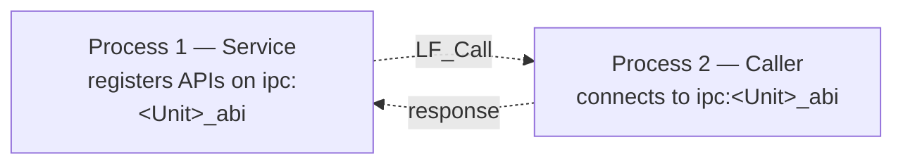
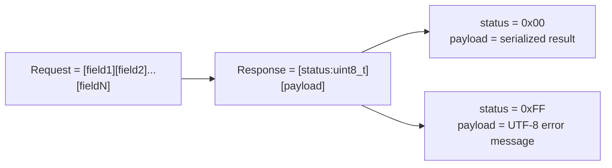

# code_decl_to_abi — User Guide

> *English translation of [code_decl_to_abi_USER_GUIDE.md](code_decl_to_abi_USER_GUIDE.md).*

> **Purpose**: the end-to-end user guide for `code_decl_to_abi`. It covers the complete workflow, organized by actual order of operations:
>
> 1. **Using the tool** — install it, feed it a Pascal unit or a C header, generate cross-language ABI sources.
> 2. **Using the generated code** — compile it, integrate it into an application, configure the runtime environment, run the service/caller pair.
>
> **Audience**: application developers, integration engineers, and AI Agents that want to drive this tool through tool calls.
>
> **Companion documents**: `code_decl_to_abi_OPERATIONS.md` (internal implementation and extension), `pascal_code_abi_rule.md` and `C_code_abi_rule.md` (the input contracts), `code_decl_to_json_abi_USER_GUIDE.md` (the HTTP/JSON sibling tool).
>
> **Language**: this guide and all source code and scripts generated by the tool are in English.

---

## Table of contents

**Part I — Using the tool**

- [Chapter 1  Tool overview](#chapter-1--tool-overview)
- [Chapter 2  Why binary ABI: serialization efficiency](#chapter-2--why-binary-abi-serialization-efficiency)
- [Chapter 3  Language support](#chapter-3--language-support)
- [Chapter 4  Installation and build](#chapter-4--installation-and-build)
- [Chapter 5  Preparing the input source](#chapter-5--preparing-the-input-source)
- [Chapter 6  Generating code through the GUI](#chapter-6--generating-code-through-the-gui)
- [Chapter 7  Generating code through the CLI](#chapter-7--generating-code-through-the-cli)
- [Chapter 8  Generating code through an AI Agent (MCP)](#chapter-8--generating-code-through-an-ai-agent-mcp)
- [Chapter 9  Embedding the generator programmatically](#chapter-9--embedding-the-generator-programmatically)

**Part II — Using the generated code**

- [Chapter 10  The list of deliverables and their responsibilities](#chapter-10--the-list-of-deliverables-and-their-responsibilities)
- [Chapter 11  Directory layout and naming of the generated files](#chapter-11--directory-layout-and-naming-of-the-generated-files)
- [Chapter 12  Consuming the output of each language](#chapter-12--consuming-the-output-of-each-language)
- [Chapter 13  Runtime environment configuration](#chapter-13--runtime-environment-configuration)
- [Chapter 14  Running a Service/Caller pair end to end](#chapter-14--running-a-servicecaller-pair-end-to-end)

**Part III — Reference**

- [Chapter 15  The type system](#chapter-15--the-type-system)
- [Chapter 16  The wire protocol](#chapter-16--the-wire-protocol)
- [Chapter 17  Troubleshooting](#chapter-17--troubleshooting)
- [Chapter 18  Known limitations and roadmap](#chapter-18--known-limitations-and-roadmap)

---

# Part I — Using the tool

---

## Chapter 1  Tool overview

`code_decl_to_abi` is the **binary ABI code generator** in the LingoFuse toolchain. It reads one **declaration file** and emits a **matching set of service-side and caller-side sources** across a range of target languages.

**Input**: one complete Pascal unit, or one complete C header.

**Output** (one set per requested target language):

- a **service-side library**: it registers the declared routines as remotely callable APIs;
- a **caller-side library**: it exposes a strongly typed function for each routine;
- for most languages, **test programs** as well (`*_test*` or `*_main*`);
- for most non-native languages, **test environment setup scripts** (`setup_*_tests.ps1`) and **build scripts** (`CMakeLists.txt`, `pom.xml`, `Project.toml`, `build.zig`, `build.zig.zon`, `runtests.jl`, etc.).

**In one sentence**: hand it a declaration file and it lays out a binary ABI RPC surface that any supported language can call.

**What changed in this version**:

- **No README/`.md` documentation is generated any more**: all build and run instructions live in this guide, or are carried by the generated scripts themselves (the scripts embed help and next-step hints).
- **The target language set expanded substantially**: from 4 to **17** (see Chapter 3).
- **Tests and build scripts are embedded**: besides the code, each language also ships its test programs and a set of `setup_*_tests.ps1` environment initialization scripts; the build files specific to each language ecosystem (CMake / Maven / Cargo / Pub / rebar3 / gcc compile scripts) are emitted by the generator too.

The tool has **three front ends sharing one backend**:

| Front end | File | Audience |
|------|------|------|
| **GUI** | `code_decl_to_abi_frm.pas` | desktop interaction |
| **CLI** | `code_decl_to_abi_cmdline.pas` | scripting / CI / automation |
| **MCP** | `code_decl_to_abi_mcp_api_tool_provider_unit.pas` | AI Agents connected through the LingoFuse beacon |

All three front ends drive **the same set of generator functions**; the GUI and MCP paths share the same button handlers, so the logic never forks.

---

## Chapter 2  Why binary ABI: serialization efficiency

This is the core reason the tool exists alongside its JSON sibling: **under high concurrency, the binary ABI path is significantly more efficient**.

### 2.1 Compact, strongly typed payloads — no text encoding overhead

On the ABI wire format, every argument is written in its **native machine representation**:

| Type family | Wire encoding |
|--------|-------------|
| Integer | little-endian fixed width (1 / 2 / 4 / 8 bytes) |
| Float | IEEE 754 (`Single` 4 bytes, `Double` 8 bytes, `Extended` 10 bytes) |
| String | raw UTF-8 bytes + one NUL terminator |

Compare with JSON:

- every number must be **converted to text** (an 8-byte `Int64` typically becomes 8–20 ASCII bytes plus a delimiter);
- every quote and every backslash must be **escaped**;
- **structural punctuation** is required (`{}`, `[]`, `:`, `,`).

### 2.2 No parse/format cost on the hot path

On the sending side JSON needs `IntToStr`/`FloatToStr`/escaping/concatenation; on the receiving side it needs tokenization/number parsing/unescaping/structural validation. Each step allocates memory, and under high concurrency those allocations become the dominant cost.

The binary ABI **writes straight into a pre-allocated buffer**:

- sending an `Int64` is one 8-byte `Move`;
- sending a string is one `Move` plus one NUL byte;
- receiving is the mirror operation.

**Zero allocation per scalar field**; a string is allocated **once**, for the final destination string only.

### 2.3 Zero-copy in the hot path

The generated ABI code uses LingoFuse's **direct buffer access**:

- `LF_WriteBuffer` / `LF_ReadBuffer` operate directly on the handle's internal buffer;
- the generated Pascal service uses `LF_ReadStringBytes` / `LF_WriteStringBytes` to **read and write UTF-8 bytes directly**, with no intermediate string;
- fixed-width fields (`Int64`, `Double`, ...) read/write a stack local with a single `Move`.

The hot path never constructs a JSON AST: no tree, no `Variant` boxing, no text scanning.

### 2.4 Deterministic, low-allocation under high concurrency

| Item | Binary ABI | HTTP/JSON |
|------|-----------|-----------|
| Allocation per scalar | 0 | 1+ (boxed number or text fragment) |
| Allocation per string | 1 (the final destination) | 2–4 (escape buffer, fragments, final) |
| Temporary AST | none | yes (JSON object tree) |
| Double UTF-8 encoding | none (raw bytes) | yes (escape → unescape round trip) |
| Text parsing | none | yes (tokenization + number parsing) |
| Framing | fixed-width binary header | variable-length text envelope |

As concurrency rises, the ABI path scales more gracefully. That is exactly the profile **service meshes, microservice backplanes and Agent tool registries** need.

### 2.5 When to choose ABI instead of JSON

Choose `code_decl_to_abi` (binary ABI):

- both ends are under your control and both natively use LingoFuse;
- the payload is numerically heavy or binary heavy;
- high concurrency with a tight latency budget;
- you want to avoid the fixed JSON parsing cost of every call.

Choose `code_decl_to_json_abi` (HTTP/JSON):

- one end is a browser, an external HTTP client, or a language without a LingoFuse binding;
- the payload needs to be readable and debuggable with `curl`;
- you need to bridge a third-party HTTP API.

Both tools share the same input format, intermediate model and type system; they differ only in **wire format**.

---

## Chapter 3  Language support

### 3.1 Current status

The tool currently ships **17 target languages**; each has a service side, a caller side, test programs and a set of `setup_*_tests.ps1` environment initialization scripts.

| # | Target language | `--lang` ID | Service | Caller | Test programs | Setup script | Ecosystem build files |
|---|----------|------------|:-------:|:------:|:---------:|:----------:|--------------|
| 1 | **Pascal** | `pascal` | ✅ | ✅ | ✅ | — (carried by the test unit) | — |
| 2 | **Python** | `python` | ✅ | ✅ | ✅ | — (the module contains `__main__`) | — |
| 3 | **C++** | `cpp` | ✅ | ✅ | ✅ | — | `CMakeLists.txt` |
| 4 | **C#** | `csharp` | ✅ | ✅ | ✅ | — | — |
| 5 | **Rust** | `rust` | ✅ | ✅ | ✅ | `setup_rust_tests.ps1` | `Cargo.toml` |
| 6 | **Go** | `go` | ✅ | ✅ | ✅ | `setup_go_tests.ps1` | `go.mod` / `go.sum` |
| 7 | **Java** | `java` | ✅ | ✅ | ✅ | `setup_java_tests.ps1` + `run_java_service.ps1` / `run_java_call.ps1` | `pom.xml` |
| 8 | **Node.js** | `nodejs` | ✅ | ✅ | ✅ | `setup_node_tests.ps1` | `package.json` |
| 9 | **TypeScript** | `http_ts` | ✅ | ✅ | ✅ | `setup_ts_tests.ps1` | `tsconfig.json` / `package.json` |
| 10 | **Erlang** | `erlang` | ✅ | ✅ | ✅ | `setup_erlang_tests.ps1` | `rebar.config` / `.app.src` |
| 11 | **Julia** | `julia` | ✅ | ✅ | ✅ | `setup_julia_tests.ps1` + `run_julia_service.ps1` / `run_julia_call.ps1` | `Project.toml` / `runtests.jl` |
| 12 | **Zig** | `zig` | ✅ | ✅ | ✅ | `setup_zig_tests.ps1` | `build.zig` / `build.zig.zon` |
| 13 | **Swift** | `swift` | ✅ | ✅ | ✅ | `setup_swift_tests.ps1` | `Package.swift` |
| 14 | **Ruby** | `ruby` | ✅ | ✅ | ✅ | `setup_ruby_tests.ps1` | — |
| 15 | **Fortran** | `fortran` | ✅ | ✅ | ✅ | `setup_fortran_tests.ps1` | — (compiled directly with gcc/gfortran) |
| 16 | **Dart** | `dart` | ✅ | ✅ | ✅ | `setup_dart_tests.ps1` | `pubspec.yaml` |
| 17 | **R** | `r` | ✅ | ✅ | ✅ | `setup_R_tests.ps1` | — |

**Source languages**: `pascal`, `c`.

### 3.2 The backend is designed for unbounded extension

Adding a target language is a **mechanical process** that involves no architectural change:

1. create two new generator units: `<lang>_abi_service_generator_tool.pas` and `<lang>_abi_call_generator_tool.pas`;
2. add test and setup generators as needed;
3. provide a mapping from the three ABI type families (integer / float / string) to that language's native types;
4. register the new units in the main program, the CLI dispatcher, the GUI form and the MCP tool provider;
5. update the CLI's `Detect_Target_Lang_ID` and its help text;
6. update the MCP tool registration count assertion.

**There is no ceiling**: as long as a target language (a) has a C-ABI compatible FFI, (b) has a runtime that can speak the LingoFuse wire protocol, and (c) can marshal the three ABI type families, it is a candidate.

---

## Chapter 4  Installation and build

### 4.1 Compiler and platform

| Item | Requirement |
|------|------|
| Compiler | Free Pascal 3.2+ or Delphi 10.4+ |
| Language mode | Delphi mode (`{$mode delphi}`) |
| Source encoding | UTF-8 (`{$CODEPAGE UTF8}`) |
| Platform | Windows / Linux / macOS |

### 4.2 Runtime dependencies of **the tool itself**

Needed only **while the tool runs**; not needed at generation time:

| Dependency | Where to place it | Consequence if missing |
|------|----------|----------|
| `LingoFuse64.dll` / `liblingofuse.so` / `liblingofuse.dylib` | next to the tool executable, or on the system PATH | all `LF_*` calls fail; MCP tool registration is disabled |
| `pascal_code_abi_rule.md` | the tool executable's directory | the GUI's "Pascal rule" button does nothing |
| `C_code_abi_rule.md` | the tool executable's directory | the GUI's "C rule" button does nothing |

**The generator itself does not need the LingoFuse runtime**; only the MCP provider embedded in the GUI process does.

### 4.3 Build

```bash
lazbuild -B code_decl_to_abi.lpi
```

The tool is compiled with the **console subsystem**. This is deliberate:

- stdout works normally in CLI mode;
- GUI mode still works; with no CLI arguments the console window hides itself automatically.

### 4.4 Verifying the build

```bash
code_decl_to_abi --help
```

Expected: the help page is printed (see Chapter 7). If the help page prints correctly, the tool is ready.

---

## Chapter 5  Preparing the input source

Before running the tool, the input must be parseable into declarations. The Pascal and C rules differ, and both are strict: **declarations that violate the rules are silently dropped**, leaving only one line of explanation in the report.

### 5.1 Pascal input

**Read `pascal_code_abi_rule.md` in full** — that is the parsing contract.

Quick view of the hard rules:

- declarations must be **at the top level**, inside the **`interface`** section. Nested routines (inside a class/record/interface) are dropped.
- parameter modifiers: only none, `const`, `in` are accepted. **`var` and `out` cause the whole declaration to be dropped**.
- type whitelist:
  - integers: `Integer`, `Int64`, `Cardinal`, `LongInt`, `DWord`, `Word`, `SmallInt`, `Byte`, `UInt64`, `LongWord`
  - floats: `Double`, `Single`, `Extended`, `Real`
  - strings: `string`, `AnsiString`, `UnicodeString`, `PChar`, `PAnsiChar`, `PWideChar`, `TP_String`, `TPascalString`, `TUPascalString`, `U_String`
- **the comment** must sit **directly above** the declaration. A `}` must not appear inside a `{ … }` comment; use `(* … *)` when you need nested braces.
- the return type must be **declared in the signature** (`: T`), not only mentioned in a comment.

Minimal example:

```pascal
unit MyUnit;

interface

(*
  Computes the sum of two integers.

  a: first addend
  b: second addend

  Return value: the sum of a and b.
*)
function Add(a: Integer; b: Integer): Integer;

implementation

function Add(a: Integer; b: Integer): Integer;
begin
  Result := a + b;
end;

end.
```

### 5.2 C input

**Read `C_code_abi_rule.md` in full** — that is the parsing contract.

Quick view of the hard rules:

- only **top-level function prototypes** (ending in `;`) are extracted. Definitions with a body are dropped.
- `struct`, `enum`, `union`, `typedef`, global variables, `#include` and other preprocessor directives are dropped.
- a function-pointer parameter causes the whole declaration to be dropped.
- varargs (`...`) cause the whole declaration to be dropped.
- accepted types:
  - integers: `signed char`/`int8_t`, `short`/`int16_t`, `int`/`int32_t`, `long`, `long long`/`int64_t` and their `unsigned` variants
  - pointer-width integers: `size_t`, `uintptr_t`, `ssize_t`, `ptrdiff_t`, `intptr_t`
  - floats: `float`, `double`, `long double`
  - strings: `char *`, `const char *`, `char const *`
  - `void` (as a return type only)
- **any other pointer type** — including `void *` — maps to `Pointer`, which the Pascal-side whitelist rejects, so the whole declaration is dropped. **Pass addresses as `uint64_t`**.
- multi-dimensional arrays are rejected. A single `[]` / `[N]` suffix survives parsing but is then rejected by the Pascal-side whitelist.
- the comment must sit **directly above** the declaration, in the form `/** … */`, `/* … */` or `// …`.

Minimal example:

```c
/* my_unit.h */
#ifndef MY_UNIT_H
#define MY_UNIT_H

/**
 * Computes the sum of two integers.
 *
 * @param a first addend
 * @param b second addend
 * @return the sum of a and b
 */
int add(int a, int b);

#endif /* MY_UNIT_H */
```

### 5.3 What happens to dropped declarations

Declarations that violate the rules above are **silently dropped**. The tool writes one explanatory line to the `Report`. That reason is visible in the GUI log, on CLI stdout, and in the MCP `ConvertToXxx` results.

The tool **never throws** on a dropped declaration — it simply does not appear in the output.

---

## Chapter 6  Generating code through the GUI

Run the executable **with no arguments** to enter the GUI.

### 6.1 The five tabs

```
[Welcome] → [Source Code] → [Source <-> JSON] → [JSON <-> Model] → [Final Source]
```

Each tab has "previous / next" buttons at the top and a log panel at the bottom.

### 6.2 Tab 1 — Welcome

- explains the tool and the workflow;
- **Pascal rule doc** opens `pascal_code_abi_rule.md`;
- **C rule doc** opens `C_code_abi_rule.md`;
- **Next: Enter source code** moves to Tab 2.

### 6.3 Tab 2 — Source Code

| Control | Effect |
|------|------|
| **Select Language** label | click it to auto-detect the source language from the pasted text |
| **Language Selector** dropdown | `Auto-detect` / `Pascal` / `C` — manual override |
| **Format** | keep only top-level declarations, drop everything else |
| **Empty unit** | insert a minimal skeleton for the selected language |
| **Test unit** | insert a rich syntax sample — a good choice for a first run |
| **Next: Pascal/C → JSON** | parse the current source, produce LV0 JSON, jump to Tab 3 |

**Flow**:

1. paste a Pascal unit or a C header;
2. if you are unsure of the language, click the **Select Language** label to auto-detect;
3. if the syntax highlighting looks wrong, select the language manually;
4. click **Next: Pascal/C → JSON**.

### 6.4 Tab 3 — Source ↔ JSON

Shows the **LV0 JSON** (the parser's raw output).

| Button | Effect |
|------|------|
| **Back: rebuild code from JSON** | rebuild the source from the current JSON and write it back to Tab 2 |
| **Next: JSON ↔ Model** | normalize LV0 into the LV1 Model and jump to Tab 4 |

The JSON can be edited by hand. If the parser misjudged a type, fix it here and then click **Next**.

### 6.5 Tab 4 — JSON ↔ Model

Shows the **LV1 Model JSON** — the single input of all generators.

| Button | Effect |
|------|------|
| **Back: JSON ↔ Model** | restore LV1 back to LV0 and write it back to Tab 3 |
| **Next: generate source** | run all generators and jump to Tab 5 |

**At this point, every routine whose type is unsupported has already been dropped.** If a function you expected is missing, this is where you find out. See Chapter 15.

### 6.6 Tab 5 — Final Source

The Final Source tab has one sub-tab per language and per side. When generation finishes:

- all sub-tabs are filled;
- **all files are also written to disk**, at:

```
<exe directory>/<UnitName>/
```

Naming follows the conventions in Chapter 11.

### 6.7 The log panel

The bottom panel is a live `DoStatus` log. It shows:

- the files that were just saved;
- the routines skipped during normalization;
- any error raised by a generator;
- the registration status of the MCP tool provider.

It clears itself automatically after 5000 lines.

---

## Chapter 7  Generating code through the CLI

### 7.1 Trigger condition

Command-line mode is entered when there is **at least one argument**. With no arguments the GUI starts.

### 7.2 Syntax

```
code_decl_to_abi --help
code_decl_to_abi --list-languages
code_decl_to_abi <input_file> <output_file>
code_decl_to_abi --call <input_file> <output_file>
code_decl_to_abi --lang <id> <input_file> <output_file>
```

| Argument | Meaning |
|------|------|
| `--help` / `-h` / `-?` / `/?` | print help and exit. Recognized only as the first argument |
| `--list-languages` / `-ll` | list all registered languages and artifact kinds. Recognized only as the first argument |
| `--call` / `-c` | generate the caller side. Recognized only as the first argument; the default is the service side |
| `--lang` / `-l` | force the target language (overrides extension inference) |
| `<input_file>` | the input file. The language is decided by extension |
| `<output_file>` | the output file. The target language is decided by extension or by `--lang` |

### 7.3 Input language → extension

| Extension | Source language |
|--------|--------|
| `.pas` / `.pp` / `.p` | Pascal |
| `.h` / `.hpp` / `.hh` / `.c` / `.cpp` / `.cc` / `.cxx` | C |

### 7.4 Target language → extension

| Extension | Target language ID | Artifacts |
|--------|-------------|------|
| `.pas` / `.pp` / `.p` | `pascal` | service unit / call unit / two test units |
| `.py` | `python` | service / call / two test programs |
| `.hpp` / `.hh` / `.h` / `.cpp` / `.cc` / `.cxx` / `.c` | `cpp` | `.hpp` + `.cpp` (both sides) + `CMakeLists.txt` + two `_main.cpp` |
| `.cs` | `csharp` | service / call / two test programs |
| `.rs` | `rust` | service / call / two test programs + `setup_rust_tests.ps1` + `Cargo.toml` |
| `.go` | `go` | service / call / two test programs + `setup_go_tests.ps1` + `go.mod` |
| `.java` | `java` | service / call / two test programs + `setup_java_tests.ps1` + `pom.xml` + two `run_*.ps1` |
| `.js` | `nodejs` | service / call / two test programs + `setup_node_tests.ps1` + `package.json` |
| `.ts` | `http_ts` | service / call / two test programs + `setup_ts_tests.ps1` + `tsconfig.json` |
| `.erl` | `erlang` | service / call / two `_main.erl` + `setup_erlang_tests.ps1` + `rebar.config` + `.app.src` |
| `.jl` | `julia` | service / call / two test programs + `setup_julia_tests.ps1` + `Project.toml` + `runtests.jl` + two `run_*.ps1` |
| `.zig` | `zig` | service / call / two test programs + `setup_zig_tests.ps1` + `build.zig` + `build.zig.zon` |
| `.swift` | `swift` | service / call / two test programs + `setup_swift_tests.ps1` + `Package.swift` |
| `.rb` | `ruby` | service / call / two test programs + `setup_ruby_tests.ps1` |
| `.f90` | `fortran` | service / call / two test programs + `setup_fortran_tests.ps1` |
| `.dart` | `dart` | service / call / two test programs + `setup_dart_tests.ps1` + `pubspec.yaml` |
| `.R` | `r` | service / call / two test programs + `setup_R_tests.ps1` |

### 7.5 Output naming rules

**Pascal and Python honour the file name you give.**

**The other languages replace the file name** with a canonical name derived from the parsed source unit name (for example `<Unit>_abi_service.rs`). The **directory part** is preserved; only the file name is replaced. The reason: the generated build scripts (CMake / Maven / Cargo / rebar3 etc.) and the test programs all reference that name.

### 7.6 The C++ special case

Naming either `.hpp` or `.cpp` produces two files (same base name), plus `CMakeLists.txt` and two test programs. So two CLI invocations (service + caller) leave behind one consistent, buildable directory.

### 7.7 The C# special case

Every `.cs` invocation writes the **complete set** (service + call + two tests). `--call` is accepted but **has no effect for `.cs`**, because both console test programs reference the namespaces of **both** libraries; emitting only one would leave the test project unable to compile.

### 7.8 Exit codes

| Code | Meaning |
|:----:|------|
| `0` | conversion succeeded |
| `1` | missing or invalid arguments |
| `2` | source parsing failed |
| `3` | code generation failed |
| `4` | file I/O error |

### 7.9 Examples

```bash
# Pascal → Pascal service
code_decl_to_abi calculator.pas calculator_service.pas

# Pascal → Python caller
code_decl_to_abi --call calculator.pas calculator_call.py

# C → C++ service
code_decl_to_abi ComplexTestUnit.h out/ComplexTestUnit_abi_service.hpp

# C → Rust service (brings setup_rust_tests.ps1 and Cargo.toml automatically)
code_decl_to_abi --lang rust ComplexTestUnit.h out/

# Force the language, ignoring the extension
code_decl_to_abi --lang java ComplexTestUnit.h out/
```

### 7.10 Stdout structure

On success:

```
Reading: ComplexTestUnit.h (1234 chars)
Output : out/ComplexTestUnit_abi_service.rs
Target : rust
Unit   : ComplexTestUnit
Funcs  : 28
Wrote  : out/ComplexTestUnit_abi_service.rs
Wrote  : out/ComplexTestUnit_abi_call.rs
Wrote  : out/ComplexTestUnit_abi_service_test.rs
Wrote  : out/ComplexTestUnit_abi_call_test.rs
Wrote  : out/Cargo.toml
Wrote  : out/setup_rust_tests.ps1
Done.
```

On failure the tool prints one diagnostic line and returns a non-zero exit code. **Do not depend on the exact wording** — depend only on the exit code.

### 7.11 What the CLI does **not** do

- it does not start a service or a caller. Compiling and running the generated code is your job.
- it does not start the LingoFuse runtime.
- it does not start the MCP tool provider.
- it does not open any network connection.

**All of that belongs to Part II.**

---

## Chapter 8  Generating code through an AI Agent (MCP)

### 8.1 Positioning

`code_decl_to_abi_mcp_api_tool_provider_unit.pas` exposes the whole tool as **3 LingoFuse Call APIs** and registers them on the **agent beacon** (default App `agent_main_app`, default registration API `register_agent`). An MCP client can drive generation entirely through tool calls.

The provider **simulates GUI operations**: each `internal_call_*` posts a task to the main thread through `TCompute.Sync` and calls the same button handlers the GUI uses. So the GUI path and the MCP path are **provably identical**.

### 8.2 Requirements for Agent mode

- the `code_decl_to_abi` **GUI is running**. The MCP provider lives inside the GUI process; closing the GUI takes the tool offline.
- the **beacon service is online** (default `agent_main_app`).
- both ends use the same LingoFuse endpoint (default `ipc:agent`).
- the LingoFuse runtime is reachable.

### 8.3 The three-step tool workflow

All three tools follow the same three-step pattern:

```
Step 1  CodeDeclToAbi_GenerateAll   — generate every artifact for every target in one shot
Step 2  CodeDeclToAbi_GetTargetList — list the artifact file names produced in this session
Step 3  CodeDeclToAbi_GetTargetCode — read the content of one artifact by file name
```

- **Step 1 is the only "working" step**: it runs the whole pipeline (parse → normalize → generate → write to disk) in one go.
- **Step 2 and Step 3 are pure reads**: they trigger no new generation and change no state.

### 8.4 The three tools

**Step 1**

| Tool | Parameters | Returns |
|------|------|------|
| `CodeDeclToAbi_GenerateAll` | `Source: string`, `Language: string` | `{"status":"ok","unit":"<U>","count":N}` or `{"error":"<message>"}` |

`Language` accepts `"pascal"` or `"c"` (case-insensitive). It means the **source** language; passing `"python"` / `"cpp"` / `"csharp"` is rejected (the client confused the source language with the target language).

**Step 2**

| Tool | Parameters | Returns |
|------|------|------|
| `CodeDeclToAbi_GetTargetList` | none | `{"count":N,"files":["<name1>",...]}` |

Returns a list of file names (not paths). The order of the list is not guaranteed; use them by name.

**Step 3**

| Tool | Parameters | Returns |
|------|------|------|
| `CodeDeclToAbi_GetTargetCode` | `FileName: string` | `{"name":"<file>","content":"<text>"}` or `{"error":"..."}` |

`FileName` must be the **exact file name** returned by Step 2, extension included. The comparison is case-sensitive.

### 8.5 Recommended sequence

```
# minimal complete flow
CodeDeclToAbi_GenerateAll(Source = "<contents of calculator.pas>", Language = "pascal")
CodeDeclToAbi_GetTargetList()
CodeDeclToAbi_GetTargetCode("Calculator_abi_service_unit.pas")
CodeDeclToAbi_GetTargetCode("Calculator_abi_call_unit.pas")
```

### 8.6 Notes for Agent mode

1. **The source language must be `pascal` or `c`**; anything else is rejected.
2. **The order is mandatory**: Step 1 → Step 2 → Step 3.
3. **`GenerateAll` is synchronous**: it returns only after every artifact has been written to disk.
4. **The GUI must stay alive**: there is no headless MCP mode.
5. **Generating code ≠ running code**: Part II still applies.
6. **The artifact list is not stable**: `count` depends on how many routines in the source unit pass the type whitelist; it is not a compile-time constant.

### 8.7 An Agent interaction example

```
# 1. generate every target in one shot
CodeDeclToAbi_GenerateAll(
    Source   = "<contents of calculator.pas>",
    Language = "pascal")
# returns {"status":"ok","unit":"Calculator","count":17}

# 2. list this session's artifacts
CodeDeclToAbi_GetTargetList()
# returns {"count":17,"files":["Calculator_abi_service_unit.pas","Calculator_abi_call_unit.pas","Calculator_abi_service.py",...]}

# 3. read the artifacts you need
CodeDeclToAbi_GetTargetCode("Calculator_abi_service_unit.pas")
CodeDeclToAbi_GetTargetCode("Calculator_abi_call.py")
CodeDeclToAbi_GetTargetCode("CMakeLists.txt")
```

The Agent can then hand the artifacts to the user, or, where permitted, run the generated scripts directly.

---

## Chapter 9  Embedding the generator programmatically

For tools and services that want to embed the generator (rather than launch it), `code_decl_to_abi` exposes a small set of APIs. These are exactly the functions the CLI, the GUI and the MCP provider call internally.

### 9.1 Building the model

```pascal
var
  Parser: tpascal_func_decl_tool;
  Model: TPascal_Func_Model;
  Report: TPascalStringList;
begin
  Parser := tpascal_func_decl_tool.CreateFrom_Pascal_Code(SourceText);
  try
    Report := TPascalStringList.Create;
    try
      Model := TPascal_Func_Model.Create;
      try
        Model.Typ_Normalize_Func := tnf_ABI;   // required when generating ABI
        Model.LoadFromParser(Parser, Report);
        // the Model is now ready for the generator functions
      finally
        Model.Free;
      end;
    finally
      Report.Free;
    end;
  finally
    Parser.Free;
  end;
end;
```

For C header input, replace `CreateFrom_Pascal_Code` with `CreateFrom_C_Code`. `LoadFromParser` applies the six filters described in Chapter 15, so the Model contains only routines with supported types.

### 9.2 Generator entry points

Each generator unit exports one or more functions; each returns a `TPascalStringList` that the caller must free.

**Note that this version no longer has `*Readme` functions**. Example (Rust):

```pascal
function GenerateABIServiceRsCode(Model: TPascal_Func_Model): TPascalStringList;
function GenerateABICallRsCode(Model: TPascal_Func_Model): TPascalStringList;
function GenerateABIServiceTestRsCode(Model: TPascal_Func_Model): TPascalStringList;
function GenerateABICallTestRsCode(Model: TPascal_Func_Model): TPascalStringList;
function GenerateRustTestSetupScript(Model: TPascal_Func_Model): TPascalStringList;
```

Other languages are analogous: `GenerateABIService<Lang>Code`, `GenerateABICall<Lang>Code`, plus `GenerateABI<Lang>TestCode`, `Generate<Lang>TestSetupScript`, `GenerateABICmakeScript` etc. as needed.

### 9.3 A minimal working embed

```pascal
var
  Parser: tpascal_func_decl_tool;
  Model: TPascal_Func_Model;
  Code: TPascalStringList;
begin
  Parser := tpascal_func_decl_tool.CreateFrom_Pascal_Code(SourceText);
  try
    Model := TPascal_Func_Model.Create;
    try
      Model.Typ_Normalize_Func := tnf_ABI;
      Model.LoadFromParser(Parser, nil);      // nil report = silent
      Code := GenerateABIServicePascalCode(Model);
      try
        if Code <> nil then
          Code.SaveToFile('MyUnit_abi_service_unit.pas');
      finally
        Code.Free;
      end;
    finally
      Model.Free;
    end;
  finally
    Parser.Free;
  end;
end;
```

---

# Part II — Using the generated code

The tool's responsibility ends when the files are written to disk. Part II explains what to do with them.

---

## Chapter 10  The list of deliverables and their responsibilities

### 10.1 Output per language

**Pascal**

| Kind | File name |
|------|--------|
| service | `<Unit>_abi_service_unit.pas` |
| caller | `<Unit>_abi_call_unit.pas` |
| service test | `<Unit>_abi_service_test_unit.pas` |
| call test | `<Unit>_abi_call_test_unit.pas` |

**Python**

| Kind | File name |
|------|--------|
| service | `<Unit>_abi_service.py` (contains a `__main__` test entry) |
| caller | `<Unit>_abi_call.py` |
| service test | `<Unit>_abi_service_test.py` |
| call test | `<Unit>_abi_call_test.py` |

**C++**

| Kind | File name |
|------|--------|
| service header | `<Unit>_abi_service.hpp` |
| service implementation | `<Unit>_abi_service.cpp` |
| caller header | `<Unit>_abi_call.hpp` |
| caller implementation | `<Unit>_abi_call.cpp` |
| build script | `CMakeLists.txt` |
| service test | `<Unit>_abi_service_main.cpp` |
| call test | `<Unit>_abi_call_main.cpp` |

**C#**

| Kind | File name |
|------|--------|
| service | `<Unit>_abi_service.cs` |
| caller | `<Unit>_abi_call.cs` |
| service test | `<Unit>_abi_service_test___.cs` |
| call test | `<Unit>_abi_call_test___.cs` |

**Rust**

| Kind | File name |
|------|--------|
| service | `<Unit>_abi_service.rs` |
| caller | `<Unit>_abi_call.rs` |
| service test | `<Unit>_abi_service_test.rs` |
| call test | `<Unit>_abi_call_test.rs` |
| setup | `setup_rust_tests.ps1` |

**Go**

| Kind | File name |
|------|--------|
| service | `<Unit>_abi_service.go` |
| caller | `<Unit>_abi_call.go` |
| service test | `<Unit>_abi_service_test.go` |
| call test | `<Unit>_abi_call_test.go` |
| setup | `setup_go_tests.ps1` |

**Java**

| Kind | File name |
|------|--------|
| service | `<Unit>AbiService.java` |
| caller | `<Unit>AbiCall.java` |
| service test | `<Unit>AbiServiceMain.java` |
| call test | `<Unit>AbiCallTestMain.java` |
| build | `pom.xml` |
| setup + run | `setup_java_tests.ps1` / `run_java_service.ps1` / `run_java_call.ps1` |

**Node.js**

| Kind | File name |
|------|--------|
| service | `<Unit>_abi_service.js` |
| caller | `<Unit>_abi_call.js` |
| service test | `<Unit>_abi_service_test.js` |
| call test | `<Unit>_abi_call_test.js` |
| setup | `setup_node_tests.ps1` |

**TypeScript** (`http_ts`)

| Kind | File name |
|------|--------|
| service | `<Unit>_abi_service.ts` |
| caller | `<Unit>_abi_call.ts` |
| service test | `<Unit>_abi_service_test.ts` |
| call test | `<Unit>_abi_call_test.ts` |
| setup | `setup_ts_tests.ps1` |

**Erlang**

| Kind | File name |
|------|--------|
| service | `<Unit>_abi_service.erl` |
| caller | `<Unit>_abi_call.erl` |
| service test | `<Unit>_abi_service_main.erl` |
| call test | `<Unit>_abi_call_main.erl` |
| setup | `setup_erlang_tests.ps1` |

**Julia**

| Kind | File name |
|------|--------|
| service | `<Unit>_abi_service.jl` |
| caller | `<Unit>_abi_call.jl` |
| service test | `<Unit>_abi_service_test.jl` |
| call test | `<Unit>_abi_call_test.jl` |
| setup / run | `setup_julia_tests.ps1` / `run_julia_service.ps1` / `run_julia_call.ps1` |
| build | `Project.toml` / `runtests.jl` |

**Zig**

| Kind | File name |
|------|--------|
| service | `<Unit>_abi_service.zig` |
| caller | `<Unit>_abi_call.zig` |
| service test | `<Unit>_abi_service_test.zig` |
| call test | `<Unit>_abi_call_test.zig` |
| setup | `setup_zig_tests.ps1` |

**Swift**

| Kind | File name |
|------|--------|
| service | `<Unit>_abi_service.swift` |
| caller | `<Unit>_abi_call.swift` |
| service test | `<Unit>_abi_service_test.swift` |
| call test | `<Unit>_abi_call_test.swift` |
| setup | `setup_swift_tests.ps1` |

**Ruby**

| Kind | File name |
|------|--------|
| service | `<Unit>_abi_service.rb` |
| caller | `<Unit>_abi_call.rb` |
| service test | `<Unit>_abi_service_test.rb` |
| call test | `<Unit>_abi_call_test.rb` |
| setup | `setup_ruby_tests.ps1` |

**Fortran**

| Kind | File name |
|------|--------|
| service | `<Unit>_abi_service.f90` |
| caller | `<Unit>_abi_call.f90` |
| service test | `<Unit>_abi_service_test.f90` |
| call test | `<Unit>_abi_call_test.f90` |
| setup | `setup_fortran_tests.ps1` |

**Dart**

| Kind | File name |
|------|--------|
| service | `<Unit>_abi_service.dart` |
| caller | `<Unit>_abi_call.dart` |
| service test | `<Unit>_abi_service_test.dart` |
| call test | `<Unit>_abi_call_test.dart` |
| setup | `setup_dart_tests.ps1` |

**R**

| Kind | File name |
|------|--------|
| service | `<Unit>_abi_service.R` |
| caller | `<Unit>_abi_call.R` |
| service test | `<Unit>_abi_service_test.R` |
| call test | `<Unit>_abi_call_test.R` |
| setup | `setup_R_tests.ps1` |

### 10.2 Responsibilities of each file

- **Service code**: registers the APIs into LingoFuse, decodes binary requests, calls the user's `internal_call_<Api>` stub, and encodes the binary response.
- **Caller code**: one strongly typed function per API; it marshals the arguments, issues the LingoFuse call, deserializes the result, and raises the language's exception on error.
- **Test programs**: minimal standalone programs that exercise the artifacts end to end. Every language has them, in different shapes (`__main__` blocks, a standalone `main`, `main.rs` under `examples/`, an `escript` entry, etc.).
- **`setup_*_tests.ps1`**: a one-click environment initialization script. It carries that language's **build, dependency installation, syntax check, smoke test and next-step hints** — it is the executable form of what used to be the README.

### 10.3 What must be edited before use

**Every** target language requires:

1. **fill in the `internal_call_<Api>` stub body**. The tool emits a `TODO` placeholder; replace it with a call to the real implementation.
2. **place the runtime library** (`LingoFuse64.dll` / `liblingofuse.so` / `liblingofuse.dylib`) where the process can find it. See Chapter 13.
3. **start the service process first**, then start any caller process. See Chapter 14.

Everything else — wire format, serialization helpers, callbacks, registration functions — is already correct.

---

## Chapter 11  Directory layout and naming of the generated files

### 11.1 Directory layout in GUI mode

Under the GUI, all artifacts are written to:

```
<exe directory>/<UnitName>/
```

### 11.2 Directory layout in CLI mode

Under the CLI, the directory is decided by the caller (through the output argument); the file-name rules are:

- **Pascal / Python**: exactly as you specified;
- **other languages**: the canonical name derived from the source unit name (e.g. `<Unit>_abi_service.rs`).

### 11.3 The setup scripts' default output

The generator always writes `setup_*_tests.ps1` at the root of the output directory, with fixed names:

- `setup_rust_tests.ps1`
- `setup_go_tests.ps1`
- `setup_java_tests.ps1`
- `setup_node_tests.ps1`
- `setup_ts_tests.ps1`
- `setup_erlang_tests.ps1`
- `setup_julia_tests.ps1`
- `setup_zig_tests.ps1`
- `setup_swift_tests.ps1`
- `setup_ruby_tests.ps1`
- `setup_fortran_tests.ps1`
- `setup_dart_tests.ps1`
- `setup_R_tests.ps1`

plus the run scripts and build files some languages add (`pom.xml`, `CMakeLists.txt`, `Project.toml`, `build.zig`, `build.zig.zon`, etc.).

### 11.4 A complete example

Suppose the input is `Calculator.pas` and the target directory is `out/`, requesting the service side of every language:

```
out/
├── Calculator_abi_service_unit.pas       (Pascal service)
├── Calculator_abi_service_test_unit.pas
├── Calculator_abi_service.py             (Python service)
├── Calculator_abi_service_test.py
├── Calculator_abi_service.hpp            (C++ service)
├── Calculator_abi_service.cpp
├── Calculator_abi_service_main.cpp
├── CMakeLists.txt
├── Calculator_abi_service.cs             (C# service)
├── Calculator_abi_service_test___.cs
├── Calculator_abi_service.rs             (Rust service)
├── Calculator_abi_service_test.rs
├── setup_rust_tests.ps1
├── Cargo.toml
├── Calculator_abi_service.go             (Go service)
├── setup_go_tests.ps1
├── go.mod
├── CalculatorAbiService.java             (Java service)
├── pom.xml
├── setup_java_tests.ps1
├── run_java_service.ps1
├── Calculator_abi_service.js             (Node.js service)
├── setup_node_tests.ps1
├── Calculator_abi_service.ts             (TypeScript service)
├── setup_ts_tests.ps1
├── Calculator_abi_service.erl            (Erlang service)
├── setup_erlang_tests.ps1
├── rebar.config
├── Calculator_abi_service.jl             (Julia service)
├── Project.toml
├── setup_julia_tests.ps1
├── run_julia_service.ps1
├── Calculator_abi_service.zig            (Zig service)
├── setup_zig_tests.ps1
├── build.zig
├── build.zig.zon
├── Calculator_abi_service.swift          (Swift service)
├── setup_swift_tests.ps1
├── Calculator_abi_service.rb             (Ruby service)
├── setup_ruby_tests.ps1
├── Calculator_abi_service.f90            (Fortran service)
├── setup_fortran_tests.ps1
├── Calculator_abi_service.dart           (Dart service)
├── setup_dart_tests.ps1
├── Calculator_abi_service.R              (R service)
└── setup_R_tests.ps1
```

The call side is analogous, with `_service` in the file names replaced by `_call`.

---

## Chapter 12  Consuming the output of each language

This chapter gives the high-level **build and run** flow per language. **The exact build commands and dependency installation live in the `-Help` output and the header comments of `setup_*_tests.ps1`** (the script is itself that language's build manual).

### 12.1 Pascal

- **Build**: `fpc -Fu<dir-with-lingofuse_import.pas> -Fu<dir-with-Z.Core.pas> your_program.pas`
- **Fill in the stub**: open `_abi_service_unit.pas` and replace the body of `internal_call_<Api>` with a call to the real function.
- **Calling**: `_abi_call_unit.pas` is fully generated — no edits needed, just compile and call.
- **Shutdown order**: `LF_ExitMainThread` → `LF_FreeApp(App)` (service only) → `LF_Shutdown`.

### 12.2 Python

- **Dependency**: `pip install py-lingofuse`, or set `PYTHONPATH` to `<v3>/src`.
- **Fill in the stub**: open `_abi_service.py` and replace the body of `internal_call_<Api>`.
- **Run the service**: `python <Unit>_abi_service.py` (the module ships its own `__main__`).
- **Run the call test**: `python <Unit>_abi_call_test.py`.
- **Adjusting the timeout**: `import <Unit>_abi_call as abi; abi.ABI_TIMEOUT = 30000`.

### 12.3 C++

- **Build**: CMake is recommended — `cmake -S . -B build -DLINGOFUSE_CPP_DIR=<dir-with-LingoFuse.h>; cmake --build build`.
- **Fill in the stub**: open `_abi_service.cpp` and replace the `internal_call_<Api>` stub.
- **Run**: first `./<Unit>_abi_service_main`, then `./<Unit>_abi_call_main`.
- **MSVC**: `/utf-8` is mandatory.
- **Timeout / target App**: adjust `ABI_Timeout` and `ABI_TargetApp` in the `<Unit>_abi` namespace.

### 12.4 C#

- **Build**: each `.cs` library is a class library (**no `Main`**). The test programs become a separate console project.
- **Fill in the stub**: open `_abi_service.cs` and replace the body of `InternalCalls.InternalCall_<Api>`.
- **Run the service test**:
  ```bash
  dotnet new console -o service_test && cd service_test
  cp ../<Unit>_abi_service.cs .
  cp ../<Unit>_abi_service_test___.cs Program.cs
  cp ../LingoFuse64.dll .
  dotnet run
  ```
- **Run the call test**: same, with `_call.cs` and `_call_test___.cs`.

### 12.5 Rust

- **Build**: `cargo build`
- **Fill in the stub**: the body of `internal_call_<Api>` in `src/service.rs`.
- **Run**: `cargo run --example service_test`, and in another terminal `cargo run --example call_test`.
- **Environment**: generate `setup_rust_tests.ps1` first and use it according to its `-Help`.

### 12.6 Go

- **Build**: `go build ./...`
- **Fill in the stub**: `internalCall<Api>` in `<Unit>_abi_service.go`.
- **Run**: `setup_go_tests.ps1` arranges the library and the two test main programs into `.go_clean_build/`, after which `go run ./<Unit>_abi_service_test` and `go run ./<Unit>_abi_call_test`.

### 12.7 Java

- **Build**: `mvn -q -DskipTests compile` (`pom.xml` is already generated).
- **Fill in the stub**: the body of `internal_call_<Api>` in `<Unit>AbiService.java`.
- **Run**: `run_java_service.ps1` / `run_java_call.ps1`.

### 12.8 Node.js

- **Dependency**: `npm install` (`setup_node_tests.ps1` already sets up the local link to lingofuse-js).
- **Fill in the stub**: the body of `internal_call_<Api>` in `<Unit>_abi_service.js`.
- **Run**: `node <Unit>_abi_service_test.js` and `node <Unit>_abi_call_test.js`.

### 12.9 TypeScript (`http_ts`)

- **Dependency**: `npm install` (`setup_ts_tests.ps1` generates `tsconfig.json` and `package.json`, and links `lingofuse-ts` automatically).
- **Fill in the stub**: `internal_call_<Api>` in `<Unit>_abi_service.ts`.
- **Run**: `tsx` executes `.ts` by default; adding `-Compiled` compiles with `tsc` into `dist/` and then runs the `.js`.

### 12.10 Erlang

- **Build**: `setup_erlang_tests.ps1` generates `rebar.config` and `.app.src`, and compiles.
- **Fill in the stub**: `internal_call_<Api>` in `<Unit>_abi_service.erl`.
- **Run**: `erl -noshell -pa ... -eval "<Unit>_abi_service_main:main([])."` and the corresponding call main program.

### 12.11 Julia

- **Build**: `setup_julia_tests.ps1` generates `Project.toml` and `runtests.jl`.
- **Fill in the stub**: `_internal_call_<Api>_default` in `<Unit>_abi_service.jl`.
- **Run**: `run_julia_service.ps1` (terminal A) and `run_julia_call.ps1` (terminal B). `--threads=2` is required.

### 12.12 Zig

- **Build**: `zig build`
- **Fill in the stub**: `internal_call_<api>` in `<Unit>_abi_service.zig`.
- **Run**: `zig-out/bin/<Unit>_abi_service_test` and `zig-out/bin/<Unit>_abi_call_test`.

### 12.13 Swift

- **Build**: `swift build` (`Package.swift` is generated by the setup script).
- **Fill in the stub**: `internalCall_<Api>` in `<Unit>_abi_service.swift`.
- **Run**: `swift run ServiceTest` (terminal A) and `swift run CallTest` (terminal B).

### 12.14 Ruby

- **Dependency**: the `lingofuse` gem (the setup script verifies its presence and API completeness).
- **Fill in the stub**: `internal_call_<Api>` in `<Unit>_abi_service.rb`.
- **Run**: `ruby <Unit>_abi_service_test.rb` and `ruby <Unit>_abi_call_test.rb`.

### 12.15 Fortran

- **Build**: `setup_fortran_tests.ps1` compiles directly with `gfortran` (gcc / g++ / gfortran are required).
- **Fill in the stub**: `internal_call_<api>` in `<Unit>_abi_service.f90`.
- **Run**: `.fortran_build/<Unit>_abi_service_test.exe` and `_call_test.exe`.

### 12.16 Dart

- **Build**: `dart pub get` (`setup_dart_tests.ps1` generates `pubspec.yaml`, links the `lingofuse` Dart package and copies `lf_dart_bridge.dll`).
- **Fill in the stub**: `internal_call_<Api>` in `<Unit>_abi_service.dart`.
- **Run**: `dart run <Unit>_abi_service_test.dart` and `dart run <Unit>_abi_call_test.dart`.

### 12.17 R

- **Dependency**: the `lingofuse` R package (the setup script probes the API surface for completeness), plus the optional `bit64`.
- **Fill in the stub**: `internal_call_<Api>` in `<Unit>_abi_service.R`.
- **Run**: `Rscript --vanilla <Unit>_abi_service_test.R` and `<Unit>_abi_call_test.R`.

---

## Chapter 13  Runtime environment configuration

This chapter applies to **all target languages**. It covers the binaries and endpoints every generated program needs at runtime.

### 13.1 Runtime binaries

| File | Purpose |
|------|------|
| `LingoFuse64.dll` (Windows) / `liblingofuse.so` (Linux) / `liblingofuse.dylib` (macOS) | the LingoFuse core runtime. All `LF_*` calls go through it |
| `z_ipc_*.dll` / `libz_ipc_*.so` | IPC transport plugin. Required for loopback endpoints |
| `LingoFuse.hpp` / `lf_io.hpp` (C++ only) | C++ wrapper headers |
| `LingoFuse.h` / `LingoFuse.c` (C++ only) | C ABI declarations and the dynamic-loading wrapper source |

### 13.2 Where to place them

| Environment | Where to place them |
|------|----------|
| Pascal / Python / C++ / C# etc. | the executable's directory, or the system loader search path |
| Linux / BSD | `LD_LIBRARY_PATH` |
| macOS | `DYLD_LIBRARY_PATH` |
| Windows | `PATH`, or the executable's directory |

The C++ test programs call `LF_LoadLibrary()` explicitly; the other languages rely on the OS loader.

### 13.3 Default IPC endpoint

By convention every ABI service listens on:

```
ipc:<UnitName>_abi
```

For example, when the source unit is `Calculator` the endpoint is `ipc:Calculator_abi`. `<UnitName>` is extracted from the source file by the parser. The generated code in every language uses the same endpoint convention, so a Python caller can talk straight to a Pascal service and a C# caller straight to a C++ service — no manual coordination needed.

### 13.4 Runtime thread model

The runtime is **fully thread-safe** at the C ABI layer. However:

- **callbacks execute on worker threads**, not the main thread. Each generated callback is wrapped in the language's corresponding guard so exceptions never escape into the C stack.
- **do not call `LF_Call` / `LF_Notify` inside a callback**. That self-locks the worker thread. If a callback needs to reach another service, post the work to a separate thread.
- **do not block inside a callback**. A long-running callback occupies a worker pool thread.

### 13.5 Runtime environment variables

| Variable | Purpose |
|------|------|
| `LD_LIBRARY_PATH` (Linux) / `DYLD_LIBRARY_PATH` (macOS) | append a loader search directory |
| `PATH` (Windows) | same, on Windows |

There is **no** mechanism to override the LingoFuse runtime file name through an environment variable, and **no** way at the C ABI layer to point at a runtime in an arbitrary directory. Either place it next to the executable, or put it on the loader search path.

---

## Chapter 14  Running a Service/Caller pair end to end

This chapter is the **shortest end-to-end recipe**: two processes, one service and one caller, over same-machine loopback IPC.

### 14.1 Flow diagram



### 14.2 Step 1 — Build the service and the caller

Follow the matching section of Chapter 12, or `setup_*_tests.ps1 -Help`, for each language. You end up with two executables (two runnable modules for Python), both pointing at the same endpoint.

### 14.3 Step 2 — Place the runtime binaries

Make sure both processes can find `LingoFuse64.dll` / `liblingofuse.so` / `liblingofuse.dylib` and `z_ipc_*.dll` / `libz_ipc_*.so`. See Chapter 13.

### 14.4 Step 3 — Start the service

In **terminal 1**:

- Pascal / C++ / C# / Rust / Go / Zig / Swift / Fortran: run the service executable you built;
- Python: `python <Unit>_abi_service.py`;
- Node.js: `node <Unit>_abi_service_test.js`;
- Java: `run_java_service.ps1`;
- Julia: `run_julia_service.ps1`;
- Dart: `dart run <Unit>_abi_service_test.dart`;
- Ruby: `ruby <Unit>_abi_service_test.rb`;
- Erlang: `erl -noshell -pa ... -eval "<Unit>_abi_service_main:main([])."`;
- R: `Rscript --vanilla <Unit>_abi_service_test.R`;
- TypeScript: `node <tsx> <Unit>_abi_service_test.ts` or `node dist/<Unit>_abi_service_test.js`.

Wait until it prints something like:

```
[OK] Service ready on ipc:<Unit>_abi.
```

### 14.5 Step 4 — Start the caller

In **terminal 2**:

- the matching call test in the same language;
- or your own application code importing the caller library directly.

The test program calls every API once and prints the results; your application calls as needed.

### 14.6 Step 5 — Clean shutdown

In the service terminal:

1. press Enter (or type `exit`) to trigger shutdown;
2. you should see `[OK] Shutdown complete.`;
3. the service releases the App handle and closes the runtime.

The caller side closes itself when its program exits.

### 14.7 A complete example

Source:

```pascal
unit Calculator;

interface

(* Adds two integers. *)
function Add(a: Integer; b: Integer): Integer;

(* Multiplies two integers. *)
function Mul(a: Integer; b: Integer): Integer;

implementation
end.
```

After generation and compilation:

1. the service process registers `Add` and `Mul` on `ipc:Calculator_abi`;
2. the caller process connects to `ipc:Calculator_abi` and calls `Add(20, 22)`;
3. the caller prints `42`.

### 14.8 Mixed-language deployment

The ABI wire protocol is language-agnostic. You can have:

- a Python service ↔ a C++ caller;
- a Pascal service ↔ a C# caller;
- a C++ service ↔ a Python caller;
- any other combination.

The only requirement: both ends were generated from **the same source unit**, and both speak the LingoFuse binary ABI wire format.

---

# Part III — Reference

---

## Chapter 15  The type system

### 15.1 The three supported type families

**Integer family**: `integer`, `longint`, `int64`, `cardinal`, `dword`, `longword`, `uint64`, `word`, `smallint`, `byte`.

**Float family**: `double`, `single`, `extended`, `real`.

**String family**: `string`, `ansistring`, `unicodestring`, `tpascalstring`, `tupascalstring`, `tp_string`, `pchar`, `pansichar`, `pwidechar`.

### 15.2 Type mapping per target language (excerpt)

| ABI family | Pascal | Python | C++ | C# | Rust | Go | Java | Node.js | Zig | Swift | Ruby |
|--------|--------|--------|-----|-----|------|-----|------|---------|-----|-------|------|
| String | `string` | `str` | `std::string` | `string` | `String` | `string` | `String` | `string` | `[]u8` | `String` | `String` |
| Float (double) | `Double` | `float` | `double` | `double` | `f64` | `float64` | `double` | `number` | `f64` | `Double` | `Float` |
| Float (single) | `Single` | `float` | `float` | `float` | `f32` | `float32` | `float` | `number` | `f32` | `Float` | `Float` |
| Int32 | `Integer` | `int` | `int32_t` | `int` | `i32` | `int32` | `int` | `number` | `i32` | `Int32` | `Integer` |
| Int64 | `Int64` | `int` | `int64_t` | `long` | `i64` | `int64` | `long` | `bigint` | `i64` | `Int64` | `Integer` |

(The complete mapping lives in each generator unit's `ABI_Type_To_<Lang>_Decl` function.)

### 15.3 Unsupported types — silently dropped

The following types cause **the whole routine to be silently dropped**:

- `Boolean`, `WordBool`, `LongBool`
- `Variant`, `OleVariant`
- arrays, records, classes, interfaces
- enums, sets, generics
- pointers, function pointers
- `Currency`, `Comp`, `TDateTime`
- any C `struct` / `enum` / `union`
- any C pointer other than `char *` / `const char *` / `char const *`

### 15.4 The six filters in `LoadFromParser`

Six filters run during model construction; tripping any one makes the routine disappear from the model:

1. `IsProc = False`
2. `NestLevel <> 0` (declared inside a class, record or interface)
3. empty parameter name
4. `var` / `out` parameter modifier
5. unsupported parameter type
6. unsupported return type

**Workaround**: serialize complex values to `string` before the call, and deserialize them on the receiving side.

---

## Chapter 16  The wire protocol

### 16.1 Request and response shape



### 16.2 Field encoding

| Type | Encoding |
|------|------|
| Integer | little-endian fixed width |
| Float | IEEE 754 (`Single` 4 bytes, `Double` 8 bytes, `Extended` 10 bytes) |
| String | raw UTF-8 bytes + one NUL terminator |

### 16.3 Status byte semantics

| Status | Meaning | Payload |
|:------:|------|---------|
| `0x00` | success | the serialized result; empty for a procedure |
| `0xFF` | failure | a UTF-8 error message |

The generated service always writes one of the two status bytes before any payload. The generated caller reads the status first and raises the language's exception when it is not `0x00`.

### 16.4 Concurrency profile

The wire format is deliberately **low-allocation**:

- it never builds a JSON AST;
- strings travel as raw UTF-8 bytes with no escape/unescape round trip;
- no text parsing: no number parser, no tokenizer, no structural validation;
- allocations per call: one for the handle (reused from a pool), plus one per destination string.

That is exactly the profile **high-concurrency service meshes and microservice backplanes** need.

### 16.5 Cross-language mixing

The wire format is language-agnostic. Any language that correctly implements the encoder and decoder can talk to any other. The 17 current backends produce **byte-for-byte identical** wire formats for the same signature.

---

## Chapter 17  Troubleshooting

### 17.1 Generation-time problems

| Symptom | Root cause | Fix |
|------|------|------|
| CLI reports "cannot detect source language" | the input file extension is not in the source language table | rename it, or update `Detect_Source_Lang` |
| CLI reports "cannot detect target language" | the output file extension is not in the target language table and no `--lang` was given | rename it, or specify `--lang` |
| an expected routine is not in the model | one of the six filters tripped | see Chapter 15 |
| all routines are missing | the source has no top-level routines, or none passed the type check | look at the report |
| MCP `GenerateAll` returns `{"error":"Unsupported source language"}` | a target language (`python` / `cpp` / `csharp`) was passed instead of a source language | pass `pascal` or `c` |
| MCP `GetTargetCode` returns `{"error":"File ... is not in the current target list"}` | the file name is wrong, or `GetTargetList` was not called first | call `GetTargetList` first and match the returned names exactly |
| MCP `RegisterTools` returns False | the beacon is unreachable, or `regCount` does not match | check `LF_CheckApiEx(BEACON_APP, REGISTER_API)` |

### 17.2 Build-time problems

| Symptom | Language | Fix |
|------|------|------|
| `Can't find unit Z.Core` | Pascal | add `-Fu<dir-with-Z.Core.pas>` |
| `Can't find unit lingofuse_import` | Pascal | add `-Fu<dir-with-lingofuse_import.pas>` |
| `ModuleNotFoundError: lingofuse` | Python | `pip install py-lingofuse`, or set `PYTHONPATH` |
| `fatal error: LingoFuse.hpp: No such file` | C++ | add `-I<dir-with-LingoFuse.hpp>`, or set `LINGOFUSE_CPP_DIR` |
| `undefined reference to LF_*` | C++ | add `-lLingoFuse` and `-L<dir>` |
| `error CS0017: Program has more than one entry point` | C# | you added a `Main` to a generated library, or an old copy is left behind. Delete the old files and regenerate |
| `error CS0246: type or namespace not found` | C# | the matching library `.cs` is not in the project |
| `cargo build` cannot find the `lingofuse` crate | Rust | `setup_rust_tests.ps1 -Help`; check `lingofuse = { path = ... }` in `Cargo.toml` |
| `go: module not found` | Go | `setup_go_tests.ps1`; check `go.mod` and the `replace` directive |
| `mvn compile` cannot find dependencies | Java | `setup_java_tests.ps1`; check `lib/lingofuse.jar` and the `pom.xml` systemPath |
| `npm install` fails | Node.js / TS | `setup_node_tests.ps1` / `setup_ts_tests.ps1`; check the network and the `LingoFuseJs` / `LingoFuseTs` paths |
| `tsc --noEmit` errors | TypeScript | check the `strict`/`module` settings in `tsconfig.json`; regenerate with `-Force` |
| rebar3 compile fails | Erlang | check OTP ≥ 27, `rebar.config`, and the ebin path for `lingofuse.beam` |
| Julia `Pkg.develop` fails | Julia | `setup_julia_tests.ps1 -Help`; the Julia registry must be reachable |
| `zig build` reports an invalid fingerprint | Zig | rerun `setup_zig_tests.ps1` (it fixes the fingerprint automatically) |
| `swift build` cannot find the `LingoFuse` package | Swift | `setup_swift_tests.ps1 -Help`; check `LingofuseDir` in `Package.swift` |
| `gfortran` not found | Fortran | install MinGW-w64 / MSYS2; `setup_fortran_tests.ps1 -Help` |
| `dart pub get` fails | Dart | `setup_dart_tests.ps1 -Help`; check the `lingofuse` Dart package and `pubspec.yaml` |
| the `lingofuse` R package API is incomplete | R | `setup_R_tests.ps1 -Help`; the script validates the API surface |

### 17.3 Runtime problems

| Symptom | Root cause | Fix |
|------|------|------|
| `DllNotFoundException: LingoFuse64.dll` | the runtime library is not on the search path | place it next to the executable; see Chapter 13 |
| `BadImageFormatException` | architecture mismatch (32-bit vs 64-bit) | use a runtime matching the platform |
| `LF_PrepareDone` returns 0 | another component already started the main thread, or the service is not running | reorder the startup sequence, or confirm the service is running |
| `EABI_RemoteError: nil (timeout)` | the App name does not match, or the timeout is too short | check `TargetApp` / `DEFAULT_APP_NAME`; increase the timeout |
| `EABI_RemoteError: "input truncated"` | fewer fields than expected | confirm both ends were generated from the same model |
| `EABI_RemoteError: <garbled bytes>` | encoding mismatch | confirm both ends use the same type table |
| the callback never fires | the `internal_call_*` stub is still a placeholder | replace the stub body |
| a deadlock inside the callback | a blocking LingoFuse call was made inside the callback | post the call to a separate thread |
| the service UI crashes | a worker-thread callback touched the UI | marshal to the main thread, or enable the synchronous stub variant (Pascal) |

### 17.4 Where to look next

- **Pascal / Python / C++ / C# / the other 17** — the `setup_*_tests.ps1 -Help` output is that language's environment manual; the script's header comments carry the build instructions too.
- **Wire-level questions** — Chapter 16 gives the precise byte layout for each API.

---

## Chapter 18  Known limitations and roadmap

### 18.1 Current limitations

- **17 target languages** (Pascal, Python, C++, C#, Rust, Go, Java, Node.js, TypeScript, Erlang, Julia, Zig, Swift, Ruby, Fortran, Dart, R). Full JavaScript coverage is handled by `code_decl_to_json_abi`.
- **Three type families** (integer, float, string). Complex types must be serialized to `string` by the caller.
- **Two source languages** (Pascal, C). Adding a source language is a documented process.
- **No README/`.md` documentation is generated any more**: all build and run instructions live in this guide, or in the embedded help of `setup_*_tests.ps1`.
- **The MCP provider shares the GUI's lifetime**: there is no headless MCP mode.
- **The CLI does not start a service or the runtime**: Part II covers that.

### 18.2 Roadmap

The generator backend is designed to **support an unbounded number of target languages**. The mechanical process for adding a language is documented in `code_decl_to_abi_OPERATIONS.md` Chapter 14, and it is the same for every language.

Future versions will keep expanding, including but not limited to:

- systems languages: Nim, D, OCaml.
- JVM: Kotlin, Scala.
- .NET: F#, VB.NET.
- functional: Haskell, Elixir, Clojure.
- scripting: PHP, Perl, Lua.
- domain-specific: MATLAB, Wolfram Language.

When a language is added, **the user contract does not change**: the same CLI flags, the same GUI tabs and the same MCP tools keep working. The only difference is that the backend gains a set of `<lang>_abi_*` generator units plus that language's own build and test scripts.

### 18.3 `code_decl_to_abi` vs `code_decl_to_json_abi`

| Scenario | Recommended tool |
|------|----------|
| both ends are LingoFuse native, high-concurrency service | **`code_decl_to_abi`** |
| numerically heavy or binary heavy payloads | **`code_decl_to_abi`** |
| one end is a browser, an external HTTP client, or a language without a LingoFuse binding | `code_decl_to_json_abi` |
| the payload must be readable and debuggable with `curl` | `code_decl_to_json_abi` |
| you need to bridge a third-party HTTP API | `code_decl_to_json_abi` |

Both tools share the same input format, intermediate model and type system; they differ only in **wire format**.
